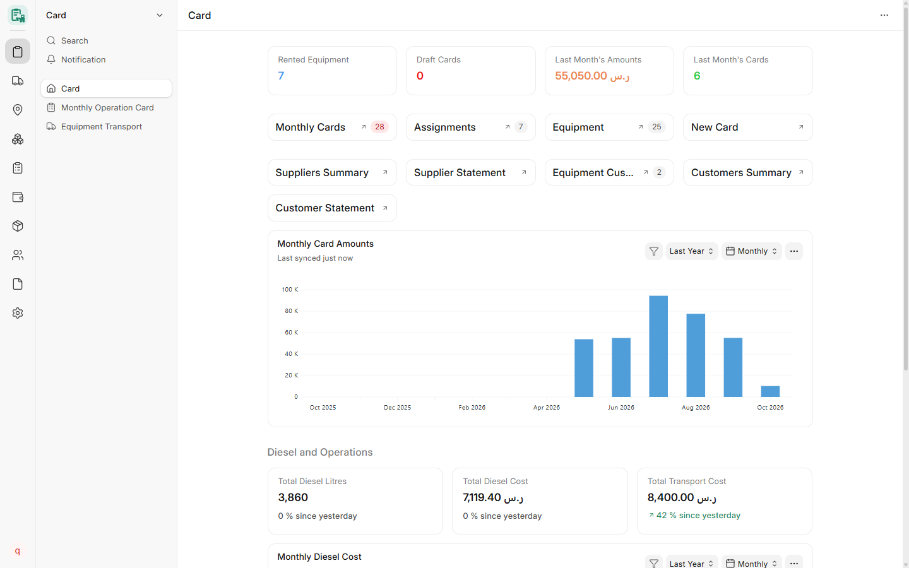
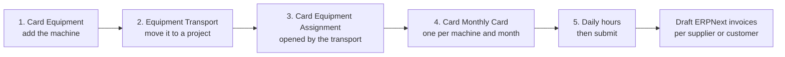
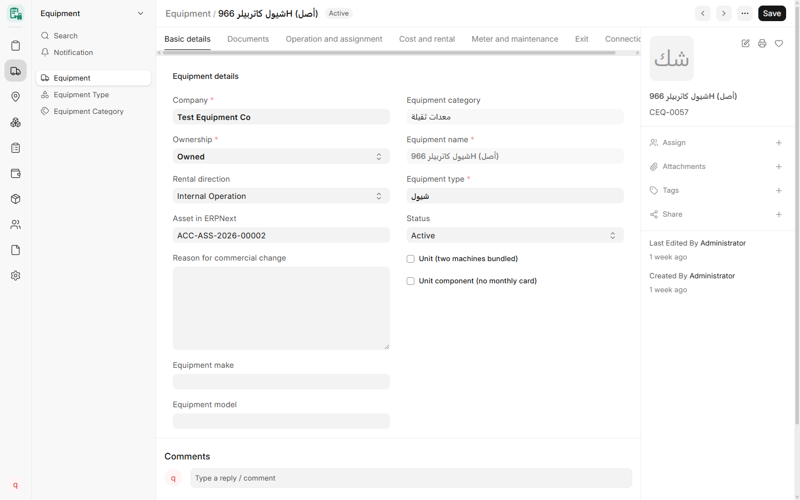
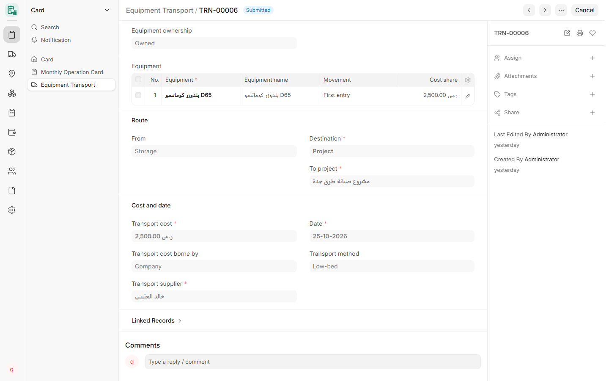
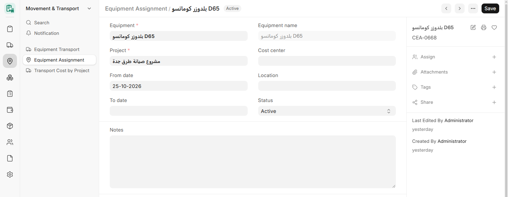
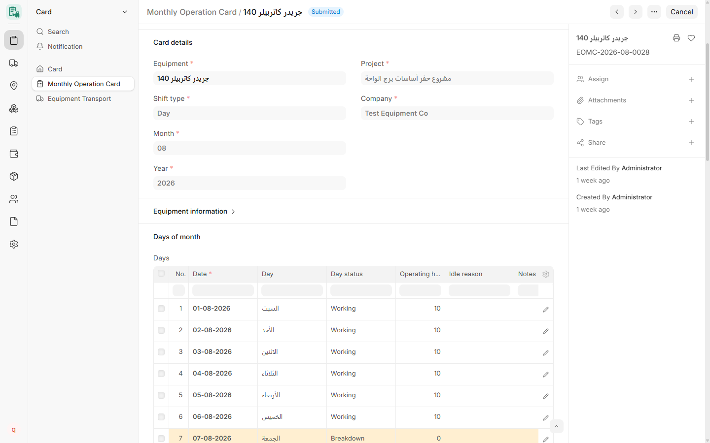
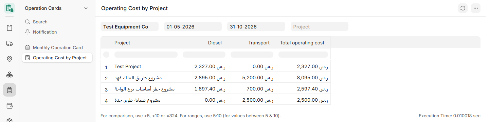
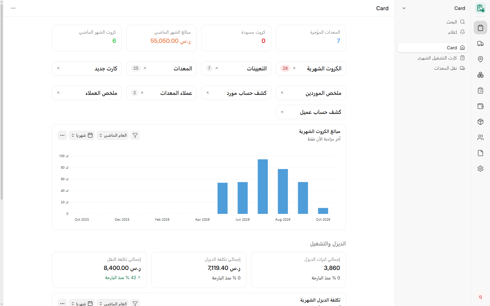

<div align="center">


<h1>CARD</h1>

**Equipment operations management for ERPNext**

إدارة تشغيل المعدات

<!-- Build and quality -->
[](https://github.com/SDe-ER/card/actions/workflows/ci.yml)
[](https://github.com/SDe-ER/card/actions/workflows/linters.yml)
[](https://github.com/SDe-ER/card/actions/workflows/codeql.yml)
[](https://codecov.io/gh/SDe-ER/card)

<!-- Release and project -->
[](https://github.com/SDe-ER/card/releases/latest)
[](https://github.com/SDe-ER/card/releases/latest)
[](LICENSE)
[](https://www.conventionalcommits.org/en/v1.0.0/)
[](https://github.com/SDe-ER/card/commits/main)

<!-- Platform -->
[](https://github.com/frappe/frappe)
[](https://github.com/frappe/erpnext)
[](https://www.python.org/)
[](https://nodejs.org/)
[](#languages)

[How it works](#how-card-works) ·
[Screenshots](#screenshots) ·
[Features](#features) ·
[Installation](#installation) ·
[Releases](#versions-and-releases) ·
[Documentation](#documentation)

</div>

CARD is a Frappe application for contractors that own, rent and operate heavy equipment. It records every
machine, where it works and who runs it. It records the monthly operating hours of each machine and turns
them into supplier and customer amounts on official ERPNext documents.

CARD is developed by **Shams Dubai Contracting Est. (SDCE)**, Saudi Arabia, for its mobile crushing,
infrastructure and equipment rental operations.

<div align="center">

<br><sub>The Card workspace in the ERPNext Desk (CARD v4.1.2, fictional test data).</sub>
</div>

## Contents

- [Overview](#overview)
- [How CARD works](#how-card-works)
- [Screenshots](#screenshots)
- [Features](#features)
- [CARD Mobile](#card-mobile)
- [Integration with Frappe, ERPNext and Frappe HR](#integration-with-frappe-erpnext-and-frappe-hr)
- [Requirements](#requirements)
- [Installation](#installation)
- [Development and quality checks](#development-and-quality-checks)
- [Security and permissions](#security-and-permissions)
- [Languages](#languages)
- [Versions and releases](#versions-and-releases)
- [Documentation](#documentation)
- [Contributing](#contributing)
- [License](#license)

## Overview

CARD has two interfaces on the same app and the same data:

| Interface | For | Status |
|---|---|---|
| **CARD Desk** | Managers, supervisors, accounts and stores, in the ERPNext Desk | Available |
| **CARD Mobile** (`/cdms`) | Operators, supervisors and managers on site, on their phones | In v4.1.0, not yet tested on real phones (see [CARD Mobile](#card-mobile)) |

CARD Desk is the full management system. CARD Mobile is a phone front end for the few actions that people
need on site. It does not copy the Desk.

CARD follows the design of Frappe HR. There is one master record per machine (like Employee) and one
transaction per period (like Salary Slip). Every record links to the ERPNext Company, Project, Supplier,
Customer and Asset.

## How CARD works

Do these steps in order. Each step needs the step before it.



1. **Add the equipment.** Open **Card Equipment** and create a record for the machine.
   - If the company owns the machine, set **Ownership** to Owned and select its ERPNext **Asset**. CARD then
     fills the name, brand, type and details from the Asset.
   - If the machine is rented, set **Ownership** to Rented and **Rental direction** to Rented from Supplier.
     Then enter the lessor, the rate type (per hour, per day or per month), the rate and the rental dates.
   - Enter the daily working hours, the operator and the documents (registration, insurance, inspection).
2. **Move the equipment to a project.** Open **Equipment Transport**. Select the ownership, the equipment
   and the destination project, then enter the transport cost. CARD finds where the machine is now. Submit
   the transport.
3. **Check the project assignment.** Open **Card Equipment Assignment**. The submitted transport opens an
   assignment for the machine on the new project. The first assignment of a machine starts on the transport
   date. A move from another project closes the old assignment on the transport date and starts the new
   one on the next day. If the assignment is there, the machine is ready to work on that project.
4. **Make the monthly card.** Open **Card Monthly Card**. Select the equipment, the shift, the month and the
   year. CARD fills the project from the machine's transports in that month, and the rate and the owner
   from the equipment.
5. **Record the operation.** Enter the operating hours for each day in the days grid, and add any additions
   or deductions. CARD refuses a day outside the machine's assignment. Submit the card when the month is
   complete. Submitted cards are then posted per supplier or customer and month as draft ERPNext invoices.

After these steps, use the rest of CARD from the Card workspace: diesel fills, equipment needs, tool custody
and the reports.

<details>
<summary><b>بالعربي: خطوات الشغل</b></summary>

<div dir="rtl">

1. **ضيف المعدة:** افتح «المعدات» واعمل معدة جديدة.
   - لو المعدة ملك الشركة: اختار الملكية «ملك» واختار الأصل بتاعها من ERPNext، والبيانات بتتملي من الأصل.
   - لو المعدة إيجار: اختار «إيجار» واتجاه الإيجار «مستأجَرة من مورد»، ودخّل المؤجر ونوع السعر (بالساعة أو باليوم أو بالشهر) والسعر وتواريخ الإيجار.
   - دخّل ساعات الشغل اليومية والمشغّل والمستندات.
2. **انقل المعدة للمشروع:** افتح «نقل المعدات»، اختار الملكية والمعدة والمشروع، ودخّل تكلفة النقل، وبعدين اعتمد النقل.
3. **اتأكد من التعيين على المشروع:** افتح «تعيين معدة على مشروع». النقل المعتمد بيفتح تعيين للمعدة على المشروع. أول تعيين بيبدأ من تاريخ النقل، والنقل من مشروع لمشروع بيقفل القديم في تاريخ النقل ويبدأ الجديد من اليوم اللي بعده. لو التعيين موجود، يبقى كله تمام.
4. **اعمل الكارت الشهري:** افتح «كارت التشغيل الشهري»، اختار المعدة والوردية والشهر والسنة. المشروع بيتملى من نقل المعدة في الشهر ده، والسعر من بيانات المعدة.
5. **سجّل التشغيل:** دخّل ساعات كل يوم، وضيف الإضافات أو الخصومات، واعتمد الكارت آخر الشهر. الكروت المعتمدة بتتحول بعد كده لفواتير ERPNext مسودة لكل مورد أو عميل في الشهر.

بعد كده استكشف باقي الشاشات: الديزل، طلبات احتياجات المعدات، العهد، والتقارير.

</div>

</details>

## Screenshots

All screenshots show CARD v4.1.2 in the ERPNext Desk with fictional test data.

<table>
  <tr>
    <td width="50%" valign="top">
      
      <br><b>1. Card Equipment</b>: an owned machine linked to its ERPNext Asset.
    </td>
    <td width="50%" valign="top">
      
      <br><b>2. Equipment Transport</b>: ownership, equipment, route, then cost and date.
    </td>
  </tr>
  <tr>
    <td width="50%" valign="top">
      
      <br><b>3. Card Equipment Assignment</b>: opened by the submitted transport.
    </td>
    <td width="50%" valign="top">
      
      <br><b>4. Card Monthly Card</b>: the days grid with operating hours and day status.
    </td>
  </tr>
  <tr>
    <td width="50%" valign="top">
      
      <br><b>Reports</b>: Operating Cost by Project (diesel and transport per project).
    </td>
    <td width="50%" valign="top">
      
      <br><b>Arabic</b>: the same workspace, right to left.
    </td>
  </tr>
</table>

## Features

Everything below is available in the latest release, **v4.2.0**. The complete inventory of each version is
in [docs/releases](docs/releases/VERSION-HISTORY.md).

### Equipment

- **Card Equipment** master with type, category, ownership (owned, managed or rented), supplier, company
  and documents with expiry warnings.
- Owned and managed equipment take their name, brand, type and details from the linked ERPNext **Asset**.
- Units made of several machines, with dated components.

### Movement and transport

- **Equipment Transport** moves one or more machines to a project, workshop, storage or back to the
  supplier. CARD reads where each machine is and charges the destination's cost center.
- Approved transports open and close the project assignments.

### Monthly operation cards

- **Card Monthly Card** per machine, shift and month, with a day-by-day grid of operating hours.
- The project comes from the machine's approved transports. No transport, no card.
- Hourly, daily and monthly rates on the supplier (cost) side and the customer (revenue) side, with
  additions and deductions.

### Diesel, materials and custody

- Per-project diesel fills, diesel supplier policy and expected-versus-actual diesel analysis.
- **Equipment needs:** operators request parts, consumables and tools for their machine. The site
  supervisor reviews the request. Management approval creates draft ERPNext **Material Requests**.
- Returnable tools tracked as employee custody.

### Accounting and reports

- Postings only through official ERPNext documents (Purchase Invoice, Sales Invoice, Material Request,
  Stock Entry). CARD never writes General Ledger entries directly.
- A **Card Equipment** accounting dimension for per-machine ledgers and financial statements.
- Period lock, company isolation and a permanent posting log.
- 14 reports, including supplier and customer statements, operating and transport cost by project, diesel,
  materials and custody.
- RTL Arabic print formats for the monthly card, diesel fill and transport.

## CARD Mobile

> [!IMPORTANT]
> **In v4.1.0, not yet tested on real phones.** v4.1.0 is the foundation of CARD Mobile (operator
> requests). The full phone app for CARD is planned for a later release.

CARD Mobile is a Progressive Web App (PWA) served by CARD itself at `/cdms`. It is built the same way as the
Frappe HR mobile app:

- **Phone only.** One interface designed for phones. On a computer the same interface shows in a centered
  column up to 480 px wide. There is no separate desktop layout.
- **Same accounts.** Users sign in inside the app with their ERPNext account. Sessions, CSRF protection
  and permissions are Frappe's own. The user needs a CARD role and an active Employee record.
- **No duplicate logic.** The app calls CARD's existing endpoints. CARD Desk stays the management system.
- **Installable.** Web app manifest, app icons and iPhone home-screen settings are included.

| Screen | For | Status |
|---|---|---|
| Sign in, Home, New request, My requests, Profile | Operators | In v4.1.0 (not device-tested) |
| Daily operating hours (enter, review, approve) | Operators, supervisors, managers | Planned |
| Equipment, projects, transport, cards, diesel | By role | Planned |
| Materials review and approval, tools and custody | Supervisors, managers, operators | Planned |
| Suppliers, costs, reports, notifications | By role | Planned |

> [!NOTE]
> iPhone (Safari → *Add to Home Screen*) and Android (*Install app*) installation is **not yet tested on
> physical devices**. Support will be stated only after those tests on an HTTPS site.

Details: [docs/mobile](docs/mobile/README.md).

## Integration with Frappe, ERPNext and Frappe HR

| Application | How CARD uses it |
|---|---|
| [Frappe Framework](https://github.com/frappe/frappe) | DocTypes, permissions, sessions, translations, web pages |
| [ERPNext](https://github.com/frappe/erpnext) | Company, Project, Supplier, Customer, Asset, Item, Employee, Material Request, invoices and the General Ledger |
| [Frappe HR](https://github.com/frappe/hrms) | Optional. CARD uses ERPNext's Employee record, which Frappe HR extends |

CARD does not change Frappe, ERPNext or Frappe HR. It extends them only through standard mechanisms
(hooks, custom DocTypes, accounting dimensions and permissions).

> CARD is an independent product of SDCE. It is not developed, endorsed or maintained by Frappe
> Technologies.

## Requirements

| Component | Version |
|---|---|
| Frappe Framework | 16.51 or later (v16) |
| ERPNext | v16 |
| Frappe HR | v16, optional |
| Python | 3.14 |
| Node.js | 24 |

Tested with Frappe 16.51.1, ERPNext 16.50.0 and Frappe HR 16.51.0.

## Installation

```bash
cd frappe-bench
bench get-app https://github.com/SDe-ER/card --branch main
bench --site your-site.local install-app card
bench --site your-site.local migrate
```

For Docker, add CARD to the `apps.json` of an official
[frappe_docker](https://github.com/frappe/frappe_docker) custom image.

**Upgrading:** take a full backup and run `bench migrate` on a restored copy of the site first. CARD ships
idempotent patches. A migrate that fails on the copy must never run on the live site.

## Development and quality checks

```bash
bench --site your-site.local set-config developer_mode 1
bench --site your-site.local set-config allow_tests true
bench --site your-site.local run-tests --app card
```

Pull requests run these GitHub Actions workflows:

| Workflow | What it checks |
|---|---|
| [CI](.github/workflows/ci.yml) | CARD unit tests on Frappe and ERPNext v16, with coverage to Codecov. CARD Mobile type check, unit tests and build |
| [Linters](.github/workflows/linters.yml) | `pre-commit` (ruff, prettier) and Semgrep with the Frappe rules |
| [CodeQL](.github/workflows/codeql.yml) | Code scanning for JavaScript and Python, also weekly |
| [PR Title](.github/workflows/pr-title.yml) | The pull request title follows Conventional Commits |
| [Upgrade rehearsal](.github/workflows/upgrade-rehearsal.yml) | Upgrade from an earlier release, when patches, DocTypes, fixtures or hooks change |
| [Release](.github/workflows/release.yml) | Makes the GitHub Release when a `v*` tag is pushed |

See [CONTRIBUTING.md](CONTRIBUTING.md) for branches, tests and linting.

## Security and permissions

- Roles: **Card Manager**, **Card User**, **Card Supervisor** and **Card Operator**, added on top of
  ERPNext's own roles.
- The server checks every action. CARD never treats hidden fields or buttons as permissions.
- Users see only the companies, projects and records that they are permitted to see.
- Postings and approvals use the user's own ERPNext rights. CARD does not widen them.

Report vulnerabilities privately to **<info@sdce.sa>**. Do not open public issues. See
[SECURITY.md](SECURITY.md).

## Languages

Arabic and Urdu (right to left), English, Bengali and Hindi. Arabic covers the whole app. Bengali, Hindi
and Urdu cover the operator screens. The application name shows as "CARD" in every language.

## Versions and releases

CARD follows [Semantic Versioning](https://semver.org/spec/v2.0.0.html). Every change goes through a pull
request with CI and review. Every release has a full documentation page.

| Version | Date | Highlights |
|---|---|---|
| [v4.2.0](docs/releases/v4.2.0.md) | 2026-10-27 | Diesel fill as a metered session with meter photos and an operations review; WhatsApp diesel session import; parts fitment in the catalog; app name CARD |
| [v4.1.2](docs/releases/v4.1.2.md) | 2026-10-25 | Full launcher navigation on upgraded sites; simpler Equipment Transport form; English for stored Arabic values |
| [v4.1.1](docs/releases/v4.1.1.md) | 2026-10-25 | Tool Custody item search fix: Card Manager no longer needs an ERPNext Item permission for New Handover |
| [v4.1.0](docs/releases/v4.1.0.md) | 2026-10-25 | First production go-live candidate: unique chassis/plate numbers, upgrade from v1.0.1 rehearsed, isolation and concurrency fixes |
| [v4.0.0](docs/releases/v4.0.0.md) | 2026-10-19 | Equipment materials: operator requests, supervisor review, approval into draft Material Requests, tool custody |
| [v3.0.0](docs/releases/v3.0.0.md) | 2026-10-19 | CARD launcher, multi-machine transport, cards follow transports, equipment from ERPNext Asset |
| [v1.2.2](docs/releases/v1.2.2.md) | 2026-10-18 | Company isolation, protected equipment fields, permanent posting log |
| [v1.2.1](docs/releases/v1.2.1.md) | 2026-10-16 | Report filters for operational roles, print amounts |
| [v1.2.0](docs/releases/v1.2.0.md) | 2026-10-16 | Rental directions and customers, settings and roles, diesel and transport, accounting dimension |
| [v1.0.1](docs/releases/v1.0.1.md) | 2026-10-13 | Frappe 16.50/16.51 compatibility fixes |
| [v1.0.0](docs/releases/v1.0.0.md) | 2026-10-13 | First release |

A published release is not a deployment. Which version runs on a site is decided and verified per site.

## Documentation

| Document | Content |
|---|---|
| [Version history](docs/releases/VERSION-HISTORY.md) | Every release with its full feature inventory |
| [Version comparison](docs/releases/VERSION-COMPARISON.md) | Features by version |
| [Which version should I use?](docs/releases/WHICH-VERSION.md) | Upgrade guidance |
| [Release policy](docs/releases/RELEASE-POLICY.md) | How releases are made and documented |
| [CARD Mobile](docs/mobile/README.md) | Phone app architecture, access, languages and device checklist |
| [Document templates](docs/templates/README.md) | Print and document designs |
| [CHANGELOG.md](CHANGELOG.md) | Changes by version |

## Contributing

Open an issue first. Work on a branch with tests, keep `pre-commit` green, and open a pull request with a
Conventional Commits title. See [CONTRIBUTING.md](CONTRIBUTING.md) and
[CODE_OF_CONDUCT.md](CODE_OF_CONDUCT.md).

## License

MIT © 2026 Shams Dubai Contracting Est. (SDCE). See [LICENSE](LICENSE).

The CARD name and logo belong to SDCE. "Frappe", "ERPNext" and "Frappe HR" are trademarks of Frappe
Technologies Pvt. Ltd., used here only to describe compatibility, in line with the
[ERPNext trademark policy](https://github.com/frappe/erpnext/blob/develop/TRADEMARK_POLICY.md).
