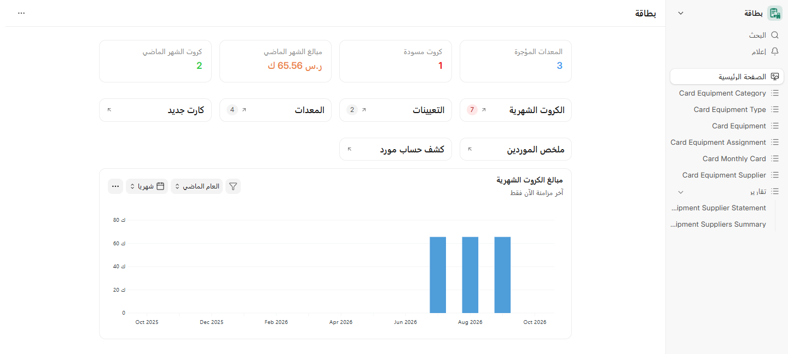
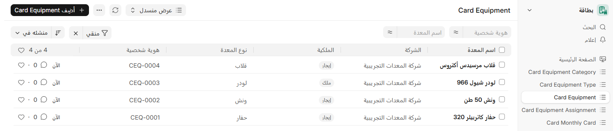
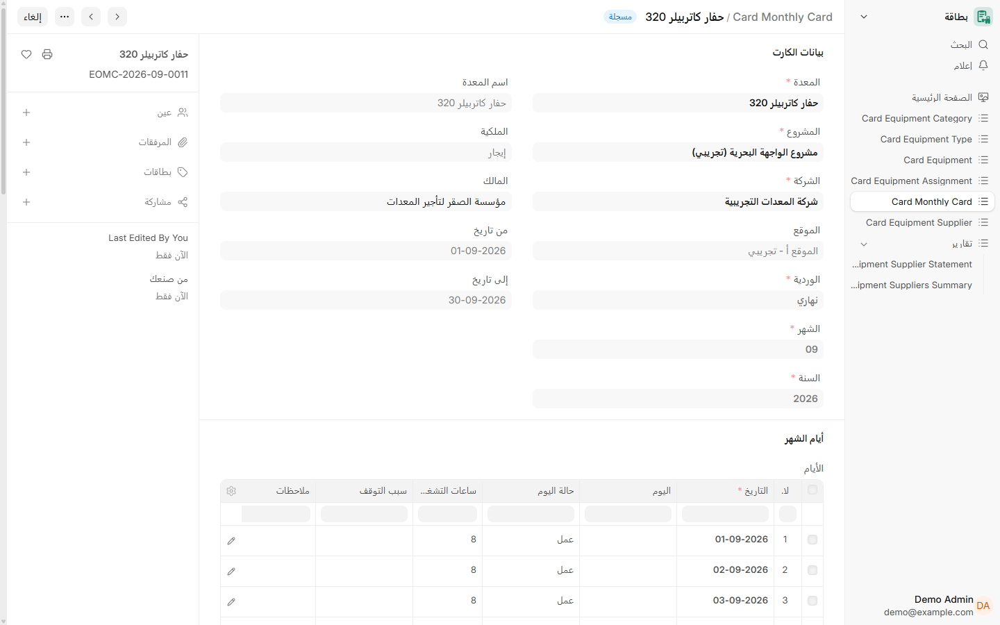
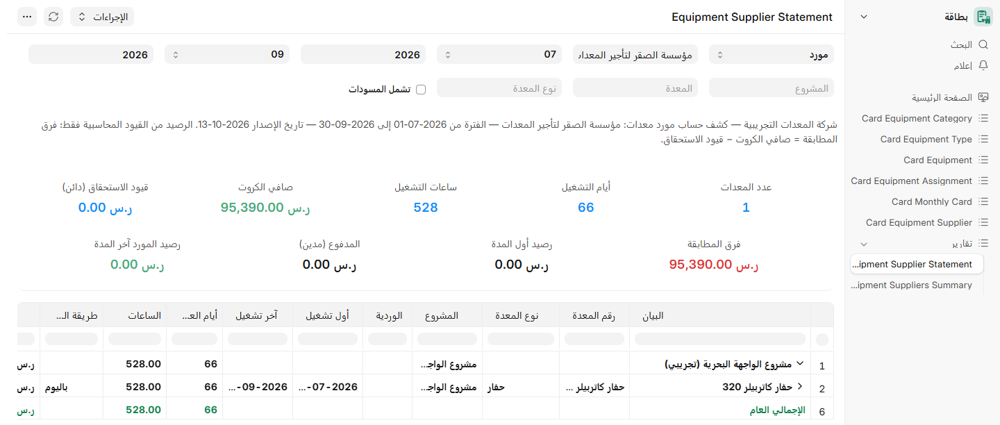
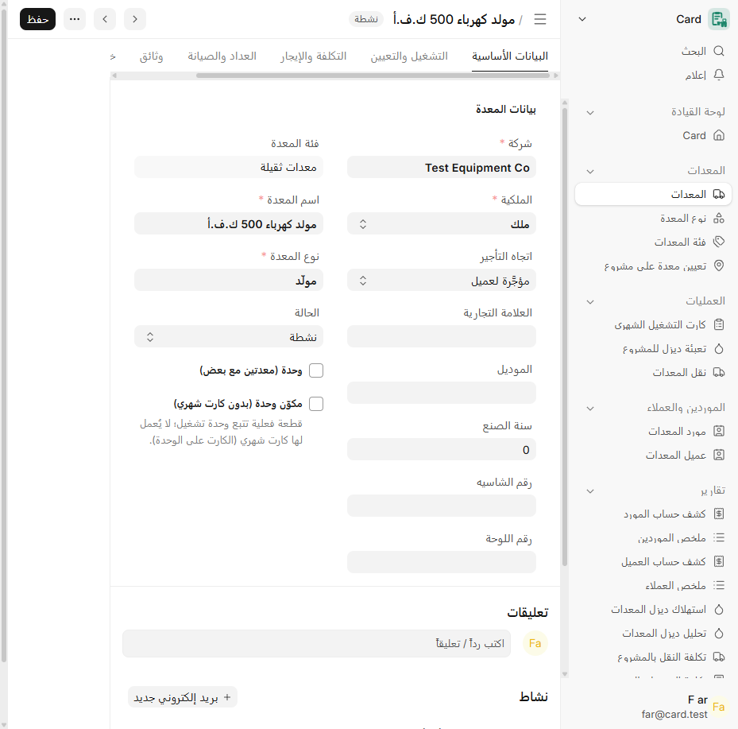
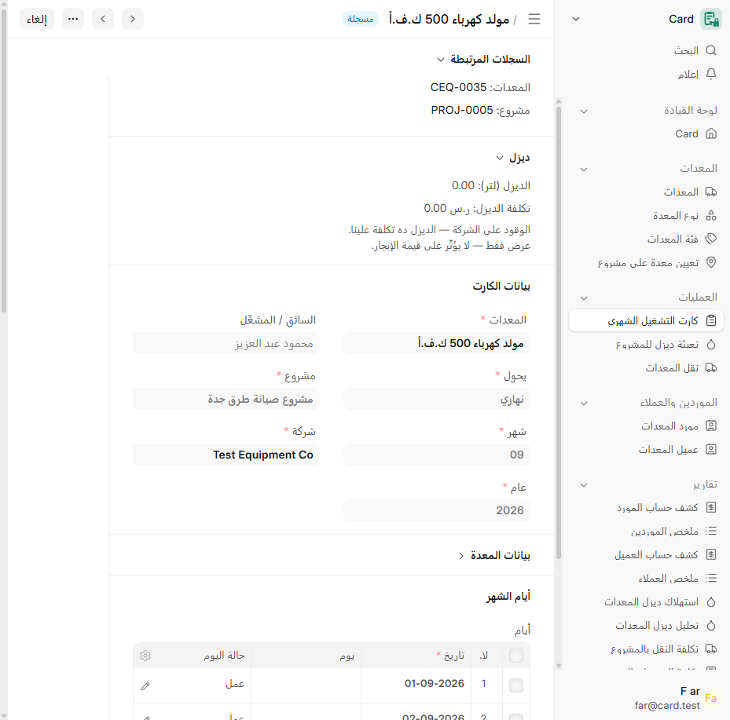
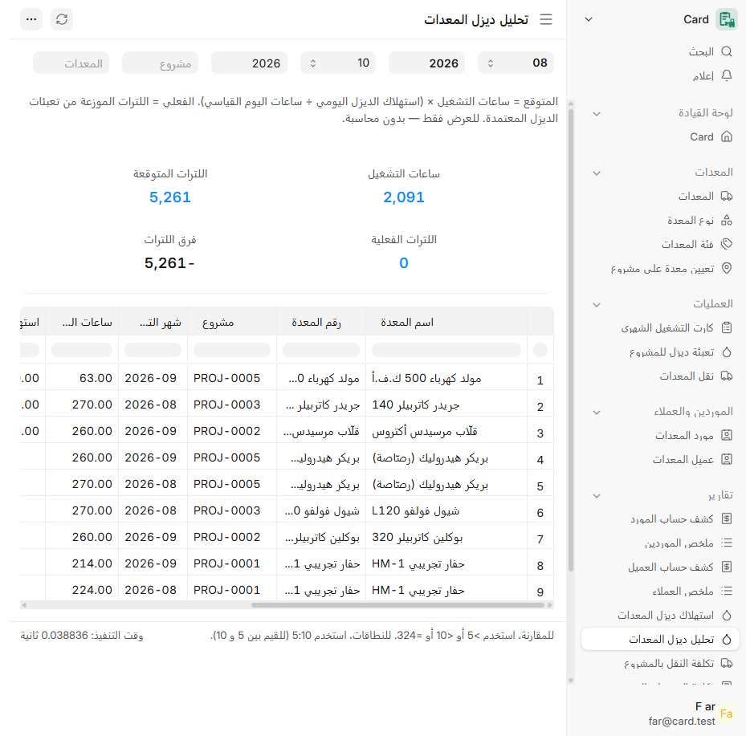
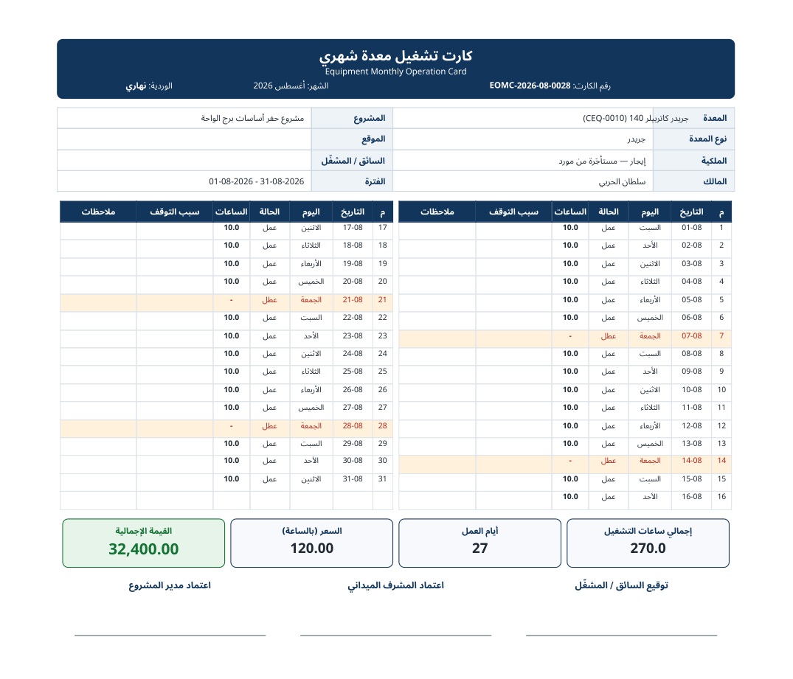

<div align="center">


<h1>CARD</h1>

**Equipment rental and operation cards for ERPNext**

إدارة المعدات وكروت التشغيل الشهرية

[](https://github.com/SDe-ER/card/actions/workflows/ci.yml)


<br>



<br>

[Features](#key-features) · [Installation](#installation) · [Development](#development) · [Releases](#release-history) · [Contributing](#contributing)

</div>

---

## What is CARD

CARD is a standalone Frappe application for contractors that own and rent heavy equipment. It tracks every machine, assigns it to projects, records daily operating hours on a monthly card, and turns that card into a supplier-ready amount with additions and deductions.

CARD follows the same design principles as Frappe HR: one master record per asset (like **Employee**), one transaction per period (like **Salary Slip**), and everything linked to ERPNext's Company, Project and Supplier.

## Key Features

<details open>
<summary><b>Equipment master</b></summary>

- **Card Equipment** with type, category, ownership (owned or rented), owner/supplier and company.
- **Card Equipment Type** and **Card Equipment Category** for clean classification.
- Standard daily hours per equipment, used to prorate daily rates.


</details>

<details open>
<summary><b>Project assignment</b></summary>

- **Card Equipment Assignment** links a machine to a project and site for a period.
- Prevents a machine from being double-counted across projects.
</details>

<details open>
<summary><b>Monthly operation card</b></summary>

- **Card Monthly Card** per equipment, shift and month, with a day-by-day grid (date, weekday, day status, operating hours, stoppage).
- Automatic totals: working days, total operating hours, amount, additions, deductions and **net amount**.
- Validations: one card per equipment, shift and month; every day must fall inside the card month.
- Owned equipment produces no supplier amount; rented equipment syncs to its supplier on submit.


</details>

<details open>
<summary><b>Suppliers and reports</b></summary>

- **Card Equipment Supplier** with running balances.
- **Equipment Suppliers Summary** and **Equipment Supplier Statement** reports.
- Workspace with number cards (rented equipment, draft cards, last month amounts, last month cards) and a monthly amounts chart.


</details>

<details open>
<summary><b>Rental directions &amp; the customer side</b></summary>

- Every equipment carries a **rental direction**: rented from a supplier, rented out to a customer, sub-rental (both sides on one card), or internal operation. The form shows only the side that applies.
- **Card Equipment Customer** registry mirrors the supplier registry; **Equipment Customer Statement** and **Equipment Customers Summary** read the official receivables only — CARD never keeps a parallel ledger.
- Cards are **hours entry only**: equipment, shift, month, year and the driver — everything else (project, company, direction, parties, rates) flows in automatically and sits in a collapsed info section.



</details>

<details open>
<summary><b>Diesel &amp; transport management</b></summary>

- Per-company diesel litre price; a **diesel supplier policy** (fixed supplier enforced on every fill, or variable behind a permitted role).
- Per-project **transport prices** defaulting every Equipment Transport, change-gated by role.
- **Equipment Diesel Analysis**: expected litres (from each machine's daily consumption) vs actually allocated litres, with variance per equipment, project and month.


</details>

<details open>
<summary><b>Accounting on official ERPNext documents</b></summary>

- A non-mandatory **Card Equipment accounting dimension** on the GL-bearing ERPNext doctypes: per-equipment General Ledger, Trial Balance, P&amp;L and Balance Sheet with the standard reports — including the depreciation path from linked Assets.
- Guard report **Equipment Expenses Without Equipment** catches expense lines that missed the dimension.
- Period lock, role model (**Card Manager** / **Card User** / Accounts Manager read), and a per-company settings page keep policies in one place.
- **Note:** users running the supplier/customer statement reports also need a standard ERPNext role with read access to Supplier/Customer (e.g. **Accounts User**) — Frappe validates report link-filters against those doctypes, and CARD does not modify ERPNext doctype permissions.
</details>

<details open>
<summary><b>Professional print formats</b></summary>

- RTL Arabic-first print formats for the monthly card, diesel fill and transport — header, logo and company details pulled from the system, applied automatically on print.


</details>

### Billing rule (rate bases)

CARD bills by actual operating hours on any of three bases, on both the supplier (cost) and customer (revenue) sides:

```
hourly  : hourly_rate = rate
daily   : hourly_rate = rate / standard_daily_hours
monthly : hourly_rate = rate / standard_month_hours   (default 260 = 26 days × 10 h)

amount      = total_operating_hours × hourly_rate
net_amount  = amount + total_additions − total_deductions
```

Example: daily rate 600, standard day 10 hours, 88 operating hours → 88 × 60 = **5,280**.

## Under the Hood

CARD is built on the [Frappe Framework](https://frappeframework.com) and runs alongside these open-source applications:

| Dependency | Role | Tested with |
|---|---|---|
| [Frappe Framework](https://github.com/frappe/frappe) | Full-stack web framework | 16.51.1 |
| [ERPNext](https://github.com/frappe/erpnext) | Company, Project, Supplier, accounting | 16.50.0 |
| [Frappe HR](https://github.com/frappe/hrms) | Optional, for HR-linked workflows | 16.50.0 |

Runtime: Python 3.14, Node.js 24, MariaDB 10.6, Redis.

> CARD is an independent product of Shams Dubai Contracting Est. (SDCE). It is not developed, endorsed or maintained by Frappe Technologies.

## Installation

### Bench

```bash
cd frappe-bench
bench get-app https://github.com/SDe-ER/card --branch main
bench --site your-site.local install-app card
bench --site your-site.local migrate
```

### Docker (frappe_docker)

Add CARD to your `apps.json` and build a custom image:

```json
[
  { "url": "https://github.com/frappe/erpnext", "branch": "version-16" },
  { "url": "https://github.com/SDe-ER/card", "branch": "main" }
]
```

```bash
docker build \
  --build-arg APPS_JSON_BASE64=$(base64 -w 0 apps.json) \
  --tag your-registry/erp:card-v3.0.0 \
  --file images/custom/Containerfile .
```

Then deploy the image and run:

```bash
bench --site your-site.local install-app card
bench --site your-site.local migrate
```

### Upgrading

Always take a full backup and run `bench migrate` on a restored copy of production first. CARD ships idempotent patches; a migrate that fails on the copy must never be run on production.

## Development

```bash
bench get-app https://github.com/SDe-ER/card --branch main
bench new-site card.localhost --install-app erpnext
bench --site card.localhost install-app card
bench --site card.localhost set-config developer_mode 1
bench start
```

Run the tests:

```bash
bench --site card.localhost set-config allow_tests true
bench --site card.localhost run-tests --app card
```

Code style is enforced with `pre-commit` (ruff, prettier, semgrep). Commits follow [Conventional Commits](https://www.conventionalcommits.org).

## Release History

Full documentation of every release — complete feature inventory per version, comparison matrix and
upgrade guidance — lives in **[docs/releases/](docs/releases/VERSION-HISTORY.md)**:
[Version History](docs/releases/VERSION-HISTORY.md) ·
[Version Comparison](docs/releases/VERSION-COMPARISON.md) ·
[Which Version Should I Use?](docs/releases/WHICH-VERSION.md)

| Version | Date | Highlights |
|---|---|---|
| **[v3.0.0](docs/releases/v3.0.0.md)** | 2026-10-19 | CARD launcher (Dock with nine sidebars); one transport moves several machines to a project, workshop, storage or back to the supplier, reads where each machine is and charges the destination's cost center; the monthly card takes its project from the approved transports (no transport, no card); owned and managed equipment take their details from the ERPNext Asset; dated unit components; company filled automatically. Needs frappe 16.51+. |
| **[v1.2.2](docs/releases/v1.2.2.md)** | 2026-10-18 | Company isolation: registries show per-company figures and list only permitted parties, posting endpoints refuse other companies; equipment commercial terms and control fields protected (Card Manager writes, change reason + history); GL Posting Log made a permanent audit record; reconciliation split into three figures (invoiced through Card / not invoiced / outside Card); diesel estimates labelled; amend-chain and name-reuse fixes. |
| **[v1.2.1](docs/releases/v1.2.1.md)** | 2026-10-16 | Operational roles run filtered reports without ERPNext grants; monthly-card print shows each billed side's gross, adjustments and net before VAT (customer card net 6,000 instead of 0); diesel/transport money labels and Arabic amount in words; supplier and customer totals keep each side's adjustments. Multi-company registry isolation (#23) still open. |
| **[v1.2.0](docs/releases/v1.2.0.md)** | 2026-10-16 | Everything from the v1.1 line (English-source i18n with full Arabic translation, Desk connections, workspace polish, heatmaps) plus rental directions with hours-only cards, customer registry and statements, Card Settings per company with Card Manager / Card User roles, diesel and transport management, three rate bases, the Card Equipment accounting dimension, period lock, RTL print formats, opt-in monthly draft supplier/customer postings, and company-scoped reports with ledger figures limited to General Ledger users. |
| _v1.1_ | _not released_ | Developed and merged, never tagged — its content ships in v1.2.0. |
| **[v1.0.1](docs/releases/v1.0.1.md)** | 2026-10-13 | Workspace moved to module `Card`; Frappe 16.50 sidebar migrated with all items; legacy `Card (Custom)` module retired; `net_amount` backfilled for cards submitted before v1.0. |
| **[v1.0.0](docs/releases/v1.0.0.md)** | 2026-10-13 | First standalone release: equipment master, assignments, monthly cards, suppliers, reports and workspace. |

Full notes: [CHANGELOG.md](CHANGELOG.md) · [Releases](https://github.com/SDe-ER/card/releases)

## Contributing

1. Open an issue describing the bug or feature.
2. Create a branch, add tests, and keep `pre-commit` green.
3. Open a pull request with a Conventional Commits title.

See [CONTRIBUTING.md](CONTRIBUTING.md).

## Security

Please report vulnerabilities privately to **info@sdce.sa**. Do not open public issues for security reports. See [SECURITY.md](SECURITY.md).

## License

MIT © 2026 Shams Dubai Contracting Est. (SDCE). See [LICENSE](LICENSE).

## Logo and Trademark Policy

The CARD name and logo belong to SDCE. "Frappe", "ERPNext" and "Frappe HR" are trademarks of Frappe Technologies Pvt. Ltd. and are used here only to describe compatibility, in line with the [ERPNext trademark policy](https://github.com/frappe/erpnext/blob/develop/TRADEMARK_POLICY.md).

<br>

<div align="center">
<sub>Screenshots use fictional demo data.</sub>
</div>
