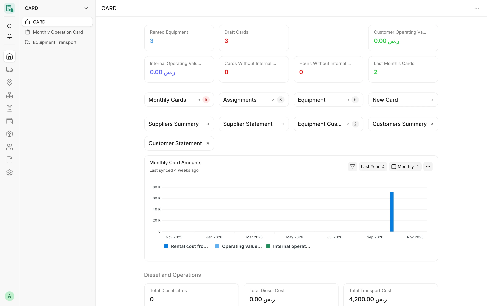

<div align="center">


<h1>CARD</h1>

**Equipment operations management for Frappe and ERPNext**

<p dir="rtl">إدارة تشغيل المعدات على Frappe و ERPNext</p>

[](https://github.com/SDe-ER/card/actions/workflows/ci.yml)
[](https://github.com/SDe-ER/card/actions/workflows/codeql.yml)
[](https://codecov.io/gh/SDe-ER/card)
[](https://github.com/SDe-ER/card/releases/latest)
[](LICENSE)
[](https://github.com/frappe/erpnext)

<br>

[](https://sde-er.github.io/card/)
[](https://sde-er.github.io/card/ar/)

[What's new](https://sde-er.github.io/card/releases/whats-new/) ·
[Installation](https://sde-er.github.io/card/getting-started/installation/) ·
[API](https://sde-er.github.io/card/api-reference/overview/) ·
[Releases](https://github.com/SDe-ER/card/releases)

</div>

<br>

CARD is a Frappe application for contractors that own, rent and operate heavy equipment. It records every
machine, where it works and what it did each day, prices that work by its rental terms, and turns it into
standard ERPNext invoices and statements — for owned, rented-in, rented-out and sub-let equipment.

<div align="center">

</div>

## Highlights

- **Monthly operating cards** — daily hours, stoppages with their reasons and responsible party, additions and
  deductions, supplier and customer totals.
- **Every rental direction** — owned, rented-in, rented-out and sub-let equipment, priced by day, hour or month.
- **Diesel, transport, meters and materials** — metered diesel sessions, equipment transport, engine-hour
  readings, parts requests and tool custody.
- **Standard ERPNext accounting** — CARD prepares draft Purchase and Sales Invoices; it never writes ledger
  entries itself.
- **25 reports** — statements, settlement status, downtime, diesel analysis, partial margin and more.
- **Arabic and English** (with Urdu, Bengali and Hindi for operator screens) and **CARD Mobile** for site staff.

## Quick start

```bash
bench get-app https://github.com/SDe-ER/card --branch main
bench --site <your-site> install-app card
bench --site <your-site> migrate
```

Requires Frappe and ERPNext v16. See the [installation guide](https://sde-er.github.io/card/getting-started/installation/)
for requirements, Docker, upgrades and CARD Mobile.

## Documentation

Everything else lives on the documentation site, in English and Arabic:

| | |
|---|---|
| [Getting started](https://sde-er.github.io/card/getting-started/introduction/) | Introduction, installation, configuration, development |
| [Features](https://sde-er.github.io/card/features/monthly-cards/) | Equipment, cards, diesel, transport, posting, mobile, roles and more |
| [Reports](https://sde-er.github.io/card/reports/overview/) | All 25 reports with their filters and columns |
| [API reference](https://sde-er.github.io/card/api-reference/overview/) | Every whitelisted method with examples |
| [Reference](https://sde-er.github.io/card/reference/) | Every DocType, field and permission, generated from the code |
| [What's new](https://sde-er.github.io/card/releases/whats-new/) | Every change and release in plain language |

## Contributing

Contributions are welcome. Read [CONTRIBUTING.md](CONTRIBUTING.md) and the
[development guide](https://sde-er.github.io/card/getting-started/development/), and follow the
[code of conduct](CODE_OF_CONDUCT.md). Changes are recorded in the [CHANGELOG](CHANGELOG.md).

## Security

Please report vulnerabilities privately as described in [SECURITY.md](SECURITY.md).

## License

[MIT](LICENSE) © 2026 Shams Dubai Contracting Est. (SDCE).

The CARD name and logo belong to SDCE. "Frappe", "ERPNext" and "Frappe HR" are trademarks of Frappe
Technologies Pvt. Ltd., used here only to describe compatibility, in line with the
[ERPNext trademark policy](https://github.com/frappe/erpnext/blob/develop/TRADEMARK_POLICY.md).
