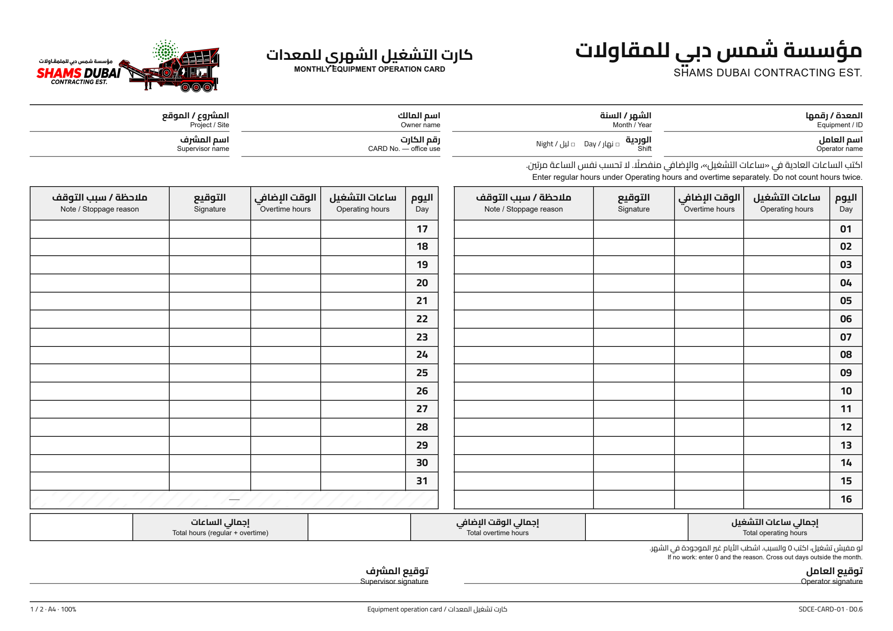
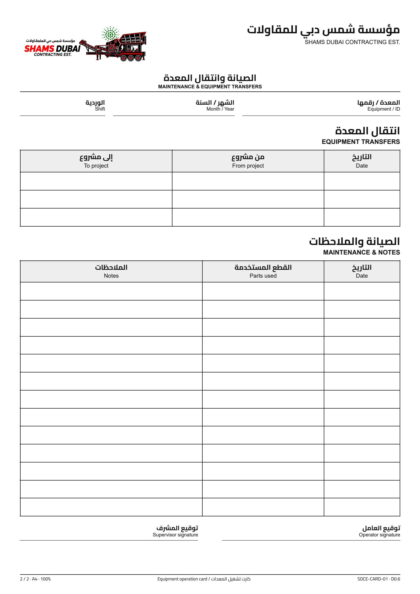

# SDCE monthly equipment card - D0.6

[Print-ready PDF](monthly-card.pdf) | [Editable HTML](monthly-card.html) | [CSS](card.css)

## Design

Blank Arabic/English form for Shams Dubai Contracting Est., archived on the owner's
explicit request. Front: A4 landscape, days 01-16 on the right and 17-31 on the left,
operating hours, overtime, signatures, notes and monthly totals. Reverse: A4 portrait,
3 equipment-transfer rows and 13 maintenance/parts/notes rows.

The owner-supplied logo was cleaned with the built-in image-editing tool and has an
alpha-transparent background. Its source identity is SDCE; company branding is scoped
to this design, not hardcoded into the CARD application.

Status: delivered design D0.6; operational approval is not recorded. The owner requested
removal of the printed review label. This does not confer electronic approval.

## Edit and print

Keep `monthly-card.html`, `card.css` and `shams-dubai-logo.png` together. Open the HTML
in Chrome/Edge. Print to PDF at 100% with CSS page sizes, no added browser headers or
footers, and background graphics enabled. CSS embeds Cairo Regular/Bold; its SIL OFL
license is included as `Cairo-OFL.txt`. Do not require online font loading.

The PDF has mixed page orientations. Check one duplex sheet for driver rotation before
batch printing; do not assume a universal long-edge/short-edge setting. Physical print
testing has not been performed. After source edits, regenerate the PDF and previews and
repeat pagination, font embedding, 31-day, RTL and overflow checks.

## Data mapping and limits

See `field-mapping.csv` and `verification-report.md`. Source inspection baseline was
SDe-ER/card commit `d69fa67038b1fe7f448cf1109fda30552120091e`; mapping is historical
source evidence, not a claim that current production or newer repository revisions match.

Regular and overtime hours are mutually exclusive on paper. Office entry combines them
once in `working_hours` (8 + 2 = 10). No overtime field or premium rate is implied.
Daily signatures, maintenance parts and detailed project-transfer evidence are paper
data, not newly created CARD fields. No transaction, settings or schema changes occur.

## Scope

This folder archives a standalone print design only. It is not a Frappe Print Format
fixture and is not automatically available in Desk, installed, migrated or deployed.
Runtime integration requires a separate explicit implementation and review.

`manifest.json` records SHA-256 checksums for the included files. The exported CSS is
excluded from automatic Prettier rewriting to preserve this validated snapshot; a new
design revision should be regenerated and validated as a complete package.
