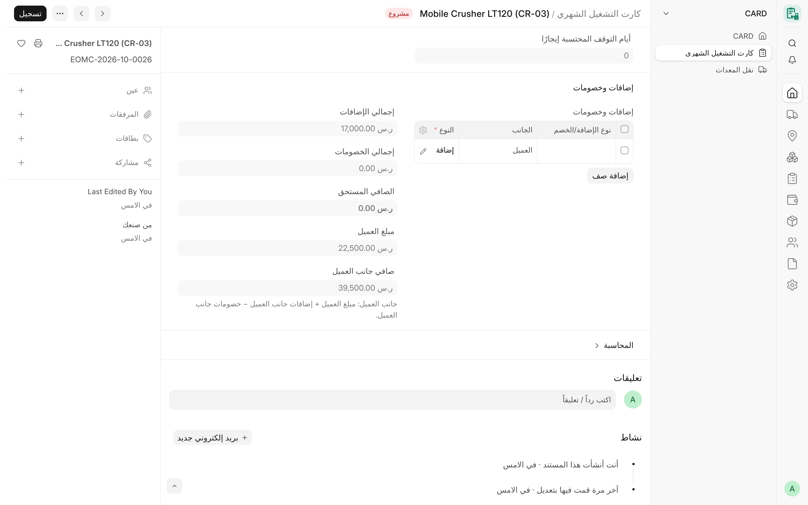

## نظرة عامة

تعدّل الإضافات والخصومات مبلغ الكارت الشهري: كرسوم التجهيز والنقل إلى الموقع، أو خصم التأخر، أو رسوم توقف متفق عليها
مع العميل. وتعرّف كل شركة **أنواع الإضافات والخصومات** الخاصة بها في الإعدادات. ويحدد النوع هل هو إضافة أم خصم، والحساب
الذي يُرحَّل إليه سطر الفاتورة، وهل هو خاضع للضريبة. وفي الكارت يذكر كل سطر نوعه والجانب الذي ينتمي إليه – فاتورة المورد
أو فاتورة العميل.

وعند ترحيل الشهر يصبح كل سطر ذي نوع سطرًا مستقلًا في فاتورة الشراء أو فاتورة المبيعات بحالة المسودة، وفق قواعد تحافظ
على صلاحية فواتير العملاء للفوترة الإلكترونية لدى ZATCA (لا سطور سالبة).

<!-- screenshot: adjustments-card-table -->

*الإضافات والخصومات في الكارت الشهري*

## المفاهيم الأساسية

| المفهوم | المعنى |
|---|---|
| نوع الإضافة/الخصم (Card Adjustment Type) | سطر في جدول **أنواع الإضافات والخصومات** في الإعدادات، لشركة واحدة في كل سطر. |
| النوع (Kind) | «إضافة» أو «خصم». |
| خاضع للضريبة | مفعّل: يحمل السطر نسبة ضريبة القيمة المضافة للشركة (مثل 15%). غير مفعّل: قالب 0%. |
| الجانب | المورد (فاتورة شراء) أو العميل (فاتورة مبيعات). |
| رسوم توقف | نوع موسوم بأنه رسوم عن التوقف، ويجب أن تذكر سطوره سبب التوقف والجهة المسؤولة ومرجع الاتفاق. |

## المزايا

### نوع الإضافة/الخصم

يُعرَّف في **الإعدادات ← أنواع الإضافات والخصومات**.

| الحقل | القواعد |
|---|---|
| الشركة | إلزامي. ويتبع النوع شركة واحدة. |
| اسم النوع | إلزامي، وفريد داخل الشركة. |
| النوع | «إضافة» أو «خصم»؛ إلزامي. |
| الحساب | إلزامي. حساب المصروف (جانب المورد) أو حساب الإيراد (جانب العميل) لسطر الفاتورة، ويجب أن يكون حسابًا فرعيًا مفعّلًا تابعًا لشركة السطر. |
| خاضع للضريبة | مفعّل افتراضيًا. تحمل السطور الخاضعة قالب ضريبة الصنف بنسبة قوالب الضريبة الخاصة بالشركة، وتحمل غير الخاضعة قالب 0%. |
| الصنف | للقراءة فقط. صنف خدمي غير مخزني يُنشأ للنوع عند أول ترحيل. |
| رسوم توقف | غير مفعّل افتراضيًا. انظر أدناه. |
| معطّل | غير مفعّل افتراضيًا. ولا يمكن استخدام النوع المعطّل في أي كارت. |

ولا يرى المستخدم المقيَّد بشركات معينة ولا يغيّر إلا أنواع شركاته.

### الإضافات والخصومات في الكارت

جدول **إضافات وخصومات** في الكارت الشهري:

- **نوع الإضافة/الخصم** – اسم النوع المُعرَّف لشركة الكارت، ويضبط حقل **النوع** (إضافة / خصم) من نوعه. وتظل السطور
  القديمة التي ليس لها نوع صالحة، وتُحتسب على جانب المورد.
- **الوصف** و**المبلغ** – إلزاميان؛ ويجب أن يكون المبلغ أكبر من صفر (والنوع هو الذي يحدد الإشارة).
- **الجانب** – المورد أو العميل. وإذا تُرك فارغًا أُخذ الجانب المحاسَب عليه في الكارت (العميل في الكارت المؤجَّر لعميل،
  والمورد في غيره). وكارت الإيجار من الباطن يحاسب الطرفين، فيجب أن يختار كل سطر جانبه.
- يتطلب السطر ذو النوع على جانب العميل كارتًا له عميل، ويتطلب السطر ذو النوع على جانب المورد كارتًا له مورد.

يضيف كل جانب سطوره إلى إجماليه الخاص:

- **الصافي المستحق** = القيمة الإجمالية + إضافات جانب المورد − خصومات جانب المورد؛
- **صافي جانب العميل** = مبلغ العميل + إضافات جانب العميل − خصومات جانب العميل.

ويعرض **إجمالي الإضافات** و**إجمالي الخصومات** مجموع الجانبين معًا.

لا تُغيَّر السطور إلا عبر حفظ الكارت نفسه، فيُتحقق من كل تغيير ويُحفظ في سجل تغييرات الكارت. ويُرفض التحديث المباشر
لمبلغ السطر أو نوعه أو جانبه أو حقول التوقف فيه (عبر REST أو `frappe.client`)، ولا يمكن نقل السطر إلى كارت آخر.

### رسوم التوقف

النوع المفعّل فيه **رسوم توقف** هو الطريق الصريح والمدقق لاحتساب رسوم عن التوقف. ويجب أن يذكر كل سطر من هذا النوع في الكارت:

- **سبب التوقف** – سبب توقف مفعّل تابع لشركة الكارت؛
- **الجهة المسؤولة** – الشركة (وهي دائمًا شركة الكارت)، أو المورد، أو العميل (مع السجل)، أو جهة أخرى (مع الاسم)؛
- **مرجع الاتفاق** – الاتفاق الذي تُحتسب الرسوم بموجبه.

وفي السطور الأخرى تكون هذه الحقول اختيارية، لكن سبب التوقف إن ذُكر يجب أن يتبع شركة الكارت. وإذا ذكرت رسوم التوقف سببًا
محتسبًا أيضًا في أيام الكارت على الجانب نفسه، يُنبّه الكارت إلى احتمال احتساب التوقف نفسه مرتين.

### ضوابط ZATCA في الترحيل الشهري

عند إعداد الفواتير الشهرية بحالة المسودة (انظر [الفوترة والترحيل](/card/ar/features/invoicing-posting/)):

| الحالة | النتيجة |
|---|---|
| إضافة على جانب المورد | سطر موجب في فاتورة الشراء بصنف النوع وحسابه. |
| خصم على جانب المورد | سطر سالب في فاتورة الشراء. |
| إضافة على جانب العميل | سطر موجب في فاتورة المبيعات، خاضع أو بنسبة 0% بحسب النوع. |
| خصم **خاضع للضريبة** على جانب العميل | لا سطر سالب: يتحول إلى خصم على صافي الفاتورة (Net Total)، فيُخفض وعاء الضريبة بالمبلغ نفسه. |
| خصم **غير خاضع للضريبة** على جانب العميل | مرفوض: لا يمكن عرضه كخصم على صافي الفاتورة دون تغيير وعاء الضريبة. |
| عميل لديه سطر إضافة بنسبة 0% وخصم على الصافي في الشهر نفسه | مرفوض: لأن الخصم سيتوزع على السطر ذي النسبة الصفرية. يُرحَّلان في شهرين مختلفين. |
| إجمالي شهري سالب لطرف | مرفوض: الخصومات تتجاوز المستحقات، فتُصحَّح الكروت أولًا. |
| سطر بنوع غير معرَّف أو معطّل | مرفوض حتى يُعرَّف النوع أو يُعاد تفعيله. |

تُقرأ نسبة الضريبة للسطور الخاضعة من قوالب ضريبة المشتريات والمبيعات الخاصة بالشركة نفسها، ولا تُثبَّت النسبة في الشيفرة.

### حدود الخصومات ومستوى الاعتماد

حدود الخصومات لكل شركة مع مستوى اعتماد يحسبه الخادم **مُخطَّط لها**. أما حاليًا فيستطيع أي مستخدم يملك تعديل الكارت أن
يضيف خصمًا بأي مبلغ موجب، وتكون الرقابة عبر تقديم الكارت ومراجعة الترحيل.

## سير العمل

1. في الإعدادات، أضف أنواع الإضافات والخصومات للشركة مع حساباتها ومعاملتها الضريبية.
2. في الكارت الشهري، أضف سطرًا: اختر النوع، واكتب الوصف والمبلغ، واختر الجانب.
3. في رسوم التوقف، املأ سبب التوقف والجهة المسؤولة ومرجع الاتفاق.
4. احفظ وتحقق من **الصافي المستحق** و**صافي جانب العميل**، ثم قدّم الكارت.
5. يحوّل الترحيل الشهري كل سطر إلى سطر فاتورة أو خصم وفق القواعد السابقة.

## الصلاحيات

| الإجراء | من يقوم به |
|---|---|
| تعريف الأنواع في الإعدادات | مدير النظام ومدير الحسابات (ويستطيع مدير الكروت القراءة)، والمستخدم المقيَّد لشركاته فقط |
| إضافة السطور في كارت مسودة | من يملك تعديل الكارت (مستخدم الكروت، مدير الكروت، مدير النظام) |
| تقديم الكارت | مدير الكروت، مدير النظام |
| إعداد الترحيل الشهري | مدير الكروت، مدير النظام |

## ذات صلة

- [الكروت الشهرية](/card/ar/features/monthly-cards/)
- [الفوترة والترحيل](/card/ar/features/invoicing-posting/)
- [الموردون والعملاء](/card/ar/features/suppliers-customers/)
- [الإعدادات](/card/ar/getting-started/configuration/)
