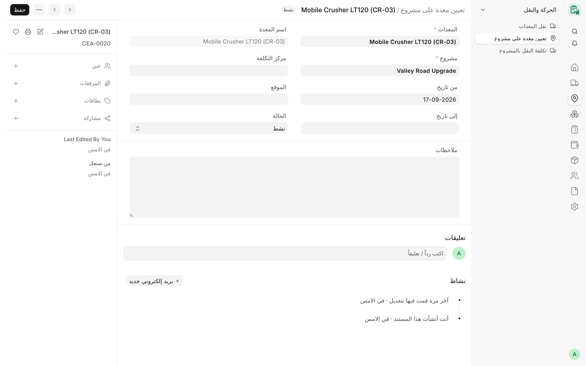
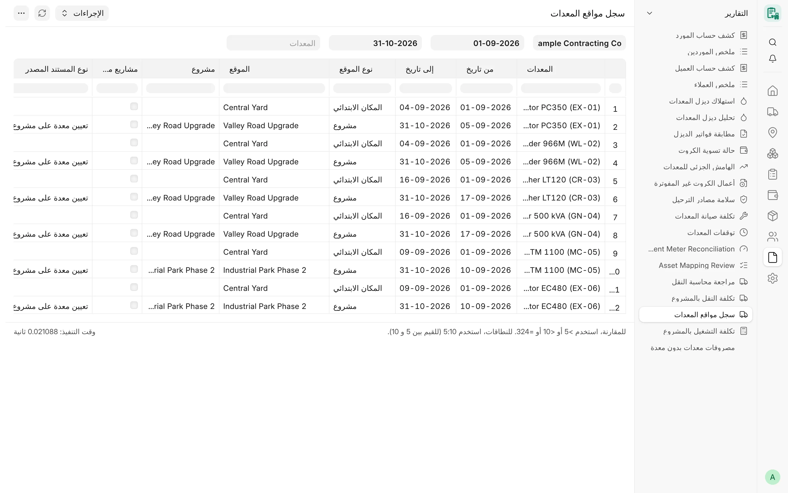

## نظرة عامة

يسجّل **تعيين معدة على مشروع** (Card Equipment Assignment) وجود المعدة على مشروع خلال فترة معينة. والتعيينات هي العمود
الفقري لمنطق المواقع في CARD: فهي تحدد المشروع الذي ينتمي إليه الكارت الشهري، والأيام الصالحة في الكارت، ومركز التكلفة
الذي يأخذه سطر الترحيل، والمكان الذي تظهر فيه المعدة اليوم.

تُكتب التعيينات عادةً بواسطة [نقل المعدات](/card/ar/features/transport/) المعتمد: فنقل المعدة إلى مشروع يُغلق تعيينها
السابق ويفتح تعيينًا جديدًا. ويمكن لمدير CARD أيضًا إنشاء تعيين أو تصحيحه يدويًا. وعندما لا تكون المعدة على مشروع، يُقرأ
مكانها من آخر نقل معتمد لها (ورشة أو مستودع أو مورد)، أو من المكان الابتدائي للشركة.

<!-- screenshot: assignments-locations-assignment-form -->

*تعيين معدة لمشروع*

## الحقول الأساسية

| الحقل | الوصف |
|---|---|
| **المعدات** | سجل المعدة (إلزامي)، ويُجلب منه **اسم المعدة**. |
| **المشروع** | مشروع ERPNext (إلزامي)، ويجب أن يتبع شركة المعدة. |
| **من تاريخ** / **إلى تاريخ** | الفترة. وخلوّ «إلى تاريخ» يعني أن التعيين مفتوح (ما زال ساريًا). |
| **مركز التكلفة** | مركز تكلفة اختياري لهذه الفترة، تستخدمه سطور الترحيل في الفترة، وإلا استُخدم مركز تكلفة المشروع. |
| **الموقع** | نص حر لمكان المعدة داخل الموقع. |
| **الحالة** | «نشط» أو «منتهي»، للعلم فقط. |
| **ملاحظات** | نص حر. |

تُرقَّم التعيينات `CEA-0001` وهكذا، ويُحتفظ بسجل تغييراتها.

## المزايا

### الفتح والإغلاق عبر النقل

عند اعتماد عملية نقل المعدات، تُنقل كل معدة فيها على النحو التالي:

| الحالة | ما يحدث |
|---|---|
| أول نقل إلى مشروع (لا يوجد تعيين مفتوح) | يُفتح تعيين جديد في تاريخ النقل. |
| من مشروع إلى مشروع آخر | يُغلق التعيين المفتوح ويُفتح تعيين جديد وفق قاعدة يوم النقل. |
| المعدة على المشروع نفسه مسبقًا | لا يتغير شيء (ويرفض نموذج النقل نقل المعدة إلى المشروع الذي هي عليه). |
| من مشروع إلى ورشة أو مستودع أو مورد | يُغلق التعيين المفتوح في تاريخ النقل، ولا يُفتح تعيين جديد. |

يسجّل كل صف في النقل **التعيين السابق** الذي أغلقه و**التعيين المُنشأ** الذي فتحه، وإلغاء النقل يتراجع عن هذين
التغييرين بالضبط. انظر [النقل](/card/ar/features/transport/).

### فحص التداخل

لا يمكن أن تكون المعدة الواحدة على مشروعين في آن واحد. ويُرفض التعيين الجديد أو الممدَّد إذا تداخلت فترته مع تعيين
آخر للمعدة نفسها (ويُعدّ التعيين المفتوح ممتدًا بلا نهاية):

> Equipment EQ-0001 is already assigned to project PROJ-0001 from … to (open).

- يجري الفحص للتعيين الجديد، أو عند تغيير المعدة، أو عندما تغطي الفترة أيامًا أكثر (بداية أبكر أو نهاية أبعد أو إعادة
  فتح النهاية). أما تقصير الفترة — وهو ما يفعله النقل عند إغلاق تعيين — فلا يُعاد فحصه.
- الطلبان اللذان يكتبان تعيينات للمعدة نفسها في الوقت نفسه (تعيينان جديدان، أو تعيين جديد أثناء إعادة فتح التعيين
  السابق بإلغاء نقل) يُعالَجان واحدًا بعد الآخر، فلا يمكن أن يتركا فترتين متداخلتين أبدًا.

### حماية أيام الكروت المعتمدة

يُرفض أي تغيير يترك يومًا مفوترًا في كارت شهري **معتمد** خارج كل تعيينات مشروعه — سواء بتقصير التعيين أو نقله أو
حذفه — وذلك للمعدة نفسها ولكل مكوّن في كارت الوحدة. واليوم المفوتر هو يوم فيه ساعات عمل، أو ساعات توقف بسبب توقف
قابل للفوترة. وفي حالة النقل بتاريخ سابق، استخدم تاريخًا لاحقًا.

### وقوع أيام الكارت داخل تعيين

يجب أن تقع أيام العمل في الكارت الشهري داخل تعيين على مشروع الكارت. وفي الوحدة، يجب أن يكون كل مكوّن داخل الوحدة في
ذلك اليوم معيّنًا على المشروع أيضًا. أما المعدة التي ليس لها أي سجل تعيينات فلا تخضع لهذا القيد (فتبقى البيانات
القديمة صالحة). انظر [الوحدات والمكوّنات](/card/ar/features/units-components/).

### قاعدة الشركة

يجب أن تتبع المعدة والمشروع الشركة نفسها. والمستخدمون المقيَّدون بصلاحيات المستخدم على الشركة لا يرون ولا يفتحون ولا
يغيّرون إلا تعيينات معدات شركاتهم، في القوائم والتقارير والبحث في الروابط وكل مسارات الحفظ، ولا يمكن نقل تعيين
محفوظ إلى معدة شركة أخرى.

### ضابط حالة المعدة

يُحذَّر من التعيين الجديد لمعدة حالتها «منتهية» أو يُرفض وفق **قاعدة حالة المعدة** في الشركة (انظر
[المعدات](/card/ar/features/equipment/)). أما التعيين الذي يفتحه النقل فلا يُفحص مرتين، لأن النقل قد فحص المعدة.

### المشروع الحالي وتاريخ التعيين

يتبع **المشروع الحالي** و**تاريخ التعيين** في المعدة التعيينَ الساري **اليوم**:

- تعيين واحد سارٍ: مشروعه وتاريخ بدايته.
- لا تعيين سارٍ: يُفرَّغ الحقلان، ولا يحرّكهما أي تعيين مستقبلي.
- تعيينان أو أكثر ساريان (تداخل من بيانات قديمة): يبقى الحقلان فارغين ولا يُخمَّن شيء، ويسرد تعليق معلوماتي على المعدة
  التعيينات المتداخلة (مرة واحدة لكل مجموعة مختلفة)، وتظهر الرسالة أيضًا للمستخدم القائم بالعملية.

ويُحدَّثان بعد كل تغيير في التعيينات وبعد كل نقل. ولأن النقل من مشروع إلى مشروع قد يفتح التعيين الجديد في اليوم
التالي، توفر إعدادات CARD خيار **المزامنة اليومية لموقع المعدات** (معطّل افتراضيًا): مهمة يومية تعيد مزامنة كل معدة
لها تعيينات، وتترك القيمة المستبدلة تعليقًا. وتحتفظ المعدة التي لا تعيينات لها بقيمها.

### قاعدة يوم النقل

عند النقل من مشروع إلى مشروع، يُحدَّد لكل شركة في إعدادات CARD أي المشروعين يأخذ يوم النقل (**قاعدة يوم النقل**):

| القاعدة | ينتهي التعيين القديم | يبدأ التعيين الجديد |
|---|---|---|
| التخصيص الجديد يبدأ في اليوم التالي للنقل (الافتراضي، وكذلك عند تركها فارغة) | في يوم النقل | في اليوم التالي |
| التخصيص الجديد يبدأ في يوم النقل | في اليوم السابق | في يوم النقل |

تُسجَّل القاعدة السارية في كل نقل إلى مشروع عند حفظه واعتماده، فلا يغيّر أي تعديل لاحق للإعداد طريقةَ تطبيق نقل قائم
أو إلغائه. وفي ظل قاعدة «يبدأ في يوم النقل»، لا يمكن للمعدة التي وصلت إلى مشروع في تاريخ ما أن تغادر إلى مشروع آخر في
التاريخ نفسه؛ استخدم تاريخًا لاحقًا.

### المكان الابتدائي للمعدة الجديدة

يمكن لكل شركة أن تحدد **المكان الابتدائي للمعدة الجديدة** (موقع Location في ERPNext) في إعدادات CARD. فالمعدة التي ليس
لها تعيين ولا نقل معتمد تُعدّ في المستودع في ذلك المكان، ويظهر بوصفه **من** في أول نقل لها، ويُسجَّل أول نقل لها إلى
مشروع بوصفه **أول دخول**. وإذا كان الإعداد فارغًا، فالمعدة في المستودع دون مكان محدد.

### المكان الحالي للمعدة

يُشتق مكان المعدة الحالي دائمًا ولا يُكتب يدويًا:

1. على مشروع تعيينها المفتوح؛ وإلا
2. حيث أرسلها آخر نقل معتمد لها (ورشة أو مستودع أو مورد، مع المكان)؛ وإلا
3. في المستودع في المكان الابتدائي للشركة.

### مراكز تكلفة الأماكن

لا ترتبط المواقع (Locations) في ERPNext بشركة، لذا تحتوي إعدادات CARD على جدول **مركز التكلفة لكل ورشة / مستودع**
(مركز تكلفة المكان) بصف واحد لكل **شركة** و**مكان** و**مركز تكلفة**. ويُحمَّل النقل الذي تدفعه الشركة إلى ورشة أو
مستودع على مركز تكلفة ذلك المكان لشركة النقل، ويُرفض هذا النقل حتى يوجد الصف. انظر [النقل](/card/ar/features/transport/).

### الموقع داخل الموقع

لكلٍّ من المعدة والتعيين حقل نصي حر هو **الموقع** لتحديد المكان الدقيق داخل الموقع (مثل ساحة أو منطقة عمل). وهو للعلم
فقط ولا يؤثر في أي قاعدة.

### سجل مواقع المعدات

يعرض تقرير **سجل مواقع المعدات** (للقراءة فقط)، لشركة واحدة وفترة زمنية ومعدة اختيارية، أين كانت كل معدة على شكل
مقاطع زمنية:

| العمود | المحتوى |
|---|---|
| المعدات | المعدة |
| من تاريخ / إلى تاريخ | المقطع، مقصوصًا على الفترة المطلوبة |
| نوع الموقع | مشروع أو ورشة أو مستودع أو مورد أو المكان الابتدائي |
| الموقع | عنوان المشروع أو المكان أو المورد |
| المشروع | لمقاطع المشاريع |
| مشاريع متداخلة | مفعّل عندما يكون مشروعان ساريين في اليوم نفسه (مقطع لكل منهما) |
| نوع المستند المصدر / المستند المصدر | النقل الذي فتح التعيين، وإلا التعيين نفسه؛ والنقل لمكان الورشة أو المستودع أو المورد؛ وفارغ للمكان الابتدائي |

يستخدم التقرير القواعد نفسها المطبقة في بقية CARD (ومنها قاعدة يوم النقل المسجلة في كل نقل). فالنقل إلى ورشة أو
مستودع أو مورد في اليوم T يُظهر المشروع في اليوم T والمكان الجديد اعتبارًا من T+1. وتحتسب الوحدة تاريخ المكوّن في الأيام
التي يكون فيها داخل الوحدة فقط. ويُحدَّد كل يوم من السجل الكامل، فلا تتوقف الصفوف أبدًا على الفترة المطلوبة.

<!-- screenshot: assignments-locations-location-history -->

*تقرير سجل مواقع المعدات*

## سير العمل

1. اضبط **المكان الابتدائي** و**قاعدة يوم النقل** للشركة وصفوف **مركز التكلفة لكل ورشة / مستودع** في إعدادات CARD.
2. انقل المعدة عبر [نقل المعدات](/card/ar/features/transport/) واعتمده، فيُفتح التعيين.
3. راجع التعيين في **تعيين معدة على مشروع**، وأضف مركز تكلفة للفترة إذا كان يختلف عن مركز تكلفة المشروع.
4. سجّل [الكارت الشهري](/card/ar/features/monthly-cards/)؛ ويُؤخذ مشروعه من تعيينات الشهر.
5. راجع التنقلات السابقة في تقرير **سجل مواقع المعدات**.

## الصلاحيات

| الدور | تعيين معدة على مشروع | سجل مواقع المعدات |
|---|---|---|
| مدير النظام | قراءة، كتابة، إنشاء، حذف | نعم |
| مدير CARD | قراءة، كتابة، إنشاء | نعم |
| مستخدم CARD | قراءة | نعم |
| مدير الحسابات | قراءة | نعم |

## ذات صلة

- [النقل](/card/ar/features/transport/)
- [المعدات](/card/ar/features/equipment/)
- [الوحدات والمكوّنات](/card/ar/features/units-components/)
- [الكروت الشهرية](/card/ar/features/monthly-cards/)
- [التقارير: العمليات](/card/ar/reports/operations/)
