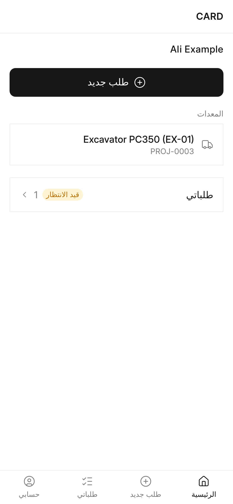
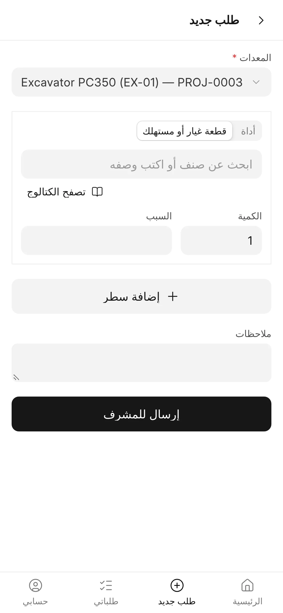

## نظرة عامة

**CARD Mobile** هو واجهة CARD على الهاتف، وهو تطبيق ويب تقدّمي (PWA) يقدّمه تطبيق CARD نفسه على المسار `/cdms`، ومبني
بالطريقة نفسها التي بُني بها تطبيق Frappe HR للهاتف. وتبقى واجهة CARD Desk نظام الإدارة الكامل، بينما يغطي CARD Mobile
الإجراءات التي يحتاجها العاملون في الموقع، بالحسابات نفسها والبيانات نفسها وفحوص الخادم نفسها.

يغطي الإصدار الحالي جانب المشغّل من [احتياجات المعدات](/card/ar/features/equipment-needs/): يرى المشغّل معداته، ويطلب
قطع الغيار والمستهلكات والأدوات، ويتابع طلباته. ويستطيع مستخدمو Card User أيضًا فتح كتالوج قطع غيار للقراءة فقط. أما
إدخال الساعات والاعتمادات والعهد والإشعارات على الهاتف فمخطَّط لها (راجع [الشاشات المخطَّط لها](#الشاشات-المخطط-لها)).

:::caution[دعم الأجهزة]
لم يُختبر التثبيت على هواتف iPhone وAndroid فعلية بعد، ولن يُعلَن دعم الأجهزة إلا بعد هذه الاختبارات على موقع يعمل
بـ HTTPS.
:::

<!-- screenshot: card-mobile-home -->

*الشاشة الرئيسية في CARD Mobile*

## المفاهيم الأساسية

| المفهوم | المعنى |
|---|---|
| **للهاتف فقط** | واجهة واحدة مصمَّمة للهواتف. وعلى الحاسوب تُعرض الواجهة نفسها في عمود متوسّط بعرض يصل إلى 480 بكسل، ولا يوجد تخطيط مستقل لسطح المكتب. |
| **الحساب نفسه** | يسجّل المستخدمون الدخول داخل التطبيق بمستخدم ERPNext الخاص بهم، والجلسات وحماية CSRF والصلاحيات هي نفسها التي يوفّرها Frappe. |
| **دور البوابة** | Card Operator أو Card Supervisor أو Card Manager أو System Manager، ويلزم لفتح شاشات الطلبات. |
| **موظف نشط** | موظف في ERPNext حالته «نشط» ومعرّف المستخدم (User ID) فيه هو المستخدم نفسه، ويلزم لشاشات الطلبات. |
| **مستعرض الكتالوج** | مستخدم Card User ليس له دور بوابة، ولا يفتح إلا الكتالوج وصفحة حسابه. |
| **لا منطق مكرَّر** | يستدعي CARD Mobile دوال الخادم الموجودة في CARD، ويُعاد فحص كل استدعاء على الخادم. |

## المزايا

### الوصول

- يرى الزائر غير المسجّل شاشة تسجيل الدخول داخل التطبيق.
- يفتح المستخدم المسجّل الذي لديه دور بوابة وموظف نشط التطبيق كاملًا.
- يرى المستخدم المسجّل الذي لديه دور بوابة دون موظف نشط شاشة «غير مهيأ»: «حسابك غير مهيأ لطلب احتياجات المعدات.
  راجع المشرف.»
- مستخدم Card User الذي ليس له دور بوابة مستعرضٌ للكتالوج: لا يتاح له إلا **الكتالوج** و**حسابي**.
- عند تعذّر الوصول إلى الخادم يوضّح التطبيق ذلك ويعرض زر **حاول مرة أخرى**.
- الجلسة المنتهية تعيد المستخدم إلى شاشة تسجيل الدخول.

### شريط التنقل السفلي

| المستخدم | التبويبات |
|---|---|
| المشغّل والمشرف والمدير | الرئيسية، طلب جديد، طلباتي، حسابي |
| مستعرض الكتالوج | الكتالوج، حسابي |

### الرئيسية

- اسم الموظف.
- زر **طلب جديد** (يظهر عندما يكون للمستخدم معدة واحدة على الأقل).
- **المعدات** — المعدات التي يعمل عليها المشغّل: التي هو مشغّلها (ما لم تكن حالة المعدة «منتهية»)، والتي يكون هو
  المشغّل في كارتها الشهري (مسودة أو معتمد) للشهر الحالي. وتعرض كل معدة مشروعها الحالي. وإن لم توجد معدات تظهر
  العبارة: «لا توجد معدة مسجلة عليك هذا الشهر.»
- **طلباتي** — عدد الطلبات، مع شارة «قيد الانتظار» ما دام بعضها لم يُعتمد أو يُرفض بعد.
- **مراجعة احتياجات المعدات** — للمشرفين والمديرين، رابط إلى المراجعة في CARD Desk.

### طلب جديد

1. اختر **المعدة** (تكون مختارة مسبقًا إذا كان للمشغّل معدة واحدة).
2. لكل سطر اختر النوع — **قطعة غيار أو مستهلك** أو **أداة** — ثم الصنف. يبحث حقل الصنف برمز الصنف أو اسمه أو
   الباركود أو رقم القطعة الأصلي (OEM)، ويفتح زر **تصفح الكتالوج** الكتالوج للمعدة المختارة.
3. أدخل **الكمية**، و**السبب** عند الحاجة.
4. أضف أسطرًا أخرى بزر **إضافة سطر**، وملاحظات اختيارية.
5. اضغط **إرسال للمشرف**.

يفحص التطبيق كل سطر قبل الإرسال: يحتاج كل سطر إلى صنف وكمية، ويجب أن يكون لسطر واحد على الأقل كمية، والصنف الذي ليس
له توافق مؤكد مع المعدة يحتاج إلى سبب («لماذا هذا الصنف بدون توافق مؤكد؟»). وبعد الإرسال يفتح التطبيق **طلباتي**
مع الرسالة: «تم إرسال طلبك للمشرف.»

<!-- screenshot: card-mobile-new-request -->

*الطلبات في CARD Mobile*

### طلباتي

آخر 20 طلبًا للمشغّل (غير الملغاة)، الأحدث أولًا. يعرض كل طلب المعدة ورقم الطلب وتاريخه، وأسطره بكمياتها، وحالة
المراجعة:

| الحالة | الشارة |
|---|---|
| قيد الانتظار | كهرماني |
| قيد المراجعة | أزرق |
| معتمد | أخضر |
| مرفوض | أحمر |

### الكتالوج

يبحث الكتالوج في كتالوج أصناف ERPNext القياسي بالاسم أو الرمز أو الباركود أو رقم OEM، مع مرشّحي **مجموعة الصنف**
(بما فيها المجموعات الفرعية) و**العلامة التجارية**، والصور، وأرقام OEM، والبدائل، وزر **تحميل المزيد** للنتائج
الطويلة. وعند اختيار معدة، يعرض كل صنف توافقه معها:

| التوافق | المعنى |
|---|---|
| مؤكد لهذه المعدة | سجل توافق يؤكد القطعة لهذه المعدة |
| مؤكد للموديل *X* | سجل توافق يؤكدها لموديل المعدة |
| غير متوافق مع هذه المعدة | تحذير: القطعة مسجّلة على أنها لا تركب |
| التوافق قيد المراجعة الفنية | يوجد سجل توافق لم يُراجَع بعد |
| لا يوجد سجل توافق | لا شيء مسجّل |

ويقصر المفتاح **يركب على هذه المعدة** القائمة على القطع المؤكدة، ولا يُعدّ توافقًا إلا التوافق المؤكد. راجع
[الصيانة وقطع الغيار](/card/ar/features/maintenance-parts/) لمعرفة سجلات التوافق.

### حسابي

**الموظف** و**الشركة** و**المستخدم** الخاصة بالمستخدم، وتلميح التثبيت (انظر أدناه)، وزر **تسجيل الخروج**.

### اللغات والاتجاه

تأتي الترجمات من نظام الترجمة في Frappe ضمن بيانات تحميل الصفحة. تُعرض العربية والأردية من اليمين إلى اليسار،
والإنجليزية والبنغالية والهندية من اليسار إلى اليمين. وتستخدم الكلمات العامة (الرئيسية، الكمية، تسجيل الخروج…)
سياق الترجمة *Card Mobile*، فلا يغيّر CARD أبدًا ترجمات Frappe أو ERPNext الخاصة. واسم التطبيق CARD في كل اللغات.
راجع [اللغات](/card/ar/features/languages/).

### التثبيت على الهاتف

- **Android (Chrome)** — عندما يعرض المتصفح التثبيت، تُظهر شاشة **حسابي** زر **ثبّت التطبيق**.
- **iPhone (Safari)** — تُظهر شاشة **حسابي** التلميح: «على iPhone: اضغط «مشاركة» ثم «إضافة إلى الشاشة الرئيسية».»
- بعد التثبيت يُفتح التطبيق مستقلًا باسم **CARD Mobile** (والاسم المختصر **CARD**) وبأيقونة CARD، ويُخفى التلميح
  عندما يعمل التطبيق مثبّتًا.

يتضمن التطبيق ملف بيان تطبيق الويب (manifest) وأيقونات التطبيق وإعدادات الشاشة الرئيسية في iPhone. ويُقدَّم عامل
الخدمة (service worker) على المسار `/cdms/sw.js`، فيتحكم في `/cdms` ولا شيء أوسع منه، ويعيد المتصفح فحصه مع كل
تحميل، فيُلتقَط أي بناء جديد.

### قواعد التخطيط

- مناطق آمنة للنتوء (notch) والجزيرة الديناميكية ومؤشر الشاشة الرئيسية.
- أهداف لمس لا تقل عن 48 بكسل، وإجراء رئيسي واحد في كل شاشة.
- التكبير مسموح.

### الشاشات المخطط لها

مخطَّط لها وغير منفَّذة:

| الشاشة | لمن |
|---|---|
| ساعات التشغيل اليومية: الإدخال والمراجعة والاعتماد مع فصل المهام | المشغّلون والمشرفون والمديرون |
| مراجعة المشرف، والطلب نيابةً عن مشغّل، والعهد | المشرفون |
| اعتمادات المدير | المديرون |
| أدواتي في العهدة | المشغّلون |
| عرض المعدات والمشروعات والتعيين والنقل | حسب الدور |
| الكروت الشهرية والديزل | حسب الدور |
| الموردون والتكاليف والتقارير والإشعارات | حسب الدور |

:::note[صفحة المشغّل على الويب]
قبل CARD Mobile كان المشغّلون يستخدمون الصفحة المولَّدة على الخادم `/equipment-needs` («احتياجات معداتي»)، وهي ما
زالت متاحة وتستخدم منطق الطلبات نفسه.
:::

## الصلاحيات

| الدور | الوصول إلى CARD Mobile |
|---|---|
| Card Operator | التطبيق كاملًا مع موظف نشط: معداته، والطلبات الجديدة، وطلباته |
| Card Supervisor وCard Manager وSystem Manager | التطبيق كاملًا مع موظف نشط، إضافة إلى رابط المراجعة في Desk |
| Card User (دون دور بوابة) | الكتالوج وحسابي فقط، ولا يلزمه موظف |
| المستخدمون الآخرون | لا وصول |

يُعاد فحص كل طلب على الخادم: لا يرى المشغّل إلا طلباته، ولا يختار إلا الأصناف المسموح له بها.

## صفحات ذات صلة

- [احتياجات المعدات](/card/ar/features/equipment-needs/)
- [عهدة الأدوات](/card/ar/features/tool-custody/)
- [الأدوار والصلاحيات](/card/ar/features/roles-permissions/)
- [التثبيت — بناء CARD Mobile](/card/ar/getting-started/installation/#بناء-card-mobile)
