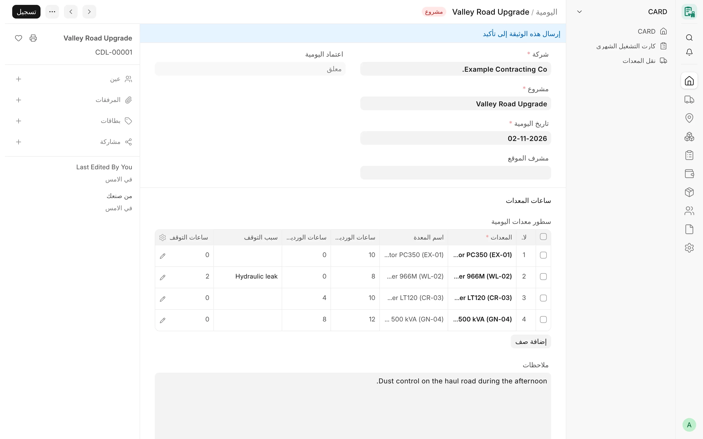
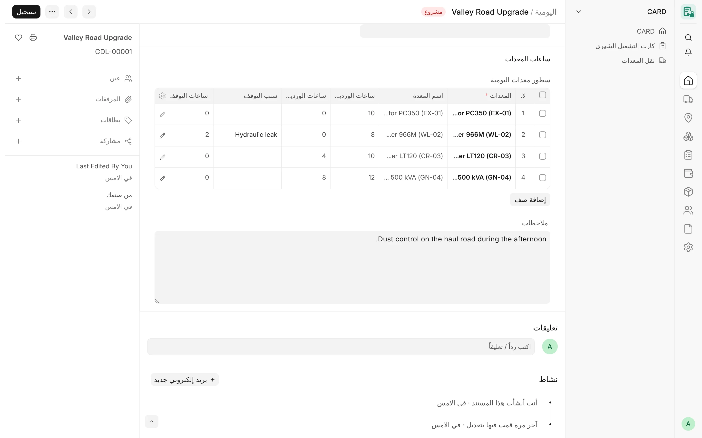

## نظرة عامة

تسجّل **اليومية** (Card Daily Log)، لشركة واحدة ومشروع واحد وتاريخ واحد، الساعات التي عملتها كل معدة في الوردية
النهارية والوردية الليلية، والساعات التي توقفت فيها وسبب ذلك. يُدخل المشغّل أو مشرف الموقع اليومية ثم يقدّمها،
وبعد ذلك يعتمدها مدير الكروت (Card Manager) أو يعيدها للتصحيح مع ذكر السبب. ويمكن تفعيل خطوة اختيارية لتحقق المشرف
لكل شركة على حدة.

الغرض من اليوميات أن تُسجَّل الساعات قريبًا من موقع العمل، وأن يراجعها شخص غير الذي أدخلها، ثم تُحتسب بعد ذلك.
وتغذّي اليومياتُ المعتمدةُ [الكروت الشهرية](/card/ar/features/monthly-cards/): إذ يُنشئ إجراء واحد كروت الوردية
النهارية والليلية لمشروع وشهر معيّنين، أو يحدّثها وهي في حالة المسودة، من جميع اليوميات المعتمدة، دون أن يقدّم أي
كارت أو يمسّ كارتًا مقدَّمًا.

:::note
اليوميات جزء من خط التطوير الحالي لنظام CARD (بعد الإصدار v4.7.0). يُفتح نوع المستند من المسار `/app/card-daily-log`،
ولا يوجد له حتى الآن رابط في الشريط الجانبي لواجهة Desk ولا شاشة في تطبيق CARD Mobile. وإدخال الساعات من الجوال مُخطَّط له.
:::

<!-- screenshot: daily-logs-form -->

*يومية تشغيل بصفوفها*

## المفاهيم الأساسية

| المفهوم | المعنى |
|---|---|
| اليومية | سجل واحد قابل للتقديم لكل شركة ومشروع وتاريخ (`CDL-#####`)، ويضم سطرًا لكل معدة. |
| السطر | معدة واحدة في ذلك التاريخ: ساعات الوردية النهارية، وساعات الوردية الليلية، وسبب التوقف، وساعات التوقف، والجهة المسؤولة، والملاحظات. |
| المُعِدّ | كل مستخدم أنشأ اليومية أو حفظها أو قدّمها أو تحقق منها، أو فعل ذلك في أي يومية سابقة ضمن سلسلة تعديلاتها. |
| حالة الاعتماد | قيد الانتظار ← (تحقق منها المشرف) ← معتمد، أو مرجعة للتصحيح. ولا يكتبها إلا الخادم. |
| إعدادات اليومية | سجل واحد لكل شركة يحدد قاعدة الاعتماد من المُعِدّ وما إذا كان تحقق المشرف مطلوبًا. |
| الإنشاء | إجراء **إنشاء الكروت الشهرية** الذي يبني كروتًا شهرية بحالة المسودة من اليوميات المعتمدة. |

## المزايا

### رأس اليومية

يحدد الرأس اليومية ويعرض مسار اعتمادها.

- **الشركة** – إلزامية، وتُملأ من المشروع.
- **المشروع** – إلزامي، ويجب أن يتبع شركة اليومية.
- **تاريخ اليومية** – إلزامي، وقيمته الافتراضية تاريخ اليوم.
- **مشرف الموقع** – رابط اختياري إلى مستخدم.
- **اعتماد اليومية** – حالة الاعتماد (للقراءة فقط).
- **قدّم اليومية**، و**تحقق من اليومية** وتاريخه، و**اعتمد اليومية** وتاريخه – يكتبها الخادم.
- **اعتمدها معدّها** – يُحدَّد عندما يعتمد أحد المُعِدّين اليومية وفق قاعدة «تحذير فقط».
- **سبب إرجاع اليومية** ومن أرجعها ومتى – تظهر عند إرجاع اليومية للتصحيح.
- **ملاحظات** – نص حر.

### سطور المعدات

يضم قسم **ساعات المعدات** السطور، ويلزم سطر واحد على الأقل.

| الحقل | القواعد |
|---|---|
| المعدات | إلزامي. يجب أن تتبع المعدة شركة اليومية، ولا تتكرر في اليومية نفسها. |
| اسم المعدة | يُملأ من المعدة. |
| ساعات الوردية النهارية | ساعات العمل في الوردية النهارية. |
| ساعات الوردية الليلية | ساعات العمل في الوردية الليلية. |
| سبب التوقف | اختياري، ويجب أن يكون **سبب توقف معدة** مفعّلًا تابعًا لشركة اليومية. |
| ساعات التوقف | الساعات التي توقفت فيها المعدة. |
| الجهة المسؤولة | الشركة أو المورد أو العميل أو جهة أخرى. وإذا تُرك فارغًا أُخذت الجهة المسؤولة الافتراضية لسبب التوقف. |
| سجل الجهة المسؤولة | سجل الشركة أو المورد أو العميل (والجهة من نوع الشركة هي دائمًا شركة اليومية). |
| اسم الجهة المسؤولة | اسم نصي حر، لا يُستخدم إلا عندما تكون الجهة «أخرى». |
| ملاحظات | نص حر. |

تتبع السطور القواعد نفسها المطبّقة على سطور الأيام في الكارت الشهري:

- لا يجوز أن تكون الساعات سالبة، ولا أن يتجاوز مجموع ساعات النهار والليل والتوقف 24 ساعة؛
- لا يجوز تسجيل ساعات لتاريخ مستقبلي؛
- يجب أن يقع السطر الذي فيه ساعات ضمن فترة تخصيص للمعدة على مشروع اليومية (ولكل مكوّن في حالة الوحدة)، ولا تُفحص
  المعدة التي ليس لها أي سجل تخصيص؛
- تُطبَّق قاعدة حالة المعدة الخاصة بالشركة على المعدة المضافة حديثًا إلى اليومية (وقد تُرفض المعدة المنتهية)؛
- حدود الورديات في الإعدادات (**أقصى ساعات الوردية النهارية** و**أقصى ساعات الوردية الليلية**، وقيمتهما الافتراضية
  12) للتحذير فقط: فكل ساعة مسجلة تُحتسب، وتُدرج السطور التي تتجاوز الحد للمراجعة.

### يومية واحدة لكل معدة ومشروع وتاريخ

لا يجوز أن تظهر المعدة إلا في يومية واحدة سارية (غير ملغاة) للمشروع والتاريخ نفسيهما. ويقفل الفحص سجلات المعدات
أولًا، فلا يمكن أن تمرّ يوميتان محفوظتان في اللحظة نفسها للمعدة نفسها.

### مسار الاعتماد

بعد التقديم يكون التغيير الوحيد المسموح به على اليومية هو اعتمادها، ويقرر الخادم كل انتقال بناءً على القيم المخزنة
في قاعدة البيانات، أيًّا كان المسار المستخدم (زر النموذج، أو REST، أو `frappe.client.set_value`، أو التحديث الجماعي).

| من | إلى | من يقوم به | القاعدة |
|---|---|---|---|
| قيد الانتظار | تحقق منها المشرف | مشرف كروت (Card Supervisor) ليس من المُعِدّين | فقط عندما تشترط الشركة تحقق المشرف. |
| قيد الانتظار (أو تحقق منها المشرف) | معتمد | مدير الكروت أو مدير النظام (System Manager) | عند تفعيل تحقق المشرف يجب التحقق من اليومية أولًا. |
| قيد الانتظار (أو تحقق منها المشرف) | مرجعة للتصحيح | مدير الكروت أو مدير النظام | يلزم ذكر سبب الإرجاع. وعند تفعيل تحقق المشرف يجوز لمشرف الكروت أيضًا إرجاع يومية قيد الانتظار. |
| معتمد أو مرجعة للتصحيح | أي حالة | – | حالة نهائية. لتغييرها تُلغى اليومية ثم تُعدَّل. |
| أي حالة | قيد الانتظار | – | غير مسموح أبدًا؛ تُلغى اليومية وتُعدَّل بدلًا من ذلك. |

يعرض النموذج أزرار **التحقق من اليومية** و**اعتماد اليومية** و**إرجاع اليومية** للمستخدمين المخوّلين باستخدامها.
ويكتب الخادم جميع حقول الاعتماد (من، ومتى، والسبب، وعلامة الاعتماد من المُعِدّ)، ويتجاهل أي قيم يرسلها العميل.

### منع الاعتماد الذاتي

المُعِدّ هو كل من أنشأ اليومية أو عدّلها وهي مسودة أو قدّمها أو تحقق منها، أو فعل ذلك في أي يومية تعدّلها هذه
اليومية. وعندما يعتمد أحد المُعِدّين اليومية، تحسم **قاعدة اعتماد اليومية من معدّها** الخاصة بالشركة الأمر:

- **تحذير فقط (اليومية)** – القيمة الافتراضية، وتسري أيضًا إذا لم يكن للشركة سجل إعدادات: تُعتمد اليومية ويظهر
  تحذير، ويُحدَّد حقل **اعتمدها معدّها** لتمكين مراجعتها لاحقًا.
- **رفض (اليومية)** – يُرفض الاعتماد، ويجب أن يعتمدها شخص آخر.

لا يُستثنى أي دور، ولا حتى مدير النظام أو المسؤول (Administrator). ويُعدّ من تحقق من اليومية مُعِدًّا لأغراض الاعتماد.

### الإلغاء والتعديل

يمكن إلغاء اليومية وتعديلها كأي مستند قابل للتقديم. ولا يُلغي اليومية المعتمدة إلا مدير الكروت أو مدير النظام، لأن
كروتًا شهرية ربما أُنشئت منها. ويجب أن يبقى التعديل في الشركة نفسها، ويحتفظ بجميع المُعِدّين السابقين.

### إعدادات اليومية

سجل واحد لكل شركة (يحمل اسم الشركة). والشركة التي ليس لها سجل تستخدم القيم الافتراضية.

| الحقل | الخيارات | القيمة الافتراضية |
|---|---|---|
| الشركة | – | إلزامي |
| قاعدة اعتماد اليومية من معدّها | تحذير فقط (اليومية) / رفض (اليومية) | تحذير فقط (اليومية) |
| تحقق المشرف من اليومية مطلوب | مفعّل / غير مفعّل | غير مفعّل (مسار من خطوتين: التقديم ← الاعتماد) |

لا ينشئ هذه السجلات أو يغيّرها إلا مدير النظام، ويستطيع مدير الكروت قراءتها. ولا يرى المستخدم المقيَّد بشركات معينة
إلا إعدادات تلك الشركات، ولا يمكن مشاركة هذه السجلات مع مستخدمين من خارج شركتها.

### إنشاء كروت شهرية بحالة المسودة

في اليومية المعتمدة والمقدَّمة، يظهر زر **إنشاء الكروت الشهرية** للمستخدمين المخوّلين بإنشاء الكروت الشهرية. يطلب
الزر التأكيد، ثم ينشئ الكروت الشهرية بحالة المسودة لمشروع اليومية عن شهر تاريخ اليومية، أو يحدّثها، اعتمادًا على
**جميع** اليوميات المعتمدة لتلك الشركة والمشروع والشهر.

آلية الإنشاء:

1. لا يقرأ إلا اليوميات المقدَّمة التي حالتها **معتمد**.
2. يبني كارتًا واحدًا لكل معدة ومشروع وشهر ووردية، وهو المفتاح نفسه الذي يستخدمه الكارت الشهري لمنع التكرار.
   تذهب ساعات الوردية النهارية وبيانات التوقف (سبب التوقف وساعات التوقف والجهة المسؤولة) إلى كارت الوردية
   **النهارية**، وتذهب ساعات الوردية الليلية إلى كارت الوردية **الليلية**. ولا يُنشأ كارت لوردية إلا إذا كان في أحد
   سطور اليوميات ساعات لها.
3. يحصل كل يوم مأخوذ من يومية على حالة اليوم «عمل»، واسم اليوم، واسم اليومية في ملاحظات اليوم.
4. **اليومية المعتمدة هي المرجع:** يُضبط اليوم المشمول بيومية معتمدة في كارت المسودة وفق اليومية في كل تشغيل. وإذا
   كان اليوم يحمل قيمًا أخرى (تصحيحًا يدويًا أو يومية سابقة) فإنها تُستبدل وتُدرج مع الساعات والملاحظات القديمة
   والجديدة. وتبقى أيام الكارت الأخرى كما هي.
5. اليوم الذي تذكر ملاحظاته يومية لم تعد معتمدة (كأن تكون ملغاة) يُفرَّغ في كارت المسودة، ويُكتفى بالإبلاغ عنه في
   الكارت المقدَّم.
6. تُستبعد الأيام ويُبلَّغ عنها إذا لم تكن المعدة على المشروع في ذلك اليوم (في الساحة أو الورشة أو المخزن أو مشروع
   آخر) أو كانت مكوّنًا في وحدة في ذلك اليوم.
7. يُحفظ كل كارت عبر تحققه المعتاد وبصلاحيات المستخدم نفسه. والكارت الذي يفشل في التحقق يُتراجع عنه وحده ويُدرج في
   النتيجة، أما خطأ الصلاحيات فيوقف التشغيل كله.

قواعد ثابتة:

- لا يُغيَّر أي كارت مقدَّم أبدًا، ولا يُقدَّم أي كارت أبدًا؛
- إعادة التشغيل لا تغيّر ما هو صحيح أصلًا، واليومية التي تُعتمد لاحقًا تملأ يومها في التشغيل التالي؛
- المعدة التي انتقلت بين مشروعين خلال الشهر تحصل على كارت لكل مشروع (وكل تشغيل يعالج مشروعًا واحدًا)؛
- إذا غيّر تشغيل آخر كروت المعدة نفسها في الوقت نفسه، تُتخطّى المعدة وتُدرج كتعارض، وعندها يُعاد تشغيل الإنشاء.

تعرض نافذة النتيجة الكروت المنشأة والمحدَّثة وغير المتغيرة والكروت المقدَّمة التي لم تُغيَّر، ثم الأيام المستبدلة،
والأيام المفرَّغة، والأيام غير المحدَّثة في الكروت المقدَّمة، والتعارضات، والأيام المستبعدة، والكروت التي لم تُحفظ.

<!-- screenshot: daily-logs-generation-result -->

*صفوف اليومية*

## سير العمل

1. ينشئ المشغّل أو مشرف الموقع يومية للمشروع والتاريخ، ويضيف سطرًا لكل معدة، ثم يقدّمها.
2. إذا اشترطت الشركة ذلك، يتحقق منها مشرف كروت آخر.
3. يعتمد مدير الكروت اليومية، أو يعيدها مع ذكر السبب (وتُلغى اليومية المرجعة وتُعدَّل وتُقدَّم من جديد).
4. خلال الشهر أو في نهايته، يفتح المستخدم يومية معتمدة وينقر **إنشاء الكروت الشهرية**.
5. تُراجع الكروت الشهرية بحالة المسودة وتُستكمل (الإضافات والخصومات) وتُقدَّم وفق المسار المعتاد
   [للكارت الشهري](/card/ar/features/monthly-cards/).

## الصلاحيات

| الدور | اليومية | إعدادات اليومية |
|---|---|---|
| مشغّل الكروت (Card Operator) | إنشاء يومياته **الخاصة** وتقديمها وإلغاؤها وتعديلها | – |
| مشرف الكروت (Card Supervisor) | الإنشاء والتقديم والإلغاء والتعديل؛ والتحقق (عند اشتراطه) وإرجاع اليومية قيد الانتظار | – |
| مدير الكروت (Card Manager) | الاستخدام الكامل عدا الحذف؛ والاعتماد والإرجاع | قراءة |
| مدير النظام (System Manager) | الاستخدام الكامل بما فيه الحذف؛ والاعتماد والإرجاع | إنشاء وتغيير وحذف |
| مستخدم الكروت (Card User) | القراءة والطباعة والتقارير | – |

تسري صلاحيات المستخدم على الشركات (Company User Permissions): فلا يرى المستخدم المقيَّد ولا يغيّر إلا يوميات شركاته.
ويتطلب إنشاء الكروت صلاحية إنشاء كارت شهري لتلك الشركة والمشروع وصلاحية قراءة يومياتها.

## ذات صلة

- [الكروت الشهرية](/card/ar/features/monthly-cards/)
- [التخصيصات والمواقع](/card/ar/features/assignments-locations/)
- [المعدات](/card/ar/features/equipment/)
- [الأدوار والصلاحيات](/card/ar/features/roles-permissions/)
- [تطبيق CARD Mobile](/card/ar/features/card-mobile/)
