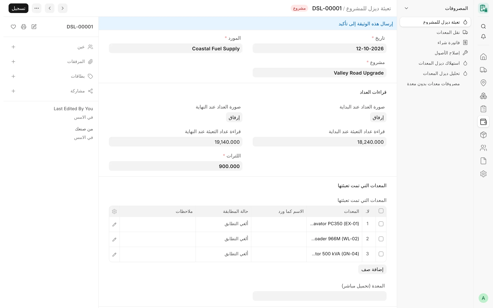

## نظرة عامة

تسجّل **تعبئة ديزل للمشروع** (Project Diesel Fill) توريدة ديزل واحدة في مشروع: جلسة مقيسة بالعداد يملأ فيها صهريج المورد
خزانَ المشروع أو معدة أو أكثر. وتأتي اللترات من قراءات عداد التعبئة، وتثبتها صور خاصة للعداد عند البداية وعند النهاية. ولا
يُكتب سعر اللتر يدويًا، بل يؤخذ من السعر المعتمد للشركة، وأي سعر آخر استثناءٌ يخضع للتدقيق.

تراجع إدارة التشغيل التعبئة قبل أن يمكن اعتمادها. وبعد اعتمادها تصبح بند ديزل في مسودة فاتورة الشراء الشهرية للمورد (انظر
[الفوترة والترحيل](/card/ar/features/invoicing-posting/))، وتغذي تقارير استهلاك الديزل وتحليله. وتُسمّى التعبئات بالصيغة
`DSL-#####`.

<!-- screenshot: diesel-form -->

*تعبئة ديزل لمشروع*

## المفاهيم الأساسية

| المفهوم | المعنى |
|---|---|
| الجلسة | توريدة واحدة: قراءة البداية (العداد مُصفَّر)، وقراءة النهاية، واللترات = النهاية − البداية. |
| التحميل المباشر | تُحمَّل التعبئة كاملة على معدة واحدة هي **المعدة (تحميل مباشر)**، وتُسجَّل اللترات لتلك المعدة. |
| خزان المشروع | لا معدة واحدة؛ فتبقى التعبئة على مستوى المشروع، ويمكن الاحتفاظ بقائمة المعدات التي عُبئت دون لترات. |
| سعر الشركة | سعر اللتر المعتمد لشركة التعبئة في تاريخ التعبئة. |
| مصدر السعر | «سعر الشركة» أو «استثناء» أو «يحتاج مراجعة». |
| مراجعة التشغيل | مسودة ← يحتاج مراجعة ← موافقة التشغيل أو مرفوض. ولا تُعتمد إلا التعبئة الموافق عليها. |
| العداد التراكمي | العداد التجميعي في جهاز القياس، ويُستخدم فحصًا استرشاديًا للجلسة. |

## المزايا

### نموذج التعبئة

للنموذج ثلاثة أقسام رئيسية:

1. **التعبئة**: **التاريخ**، و**المشروع**، و**المورد**، و**الشركة** (مخفية لمستخدم الشركة الواحدة).
2. **قراءات العداد**: **صورة العداد عند البداية** و**قراءة عداد التعبئة عند البداية**، و**صورة العداد عند النهاية** و**قراءة
   عداد التعبئة عند النهاية**، و**اللترات**.
3. **المعدات التي تمت تعبئتها**: إما **المعدة (تحميل مباشر)** وإما جدول **المعدات التي تمت تعبئتها**.

يظهر السعر في سطر واحد: **سعر الوحدة**، و**قيمة التعبئة** (اللترات × سعر الوحدة)، و**مصدر السعر** إذا لم يكن سعر الشركة.
أما **تفاصيل العداد**، و**استثناء السعر**، و**فاتورة المورد والمصدر**، و**مركز التكلفة والترحيل**، و**الملاحظات** فتظهر مطوية
أو عند الحاجة فقط. ويظهر قسم مراجعة التشغيل بعد أول حفظ.

<!-- screenshot: diesel-meter-photos -->

*قراءات العداد في تعبئة الديزل*

### صور العداد وقراءاته

- تُعرض صور العداد في بطاقات كبيرة بدل رابط الملف. والنقر على الصورة يفتحها بحجمها الكامل، وفي التعبئة القابلة للتعديل يظهر
  زرّا **تغيير** و**إزالة**.
- يجب أن تكون الصور ملفات صور **خاصة** مرفوعة على هذه التعبئة (JPEG أو PNG أو WebP، يُتحقق منها بمحتواها، وبحد أقصى 10
  ميغابايت).
- يجب أن تكون صورتا البداية والنهاية ملفين مختلفين، ولا تثبت الصورة الواحدة (الملف نفسه أو المحتوى نفسه) إلا تعبئة حية
  واحدة. والتعبئة المرفوضة تحرر صورها.
- عند إدخال قراءة النهاية تصبح **اللترات = قراءة النهاية − قراءة البداية**، ويُستبدل أي رقم لترات مكتوب يدويًا (مع تنبيه).
  وتُرفض قراءة نهاية أقل من قراءة البداية.

### فحص العداد التراكمي

يحمل قسم **تفاصيل العداد** **العداد التراكمي عند البداية** و**العداد التراكمي عند النهاية** (الأسطوانات التجميعية)، ووقتي
صورتي البداية والنهاية، وموقع التصوير. ويمكن كتابة الأسطوانة الأخيرة غير المقروءة بالرمز `?`. ويقارن CARD الجلسة بحركة العداد
التراكمي (بسماحية لتر واحد) ويضبط **فحص العداد التراكمي**:

| القيمة | المعنى |
|---|---|
| غير قابل للفحص | لا قراءة نهاية، أو أحد طرفي العداد التراكمي مفقود أو غير مقروء |
| متطابق | تقع الجلسة داخل حركة العداد التراكمي |
| غير متطابق | تقع الجلسة خارجها، فيُكتب تنبيه وتنتقل التعبئة إلى المراجعة |

والتنبيهات الأخرى، التي تُكتب في **تنبيهات الأدلة**، هي: وجود تعبئة أخرى للمشروع والتاريخ نفسيهما (وهذا مسموح، وليس تكرارًا
بذاته)، ووقت صورة النهاية قبل وقت صورة البداية، وتاريخ صورة النهاية في يوم غير يوم التعبئة.

### التحميل المباشر أو خزان المشروع

| الطريقة | كيفية إدخالها | الترحيل | التقارير |
|---|---|---|---|
| تحميل مباشر | حدد **المعدة (تحميل مباشر)** | بند واحد على تلك المعدة | لترات مسجلة لتلك المعدة |
| خزان المشروع | اتركها فارغة، ويمكن سرد **المعدات التي تمت تعبئتها** | بند واحد على مستوى المشروع، بلا معدة | تُقسم على المعدات بحسب ساعات التشغيل وتُعرض **تقديرًا** |

لا يمكن استخدام الطريقتين معًا؛ فللتعبئة إما معدة تحميل مباشر واحدة وإما القائمة. ولكل صف في القائمة **المعدة**، و**الاسم كما
ورد**، و**حالة المطابقة** («غير مطابق» أو «مطابق» أو «طرف ثالث»)، و**ملاحظات**. ويحتاج الصف المطابق إلى معدته، ويجب أن تتبع
كل معدة مدرجة شركة التعبئة. ولا تحمل القائمة لترات، ولا تُحتسب أبدًا استهلاكًا مسجلًا.

### توزيع الديزل على المعدات بحسب الساعات

لأغراض تقارير الديزل ولوحة الديزل في كارت التشغيل الشهري، تُقسم تعبئة خزان المشروع على المعدات التي عملت في المشروع والشهر
نفسيهما، بنسبة ساعات تشغيلها في الكروت المعتمدة للشركة نفسها. وتضمن قاعدة واحدة لأكبر باقٍ أن يساوي مجموع الحصص التعبئة
تمامًا. ويُبقي كل رقم الجزء المسجل (التعبئات المباشرة) منفصلًا عن الجزء التقديري (تعبئات الخزان المقسومة بالساعات). وهذا
التقسيم للعرض فقط: لا يغيّر مبلغ أي كارت، ولا يُستخدم في أي ترحيل.

### سعر الديزل

سعر اللتر مقفل على سعر الشركة:

- تأخذ التعبئة الجديدة سعر الشركة في تاريخها، ويُرفض السعر المكتوب المختلف عنه؛ استخدم استثناء السعر بدلًا من ذلك.
- إذا لم يكن للشركة سعر معتمد (صفر أو غير موجود) تُرفض التعبئة الجديدة.
- تحتفظ المسودة المحفوظة بالسعر الذي أُنشئت به إذا تغير سعر الشركة لاحقًا (ويذكر ذلك تنبيه برتقالي). وإذا تغيرت شركتها أو
  تاريخها فإن اختلاف السعر ينقلها إلى **يحتاج مراجعة**.
- لا يمكن اعتماد تعبئة حالتها **يحتاج مراجعة** حتى يُتخذ قرار: **استخدم سعر الشركة** أو استثناء معتمد.

يأتي سعر الشركة من الإعدادات، تبويب **إعدادات الديزل**:

- **جدول أسعار الديزل**: صفوف مؤرخة تضم **الشركة**، و**سعر الديزل ساري من**، و**سعر لتر الديزل**، و**عملة سعر الديزل** (عملة
  الشركة، وتُرفض أي عملة أخرى)، و**وحدة قياس سعر الديزل** اختياريًا. سعر واحد لكل شركة وتاريخ، وأكبر من الصفر دائمًا. وتأخذ
  التعبئة الصف الذي يحمل أحدث تاريخ سريان في تاريخها أو قبله.
- إذا لم يوجد صف في الجدول لذلك التاريخ، يُطبق **سعر لتر الديزل** المسجل في صف إعدادات الشركة. وما دام للشركة جدول، فلا يتغير
  سعرها إلا بصف مؤرخ جديد.

لا يعيد صف جديد أو صف بتاريخ سابق تسعير التعبئات المعتمدة أبدًا، ويخبرك CARD بعدد التعبئات المعتمدة للشركة المؤرخة في تاريخ
الصف أو بعده.

### لقطة السعر

تحفظ كل تعبئة مصدر سعر شركتها: **سعر الشركة** (مخفي)، و**عملة سعر الديزل**، و**وحدة قياس سعر الديزل**، و**سعر الديزل ساري
من** (فارغ عند استخدام سعر اللتر العادي للشركة). وتبقى اللقطة ما بقي السعر، ولا تتغير بعد الاعتماد أبدًا.

### استثناءات السعر

يمكن للمستخدم الذي لديه **دور استثناء سعر الديزل** (الافتراضي *Accounts Manager*) تحديد **استثناء السعر**، وكتابة سعر آخر،
وذكر **سبب الاستثناء**. ويسجّل CARD **صاحب الاستثناء** و**وقته**، ويحتفظ بسعر الشركة الذي حلّ محله، ويقيّد التغيير في السجل.

| الإجراء | القاعدة |
|---|---|
| سعر صفري | لدور **السعر الصفري للديزل** فقط (فارغ افتراضيًا = لا أحد) |
| سعر سالب | مرفوض دائمًا |
| سعر جديد على استثناء قائم | يحتاج سببًا جديدًا خاصًا به |
| إنهاء الاستثناء | **إلغاء استثناء السعر**، بدور الاستثناء وسبب مكتوب؛ ولا يُنهيه الحفظ العادي |
| تغيير سعر مسودة محفوظة | **استخدم سعر الشركة**، بدور الاستثناء وسبب مكتوب |
| تعديل (Amend) تعبئة ملغاة | يُسقط الاستثناء المنسوخ وتنتقل النسخة إلى «يحتاج مراجعة» |

يُسجَّل كل تغيير لسعر مسودة محفوظة في سجل الإصدارات (Version) وفي تعليق مع سببه.

### سياسة مورد الديزل

يتحكم الحقلان **سياسة مورد الديزل** و**مورد الديزل** في الإعدادات بالمورد:

- «ثابت»: يُملأ مورد الإعدادات ولا يجوز لأحد تغييره؛
- «متغير» (الافتراضي): مورد الإعدادات هو القيمة الافتراضية، ولا يختار غيره إلا **دور تعديل مورد الديزل** (الافتراضي *Card
  Manager*).

يسأل النموذج الخادمَ عما إذا كان المورد قابلًا للتعديل، فلا يحتاج مستخدمو Card User إلى قراءة الإعدادات. ولا يمكن اختيار مورد
معطّل.

### فحوص المشروع والحالة والشركة

- **المشروع ومركز التكلفة** يجب أن يتبعا شركة التعبئة، وأن يكون مركز التكلفة مفعّلًا وغير تجميعي.
- **فحص مشروع تعبئة الديزل** (لكل شركة في إعدادات كارت للشركة): تحتاج كل معدة تحميل مباشر أو معدة مدرجة إلى تخصيص معدة على
  مشروع التعبئة ساري المفعول في تاريخها. والقيم: «إيقاف»، أو «تنبيه فقط» (الافتراضي، وكذلك عند الفراغ: رسالة ثم تُحفظ
  التعبئة)، أو «رفض». ولا يُفحص إلا التعبئات الجديدة أو التي تغيرت شركتها أو معداتها أو مشروعها أو تاريخها.
- **حالة المعدة**: لا تحصل المعدة ذات الحالة «منتهية» على تعبئة جديدة، وفق **قاعدة حالة المعدة** للشركة («تحذير فقط» افتراضيًا
  أو «رفض»). والتعبئة المؤرخة في تاريخ خروج المعدة أو قبله هي آخر عمل لها فلا تُوقف أبدًا. وتُفحص كل المعدات مرة أخرى عند
  الاعتماد.
- **عزل الشركات**: لا يستطيع المستخدم المقيّد ببعض الشركات قراءة تعبئات شركة أخرى ولا إنشاءها ولا تغييرها ولا مشاركتها.

### مراجعة التشغيل

يضم قسم **مراجعة التشغيل** الحقول **حالة المراجعة**، و**ملاحظات المراجعة**، و**راجعه**، و**تاريخ المراجعة**:

- لا يضبط *موافقة التشغيل* أو *مرفوض* إلا **Card Manager** أو **System Manager**، ويكتب الخادم اسم المراجع ووقته.
- تحتاج الموافقة إلى صورة العداد عند النهاية وقراءة النهاية.
- تنتقل المسودة التي فيها تنبيه، أو عداد تراكمي غير متطابق، إلى *يحتاج مراجعة* تلقائيًا.
- أي تغيير جوهري بعد الموافقة (اللترات، أو الشركة، أو المشروع، أو التاريخ، أو المورد، أو المعدة، أو مركز التكلفة، أو
  القراءات، أو الصور، أو العدادات التراكمية، أو قائمة المعدات) يعيد التعبئة إلى *يحتاج مراجعة*.
- يتطلب الاعتماد *موافقة التشغيل* وسعرًا ليس في حالة *يحتاج مراجعة*.

### استيراد الجلسات المراجَعة

يمكن لـ Card Manager أو System Manager استيراد جلسات الديزل المُعدّة والمُراجَعة خارج الموقع (من سجل رسائل مثلًا) بأمر على
الخادم، ويكون التشغيل التجريبي هو الافتراضي:

- تعبئة مسودة واحدة لكل **مفتاح مصدر**، وإعادة التشغيل تتخطى المفاتيح الموجودة؛
- تُفحص صور العداد مقابل بصمة SHA-256 الخاصة بها وتُحفظ ملفات خاصة للتعبئة؛
- تُحفظ المعدات باسمها **كما ورد** فقط؛
- السعر هو سعر الشركة، أو سعر فاتورة المورد الخاصة بالجلسة (ويظهر في **رقم فاتورة المورد**، و**اللترات في الفاتورة**، و**سعر
  اللتر في الفاتورة**، و**أجرة النقل المفوترة كلترات**، و**دليل الفاتورة**)؛ ويبقى سعر الفاتورة التاريخي في حالة *يحتاج
  مراجعة* حتى يوافق عليه دور استثناء السعر؛
- لا يوافق الاستيراد ولا يعتمد ولا يرحّل أبدًا. وحقول المصدر لا يضبطها إلا الاستيراد، ولا يمكن كتابتها يدويًا.

لا يرحّل CARD التعبئات المستوردة أبدًا، فالفاتورة الخاصة بالمورد هي فاتورة الشراء.

### استخراج قراءات العداد

يمكن لعامل محلي اختياري قراءة صور العداد. وهو معطّل ما لم يضبطه مسؤول الموقع، ومن دونه يبقى المسار اليدوي كما هو. وعند إضافة
صورة جديدة أو تغييرها، ترسلها مهمة خلفية إلى العامل باسم المستخدم الذي حفظ، وتطبّق الجواب عبر تحقق التعبئة نفسها:

- لا تُكتب إلا قراءة نهاية واضحة متحقَّق منها وتطابق اللترات المدخلة، مع ملاحظة تطلب مقارنتها بالصورة؛
- الصورة غير المقروءة، أو غياب العداد، أو عداد غير مُصفَّر، أو قراءة ملتبسة أو متعارضة، أو قراءة كانت ستغير قيمة أدخلها شخص،
  كلها تنقل التعبئة إلى *يحتاج مراجعة* مع سطر في **تنبيهات الأدلة**؛
- لا تُستبدل أبدًا قيمة أدخلها شخص، ولا تُمس التعبئات الموافق عليها أو المرفوضة أو المعتمدة؛
- يُرفق مقطع خاص من صورة العداد ويظهر بجانب الصورة عند وجود قراءة متنازع عليها.

### مطابقة فواتير الديزل

يطابق التقرير القرائي **مطابقة فواتير الديزل** (Diesel Invoice Reconciliation)، المتاح لـ System Manager وAccounts
Manager، جلساتِ الديزل مع فواتير الشراء الخاصة بالموردين. وعوامل التصفية: **الشركة**، و**موردو الديزل (مسار توريد واحد)**،
و**من تاريخ**، و**إلى تاريخ**، و**جلسات الديزل المشمولة** (المعتمدة والمسودات، أو المعتمدة فقط)، و**مدى تاريخ الفاتورة
(أيام)**، و**أجرة التوصيل حتى (لتر)**.

يقرأ التقرير اللترات من نص بند الفاتورة، ويفصل أجور التوصيل عن الديزل الفعلي، ويستنتج أساس ضريبة كل فاتورة من أرقامها هي،
ويطابق لكل توريدة ولكل فترة (الفواتير المجمعة)، ويقسم حسب المشروع، ويسرد الاستثناءات. ولا يكتب شيئًا. انظر
[تقارير الديزل والوقود](/card/ar/reports/diesel-fuel/).

### الديزل صنفًا مخزنيًا

:::caution[مخطط له]
لم يُبنَ بعد التعامل مع الديزل صنفًا مخزنيًا له خزانات ومستودعات. والتعبئة اليوم بند مصروف في فاتورة شراء المورد.
:::

### تنسيق الطباعة

يطبع **Project Diesel Fill Print** رقم المستند، والتاريخ، والمشروع، والمورد، ومعدة التحميل المباشر، والملاحظات، وملخص المبلغ
(اللترات، وسعر الوحدة، والمبلغ) مع المبلغ كتابةً، وثلاثة خطوط توقيع (أعدّه، واستلمه، واعتمده). ويتبع لغة المستخدم واتجاه
صفحته، ويميز المسودات والتعبئات الملغاة. انظر [تنسيقات الطباعة](/card/ar/features/print-formats/).

## سير العمل

1. أنشئ تعبئة جديدة: التاريخ، والمشروع، والمورد (يُملأ من الإعدادات)، والمعدة أو قائمة المعدات التي عُبئت.
2. أرفق صورة العداد عند البداية وأدخل قراءة البداية (صفر بعد التصفير).
3. بعد التعبئة، أرفق صورة النهاية وأدخل قراءة النهاية، فتُحسب اللترات.
4. احفظ. يُضبط السعر من سعر الشركة، وأي تنبيهات تنقل التعبئة إلى *يحتاج مراجعة*.
5. يراجع Card Manager الصور والقراءات ويضبط *موافقة التشغيل* (أو *مرفوض*).
6. اعتمد. تنتظر التعبئة الترحيل الشهري لموردها.

## الصلاحيات

| الإجراء | الأدوار |
|---|---|
| إنشاء التعبئات المسودة وتعديلها | Card User وCard Manager وSystem Manager |
| الاعتماد والإلغاء والتعديل (Amend) | Card Manager وSystem Manager |
| الموافقة على مراجعة التشغيل أو رفضها | Card Manager وSystem Manager |
| استثناء السعر، واستخدام سعر الشركة، وإلغاء الاستثناء | دور استثناء سعر الديزل (الافتراضي Accounts Manager) |
| السعر الصفري | دور السعر الصفري للديزل (لا أحد افتراضيًا) |
| تغيير المورد (السياسة المتغيرة) | دور تعديل مورد الديزل (الافتراضي Card Manager) |
| تعديل جدول الأسعار وسعر الشركة | System Manager وAccounts Manager |
| استيراد الجلسات | Card Manager وSystem Manager |
| قراءة التعبئات | Card User وCard Manager وAccounts Manager وSystem Manager |

## ذات صلة

- [الفوترة والترحيل](/card/ar/features/invoicing-posting/)
- [قراءات العداد](/card/ar/features/meter-readings/)
- [كروت التشغيل الشهرية](/card/ar/features/monthly-cards/)
- [التخصيصات والمواقع](/card/ar/features/assignments-locations/)
- [تقارير الديزل والوقود](/card/ar/reports/diesel-fuel/)
- [واجهة الديزل البرمجية](/card/ar/api-reference/diesel/)
