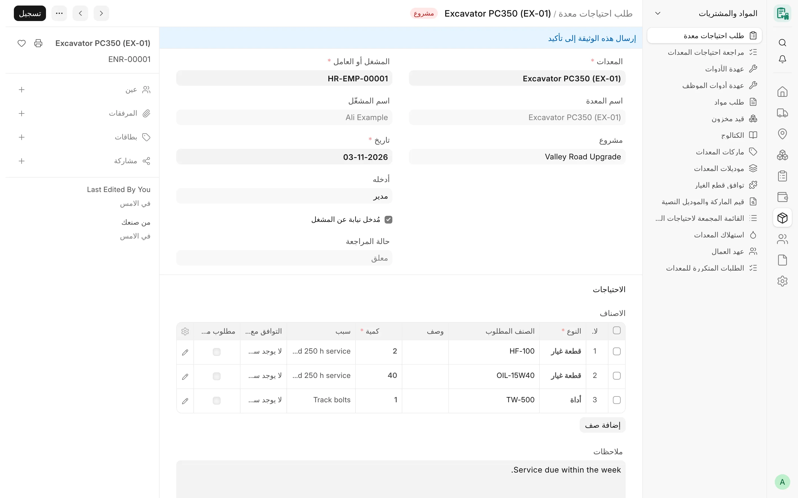
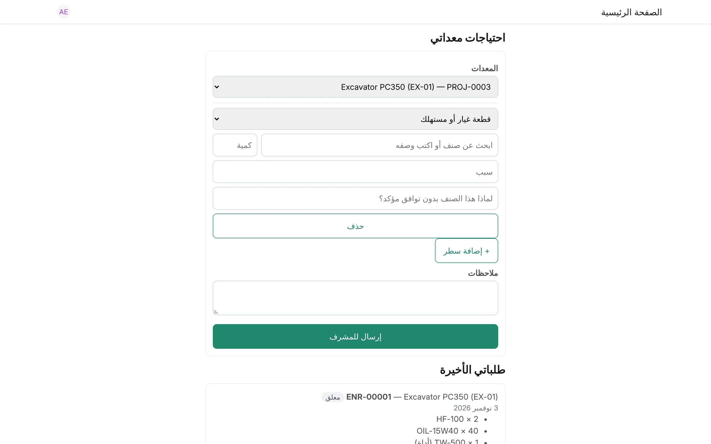

## نظرة عامة

احتياجات المعدات هي الطريقة التي تُطلب بها قطع غيار المعدة ومستهلكاتها وأدواتها، وتُفحص، ثم تتحول إلى مستندات قياسية في
ERPNext:

1. يطلب **مشغل** المعدة ما تحتاجه (**طلب احتياجات معدة**).
2. يجمع **مشرف** المشروع الطلبات، ويتحقق مما هو موجود في الموقع، ويقرر الكميات (**مراجعة احتياجات المعدات**).
3. يعتمد المراجعةَ **مدير** لم يشارك في إعدادها. وينشئ الاعتماد **طلبات مواد مسودة** في ERPNext، ومسودات تسليم للأدوات، ثم
   يتابع فريقا الشراء والمخزون العمل في ERPNext كالمعتاد.

قطع الغيار والمستهلكات تخص المعدة، والأدوات عهدة على المشغل (انظر [عهدة الأدوات](/card/ar/features/tool-custody/)). ولا يرحّل
CARD أي قيد إلى الدفتر، ولا ينشئ خصومات رواتب أو جزاءات أبدًا؛ فالطلب المتكرر لا يُعلَّم إلا للمراجعة.

<!-- screenshot: equipment-needs-review -->

*طلب احتياجات معدة*

## المفاهيم الأساسية

| المفهوم | المعنى |
|---|---|
| الطلب | مشغل واحد، ومعدة واحدة، وتاريخ واحد؛ وبنود من قطع الغيار أو الأدوات. ويُسمّى بالصيغة `ENR-#####`. |
| المراجعة | مشروع واحد (ونطاق تاريخ اختياري)؛ وبنود عدة طلبات. وتُسمّى بالصيغة `ENV-#####`. |
| حالة الطلب | «قيد الانتظار» ← «قيد المراجعة» ← «معتمد» أو «مرفوض»؛ ولا يغيرها إلا المراجعة والاعتماد. |
| اعتماد الإدارة | «قيد الانتظار» أو «معتمد»، ويكتبه الخادم. |
| طريقة التوفير | «من المخزن» أو «شراء للمشروع». |
| علامة التكرار | **مطلوب مؤخرًا**: طُلب الصنف نفسه للمعدة نفسها، أو صُرف لها، خلال مدة التكرار. |
| التوافق مع المعدة | حالة توافق قطعة الغيار مع المعدة وقت طلبها. |

## المزايا

### طلب احتياجات معدة

الحقول:

- **المعدة**: إلزامية، ويملأ الخادم **اسم المعدة** و**المشروع**. والمشروع هو الذي توجد عليه المعدة الآن (تخصيصها المفتوح)،
  ولا يمكن إنشاء طلب لمعدة ليست على مشروع.
- **المشغل** (موظف): إلزامي، و**اسم المشغل**.
- **التاريخ**: الافتراضي اليوم.
- **أدخله** و**مُدخل نيابة عن المشغل**: يضبطهما الخادم.
- **حالة المراجعة**: للقراءة فقط.
- **البنود**: بند واحد على الأقل، و**ملاحظات**.

كل بند (**بند طلب احتياجات معدة**):

| الحقل | القاعدة |
|---|---|
| النوع | «قطعة غيار» (الافتراضي) أو «أداة» |
| الصنف المطلوب | صنف من ERPNext، أو اتركه فارغًا واكتب **الوصف** |
| الكمية | إلزامية وأكبر من الصفر، و**وحدة القياس** اختيارية |
| السبب | نص حر |
| التوافق مع المعدة | يضبطه الخادم من سجلات توافق القطع (للقراءة فقط) |
| سبب صنف بدون توافق مؤكد | إلزامي عند الاعتماد إذا لم يكن للصنف توافق مؤكد مع المعدة |
| مطلوب مؤخرًا / آخر طلب في | يضبطهما الخادم (انظر «الطلبات المتكررة») |

من يحق له الطلب:

- لا يطلب المشغل إلا لمعدة **يشغّلها**: أي إنه مشغل المعدة المسجل، أو مذكور في كارت التشغيل الشهري للمعدة لذلك الشهر.
- يجوز لـ Card Supervisor أو Card Manager إدخال الطلب **نيابة عن** المشغل، ويُحفظ الاسمان.
- لا يرى المشغلون إلا طلباتهم.
- لا يمكن إلغاء طلب داخل مراجعة مشرف؛ ألغِ المراجعة أولًا.

### صفحة ‎/equipment-needs

صفحة `/equipment-needs` (**احتياجات معداتي**) صفحة ويب بسيطة للجوال يطلب منها المشغل احتياجات معدته بحسابه الخاص، دون Desk:

- يُوجَّه الزائر غير المسجل دخوله إلى صفحة الدخول ثم يعود؛
- تسرد المعدات المخصصة للمشغل في الشهر الحالي مع مشروعها؛
- كل بند إما **قطعة غيار أو مستهلك** وإما **أداة**، مع بحث عن الصنف (بالرمز أو الاسم أو الباركود أو رقم القطعة الأصلي، بحد
  أقصى 20 نتيجة، وفق قواعد الكتالوج) أو وصف حر، وكمية، وسبب، وعند الحاجة سبب اختيار صنف بلا توافق مؤكد؛
- ينشئ زر **إرسال للمشرف** الطلب ويعتمده فورًا؛
- يعرض قسم **طلباتي الأخيرة** آخر 20 طلبًا للمشغل مع حالاتها.

تتطلب الصفحة أن يكون المستخدم مرتبطًا بموظف نشط وأن يحمل أحد الأدوار Card Operator أو Card Supervisor أو Card Manager أو
System Manager. ويقدم CARD Mobile ‏(`/cdms`) مسار الطلب نفسه في شاشة **طلب جديد** (انظر [CARD Mobile](/card/ar/features/card-mobile/)).

<!-- screenshot: equipment-needs-portal -->

*صفحة احتياجات المعدات*

### مراجعة احتياجات المعدات

الحقول: **المشروع** (إلزامي)، و**من تاريخ**، و**إلى تاريخ**، و**المشرف**، و**مقدّم المراجعة**، و**اعتماد الإدارة**،
و**اعتمده**، و**تاريخ الاعتماد**، و**البنود**، و**ملاحظات**. وتأتي الشركة من المشروع.

يضيف زر **جلب الطلبات** (على مسودة محفوظة) كل بنود الطلبات المعتمدة والمنتظرة للمشروع ضمن نطاق التاريخ، والتي لا تحجزها
مراجعة أخرى. ولا تُضاف البنود إلا بهذه الطريقة، ولا يمكن كتابة أي بند يدويًا. وتُنسخ الكمية المطلوبة ولا تُعدّل أبدًا.

كل بند (**بند مراجعة احتياجات المعدات**):

| الحقل | المعنى |
|---|---|
| الطلب، والمعدة، والمشغل، والنوع، والوصف | منسوخة من الطلب (للقراءة فقط) |
| الصنف المطلوب | الصنف، ويمكن مطابقته هنا إذا اكتفى المشغل بوصفه |
| الكمية المطلوبة | كما طلبها المشغل (للقراءة فقط) |
| الموجود بالموقع | ما هو متوفر في الموقع بالفعل |
| الكمية المعتمدة | ما يُوفَّر (الافتراضي الكمية المطلوبة)، والصفر يرفض البند |
| معاينة الموقع | «لم تتم المعاينة» أو «تمت المعاينة»، مع **ملاحظة المعاينة**، ويضبط الخادم اسم المعاين وتاريخها |
| طريقة التوفير | «من المخزن» (الافتراضي) أو «شراء للمشروع» |
| المستودع | الافتراضي: المخزن الرئيسي للشركة |
| المخزون المتاح | تلميح مخزون لحظي (انظر أدناه)، ولا يُحفظ أبدًا |
| مطلوب مؤخرًا، والتوافق مع المعدة، وسبب صنف بدون توافق مؤكد | منسوخة من الطلب |
| طلب المواد، وعهدة الأداة، والكمية المسلّمة | يكتبها الخادم بعد الاعتماد |

يجب أن يكون بند الأداة ذو الكمية المعتمدة صنفًا مخزنيًا لا أصلًا ثابتًا (فعهدة الأصل الثابت تُسجَّل على الأصل نفسه). واعتماد
(Submit) المراجعة يجعل طلباتها «قيد المراجعة»، وإلغاؤها يعيدها إلى «قيد الانتظار». ولا يمكن إلغاء مراجعة معتمدة من الإدارة.

### الاعتماد إلى طلبات مواد مسودة

يظهر زر **اعتماد** على المراجعة المعتمدة التي اعتماد إدارتها «قيد الانتظار»، لدورَي **Card Manager** و**System Manager**.
ويحتاج المعتمِد أيضًا إلى صلاحية إنشاء طلبات المواد في ERPNext (مثل Stock User)، وللأدوات صلاحية إنشاء سجلات عهدة الأدوات
للموظفين. وقبل إنشاء أي شيء:

- يجب أن يكون لكل بند معتمد صنف ومستودع؛
- تحتاج الأدوات إلى **مخزن عهدة الأدوات** للشركة وإلى عامل مذكور في الطلب؛
- النقرة الثانية تنتظر ثم تجد عبارة «معتمد بالفعل».

ينشئ الاعتماد، بصلاحيات المعتمِد نفسه:

| البند المعتمد | ما يُنشأ |
|---|---|
| قطعة غيار، من المخزن | طلب مواد مسودة من نوع **صرف مواد** (Material Issue) |
| قطعة غيار، شراء للمشروع | طلب مواد مسودة من نوع **شراء** (Purchase) |
| أداة، من المخزن | مسودة **تسليم** عهدة للمشغل، ويؤكدها المخزن لاحقًا |
| أداة، شراء للمشروع | طلب مواد مسودة من نوع **شراء**، ومسودة **تسليم** عهدة للمشغل |

يحمل كل صف في طلب المواد الصنف، والكمية، والمشروع، ومركز تكلفة المشروع (وإلا فمركز التكلفة الافتراضي للشركة)، والمستودع،
والبُعد **Card Equipment** لقطع الغيار. ولا يحرك الاعتماد أي مخزون. ثم يصبح كل طلب «معتمدًا» إذا اعتُمد بند واحد على الأقل
من بنوده، وإلا «مرفوضًا».

### المراجِع ليس المعتمِد

تسجّل المراجعة على الخادم **المشرف** (المراجِع)، و**مقدّم المراجعة**، وكل مستخدم حفظ المسودة. ولا يجوز لأي منهم اعتمادها، أيًّا
كان دوره (بما في ذلك Administrator وSystem Manager). ويُخفى عنهم زر **اعتماد**، ويرفض الخادم الاعتماد.

### الطلبات المتكررة

عندما يذكر بند الطلب صنفًا، يتحقق CARD مما إذا كان الصنف نفسه قد طُلب للمعدة نفسها (في طلب معتمد آخر) أو صُرف لها (في إدخال
مخزون معتمد من نوع صرف مواد يحمل المعدة) خلال مدة التكرار. فإن كان كذلك، يحصل البند على **مطلوب مؤخرًا** و**آخر طلب في**.

المدة هي **تنبيه للطلب المتكرر خلال (يوم)** للشركة (في إعدادات كارت للشركة)، وإلا فالقيمة في الإعدادات (تبويب «المواد»،
والافتراضي 30). والعلامة تلميح للمشرف فقط. ويسرد تقرير **الطلبات المتكررة للمعدات** (Repeat Equipment Requests، وعاملا
التصفية «المشروع» و«المعدة») البنود المعلَّمة.

### تلميحات المخزون

يُقرأ رقم **المخزون المتاح** في بند المراجعة لحظيًا بصلاحيات القارئ نفسه في ERPNext:

- فقط للمستخدم الذي تقرأ أدواره الأرصدة (Bin) والمستودعات (لا عن طريق مشاركة أو صلاحية مقصورة على المالك)؛
- فقط في المستودعات التي يحق له قراءتها، التابعة لشركة المراجعة؛
- وإلا فلا يُعرض شيء (ولا يظهر صفر زائف أبدًا).

ولا يُحفظ الرقم على المراجعة أبدًا. ويجمع تقرير **القائمة المجمعة لاحتياجات المعدات** (Equipment Needs Summary، وعاملا
التصفية «المشروع» و«اعتماد الإدارة») بنود المراجعات حسب الصنف مع الكميات المطلوبة والموجودة والمعتمدة والمتاحة في المخزون،
ويحذف عمود المخزون لأي قارئ آخر.

### أزرار أمر الشراء والاستلام والفاتورة

:::caution[مخطط له]
لم تُبنَ بعد أزرار إنشاء أمر شراء أو إيصال استلام أو فاتورة شراء من طلب مواد CARD. فلا ينشئ CARD إلا طلبات مواد مسودة،
ويتابع فريقا الشراء والمخزون العمل في ERPNext بإجراءاته القياسية.
:::

### الإعدادات

- الإعدادات، تبويب **المواد**: **المخزن الرئيسي**، و**مخزن عهدة الأدوات**، و**تنبيه للطلب المتكرر خلال (يوم)**.
- إعدادات كارت للشركة، قسم **المواد**: القيم الثلاث نفسها لكل شركة، والفراغ يعني قيمة الإعدادات العامة. ويجب أن يكون مستودع
  الشركة مستودعًا مفعّلًا وغير تجميعي وتابعًا لتلك الشركة.

## سير العمل

1. يفتح المشغل `/equipment-needs` (أو CARD Mobile)، ويختار معدته، ويضيف البنود، ويضغط **إرسال للمشرف**.
2. ينشئ المشرف **مراجعة احتياجات المعدات** للمشروع، ويحفظها، ويضغط **جلب الطلبات**.
3. يسجل ما وُجد في الموقع، ويعاين، ويضبط الكميات المعتمدة وطرق التوفير والمستودعات، ثم يعتمد المراجعة.
4. يضغط **اعتماد** مديرٌ (Card Manager) لم يشارك في إعداد المراجعة.
5. يستكمل فريقا الشراء والمخزون طلبات المواد المسودة في ERPNext، ويؤكد المخزن تسليمات الأدوات.
6. تحمل القطع المصروفة بإدخال مخزون المعدةَ، فتصل تكلفتها إليها.

## الصلاحيات

| الإجراء | الأدوار |
|---|---|
| إنشاء طلب لمعدته واعتماده | Card Operator |
| إنشاء الطلبات واعتمادها وإلغاؤها وتعديلها (ونيابةً عن المشغل) | Card Supervisor وCard Manager وSystem Manager |
| قراءة الطلبات | Card User (ولا يقرأ Card Operator إلا طلباته) |
| إنشاء المراجعات واعتمادها وإلغاؤها وتعديلها | Card Supervisor وCard Manager وSystem Manager |
| اعتماد الإدارة للمراجعة | Card Manager وSystem Manager (لا المراجِع ولا مقدّم المراجعة ولا من عدّلها؛ مع صلاحية إنشاء طلب مواد) |
| قراءة المراجعات | Card User |
| القائمة المجمعة لاحتياجات المعدات، والطلبات المتكررة للمعدات | System Manager وCard Manager وCard Supervisor وCard User وStock Manager وAccounts Manager |

لا يستطيع المستخدم المقيّد ببعض الشركات إنشاء طلبات أو مراجعات شركة أخرى ولا قراءتها ولا تغييرها.

## ذات صلة

- [الصيانة وقطع الغيار](/card/ar/features/maintenance-parts/)
- [عهدة الأدوات](/card/ar/features/tool-custody/)
- [CARD Mobile](/card/ar/features/card-mobile/)
- [الأدوار والصلاحيات](/card/ar/features/roles-permissions/)
- [واجهة المواد والاحتياجات البرمجية](/card/ar/api-reference/materials-needs/)
