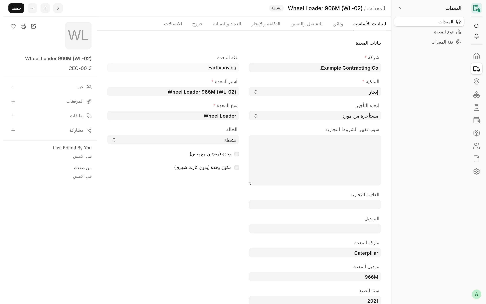
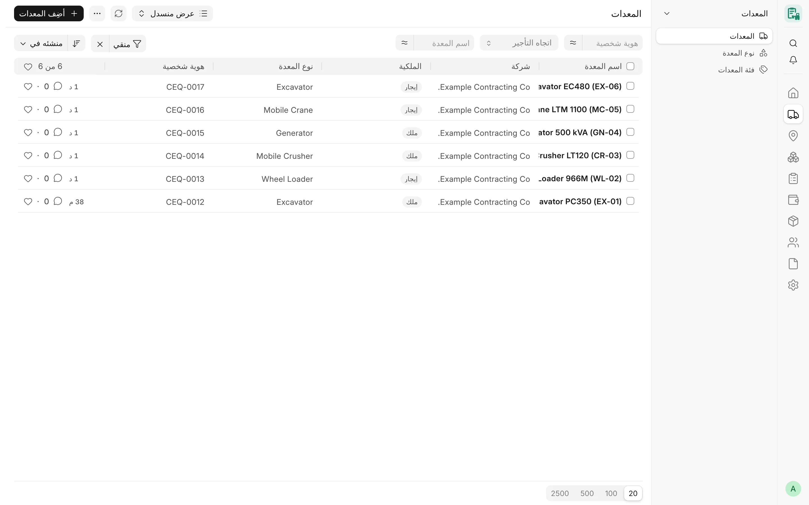

## نظرة عامة

**المعدات** (Card Equipment) هو السجل الرئيسي لكل معدة يديرها CARD: المعدات المملوكة، والمعدات المستأجرة من مورد،
والمعدات المؤجرة لعميل، والمعدات التي تُدار لحساب مالك آخر. وتشير جميع مستندات CARD الأخرى — التعيينات وعمليات النقل
والكروت الشهرية وتعبئات الديزل واحتياجات المعدات وعهدة الأدوات — إلى سجل معدة، وشركة المعدة هي التي تحدد شركة هذه
المستندات جميعًا.

ويجمع النموذج كل ما يخص المعدة الواحدة في مكان واحد: ماهيتها (النوع والماركة والموديل ورقم الشاسيه ورقم اللوحة)، ومن
يملكها وفي أي اتجاه تؤجَّر، والشروط التجارية التي تُسعَّر بها كروتها الشهرية، وارتباطها بـ**الأصل** في ERPNext، ومكان
عملها الحالي، وبيانات العداد والصيانة، ومستنداتها النظامية، وطريقة خروجها من الأسطول.

<!-- screenshot: equipment-form -->

*معدة مستأجرة في نموذج المعدات*

## المفاهيم الأساسية

| المفهوم | المعنى |
|---|---|
| **الملكية** | «ملك» أو «إيجار» أو «طرف ثالث» (معدة تُدار لحساب مالك آخر). |
| **اتجاه التأجير** | من تُصدَر له الفاتورة ومن يُصدرها: مستأجرة من مورد، أو مؤجرة لعميل، أو إيجار من الباطن، أو تشغيل داخلي. وهو المصدر الوحيد الذي يحدد الحقول التجارية المطبقة. |
| **الحقول التجارية** | الملكية والاتجاه والمورد والعميل والأسعار والعقد وتواريخ الإيجار وشروط الوقود والمشغّل. لا يغيّرها إلا مدير CARD أو مدير النظام، ويتطلب كل تغيير سببًا جديدًا. |
| **الحقول المالية** | قيمة شراء الأصل والأسعار الداخلية ومراكز التكلفة. لا يقرؤها إلا مدير النظام ومدير CARD ومدير الحسابات. |
| **الهوية** | رقم الشاسيه ورقم اللوحة، وكل منهما فريد داخل الشركة. |
| **ربط الأصل** | يمكن ربط المعدة المملوكة أو معدة الطرف الثالث بأصل واحد في ERPNext، فيصبح هو مصدر اسمها وماركتها ونوعها. |
| **الحالة** | «نشطة» أو «متوقفة» أو «في الصيانة» أو «منتهية». ولا تمنع الاستخدام الجديد إلا الحالة «منتهية». |

تُرقَّم السجلات `CEQ-0001` و`CEQ-0002` وهكذا، وتُعرض باسم **اسم المعدة**. ويمكن البحث في القائمة بنوع المعدة ورقم
اللوحة ورقم الشاسيه، كما يمكن استيراد المعدات وإعادة تسميتها.

## المزايا

### تخطيط النموذج

ينقسم النموذج إلى تبويبات:

| التبويب | الأقسام والحقول الرئيسية |
|---|---|
| **البيانات الأساسية** | الشركة، الملكية، اتجاه التأجير، الأصل في ERPNext، سبب تغيير الشروط التجارية، الماركة، الموديل، ماركة المعدة، موديل المعدة، سنة الصنع، رقم الشاسيه، رقم اللوحة، فئة المعدة، اسم المعدة، نوع المعدة، الحالة، وحدة (معدتين مع بعض)، مكوّنات الوحدة |
| **المستندات** | رقم الاستمارة وانتهاؤها وصورتها؛ انتهاء الفحص الدوري وشهادته؛ شركة التأمين ورقم الوثيقة وانتهاؤها وملفها؛ رقم TUV وانتهاؤه وصورته |
| **التشغيل والتعيين** | المشروع الحالي، تاريخ التعيين، مركز التكلفة، المشغّل (أو اسم المشغّل الخارجي وجواله)، الموقع |
| **التكلفة والإيجار** | معايير التشغيل (ساعات العمل اليومية، الوقود على، المشغّل على)، بيانات الإيجار (جانب المورد)، جانب العميل، التكلفة الداخلية |
| **العداد والصيانة** | نوع العداد، قراءة العداد عند الاستلام، آخر قراءة، سعة الخزان، الاستهلاك المتوقع، استهلاك الديزل اليومي؛ فترات الصيانة |
| **الإنهاء** | تاريخ الإنهاء، سبب الإنهاء، قراءة العداد عند الإنهاء، حالة التسوية، ملاحظات |
| **الارتباطات** | المستندات المرتبطة والسجلات ذات الصلة (انظر [الارتباطات](#الارتباطات)) |

لا تظهر الأقسام إلا عند انطباقها: يظهر قسم **بيانات الإيجار** (جانب المورد) للاتجاه الذي يُفوتَر فيه مورد فقط، وقسم
**جانب العميل** للاتجاه الذي يُفوتَر فيه عميل فقط، وقسم **التكلفة الداخلية** للمعدات المملوكة ومعدات الطرف الثالث
فقط، وقسم **الصيانة** للمعدات المملوكة فقط.

### الفئات والأنواع

- **فئة المعدات** (Card Equipment Category) — قائمة بسيطة (اسم الفئة والوصف)، مثل «معدات ترابية» أو «كسارات».
- **نوع المعدة** (Card Equipment Type) — ينتمي كل نوع إلى فئة واحدة، ويمكن أن يحدد **نوع العداد** («ساعات» أو
  «كيلومترات» أو «بدون عداد») و**فئة الأصل** في ERPNext.

**نوع المعدة** حقل إلزامي في سجل المعدة، أما **فئة المعدة** و**نوع العداد** فيُجلبان من النوع. ولا يجوز ربط فئة أصل
واحدة إلا بنوع معدة واحد، لأن المعدة المرتبطة بأصل تأخذ نوعها من فئة ذلك الأصل.

يستطيع مستخدم CARD ومدير CARD ومدير النظام إنشاء الفئات والأنواع، ويقرؤها مدير الحسابات.

### الماركات والموديلات

- **ماركة المعدة** (Card Equipment Make، بالترقيم `CMK-0001`) — الشركة المصنّعة للمعدة، مع خيار **معطّل**. ويحتفظ
  CARD بقائمته الخاصة، لأن قائمة المصنّعين (Manufacturer) في ERPNext مخصصة لمصنّعي قطع الغيار ولا تُستخدم للمعدات.
- **موديل المعدة** (Card Equipment Model، بالترقيم `CEM-0001`) — موديل لماركة واحدة ونوع معدة واحد، مع وصف وخيار
  **معطّل**.

يُمنع التكرار بمفتاح موحّد: تُقارن الأسماء بالأحرف الكبيرة بعد حذف المسافات والشرطات والنقاط والشرطات السفلية
والخطوط المائلة، فيكون «PC200-8» و«pc 200 8» موديلًا واحدًا. والموديل فريد داخل الماركة.

القواعد المطبقة على المعدة:

- يجب أن ينتمي الموديل إلى الماركة ونوع المعدة المختارين، وإذا تُركت الماركة فارغة أُخذت من الموديل.
- لا يمكن اختيار ماركة أو موديل معطّل اختيارًا جديدًا (وتحتفظ المعدة التي تحمله به).
- لا يمكن تغيير ماركة أو نوع موديل مستخدم في معدات أو في صفوف توافق قطع الغيار.
- إذا تغيّر نوع المعدة لاحقًا (لتغيّر فئة الأصل المرتبط مثلًا)، يُمسح الموديل الذي لم يعد مناسبًا مع رسالة توضيحية،
  وذلك فقط للمستخدم الذي يملك صلاحية الكتابة في حقل الموديل.

يبقى حقلا **الماركة** و**الموديل** النصيان متاحين إلى جانب رابطي الماركة والموديل. وتُستخدم الماركات والموديلات
أيضًا في كتالوج قطع الغيار لتحديد القطع المناسبة لكل معدة (انظر [الصيانة وقطع الغيار](/card/ar/features/maintenance-parts/)).

### الملكية واتجاه التأجير

تبيّن الملكية من يملك المعدة، ويبيّن اتجاه التأجير طريقة فوترتها. والتركيبات المسموح بها ثابتة:

| الملكية | الاتجاهات المسموح بها | القيمة الافتراضية عند تركه فارغًا |
|---|---|---|
| «ملك» | «مؤجَّرة لعميل»، «تشغيل داخلي» | «تشغيل داخلي» |
| «إيجار» | «مستأجَرة من مورد»، «إيجار من الباطن» | «مستأجَرة من مورد» |
| «طرف ثالث» | «مستأجَرة من مورد»، «إيجار من الباطن» | «مستأجَرة من مورد» |

معنى كل اتجاه ومتطلباته:

| الاتجاه | المعنى | المطلوب عند الحفظ |
|---|---|---|
| «مستأجَرة من مورد» | تستأجر الشركة المعدة من مورد (فواتير المورد). | المؤجر / المالك، طريقة الحساب، السعر |
| «مؤجَّرة لعميل» | تؤجر الشركة معدتها لعميل (فواتير العميل). | العميل، نوع سعر العميل، سعر العميل |
| «إيجار من الباطن» | مستأجرة من مورد **ومؤجرة** لعميل في الوقت نفسه. | كل ما سبق |
| «تشغيل داخلي» | معدة مملوكة تُستخدم داخليًا دون فوترة. | — |

يرفض الخادم أي اتجاه لا يناسب الملكية، ويُشتق الاتجاه الفارغ من الملكية. وفي النموذج، يؤدي اختيار الملكية إلى تحويل
الاتجاه فورًا إلى اتجاه مسموح به، وفي المعدة المملوكة يُضبط حقلا **المشغّل على** و**الوقود على** على «الشركة» إذا
كانا فارغين.

:::note
تعرض الكروت الشهرية الاتجاه للقراءة فقط كما هو في المعدة. وتنطبق فوترة العميل على الاتجاهين «مؤجَّرة لعميل» و«إيجار
من الباطن»، وفوترة المورد على «مستأجَرة من مورد» و«إيجار من الباطن».
:::

### الحقول التجارية وسبب التغيير

الشروط التجارية هي: الملكية، المؤجر / المالك، بداية الإيجار، نهاية الإيجار، رقم العقد، طريقة الحساب، السعر، ساعات
العمل اليومية، أساس احتساب اليوم، الوقود على، سعر الساعة الداخلي، أساس السعر الداخلي للتشغيل، السعر الداخلي
للتشغيل، نوع سعر العميل، سعر العميل، سعر العميل (الوردية الليلية)، العميل، اتجاه التأجير، المشغّل على.

- تقع هذه الحقول في مستوى الصلاحية 1: يكتبها مدير CARD ومدير النظام، ويقرؤها مستخدم CARD ومدير الحسابات.
- في المعدة القائمة، يتطلب أي تغيير في أحدها نصًا **جديدًا** في حقل **سبب تغيير الشروط التجارية** (ويُرفض تكرار السبب
  السابق)، وتسرد الرسالة الحقول التي تغيّرت. ويجري هذا التحقق على الخادم، فيشمل واجهة REST واستيراد البيانات أيضًا.
- لا يُنسخ السبب عند نسخ المعدة، ويُحفظ التغيير في سجل تاريخ المستند.

### الأسعار

**جانب المورد** (يظهر للاتجاهين «مستأجَرة من مورد» و«إيجار من الباطن»):

- **المؤجر / المالك** — المورد.
- **طريقة الحساب** — «باليوم» أو «بالساعة» أو «بالشهر».
- **السعر** — السعر المتفق عليه على هذا الأساس.
- **سعر الساعة** — للقراءة فقط، ويُحسب عند الحفظ:

| طريقة الحساب | سعر الساعة |
|---|---|
| «بالساعة» | السعر نفسه |
| «باليوم» | السعر ÷ ساعات العمل اليومية (ويجب أن تكون الساعات اليومية أكبر من صفر) |
| «بالشهر» | السعر ÷ **ساعات الشهر القياسي** من إعدادات CARD (الافتراضي 260) |

- **رقم العقد** و**بداية الإيجار** و**نهاية الإيجار**.

**جانب العميل** (يظهر للاتجاهين «مؤجَّرة لعميل» و«إيجار من الباطن»): **العميل** و**نوع سعر العميل** و**سعر العميل**،
والحقل الاختياري **سعر العميل (الوردية الليلية)**. ويستخدم الكارت الشهري للوردية الليلية لمعدة تُفوتَر على عميل السعرَ
الليلي إذا كان محددًا، أما كارت الوردية النهارية أو المعدة التي لا سعر ليليًا لها فيستخدم سعر العميل.

**ساعات العمل اليومية** إلزامية في كل معدة. ويظهر **أساس احتساب اليوم** عندما يكون أحد الجانبين مسعّرًا باليوم:

| أساس احتساب اليوم | الأثر على الجانب المسعّر باليوم |
|---|---|
| تناسبي حسب الساعات (الافتراضي) | الساعات المفوترة × سعر الساعة (السعر ÷ الساعات اليومية) |
| يوم كامل | الأيام المفوترة × السعر |

:::note
أُضيف أساس احتساب اليوم بعد الإصدار v4.7.0. وتحتفظ الكروت الشهرية المعتمدة بالأساس الذي سُعّرت به.
:::

**التكلفة الداخلية** (للمعدات المملوكة ومعدات الطرف الثالث، في مستوى الصلاحية 2): **سعر الساعة الداخلي** و**أساس
السعر الداخلي للتشغيل** («بالساعة» أو «باليوم») و**السعر الداخلي للتشغيل**، وتُستخدم لعرض القيمة الداخلية للمعدات
المملوكة.

تأخذ المعدة الجديدة قيمًا افتراضية من إعدادات CARD عندما تكون الحقول فارغة: الساعات اليومية الافتراضية، والوقود على
الافتراضي، والمشغّل على الافتراضي، وأساس السعر الافتراضي (لنوع سعر المورد ونوع سعر العميل معًا). ولا تُستبدل أي قيمة
مُدخلة مسبقًا.

انظر [اتفاقيات الأسعار](/card/ar/features/rate-agreements/) و[الكروت الشهرية](/card/ar/features/monthly-cards/) لمعرفة
كيفية استخدام الأسعار.

### الوقود والمشغّل على

- **الوقود على** و**المشغّل على**: «المؤجر» أو «الشركة».
- في المعدة المملوكة، أو عندما يكون المشغّل على الشركة، يكون **المشغّل** موظفًا (Employee) في ERPNext ويُجلب **اسم
  المشغّل** منه.
- في المعدة المستأجرة التي يكون مشغّلها على المؤجر، يطلب النموذج بدلًا من ذلك **اسم المشغّل** الخارجي و**جوال المشغّل**.

### الهوية: رقم الشاسيه ورقم اللوحة

لا يجوز أن يتكرر **رقم الشاسيه** أو **رقم اللوحة** في أكثر من معدة داخل الشركة الواحدة.

- تُقارن الأرقام في صورة موحّدة: توحيد Unicode مع حذف العلامات غير المرئية، وقراءة الأرقام العربية الهندية أرقامًا
  غربية، وحذف المسافات و`- _ / .`، والتحويل إلى الأحرف الكبيرة. فيكون «ABC-123» و«abc 123» رقمًا واحدًا.
- يجري التحقق عند إدخال الرقم أو تغييره أو عند تغيير الشركة، ولا يُمنع حفظ سجل قديم لسبب لا علاقة له بالرقم. ولا يمكن
  لعمليتي حفظ متزامنتين أن تحتفظا بالرقم نفسه.
- لا تذكر الرسالة المعدة الأخرى إلا لمستخدم يملك صلاحية قراءتها.
- يجوز أن تملك شركتان مختلفتان معدتين بالرقم نفسه.
- لا تُنسخ الأرقام عند نسخ المعدة.

### ربط الأصل والإنشاء من أصل

يمكن ربط المعدة المملوكة أو معدة الطرف الثالث بـ**أصل** (Asset) في ERPNext من خلال حقل **الأصل في ERPNext** (ولا يظهر
إلا لهاتين الملكيتين؛ فالمعدات المستأجرة لا أصل لها، والتحويل إلى «إيجار» يمسح الربط في النموذج).

- لا تعرض قائمة الاختيار إلا الأصول المعتمدة التابعة لشركة المعدة، غير المستبعدة أو المبيعة، وغير المرتبطة بمعدة
  أخرى، وتطبّق صلاحيات المستخدم نفسه على الأصول؛ فالمستخدم الذي لا يستطيع قراءة الأصول لا يستطيع ربط أصل.
- يرتبط الأصل الواحد بمعدة واحدة على الأكثر، ويُرفض الأصل الملغى أو التابع لشركة أخرى.
- يُؤخذ من الأصل **اسم المعدة** و**الماركة** و**نوع المعدة** (عبر فئة الأصل المربوطة بنوع المعدة) وتصبح للقراءة فقط،
  وكذلك الموديل وسنة الصنع ورقم الشاسيه ورقم اللوحة. أما صورة الأصل ومركز تكلفته وأمين عهدته (بصفته مشغّلًا في المعدة
  المملوكة) وبيانات تأمينه فلا تملأ إلا الحقول الفارغة. وتُعرض بيانات صنف الأصل وموقعه ومركز تكلفته وقيمة شرائه
  للقراءة فقط.
- تُكتب المعدة على الأصل بصفتها البُعد المحاسبي **المعدات** (Card Equipment)، فتصل قيود الإهلاك إلى دفتر المعدة.

**إنشاء من أصل** — يظهر هذا الزر في نموذج المعدة الجديدة، ولا يطلب إلا الأصل والملكية («ملك» أو «طرف ثالث»). فإذا لم
يلزم شيء آخر (معدة مملوكة تُربط فئة أصلها بنوع معدة، مع وجود إعداد افتراضي للساعات اليومية) أُنشئت المعدة فورًا،
وإلا فُتح النموذج معبأً مسبقًا مع الحقول الناقصة لاستكمالها. وتحتاج معدة الطرف الثالث دائمًا إلى اتجاه التأجير
والشروط التجارية.

<!-- screenshot: equipment-create-from-asset -->

*قائمة المعدات*

### الحالة وضابط الحالة

القيمة الافتراضية لـ**الحالة** هي «نشطة». أما «متوقفة» و«في الصيانة» فحالتان مؤقتتان لا تمنعان شيئًا.

المعدة التي حالتها «منتهية» لا ينبغي أن تحصل على تعيين **جديد** أو نقل أو كارت شهري أو تعبئة ديزل. ويُحدَّد ما يحدث
لكل شركة في إعدادات CARD (**قاعدة حالة المعدة**):

| القاعدة | الأثر |
|---|---|
| تحذير فقط (الافتراضي، وكذلك عند تركها فارغة) | تظهر رسالة ويُحفظ السجل. |
| رفض | يُمنع الحفظ. |

لا يُمنع أبدًا: الإرجاع إلى المورد، ونقل معدة مملوكة إلى مستودع أو ورشة، والكارت الشهري أو تعبئة الديزل التي تبدأ
فترتها في **تاريخ الإنهاء** أو قبله (أو في **نهاية الإيجار** أو قبلها بعد مرور ذلك التاريخ). ولا تُغيَّر السجلات
القائمة أبدًا، ويُعاد فحص النقل عند اعتماده.

### الخصوصية المالية

تقع الحقول التالية في مستوى الصلاحية 2، فلا يقرؤها إلا مدير النظام ومدير CARD ومدير الحسابات (ويكتبها مدير النظام
ومدير CARD): **مركز التكلفة**، **مركز تكلفة الأصل**، **قيمة شراء الأصل**، **سعر الساعة الداخلي**، **أساس السعر الداخلي
للتشغيل**، **السعر الداخلي للتشغيل**. أما **سعر الساعة** الخاص بالمورد ففي المستوى 1.

يطبّق Frappe هذه المستويات على النموذج وواجهة REST وعروض القوائم والتقارير وعمليات التصدير. وفوق ذلك، تحتفظ الإدخالات
الجديدة في سجل تغييرات المعدة بمن غيّر حقلًا فوق المستوى 0 ومتى، دون قيمه. ولا تتضمن قيم الأصل المرسلة إلى النموذج
عند ربط أصل إلا الحقول التي يحق للمستخدم قراءتها.

### التعيين الحالي والموقع

**المشروع الحالي** و**تاريخ التعيين** للقراءة فقط، ولا يُضبطان إلا من التعيين الساري اليوم (انظر
[التعيينات والمواقع](/card/ar/features/assignments-locations/))؛ فلا يكتبهما الحفظ ولا واجهة REST ولا الاستيراد.
أما **الموقع** فنص حر لمكان المعدة في الموقع.

### الشركة

**الشركة** حقل إلزامي في مستوى الصلاحية 1. وبمجرد استخدام المعدة في كارت شهري أو تعيين أو تعبئة ديزل أو نقل أو وحدة أو
صف توافق قطع غيار أو قيد في الدفتر، لا يمكن تغيير شركتها؛ وعندئذ يُنشأ سجل معدة جديد للشركة الأخرى. وإذا لم يكن في
الموقع إلا شركة واحدة، يملؤها النموذج الجديد تلقائيًا.

### حقول العداد والخزان والصيانة

- **نوع العداد**، **قراءة العداد عند الاستلام**، **آخر قراءة** (للقراءة فقط).
- **سعة الخزان (لتر)**، **الاستهلاك المتوقع (لتر/ساعة)**، **استهلاك الديزل اليومي (لتر لليوم القياسي)**. ويستخدم تقرير
  تحليل ديزل المعدات (Equipment Diesel Analysis) هذه القيم المتوقعة (القيمة اليومية أولًا، وإلا القيمة بالساعة).
- للمعدات المملوكة: **الصيانة كل (ساعة)**، **تاريخ آخر صيانة**، **الصيانة كل (لتر ديزل)**، **قراءة العداد عند آخر صيانة**.

هذه قيم مرجعية، ولا يُنشئ CARD منها مهام صيانة. أما قراءات ساعات المحرك الأسبوعية فتُسجَّل بشكل منفصل (انظر
[قراءات العداد](/card/ar/features/meter-readings/)).

### المستندات وتنبيهات الانتهاء

تُحفظ بيانات الاستمارة والفحص الدوري والتأمين وTUV في تبويب **المستندات**. ولا تُقبل الملفات الأربعة إلا بصيغة JPEG أو
PNG أو WebP أو PDF (بفحص المحتوى، وبحد أقصى 10 ميغابايت)، وتبقى ملفات خاصة بهذه المعدة. وعند فتح النموذج، يعرض شريط
أحمر المستندات المنتهية، وشريط برتقالي المستندات التي تنتهي خلال 30 يومًا.

### الإنهاء

عند خروج المعدة من الأسطول، سجّل **تاريخ الإنهاء** و**سبب الإنهاء** («انتهاء الإيجار» أو «إرجاع للمؤجر» أو «بيع» أو
«تكهين» أو «نقل لفرع آخر») و**قراءة العداد عند الإنهاء** و**حالة التسوية** («لم تتم» / «تمت») و**ملاحظات**. ويُعدّ
تاريخ الإنهاء آخر يوم عمل للمعدة في ضابط الحالة.

### الارتباطات

يعرض تبويب الارتباطات ما يلي:

- **التشغيل** — الكروت الشهرية وتعيينات المعدة على المشاريع.
- **الوقود والنقل** — تعبئات ديزل المشاريع وعمليات نقل المعدات (لكل معدة في النقل متعدد المعدات).
- **توافق قطع الغيار** — صفوف قطع الغيار المناسبة (للأدوار التي تقرؤها فقط).
- **السجلات المرتبطة** — الأصل والمورد والمشروع الحالي.
- **السجلات المرتبطة** (قسم مباشر) — روابط للقراءة فقط إلى المؤجر والمشروع الحالي وكل مشروع عملت عليه المعدة (من
  كروتها الشهرية)، ولا يُنشأ من هنا أي سجل.

وتعرض لوحة المعدة كذلك خريطة حرارية لساعات التشغيل اليومية من الكروت الشهرية المعتمدة، مع خريطتين منفصلتين للوردية
النهارية والوردية الليلية للمعدات التي تعمل ورديتين.

### الوحدات

يمكن أن تكون المعدة **وحدة** تضم معدتين (مثل كسارة ومولدها). انظر [الوحدات والمكوّنات](/card/ar/features/units-components/).

## سير العمل

1. أنشئ الفئات والأنواع والماركات والموديلات التي تحتاجها.
2. افتح **المعدات** ← **جديد**. وإذا كانت المعدة أصلًا في ERPNext فاستخدم **إنشاء من أصل**.
3. اختر **الشركة** و**الملكية** و**اتجاه التأجير**، ثم **نوع المعدة** واسمها.
4. أدخل رقمي الشاسيه واللوحة والمشغّل والمستندات.
5. في تبويب **التكلفة والإيجار**، أدخل ساعات العمل اليومية وأسعار المورد و/أو العميل التي يتطلبها الاتجاه.
6. احفظ، ثم انقل المعدة إلى مشروع عبر [نقل المعدات](/card/ar/features/transport/).
7. عند تغيير الشروط التجارية لاحقًا: عدّل الحقل واكتب **سبب تغيير الشروط التجارية** جديدًا.
8. عند خروج المعدة: املأ تبويب **الإنهاء** واضبط الحالة على «منتهية».

## الصلاحيات

| الدور | الحقول الأساسية (المستوى 0) | الحقول التجارية (المستوى 1) | الحقول المالية (المستوى 2) |
|---|---|---|---|
| مدير النظام | قراءة، كتابة، إنشاء، حذف | قراءة، كتابة | قراءة، كتابة |
| مدير CARD | قراءة، كتابة، إنشاء | قراءة، كتابة | قراءة، كتابة |
| مستخدم CARD | قراءة، كتابة | قراءة | — |
| مدير الحسابات | قراءة | قراءة | قراءة |
| مشرف CARD | قراءة | — | — |

تقصر صلاحيات المستخدم على الشركة (Company User Permissions) كل دور على معدات شركاته. انظر
[الأدوار والصلاحيات](/card/ar/features/roles-permissions/).

## الفوترة بالحجم (لكل متر مكعب)

لفوترة العميل بعدد الردود وبالمتر المكعب، اجعل **نوع سعر العميل** **بالمتر المكعب** وأدخل **سعة الرد (م³)**؛ وهي
مطلوبة ويجب أن تكون أكبر من صفر. يصبح **سعر العميل** السعر لكل متر مكعب للورديات النهارية، ويُطبَّق **سعر العميل
(وردية ليلية)** على الكروت الليلية عند تحديده. يحتفظ الجانب الموَرِّد بأساس سعره. راجع
[الفوترة بالحجم](/card/ar/features/volume-billing/).

## ذات صلة

- [الوحدات والمكوّنات](/card/ar/features/units-components/)
- [التعيينات والمواقع](/card/ar/features/assignments-locations/)
- [النقل](/card/ar/features/transport/)
- [الكروت الشهرية](/card/ar/features/monthly-cards/)
- [الصيانة وقطع الغيار](/card/ar/features/maintenance-parts/)
- [واجهة API: المعدات](/card/ar/api-reference/equipment/)
