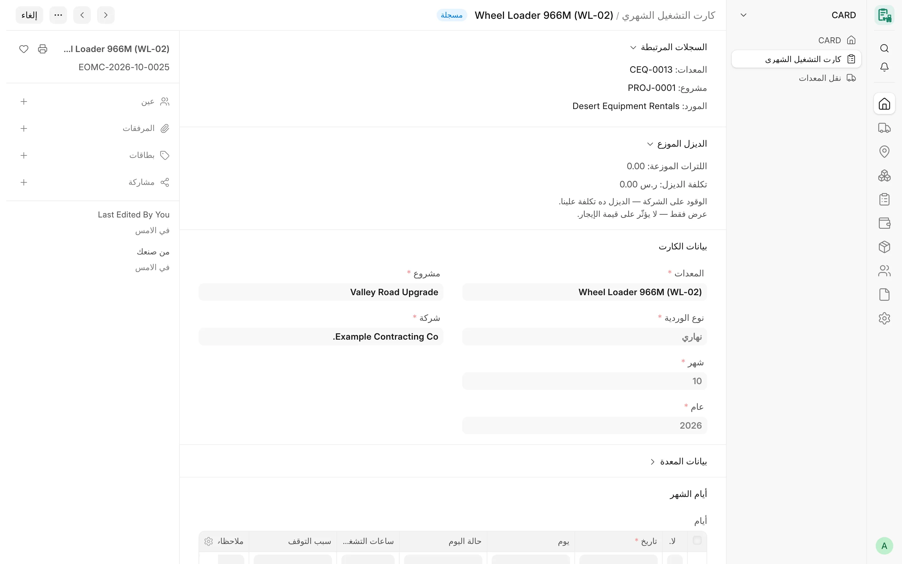

## نظرة عامة

**كارت التشغيل الشهري** (Card Monthly Card) هو المستند الأساسي في نظام CARD. يسجّل لمعدة واحدة ومشروع واحد وشهر واحد
ووردية واحدة ما قامت به المعدة في كل يوم: ساعات التشغيل، وحالة اليوم، والتوقف مع سببه والجهة المسؤولة عنه،
والملاحظات. ومن هذه الأيام ومن الأسعار المسجلة على المعدة يحسب الكارت المستحق لمورد المعدة المستأجرة، أو المبلغ
المطلوب من عميل المعدة المؤجَّرة، أو كليهما في الإيجار من الباطن، ثم يطبّق الإضافات والخصومات للوصول إلى المبالغ
الصافية.

الكارت المقدَّم هو مصدر كشوف حساب الموردين والعملاء، ومصدر فواتير الشراء والمبيعات الشهرية بحالة المسودة (انظر
[الفوترة والترحيل](/card/ar/features/invoicing-posting/)). ولا يكتب الكارت نفسه أي قيود في دفتر الأستاذ.

<!-- screenshot: monthly-cards-form -->

*كارت تشغيل شهري*

## المفاهيم الأساسية

| المفهوم | المعنى |
|---|---|
| كارت واحد لكل مفتاح | المعدة + المشروع + الشهر + السنة + الوردية. ويُرفض كارت ثانٍ ساري بالمفتاح نفسه. |
| الوردية | «نهاري» أو «ليلي». كارتا النهار والليل مستندان منفصلان، ويُسعَّر كل منهما مستقلًا. |
| اتجاه الكارت | يُنقل من اتجاه تأجير المعدة، ويحدد الجانب أو الجانبين اللذين يحاسب عليهما الكارت. |
| جانب المورد | **القيمة الإجمالية** و**الصافي المستحق**: تكلفة المعدة المستأجرة من مورد. |
| جانب العميل | **مبلغ العميل** و**صافي جانب العميل**: قيمة فوترة المعدة المؤجَّرة لعميل. |
| أساس السعر | بالساعة أو باليوم أو بالشهر، من بيانات المعدة. |
| التوقف المحتسب | ساعات التوقف لسبب توقف محتسب صراحةً، وتُحتسب كساعات التشغيل. |
| اللقطة | قيم تُخزَّن عند التقديم حتى لا يتأثر الكارت المقدَّم بأي تغيير لاحق في المعدة أو الإعدادات. |

## المزايا

### حقول الرأس

قسم **بيانات الكارت**:

- **المعدات** – إلزامي؛ وتؤخذ الشركة من المعدة ولا يجوز أن تختلف عنها.
- **المشروع** – إلزامي؛ ويُحدَّد من عمليات النقل المعتمدة للمعدة خلال الشهر (انظر أدناه).
- **نوع الوردية** – «نهاري» أو «ليلي»؛ وإذا تُرك فارغًا أُخذت **الوردية الافتراضية** من الإعدادات.
- **الشهر** و**السنة** – إلزاميان؛ ويُضبط **من تاريخ** و**إلى تاريخ** على أول يوم وآخر يوم في الشهر.
- **الموقع** و**اسم المعدة** و**الملكية** و**المالك** (المورد) – تُملأ من المعدة.
- **السائق / المشغّل** – اسم المشغّل الخارجي، أو حقل **المشغّل** (موظف) عندما تكون المعدة مملوكة أو تكون الشركة هي
  التي توفر المشغّل.

ويعرض قسم **بيانات المعدة** الاتجاه، والعميل، ونوع سعر العميل وسعره، وأساس احتساب اليوم، والقيم المستخدمة عند التقديم.

### الترقيم حسب شهر التشغيل

تُسمّى الكروت بالصيغة `EOMC-{year}-{month}-{####}`، مثل `EOMC-2026-10-0001`. والسنة والشهر هما شهر تشغيل الكارت لا
تاريخ إنشائه، فالكارت الذي يُدخل لاحقًا عن شهر سابق يُرقَّم تحت ذلك الشهر.

### المشروع من عمليات النقل المعتمدة

عندما يختار المستخدم المعدة والشهر والسنة، يسأل النموذج الخادمَ عن المشاريع التي نقلت إليها عملياتُ النقل المعتمدة
المعدةَ في ذلك الشهر، وينشئ سطر يوم لكل يوم كانت فيه المعدة على ذلك المشروع.

- مشروع واحد: يُضبط تلقائيًا.
- عدة مشاريع (انتقلت المعدة خلال الشهر): يختار المستخدم أحدها، ولكل مشروع كارت مستقل.
- لا توجد عملية نقل معتمدة في ذلك الشهر: يُرفض الكارت حتى تُسجَّل عملية نقل معدة (Equipment Transport).
- يُرفض أي مشروع لم تكن المعدة عليه في ذلك الشهر، حتى عبر واجهة API.
- الأيام التي كانت فيها المعدة مكوّنًا في وحدة تُسجَّل على كارت الوحدة لا على كارت المكوّن.

وعند تغيير الشهر أو السنة في كارت فيه سطور أيام، يطلب النموذج التأكيد قبل إعادة إنشاء الأيام، لأن الساعات المسجلة
ستُمسح.

### اتجاه الكارت والجوانب المحاسَب عليها

يُقرأ **اتجاه الكارت** من المعدة مباشرة حتى التقديم.

| الاتجاه | جانب المورد | جانب العميل |
|---|---|---|
| «مستأجَرة من مورد» | نعم | لا |
| «مؤجَّرة لعميل» | لا | نعم |
| «إيجار من الباطن» | نعم | نعم |
| «تشغيل داخلي» | لا | لا |

المعدة المملوكة («ملك») لا تكون إلا في تشغيل داخلي أو مؤجَّرة لعميل، وأي ملكية أخرى تكون مستأجرة من مورد أو إيجارًا
من الباطن. ولا يجوز تقديم كارت يحاسب عميلًا حتى يكون العميل مسجلًا على المعدة. وإذا اختلف عميل المشروع عن عميل
المعدة، يُظهر الكارت تحذيرًا دون منع.

### جدول الأيام

يحتوي جدول **أيام الشهر** على سطر لكل تاريخ.

| الحقل | المعنى |
|---|---|
| التاريخ | إلزامي؛ ويجب أن يقع داخل شهر الكارت وألا يتكرر. |
| اليوم | اسم اليوم، ويضبطه النموذج. وتُظلَّل أيام الجمعة في الجدول. |
| حالة اليوم | «عمل» أو «إجازة» أو «عطل» أو «توقف من العميل». والقيمة الافتراضية «عمل». |
| ساعات التشغيل | ساعات العمل. وأي حالة غير «عمل» تجعلها صفرًا. |
| سبب التوقف (Idle reason) | نص حر. |
| سبب التوقف (Stop reason) | رابط اختياري إلى **سبب توقف معدة** مفعّل تابع لشركة الكارت. |
| ساعات التوقف | الساعات التي توقفت فيها المعدة. |
| توقف يُحتسب إيجارًا | للقراءة فقط: هل تُحتسب ساعات التوقف في هذا السطر (لقطة من السبب عند الحفظ). |
| الجهة المسؤولة | الشركة أو المورد أو العميل أو جهة أخرى؛ وإذا تُركت فارغة أُخذت الجهة الافتراضية لسبب التوقف. |
| سجل / اسم الجهة المسؤولة | السجل للشركة أو المورد أو العميل، واسم نصي حر للجهة الأخرى. |
| ملاحظات | نص حر (اليوم المُنشأ من يومية يذكر اسمها هنا). |

القواعد عند الحفظ:

- لا ساعات تشغيل أو توقف لتاريخ مستقبلي؛
- لا يجوز أن يتجاوز مجموع ساعات التشغيل وساعات التوقف 24 ساعة في اليوم الذي فيه ساعات توقف؛
- يجب أن يقع كل يوم فيه ساعات ضمن فترة تخصيص للمعدة على مشروع الكارت (ولكل مكوّن في حالة الوحدة)؛
- اليوم الذي يتجاوز حد الوردية (**أقصى ساعات الوردية النهارية** / **أقصى ساعات الوردية الليلية**، والافتراضي 12)
  يُظهر **تحذيرًا** فقط: فكل ساعة مسجلة تُحتسب ويُدرج اليوم للمراجعة؛
- عند تفعيل **تنبيه عند تجاوز ساعات اليوم للساعات اليومية** تُدرج الأيام التي تزيد على ساعات العمل اليومية للمعدة؛
- عند تفعيل **تنبيه عند وقوع تواريخ الكارت خارج فترة الإيجار** تُدرج أيام التشغيل الواقعة خارج بداية الإيجار أو
  نهايته للمعدة المستأجرة؛
- يجب أن تكون الجهة المسؤولة من نوع الشركة هي شركة الكارت نفسها، ويُنبَّه للمراجعة إذا كان المورد أو العميل
  المسؤول غير مورد الكارت أو عميله.

### التوقف وأسباب التوقف

يُسجَّل التوقف لكل يوم مع **سبب توقف معدة** (Card Stop Reason)، وهو سجل رئيسي لكل شركة (السبب، ومفعّل، ويُحتسب إيجارًا،
وجهة الاحتساب، وسبب اعتماد الاحتساب، والجهة المسؤولة الافتراضية، وحالة اليوم المقابلة).

- السبب **لا يُحتسب** افتراضيًا: فساعات التوقف المرتبطة به لا تستحق إيجارًا.
- السبب المحتسب يحتسب ساعات التوقف كساعات تشغيل على **جهة الاحتساب** الخاصة به: على حد سواء، أو المورد، أو العميل.
  والجانب الذي لا يحاسب عليه الكارت يتجاهله. وتفعيل الاحتساب أو تغيير جهته يتطلب **سبب اعتماد الاحتساب**.
- اليوم الذي يُحتسب فقط بساعات توقف محتسبة (دون ساعات تشغيل) يُعدّ يومًا محتسبًا.
- في كارت الإيجار من الباطن يُنبَّه إلى السبب المحتسب على جانب واحد: فمبلغ الجانب الآخر لا يشمل تلك الساعات.

وتحتفظ الإجماليات بحقول **ساعات التوقف المحتسبة إيجارًا** و**أيام التوقف المحتسبة إيجارًا**، وبالحقلين الخاصين بكل
جانب: **ساعات التوقف المحتسبة على المورد** و**ساعات التوقف المحتسبة على العميل**.

:::tip
الطريقة الموصى بها لاحتساب رسوم التوقف هي إضافة من نوع «رسوم توقف» (انظر
[الإضافات والخصومات](/card/ar/features/adjustments/)). وإذا ذكرت رسوم التوقف سببًا محتسبًا أيضًا في أيام الكارت على
الجانب نفسه، يُنبّه الكارت إلى احتمال احتساب التوقف نفسه مرتين.
:::

### أسس السعر

يؤخذ السعر وأساسه من المعدة: **طريقة الحساب** و**السعر** لجانب المورد، و**نوع سعر العميل** و**سعر العميل** لجانب العميل.

| الأساس | سعر الساعة المستخدم |
|---|---|
| «بالساعة» | السعر |
| «باليوم» | السعر ÷ **ساعات العمل اليومية** للمعدة |
| «بالشهر» | السعر ÷ **ساعات الشهر القياسي** (من الإعدادات، والافتراضي 260 = 26 يومًا × 10 ساعات) |

كل ساعة مسجلة تُحتسب، فلا حد أدنى ولا حد أقصى. ويُرفض كارت يحاسب المورد دون أساس سعر، أو بسعر يومي دون ساعات يومية.

### الاحتساب باليوم الكامل مقابل الاحتساب التناسبي

في السعر اليومي يحدد **أساس احتساب اليوم** في المعدة طريقة تحويل الأيام إلى مبلغ:

- **تناسبي حسب الساعات** (الافتراضي): الساعات المحتسبة × (السعر ÷ الساعات اليومية).
- **يوم كامل**: الأيام المحتسبة × السعر، بصرف النظر عن ساعات كل يوم. والأيام المحتسبة هي أيام التشغيل مضافًا إليها
  الأيام المحتسبة فقط بساعات توقف محتسبة على ذلك الجانب.

يُطبَّق الأساس على كل جانب بحسب أساس سعره (فلا يتأثر الجانب الذي سعره بالساعة أو بالشهر)، ويظهر في الكارت في حقل
**أساس احتساب اليوم**، وبعد التقديم في حقل **أساس احتساب اليوم المستخدم**.

### كروت النهار والليل وسعر العميل الليلي

الورديتان النهارية والليلية كارتان منفصلان لكل منهما أيامه وإجمالياته. ويستخدم الكارت الليلي لمعدة تحاسب عميلًا
**سعر العميل (الوردية الليلية)** المسجل على المعدة إن وُجد، وإلا فسعر العميل العادي. أما سعر المورد فواحد للورديتين.
وفي أساس «يوم كامل» يحتسب كل كارت وردية يومه الكامل الخاص به.

### الإضافات والخصومات

يضيف جدول **إضافات وخصومات** مبالغ أو يخصمها لكل جانب:

- **النوع** – «إضافة» أو «خصم»؛ ويضبطه النوع المُعرَّف إن اختير.
- **الوصف** و**المبلغ** – إلزاميان؛ ويجب أن يكون المبلغ أكبر من صفر.
- **نوع الإضافة/الخصم** – نوع مُعرَّف لشركة الكارت في الإعدادات.
- **الجانب** – المورد أو العميل؛ وإذا تُرك فارغًا أُخذ الجانب المحاسَب عليه في الكارت، ويلزم الاختيار في كارت الإيجار
  من الباطن.
- **سبب التوقف** و**مرجع الاتفاق** و**الجهة المسؤولة** – إلزامية في رسوم التوقف.

لا تُغيَّر السطور إلا من خلال الكارت نفسه، ويُرفض التحديث المباشر للسطر. التفاصيل في
[الإضافات والخصومات](/card/ar/features/adjustments/).

### الإجماليات

| الحقل | طريقة الحساب |
|---|---|
| أيام العمل | الأيام التي فيها ساعات تشغيل. |
| إجمالي ساعات التشغيل | مجموع ساعات التشغيل. |
| القيمة الإجمالية | جانب المورد: الساعات المحتسبة × سعر الساعة، أو الأيام المحتسبة × السعر اليومي في أساس «يوم كامل». وتكون صفرًا إذا لم يحاسب الكارت موردًا. |
| إجمالي الإضافات / إجمالي الخصومات | مجموع سطور الجانبين معًا. |
| الصافي المستحق | القيمة الإجمالية + إضافات جانب المورد − خصومات جانب المورد. |
| مبلغ العميل | جانب العميل، ويُحسب كجانب المورد بسعر العميل. ويكون صفرًا إذا لم يحاسب الكارت عميلًا. |
| صافي جانب العميل | مبلغ العميل + إضافات جانب العميل − خصومات جانب العميل. |

يعرض النموذج معاينة فورية للإجماليات، ويعيد الخادم حساب كل شيء عند الحفظ.

### مثال محسوب

بيانات افتراضية: المعدة **EQ-0001** على المشروع **PROJ-0001**، وردية نهارية، إيجار من الباطن من **المورد أ** إلى
**شركة المثال للمقاولات**. سعر المورد «باليوم» 2,500 لليوم، وساعات العمل اليومية 10، فيكون سعر الساعة 250. وسعر
العميل «بالساعة» 300.

| الأيام | حالة اليوم | ساعات التشغيل | سبب التوقف | ساعات التوقف |
|---|---|---|---|---|
| 24 يومًا | «عمل» | 10 لكل يوم = 240 | – | – |
| يوم واحد | «عمل» | 6 | – | – |
| يوم واحد | «عطل» | 0 | عطل (لا يُحتسب) | 10 |
| يوم واحد | «توقف من العميل» | 0 | انتظار العميل (يُحتسب، على حد سواء) | 8 |

- أيام العمل 25، وإجمالي ساعات التشغيل 246، وساعات التوقف المحتسبة 8، وأيام التوقف المحتسبة 1.
- **تناسبي حسب الساعات:** (246 + 8) × 250 = **63,500** القيمة الإجمالية.
- **يوم كامل** (لو استخدمته المعدة في الكارت نفسه): (25 + 1) × 2,500 = **65,000**.
- سطور جانب المورد: إضافة 500 وخصم 1,500 ← **الصافي المستحق** = 63,500 + 500 − 1,500 = **62,500**.
- جانب العميل: (246 + 8) × 300 = **76,200** مبلغ العميل؛ وإضافة على جانب العميل بقيمة 1,000 ← **صافي جانب العميل
  77,200**.

الساعات العشر في يوم العطل لا تستحق شيئًا لأن سببها غير محتسب.

### قراءات العداد والعمل الإضافي والفوترة بالكمية والاستعداد

هذه البنود **ليست** جزءًا من الكارت الشهري حاليًا:

- ساعات العمل الإضافي، وقراءات العداد لكل وردية، والفوترة بالكمية أو بالمتر المكعب، وفوترة الاستعداد والمبلغ
  المقطوع، والسجل الرئيسي لأساس الفوترة، كانت موجودة في جيل سابق من التطبيق وليست في الشيفرة الحالية؛
- تُحفظ قراءات ساعات المحرك في مستند منفصل (انظر [قراءات العداد](/card/ar/features/meter-readings/))؛
- يمكن تسجيل سعر لكل وحدة كمية في [اتفاقية الأسعار](/card/ar/features/rate-agreements/)، لكن لا يستخدمه أي كارت حتى الآن.

### التقديم واللقطة

عند التقديم يخزّن الكارت القيم التي سُعِّر بها: **الساعات اليومية (المستخدمة)**، و**سعر الساعة (المستخدم)**،
و**الوقود على (المستخدم)**، و**سعر الساعة للعميل المستخدم**، و**الاتجاه المستخدم**، و**العميل المستخدم**، و**أساس
السعر المستخدم**، و**أساس احتساب اليوم المستخدم**. ولا يعيد أي تغيير لاحق في المعدة أو الإعدادات تسعير كارت مقدَّم.
وتُحدَّث سجلات الموردين والعملاء، وعند تفعيل **إشعار عند اعتماد الكارت** يُبلَّغ منشئ الكارت.

### المراجعة والاعتماد والفصل بين المهام

للكارت الحالات القياسية: مسودة ← مقدَّم ← ملغى. ولا توجد للكارت الشهري خطوة مراجعة منفصلة، لذا فإن **اعتماده هو
تقديمه**:

- من يملك صلاحية تقديم الكارت (مدير الكروت، مدير النظام) يقدّمه مباشرة؛
- يُفحص **الفصل بين المهام** على الخادم عند التقديم: منشئ الكارت وكل مستخدم حفظ مسودته (ومُعِدّو الكروت التي يعدّلها)
  هم *مُعِدّوه*. ويحدد إعداد كل شركة **قاعدة اعتماد الكارت الشهري** في إعدادات شركة الكارت ما يحدث عندما يقدّمه أحد
  مُعِدّيه:
  - **تحذير فقط (اعتماد الكارت)** (الافتراضي): يُقدَّم الكارت مع تحذير، ويُعلَّم بأنه اعتمده مُعِدّه؛
  - **رفض (اعتماد الكارت)**: يُرفض التقديم. ولا يُستثنى أي دور، بما في ذلك مدير النظام؛
- بعد التقديم يعرض القسم القابل للطي **اعتماد الكارت الشهري** من قدّم الكارت ومن اعتمده وتاريخ الاعتماد، وهل اعتمده
  مُعِدّه. ويضبط الخادم وحده هذه الحقول؛
- خطوة المراجعة مع «الإرجاع مع السبب» **غير متاحة** في الكروت الشهرية حاليًا. ويمكن استخدام اعتماد
  [اليوميات](/card/ar/features/daily-logs/)، الذي يفصل بين المُعِدّ والمعتمِد، لمراجعة الساعات قبل وصولها إلى الكارت.

### سبب الإلغاء والتعديل

- يتطلب الإلغاء **سبب الإلغاء**. يطلبه زر الإلغاء في النموذج، ويجب أن يُرسَل مع طلب الإلغاء عبر REST. ويُخزَّن السبب
  في الكارت وفي تعليق يذكر المستخدم والتاريخ، ولا يمكن تعديله بعد ذلك.
- يُرفض طلب الإلغاء الذي يغيّر أي حقل أو سطر آخر.
- لا يمكن إلغاء كارت محجوز في ترحيل بحالة المسودة أو مقدَّم حتى يُلغى ذلك الترحيل.
- يمكن تعديل الكارت الملغى إلى مسودة جديدة، ويُرفض التعديل على نسخة من كارت مرحَّل ما لم يُلغَ ترحيله.
- يُرفض الإلغاء الجماعي من عرض القائمة: يُلغى كل كارت من نموذجه.

### قفل الفترة

عند ضبط **تاريخ قفل الفترة** في الإعدادات (تبويب قفل الفترة)، لا يمكن حفظ الكارت الذي تنتهي فترته في ذلك التاريخ أو
قبله، ولا تقديمه ولا تعديله ولا إلغاؤه ولا حذفه. ويُفحص التاريخ المخزَّن والتاريخ الجديد معًا، فلا يمكن نقل الكارت إلى
داخل الفترة المقفلة أو إلى خارجها. ويجوز لمن يحمل **دور تجاوز قفل الفترة** المتابعة، ويُسجَّل كل تجاوز ويُعلَّق عليه في
الكارت، ويُبلَّغ به مديرو النظام عند تفعيل **إشعار عند تجاوز قفل الفترة**.

ولا يجوز إدخال كروت بأثر رجعي إلا ضمن **السنة المالية الحالية**.

### المدفوعات

لا يسجّل الكارت مدفوعات ولا ينشئ قيود دفع (Payment Entry). تُسدَّد المدفوعات في ERPNext مقابل الفواتير التي يعدّها
CARD، وتظهر حالة التسوية لكل كارت في التقارير (انظر [الأطراف والكشوف](/card/ar/reports/parties-statements/)).

### إظهار المبالغ

حاليًا يرى كل مستخدم يستطيع قراءة الكارت مبالغه. وقصر مبالغ الكروت على الأدوار المخوّلة **مُخطَّط له**. أما السعر
الداخلي للتشغيل للمعدات المملوكة فمقيَّد بالفعل في سجل المعدة.

## سير العمل

1. سجّل نقل المعدة بعملية نقل معدة معتمدة (وهذا ينشئ التخصيص).
2. أنشئ الكارت: اختر المعدة والشهر والسنة والوردية، فيُملأ المشروع والأيام المؤهلة.
3. أدخل الساعات لكل يوم (أو أنشئها من اليوميات المعتمدة)، مع أسباب التوقف حيث توقفت المعدة.
4. أضف الإضافات والخصومات مع الجانب والنوع.
5. احفظ وراجع التحذيرات والإجماليات، ثم قدّم الكارت.
6. يظهر الكارت المقدَّم في الكشوف، ويُلتقط في الترحيل الشهري.

## الصلاحيات

| الدور | الصلاحيات على الكروت الشهرية |
|---|---|
| مستخدم الكروت (Card User) | الإنشاء والتعديل والقراءة والطباعة والتقارير (لا يقدّم ولا يلغي) |
| مدير الكروت (Card Manager) | الإنشاء والتعديل والتقديم والإلغاء والتعديل بعد الإلغاء |
| مدير النظام (System Manager) | جميع الصلاحيات، بما فيها الحذف |
| مدير الحسابات (Accounts Manager) | القراءة والطباعة والتقارير والتصدير |

تسري صلاحيات المستخدم على الشركات: فشركة الكارت هي دائمًا شركة معدته، ولا يستطيع المستخدم المقيَّد إنشاء كارت في
شركة أخرى أو نقله إليها.

## ذات صلة

- [اليوميات](/card/ar/features/daily-logs/)
- [اتفاقيات الأسعار](/card/ar/features/rate-agreements/)
- [الإضافات والخصومات](/card/ar/features/adjustments/)
- [الفوترة والترحيل](/card/ar/features/invoicing-posting/)
- [الموردون والعملاء](/card/ar/features/suppliers-customers/)
- [نماذج الطباعة](/card/ar/features/print-formats/)
