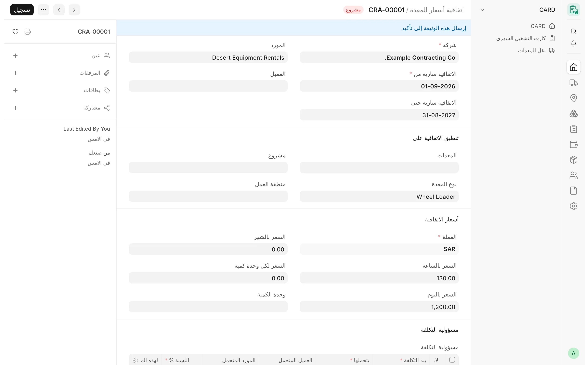

## نظرة عامة

تسجّل **اتفاقية أسعار المعدة** (Card Rate Agreement)، لشركة واحدة، الأسعار المتفق عليها لمعدة واحدة – أو لجميع معدات
نوع معدة واحد – مع مورد أو عميل أو كليهما، لفترة زمنية محددة، ويمكن قصرها على مشروع واحد ومنطقة عمل واحدة. ويبيّن
جدول **مسؤولية التكلفة** فيها من يتحمل كل بند من بنود التكلفة (الإيجار، الديزل، النقل، الصيانة) وبأي نسبة.

الغرض من الاتفاقيات أن يكون تغيير السعر سجلًا جديدًا مؤرخًا بدلًا من تعديل بيانات المعدة، وأن يُحفظ تاريخ من اتفق
على دفع ماذا.

:::caution[اختيارية وغير مربوطة بعد]
يمكن إنشاء الاتفاقيات وتقديمها، لكن **لا يقرؤها أي جزء من CARD حتى الآن**. فالكروت الشهرية والترحيل الشهري وعمليات
النقل ما زالت تستخدم الأسعار المسجلة على المعدة. وسيكون استخدام الاتفاقيات في الكروت خيارًا مستقلًا يُفعَّل لكل شركة.
واتفاقيات الأسعار جزء من خط التطوير الحالي (بعد الإصدار v4.7.0)، وتُفتح من المسار `/app/card-rate-agreement`.
:::

<!-- screenshot: rate-agreements-form -->

*اتفاقية أسعار*

## المفاهيم الأساسية

| المفهوم | المعنى |
|---|---|
| الاتفاقية | سجل قابل للتقديم (`CRA-#####`). ولا تُعدَّل الاتفاقية المقدَّمة أبدًا: فالسعر المتغير اتفاقية جديدة. |
| النطاق | الشركة + المعدة أو نوع المعدة + المورد و/أو العميل + مشروع اختياري + منطقة عمل اختيارية. |
| مدة السريان | من **الاتفاقية سارية من** (إلزامي) إلى **الاتفاقية سارية حتى** (الفراغ يعني مفتوحة المدة). |
| مفتاح الاتفاقية | قيم النطاق. ولا يجوز أن تتداخل زمنيًا اتفاقيتان مقدَّمتان لهما المفتاح نفسه. |
| مسؤولية التكلفة | سطور من نوع **مسؤولية تكلفة في الاتفاقية**: بند التكلفة، والجهة المتحملة، والنسبة. |

## المزايا

### حقول الاتفاقية

- **الشركة** – إلزامية.
- **الاتفاقية سارية من** – إلزامي؛ و**الاتفاقية سارية حتى** – اختياري، ولا يجوز أن يسبق تاريخ البداية.
- **المورد** و**العميل** – يلزم أحدهما على الأقل.
- **تنطبق الاتفاقية على**: **المعدات** أو **نوع المعدة** (يلزم أحدهما)، و**المشروع**، و**منطقة العمل**.
- **أسعار الاتفاقية**: **العملة** (عملة الشركة، للقراءة فقط)، و**السعر بالساعة**، و**السعر باليوم**، و**السعر بالشهر**،
  و**السعر لكل وحدة كمية** مع **وحدة الكمية** (إلزامية عند إدخال سعر للكمية).
- جدول **مسؤولية التكلفة** وحقل **ملاحظات**.

التحقق:

- يجب أن تتبع المعدة والمشروع شركة الاتفاقية، ويحتفظ التعديل بالشركة نفسها؛
- عند اختيار معدة يُملأ نوعها تلقائيًا (ويجب أن يطابق النوع المُدخل إن وُجد)؛
- لا يجوز أن تكون الأسعار سالبة، ويلزم في الاتفاقية سعر واحد على الأقل أو سطر واحد لمسؤولية التكلفة؛
- السعر صفر يعني «لا سعر لهذا الأساس»، ولا يعني أبدًا خدمة مجانية؛
- منطقة العمل نص حر، وتُقارن بعد حذف المسافات المحيطة ودون تمييز لحالة الأحرف.

### الاتفاقيات المؤرخة والتداخل

لا يجوز أن تسري في اليوم نفسه اتفاقيتان مقدَّمتان لهما المعدة نفسها ونوع المعدة والمورد والعميل والمشروع ومنطقة العمل
أنفسها. ولتغيير السعر، أنهِ الاتفاقية الحالية أو ألغِها، ثم أنشئ اتفاقية جديدة من تاريخ لاحق. ويجري هذا الفحص عند
الحفظ ومرة أخرى عند التقديم مع قفل على مستوى الشركة، فلا يمكن أن تمرّ اتفاقيتان مقدَّمتان في اللحظة نفسها.

ويجوز أن تتداخل اتفاقيات ذات مفاتيح مختلفة – كاتفاقية لنوع معدة وأخرى لمعدة واحدة من ذلك النوع. ولا يختار CARD
بينهما: فعندما تنطبق أكثر من اتفاقية على معدة وطرف وتاريخ، يعرض البحث كل الاتفاقيات المطابقة ويرفض اختيار إحداها،
فيُنهي المستخدم جميعها عدا واحدة.

### كيفية مطابقة الاتفاقية

تعثر آلية البحث التي ستستخدمها خطوات الكروت والترحيل مستقبلًا على الاتفاقية المقدَّمة الوحيدة التي:

1. تتبع الشركة وتكون سارية في التاريخ المطلوب؛
2. تخص المعدة نفسها، أو (إذا لم تُحدَّد معدة في الاتفاقية) نوع المعدة؛
3. تذكر الطرف المحاسَب (المورد أو العميل)؛
4. تخص المشروع المعطى أو لا تخص أي مشروع، وتخص منطقة العمل المعطاة أو لا تخص أي منطقة.

عدم وجود مطابقة لا يعيد شيئًا، وتعدد المطابقات خطأ.

### مسؤولية تكلفة في الاتفاقية

كل سطر في جدول **مسؤولية التكلفة**:

| الحقل | الخيارات / القواعد |
|---|---|
| بند التكلفة | الإيجار، الديزل، النقل، الصيانة (إلزامي) |
| يتحملها | الشركة، العميل، المورد، طرف آخر (إلزامي) |
| العميل المتحمل | إلزامي عندما يتحملها العميل |
| المورد المتحمل | إلزامي عندما يتحملها المورد |
| طرف آخر متحمل | اسم نصي حر، إلزامي عندما يتحملها طرف آخر |
| النسبة % | الافتراضي 100؛ أكبر من صفر ولا تزيد على 100 |
| لهذه المعدة فقط | اختياري؛ ولا يُستخدم إلا في اتفاقية لنوع معدة، ويجب أن تكون المعدة من ذلك النوع |

القواعد:

- يجب أن يكون مجموع نسب كل بند تكلفة (ولكل معدة محددة في «لهذه المعدة فقط») 100% تمامًا؛
- لا يجوز أن تتكرر الجهة المتحملة نفسها للبند والمعدة نفسيهما؛
- لا يُحتفظ إلا بحقل الطرف الخاص بالجهة المتحملة المختارة؛
- تتبع معدة كل سطر شركة الاتفاقية.

مثال (افتراضي): الإيجار 100% على الشركة؛ والديزل 60% على **العميل أ** و40% على الشركة.

### السجل الرئيسي لأساس الفوترة والأسعار الافتراضية

- لا يوجد في CARD الحالي سجل رئيسي مستقل باسم **أساس الفوترة** (Billing Basis). فأساس الفوترة هو **طريقة الحساب** في
  المعدة (بالساعة، باليوم، بالشهر)، مع **أساس احتساب اليوم** للأسعار اليومية (انظر
  [الكروت الشهرية](/card/ar/features/monthly-cards/)).
- الأسعار الافتراضية لكل فئة معدات أو نوع في الإعدادات **مُخطَّط لها** ولم تُنفَّذ. فحاليًا تحمل كل معدة أسعارها
  الخاصة، والاتفاقية الخاصة بنوع معدة تسجّل أسعارًا على مستوى النوع لكنها لا تُطبَّق بعد.

## سير العمل

1. أنشئ اتفاقية للشركة وللمعدة أو نوع المعدة وللطرف، مع تاريخ البداية.
2. أدخل الأسعار، وعند الحاجة سطور مسؤولية التكلفة.
3. قدّم الاتفاقية. ومنذ ذلك الحين لا يمكن إلا إلغاؤها (وتعديلها) أو إنهاؤها باتفاقية جديدة.
4. عند تغيّر السعر، أنشئ اتفاقية جديدة من التاريخ الجديد وأنهِ الاتفاقية القديمة.

## الصلاحيات

| الدور | الصلاحيات |
|---|---|
| مدير الكروت (Card Manager) | الإنشاء والتعديل والتقديم والإلغاء والتعديل بعد الإلغاء |
| مدير النظام (System Manager) | جميع الصلاحيات، بما فيها الحذف |
| مدير الحسابات (Accounts Manager) | القراءة والطباعة والتقارير والتصدير |
| مستخدم الكروت (Card User) | القراءة والطباعة والتقارير |

تسري صلاحيات المستخدم على الشركات في الاتفاقيات: فلا يرى المستخدم المقيَّد ولا يغيّر إلا اتفاقيات شركاته.

## ذات صلة

- [الكروت الشهرية](/card/ar/features/monthly-cards/)
- [المعدات](/card/ar/features/equipment/)
- [الموردون والعملاء](/card/ar/features/suppliers-customers/)
- [النقل](/card/ar/features/transport/)
