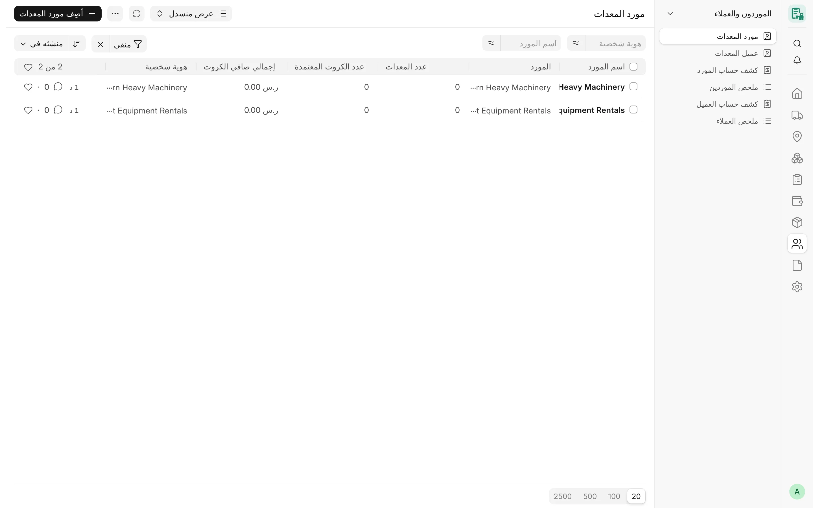
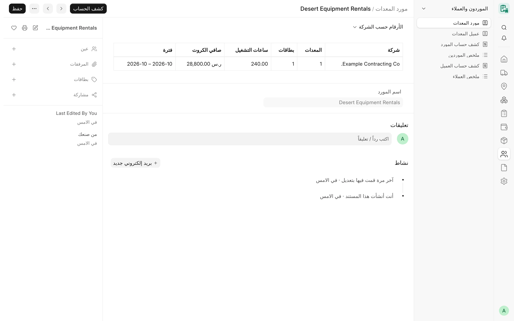
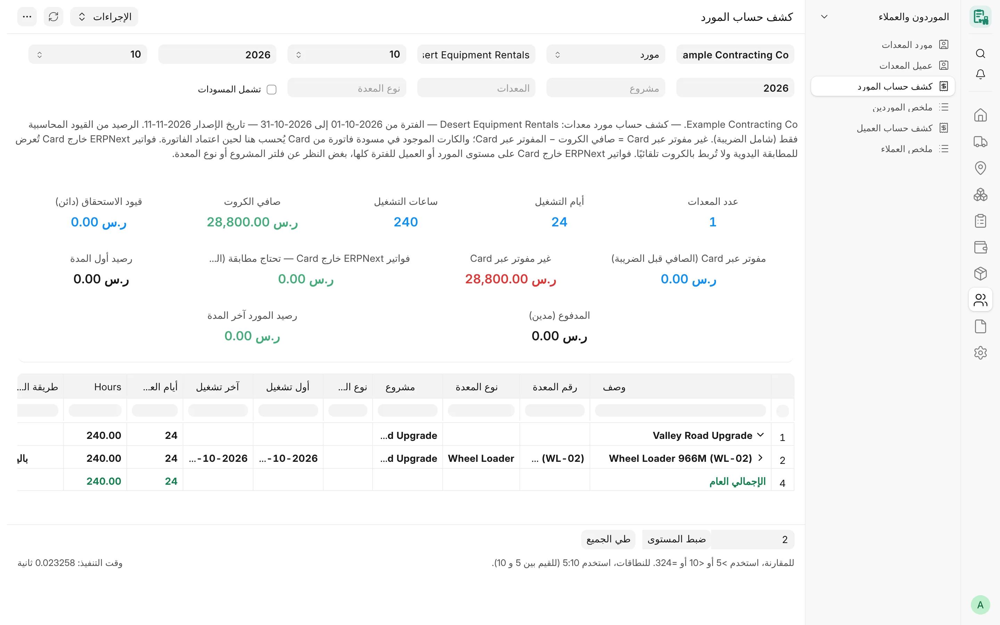

## نظرة عامة

يحتفظ CARD بسجل خفيف للأطراف التي يتعامل معها: **مورد المعدات** (Card Equipment Supplier) للموردين الذين تُستأجر منهم
المعدات، و**عميل المعدات** (Card Equipment Customer) للعملاء الذين تؤجَّر لهم المعدات. وصف السجل ليس إلا مؤشرًا إلى المورد
أو العميل القياسي في ERPNext، و**لا يحفظ أي إجماليات**؛ فكل رقم يُحسب عند عرضه، لكل شركة، وللشركات التي يحق للمستخدم رؤيتها
فقط.

ومن هذه الأطراف ينتج CARD **كشوف الحساب** (طرف واحد وفترة واحدة) و**الملخصات** (كل أطراف الفترة)، ويطابق أرقام الكروت مع ما
فوتر فعلًا عبر CARD ومع دفتر الطرف الرسمي.

<!-- screenshot: suppliers-customers-registry -->

*سجل موردي المعدات*

## المفاهيم الأساسية

| المفهوم | المعنى |
|---|---|
| صف السجل | صف واحد لكل مورد أو عميل في ERPNext، يحمل اسمه. يُنشأ ويُزامَن عند اعتماد كارت لذلك الطرف أو إلغائه. |
| كارت المورد | كارت معتمد لمعدة مستأجرة (ملكية غير «ملك») يُفوتر به المورد. |
| كارت العميل | كارت معتمد يفوتر اتجاهه عميلًا (تأجير للغير أو تأجير من الباطن). |
| صافي الكروت | مبلغ الكارت + الإضافات − الخصومات، قبل الضريبة (جانب المورد)، ويقابله «إجمالي المستحق (من الكروت)» في جانب العميل. |
| مفوتر عبر Card | صافي الكروت الذي فوترته فواتير CARD **المعتمدة**، مقروءًا من مسار الترحيل، قبل الضريبة. |
| غير مفوتر عبر Card | صافي الكروت − المفوتر عبر Card. ويبقى الكارت الموجود في مسودة فاتورة CARD هنا حتى تُعتمد الفاتورة. |
| فواتير ERPNext خارج Card | فواتير الطرف التي لم يبنها CARD، وتُعرض للمطابقة اليدوية، ولا تُطابق مع الكروت آليًا أبدًا. |

## المزايا

### سجلّا الموردين والعملاء

- **المورد** / **العميل**: طرف ERPNext (وهو اسم الصف)، و**اسم المورد** / **اسم العميل** للقراءة فقط.
- حقول الإحصاءات القديمة (عدد المعدات، وعدد الكروت المعتمدة، وإجمالي الساعات، والإجماليات، وأول شهر وآخر شهر، وآخر تحديث)
  مخفية ولم تعد تُحفظ، لأن الإجمالي الواحد للطرف كان يخلط أرقام عدة شركات.
- إعادة تسمية طرف ERPNext تعيد تسمية صف سجله، ودمج الطرف يحذف صف الطرف المدموج ويعيد حساب الطرف الباقي.
- لا يمكن تفعيل تتبع التغييرات على السجلين، لأن تاريخهما القديم يحمل أرقام كل الشركات.

المستخدم المقيّد ببعض الشركات لا يرى إلا الأطراف التي لها كارت مسودة أو معتمد في إحدى تلك الشركات.

### الأرقام حسب الشركة

يعرض فتح صف السجل جدول **الأرقام حسب الشركة**، المحسوب لحظيًا من الكروت المعتمدة لذلك الطرف في الشركات التي يحق للمستخدم
رؤيتها:

| العمود | المحتوى |
|---|---|
| الشركة | شركة الكروت |
| المعدات | عدد المعدات المختلفة |
| الكروت | عدد الكروت المعتمدة |
| ساعات التشغيل | إجمالي ساعات العمل |
| صافي الكروت / إجمالي المستحق (من الكروت) | صافي المورد، أو صافي مبلغ العميل |
| الفترة | أول شهر تشغيل وآخر شهر |

ويفتح زر **كشف الحساب** كشف الطرف لآخر شهر تشغيل له (أو للشهر الميلادي السابق إذا لم يُعرف)، مع اختيار الشركة مسبقًا إذا
كان الطرف يتعامل مع شركة واحدة فقط.

<!-- screenshot: suppliers-customers-figures -->

*أرقام المورد*

### تحديث الأرقام

تعيد الدالتان `refresh_supplier` و`refresh_customer` مزامنة طرف واحد (أو كل طرف له كروت معتمدة)، وهما مقصورتان على دور
**System Manager**. ولأن الأرقام لم تعد تُحفظ، فإن التحديث يقتصر على التأكد من وجود صف السجل وأنه يحمل اسم طرفه.

:::note
إذا فشلت مزامنة السجل أثناء اعتماد كارت، يُحفظ الكارت مع ذلك وتظهر رسالة تذكر زر «تحديث الأرقام». ولا يوجد هذا الزر في
النموذج حاليًا، ويستطيع مدير النظام تشغيل التحديث عبر الواجهة البرمجية.
:::

### كشف حساب المورد

يجمع **كشف حساب المورد** (Equipment Supplier Statement) كروت التشغيل الشهرية حسب **المشروع ← المعدة ← الكارت** لمورد واحد
وفترة واحدة.

عوامل التصفية: **الشركة**، و**نوع الكشف** («مورد» أو «معدات ملك»، والقيمة الافتراضية من الإعدادات)، و**المورد**، و**من شهر
/ من سنة**، و**إلى شهر / إلى سنة**، و**المشروع**، و**المعدة**، و**نوع المعدة**، و**تشمل المسودات** (الافتراضي من «تضمين
الكروت المسودة في التقارير»).

تشمل الأعمدة الوصف، ورقم المعدة ونوعها، ونوع الوردية، ونوع السعر، وأساس فوترة اليوم، وأول تشغيل وآخر تشغيل، وأيام العمل،
والساعات، والسعر، وسعر الساعة، ومبلغ التشغيل، والإضافات، والخصومات، والصافي.

أرقام الملخص:

- **عدد المعدات**، و**أيام التشغيل**، و**ساعات التشغيل**، و**صافي الكروت**؛
- لمن لديه صلاحية دفتر الأستاذ العام: **رصيد أول المدة**، و**قيود الاستحقاق (دائن)**، و**المدفوع (مدين)**، و**رصيد المورد
  آخر المدة** من قيود المورد في الأستاذ (شاملة الضريبة)؛
- **مفوتر عبر Card (الصافي قبل الضريبة)**، و**غير مفوتر عبر Card**، و**فواتير ERPNext خارج Card — تحتاج مطابقة (الصافي قبل
  الضريبة)**.

ويعرض نوع «معدات ملك» معدات الشركة نفسها حسب المشروع بالساعات فقط (بلا أعمدة مالية).

:::note
تُزال أعمدة الأستاذ وبطاقاته على الخادم، لا تُخفى فقط، للمستخدمين الذين لا يملكون صلاحية دفتر الأستاذ العام، ويذكر الكشف
حينئذ أن أرصدة الأستاذ لا تظهر إلا لأصحاب هذه الصلاحية.
:::

### كشف حساب العميل

**كشف حساب العميل** (Equipment Customer Statement) هو المقابل في جانب العميل: الكروت التي يُفوتر بها العميل (التأجير للغير
والتأجير من الباطن)، مجمعة حسب المشروع والمعدة والكارت. وعوامل التصفية نفسها بلا نوع الكشف. وتأتي أرقام الأستاذ من قيود
العميل: **رصيد أول المدة**، و**قيود الفوترة (مدين)**، و**المحصّل (دائن)**، و**رصيد العميل آخر المدة**. ولا يحفظ CARD
رصيدًا للعميل، فتبقى هذه الأرقام صفرًا حتى تُرحَّل فواتير المبيعات.

### ملخصا الموردين والعملاء

يعرض **ملخص الموردين** (Equipment Suppliers Summary) و**ملخص العملاء** (Equipment Customers Summary) صفًا لكل طرف له كروت
معتمدة في الفترة، دون أي خطوة تسجيل. وعوامل التصفية: الشركة والفترة والمشروع.

الأعمدة: رمز الطرف واسمه، والمعدات، والكروت، والساعات، وأيام التشغيل، وصافي الكروت (أو إجمالي المستحق)، والمفوتر وغير المفوتر
عبر Card، والفواتير خارج Card، ولقراء الأستاذ: رصيد أول المدة، وقيود الاستحقاق أو قيود الفوترة، والمدفوع أو المحصّل،
ورصيد آخر المدة. والنقر على اسم الطرف يفتح كشفه. ويُبرز أي فرق بين صافي الكروت والمفوتر عبر Card.

### طباعة الكشف على A4

لكشف المورد تنسيق طباعة قياسي للتقرير باسم **Equipment Supplier Statement A4**، يُختار مسبقًا في نافذة الطباعة وPDF:

- تخطيط طباعة أبيض قياسي، واسم الشركة فوق العنوان؛
- تفاصيل الكشف في أزواج «تسمية/قيمة»، ثم جدول الصفوف، ثم جدول الإجماليات تحت أعمدة المبالغ؛
- الطباعة كلها بلغة المستخدم، واتجاه الصفحة يتبعها؛
- عمودا **الإضافات** و**الخصومات** لا يظهران إلا عند استخدامهما؛
- صفحة A4، وخطوط التوقيع في الأسفل.

يُولَّد ملف PDF على الخادم من نتائج التقرير بصلاحيات المستخدم نفسه، وبالتخطيط ذاته الذي تستخدمه طباعة المتصفح، فيظهر النص
العربي متصلًا الحروف تشكيلًا صحيحًا.

<!-- screenshot: suppliers-customers-a4 -->

*كشف حساب مورد المعدات*

### حالة التسوية

**حالة تسوية الكروت** (Card Settlement Status) تقرير للقراءة فقط لدورَي **System Manager** و**Accounts Manager**. وعوامل
التصفية: **الشركة**، و**نوع الطرف** (مورد أو عميل)، و**الطرف**، و**من تاريخ**، و**إلى تاريخ**.

ويعرض لكل كارت معتمد للطرف صافي الكارت، والمستند الذي أثبته (**نوع مستند الاستحقاق** و**مستند الاستحقاق**)، و**حصة الكارت من
المستند**، و**المسدد على الكارت**، و**إشعارات دائنة وتسويات**، و**المتبقي على الكارت**، و**حالة التسوية**:

| الحالة | المعنى |
|---|---|
| غير مستحق بعد | لا تحجز الكارت فاتورة CARD ولا فاتورة مربوطة ولا قيد يومية مربوط |
| مستند الاستحقاق مسودة | فاتورة الاستحقاق غير معتمدة |
| لم يُعثر على قيد المستند في دفتر المدفوعات | ليس للمستند صف في دفتر المدفوعات، ويجب فحصه |
| مستحق – غير مسدد | مُثبت، ولم يُدفع منه شيء ولم يُسوَّ بعد |
| مسدد جزئياً | دُفع جزء من حصة الكارت أو سُوّي |
| مسدد بالكامل | لم يتبقَّ شيء |

تأتي كل المبالغ من دفتر المدفوعات (Payment Ledger) لمستند الاستحقاق (شاملة الضريبة في الفواتير). والمستند الذي أثبت عدة مصادر
يُقسم بحسب مبالغها، وتُخصص مدفوعاته للأقدم أولًا. وتُعرض مدفوعات الطرف غير المخصصة لأي مستند على حدة، وتُسوّى في ERPNext عبر
«تسوية المدفوعات» (Payment Reconciliation)، لا في CARD أبدًا.

## سير العمل

1. اعتمد كروت الشهر، فيُنشأ صف المورد أو العميل في السجل أو يُزامن تلقائيًا.
2. افتح صف السجل لرؤية الأرقام حسب الشركة، أو اضغط **كشف الحساب**.
3. راجع **غير مفوتر عبر Card** قبل الترحيل الشهري، ومرة أخرى بعد اعتماد الفواتير (يُفترض أن يكون صفرًا).
4. راجع **فواتير ERPNext خارج Card** بحثًا عن تكرار محتمل.
5. اطبع كشف المورد على A4 للتوقيع.
6. تابع المدفوعات في **حالة تسوية الكروت**.

## الصلاحيات

| البند | الأدوار |
|---|---|
| السجلات (قراءة) | System Manager وCard Manager وCard User وAccounts Manager |
| السجلات (إنشاء وكتابة) | System Manager وCard Manager |
| كشوف الحساب والملخصات | System Manager وCard Manager وCard User وAccounts Manager |
| أعمدة الأستاذ في الكشوف والملخصات | المستخدمون الذين لديهم صلاحية دفتر الأستاذ العام |
| حالة تسوية الكروت | System Manager وAccounts Manager |
| تحديث صف في السجل | System Manager |

## ذات صلة

- [كروت التشغيل الشهرية](/card/ar/features/monthly-cards/)
- [الفوترة والترحيل](/card/ar/features/invoicing-posting/)
- [تنسيقات الطباعة](/card/ar/features/print-formats/)
- [تقارير الأطراف وكشوف الحساب](/card/ar/reports/parties-statements/)
- [واجهة الأطراف وكشوف الحساب البرمجية](/card/ar/api-reference/parties-statements/)
