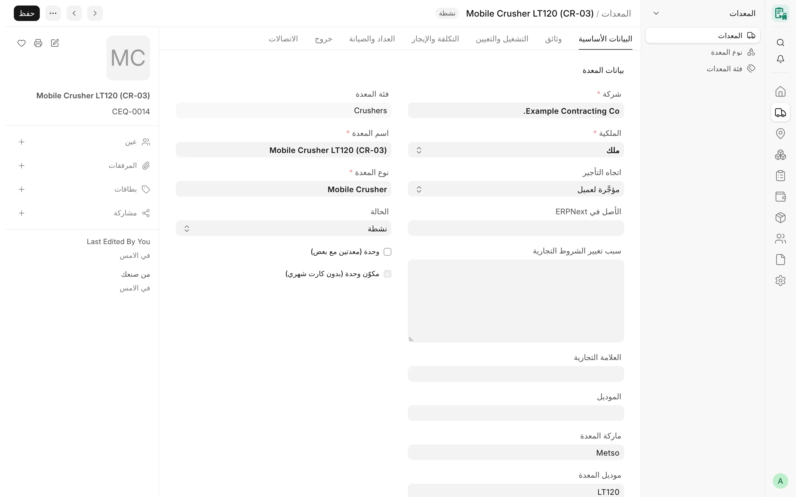

## نظرة عامة

بعض المعدات لا تعمل إلا معًا، مثل الكسارة المتنقلة والمولد الذي يشغّلها. ويسجّل CARD هذا الزوج بوصفه **وحدة**: سجل
معدة واحد يسرد قطعه بوصفها **مكوّنات**. وتبقى الوحدة **معدة واحدة في كارتها الشهري**، فتُسعَّر وتُفوتَر مرة واحدة،
بينما يحتفظ جدول المكوّنات بالسجل المؤرَّخ للقطع التي كانت ضمنها.

الوحدات مقصورة على المعدات المملوكة. وتبقى كل قطعة سجل معدة مستقلًا بأصلها ومستنداتها وعدادها، لكنها ما دامت داخل
الوحدة تُفوتَر في كارت الوحدة لا في كارت خاص بها.

<!-- screenshot: units-components-unit-form -->

*كسارة في نموذج المعدات*

## المفاهيم الأساسية

| المفهوم | المعنى |
|---|---|
| **الوحدة** | معدة مفعّل فيها خيار **وحدة (معدتين مع بعض)**. |
| **المكوّن** | صف في جدول **المكوّنات** الخاص بالوحدة: القطعة (سجل معدة)، و**الدور** (نص حر مثل «مولد»)، وتاريخا **من** و**إلى**، و**سبب التغيير**. |
| **المكوّن الحالي** | صف بلا تاريخ **إلى**. أما الصف الذي له تاريخ «إلى» فهو سجل تاريخي، أي أن القطعة غادرت الوحدة. |
| **علامة مكوّن الوحدة** | الحقل **مكوّن وحدة (بدون كارت شهري)** في القطعة — للقراءة فقط، ويُشتق من جداول مكوّنات الوحدات. |

## المزايا

### قاعدة الملكية

- يجب أن تكون الوحدة وكل قطعة تنضم إليها «ملك». ويكون خيار **الوحدة** للقراءة فقط في المعدة غير المملوكة.
- لا يمكن تغيير ملكية الوحدة أو أي مكوّن حالي فيها إلى غير «ملك»؛ أخرج القطعة من الوحدة أولًا.
- لا تعرض قائمة اختيار المكوّنات إلا المعدات المملوكة التابعة للشركة نفسها والتي ليست وحدات.
- لا تُغيَّر السجلات التي أُنشئت قبل هذه القاعدة. ويوجد فحص للقراءة فقط يسرد أي وحدة أو قطعة قائمة تخالفها، أو لا
  تتطابق علامة المكوّن فيها مع الجداول (انظر [واجهة API: المعدات](/card/ar/api-reference/equipment/)).

### قواعد المكوّنات

يتحقق منها الخادم في كل مرة يتغير فيها جدول المكوّنات:

- لا يسرد المكوّنات إلا الوحدة.
- لا تكون الوحدة مكوّنًا لنفسها، ولا تكون الوحدة مكوّنًا في وحدة أخرى.
- لا يكون المكوّن نفسه وحدة.
- لا تُدرج القطعة مرتين بين المكوّنات الحالية، ولا تكون مكوّنًا حاليًا في وحدتين في آن واحد.
- ينتمي كل مكوّن إلى شركة الوحدة.
- لا يكون تاريخ **إلى** في الصف سابقًا لتاريخ **من**.
- لا تُغيَّر صفوف المكوّنات إلا من خلال الوحدة نفسها: يُرفض حفظ الصف أو نقله أو تحديثه منفردًا، حتى يُسجَّل كل تغيير
  في تاريخ الوحدة. ويُسمح بتغيير **الدور** وحده.
- صفوف المكوّنات في مستوى الصلاحية 1، فلا يغيّرها إلا مدير CARD ومدير النظام.

### التواريخ والسجل التاريخي

يحدد تاريخا **من** و**إلى** متى تُعدّ القطعة جزءًا من الوحدة (والتاريخ الفارغ مفتوح من جهته). وتتيح قائمة **الوحدة**
في نموذج الوحدة إجراءين يحفظان السجل دون تعديل الصفوف يدويًا:

| الإجراء | ما يفعله |
|---|---|
| **استبدال مكوّن** | اعتبارًا من التاريخ المختار تحل قطعة جديدة محل القطعة القديمة: يُضبط «إلى» في الصف القديم على اليوم السابق، ويبدأ صف جديد بالدور نفسه في ذلك التاريخ. |
| **نقل لوحدة تانية** | اعتبارًا من التاريخ المختار تغادر القطعة هذه الوحدة وتنضم إلى وحدة مملوكة أخرى للشركة نفسها. |

يطلب كلا الإجراءين المكوّن والتاريخ وسبب تغيير اختياريًا، ويرفضان ما يلي:

- تاريخًا يساوي تاريخ «من» في الصف الحالي أو يسبقه؛
- تاريخًا يغطيه كارت شهري **معتمد** للوحدة (أو للوحدة المستهدفة)، فالفترة المعتمدة لا يُعاد كتابتها أبدًا؛
- قطعة ليست على المشروع الحالي للوحدة في ذلك التاريخ إذا كان لها سجل تعيينات؛ وعندئذ تُنقل إليه أولًا عبر
  [نقل المعدات](/card/ar/features/transport/).

ولا تظهر الأزرار إلا للمستخدمين الذين يملكون صلاحية الكتابة في جدول المكوّنات.

### علامة مكوّن الوحدة

يُفعَّل الحقل **مكوّن وحدة (بدون كارت شهري)** تلقائيًا في القطعة ما دامت مكوّنًا حاليًا في وحدة، ويُلغى عند مغادرتها،
ويترك كل تغيير تعليقًا على القطعة. ولا يضبطه يدويًا الحفظ ولا واجهة REST ولا الاستيراد.

### الأثر على الكروت الشهرية والتعيينات

- كارت الوحدة يحمل قطعها: لا يجوز لكارت القطعة الخاص بها أن يسجّل ساعات عمل في يوم يقع ضمن إحدى فترات كونها مكوّنًا.
- لا يكون اليوم في كارت الوحدة صالحًا على مشروع إلا إذا كانت الوحدة (إن كانت لها تعيينات) و**كل** مكوّن فيها في ذلك
  اليوم معيّنة على ذلك المشروع، وتسرد رسالة الخطأ القطع غير المعيّنة مع فترات تعيينها.
- تستخدم الوحدة التي لا تعيين خاصًا بها تعييناتِ مكوّناتها لتحديد مشاريعها.
- يحتسب تقرير [سجل مواقع المعدات](/card/ar/features/assignments-locations/) تاريخ المكوّن ضمن الوحدة في الأيام التي
  يكون فيها داخل الوحدة فقط.

## سير العمل

1. أنشئ كل قطعة بوصفها معدة مملوكة.
2. أنشئ المعدة الرئيسية (أو افتحها)، وفعّل **وحدة (معدتين مع بعض)**، وأضف القطع في **المكوّنات** مع أدوارها وتواريخ «من».
3. انقل الوحدة وقطعها إلى المشروع بعملية [نقل معدات](/card/ar/features/transport/) واحدة.
4. سجّل الكارت الشهري على الوحدة فقط.
5. عند استبدال قطعة أو نقلها إلى وحدة أخرى، استخدم **الوحدة ← استبدال مكوّن** أو **الوحدة ← نقل لوحدة تانية** مع
   تاريخ التغيير.

## الصلاحيات

| الدور | خيار الوحدة والمكوّنات |
|---|---|
| مدير النظام، مدير CARD | قراءة وكتابة (ومنها إجراءا الاستبدال والنقل) |
| مستخدم CARD، مدير الحسابات | قراءة |

## ذات صلة

- [المعدات](/card/ar/features/equipment/)
- [التعيينات والمواقع](/card/ar/features/assignments-locations/)
- [الكروت الشهرية](/card/ar/features/monthly-cards/)
- [النقل](/card/ar/features/transport/)
