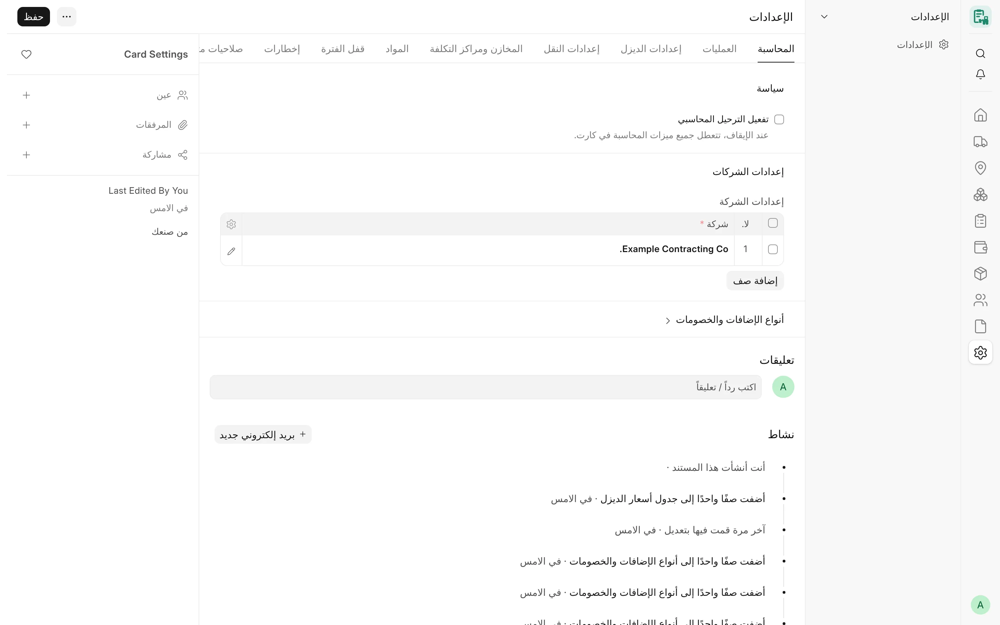

## نظرة عامة

تقع جميع إعدادات CARD في نوع مستند مفرد واحد هو **Card Settings** «الإعدادات»، ويُفتح من مدخل **الإعدادات** في
مشغِّل التطبيق. يضم قيمًا على مستوى الموقع (الورديات، والتنبيهات، وسياسة مورد الديزل، وقفل الفترة، والإشعارات)،
وجدول **Card Company Settings** «إعدادات كارت للشركة» بصف واحد لكل شركة: حسابات تلك الشركة وأصنافها وقوالب ضرائبها
وسعر الديزل ومخازنها وقواعد معداتها.

لكل قيمة قيمة افتراضية مدمجة. وعندما لا يُضبط حقل ما أبدًا، يتصرف CARD كما كان يتصرف قبل وجود ذلك الحقل؛ لذا
يعمل الموقع الجديد بإعدادات فارغة إلى أن يُفعَّل الترحيل المحاسبي.

<!-- screenshot: configuration-card-settings -->

*إعدادات الكارت*

## المفاهيم الأساسية

| المفهوم | المعنى |
|---|---|
| قيمة الموقع | حقل في الإعدادات نفسها، ينطبق على كل الشركات. |
| صف الشركة | صف في جدول **إعدادات الشركة** (Card Company Settings)، ينطبق على تلك الشركة وحدها. وللشركة صف واحد على الأكثر. |
| القيمة البديلة | بعض قيم الشركة اختيارية؛ فإذا كانت فارغة طُبِّقت قيمة الموقع (المخازن، وأيام الطلب المتكرر). |
| مستوى الحقل | لحقول الإعدادات مستويات صلاحية؛ حقول المستوى 2 قيم سياسات، وحقول المستوى 1 هي صفوف الشركات وجدول أسعار الديزل. راجع [من يستطيع تغيير الإعدادات](#من-يستطيع-تغيير-الإعدادات). |

## المزايا

### تبويب «المحاسبة»

- **تفعيل الترحيل المحاسبي** — عند إيقافه تتعطل جميع مزايا CARD المحاسبية. القيمة الافتراضية: متوقف.
- **إعدادات الشركة** — جدول صفوف إعدادات الشركات (راجع [إعدادات كارت للشركة](#إعدادات-كارت-للشركة)).
- **أنواع الإضافات والخصومات** — أنواع الإضافات والخصومات المهيّأة لكل شركة. لكل نوع **اسم النوع**، و**النوع**
  («إضافة» أو «خصم»)، و**الحساب** (حساب مصروف في جانب المشتريات وحساب إيراد في جانب المبيعات)، و**خاضع للضريبة**،
  و**الصنف** (صنف خدمي غير مخزني يُنشأ تلقائيًا)، و**رسوم توقف**، و**معطَّل**. يُرحَّل كل نوع إلى حسابه الخاص سطرًا
  في الفاتورة؛ وتحمل الأنواع الخاضعة للضريبة نسبة ضريبة القيمة المضافة المأخوذة من قوالب ضرائب الشركة، والأنواع
  غير الخاضعة نسبة 0%. وتُخفى الأنواع المعطّلة من صفوف الكروت الجديدة، وتبقى الصفوف القائمة صحيحة.

:::note
الحقل **ترحيل تلقائي** (Auto-submit postings) مُهمَل: مخفي وللقراءة فقط وغير مستخدم.
:::

### تبويب «التشغيل»

**القيم الافتراضية**

| الحقل | الافتراضي | الأثر |
|---|---|---|
| الوردية الافتراضية | «نهاري» | الوردية المقترحة في الكارت الشهري الجديد |
| أقصى ساعات الوردية النهارية / الليلية | 12 / 12 | عدد الساعات اليومية الذي يُظهر الكارت بعده تحذيرًا (دون منع أبدًا؛ وتُفوتَر جميع الساعات) |
| الساعات اليومية الافتراضية (للمعدات الجديدة فقط) | 0 | تملأ المعدات الجديدة فقط؛ والقيمة 0 تعني عدم وجود افتراضي |
| الوقود على حساب (افتراضي للمعدات الجديدة) | فارغ | «المؤجر» أو «الشركة» |
| المشغّل على حساب (افتراضي للمعدات الجديدة) | فارغ | «المؤجر» أو «الشركة» |
| أساس السعر الافتراضي | فارغ | يملأ أساس سعر المورد والعميل في المعدات الجديدة إذا تُرك فارغًا: «باليوم» أو «بالساعة» أو «بالشهر» |
| ساعات الشهر القياسي | 260 | عدد الساعات التي يوزَّع عليها السعر الشهري (26 يومًا × 10 ساعات) |
| المزامنة اليومية لموقع المعدات | متوقفة | عند تفعيلها تضبط مهمة يومية المشروع الحالي لكل معدة وتاريخ تعيينها من التعيين الساري اليوم، ويُترك تعليق عند استبدال قيمة. ولا تتغير أبدًا المعدات التي ليس لها سجل تعيينات |

**التنبيهات**

- **تنبيه عند تجاوز ساعات اليوم للساعات اليومية** (مفعّل افتراضيًا).
- **تنبيه عند وقوع تواريخ الكارت خارج فترة الإيجار** (مفعّل افتراضيًا؛ للمعدات المستأجرة فقط).

**افتراضيات التقارير**

- **سماحية المطابقة** — القيمة الافتراضية 0.01.
- **نوع كشف الحساب الافتراضي** — «مورد» أو «معدات ملك»؛ والافتراضي «مورد».
- **تضمين الكروت المسودة في التقارير** — متوقف افتراضيًا.

### تبويب «إعدادات الديزل»

- **سعر لتر الديزل** — يُعرض في الأعلى قيمةً واحدة لكل شركة: سعر صف جدول أسعار الديزل الساري اليوم لتلك الشركة، أو
  — للشركة التي ليس لها جدول — قيمة **سعر لتر الديزل** في صف الشركة. ولا يظهر منتقي الشركة إلا عند وجود عدة شركات.
  ويحصل المستخدمون الذين يملكون صلاحية الكتابة في المستوى 1 على زر لتغيير السعر.
- **جدول أسعار الديزل** — أسعار مؤرّخة (صفوف **Card Diesel Price**): الشركة، ونوع الوقود (ديزل)، و**سعر الديزل ساري
  من**، و**سعر لتر الديزل**، والعملة (عملة الشركة)، ووحدة قياس اختيارية. تأخذ التعبئة السعر الساري في تاريخها. ومتى
  صار للشركة صفوف في الجدول، لا يتغير سعرها إلا بإضافة صف مؤرّخ جديد.
- **سياسة مورد الديزل** — «ثابت» (مورد ديزل واحد يُحدَّد في **مورد الديزل**) أو «متغير» (الافتراضي: يُختار المورد في
  كل تعبئة).

راجع [الديزل](/card/ar/features/diesel/) لمعرفة كيفية استخدام التعبئات لهذه القيم.

### تبويب «إعدادات النقل»

- **سعر النقل لكل مشروع** — جدول من **المشروع** و**قيمة النقل**: سعر النقل المعياري لكل مشروع. ولا يغيّره إلا دور
  تعديل سعر النقل (راجع تبويب الصلاحيات المتقدمة).

### تبويب «المخازن ومراكز التكلفة»

- **مركز التكلفة لكل ورشة / مستودع** — صفوف من الشركة و**المكان** (موقع Location في ERPNext) و**مركز التكلفة**.
  ويُحمَّل النقل إلى تلك الورشة أو ذلك المستودع على مركز التكلفة المحدد.

### تبويب «المواد»

قيم على مستوى الموقع لـ [احتياجات المعدات](/card/ar/features/equipment-needs/) و[عهدة الأدوات](/card/ar/features/tool-custody/):

- **المخزن الرئيسي** — المخزن الذي تستخدمه مراجعات احتياجات المعدات، والمخزن الافتراضي لعهدة الأدوات.
- **مخزن عهدة الأدوات** — المخزن الذي يحتفظ بالأدوات المسلّمة عهدةً للموظفين.
- **تنبيه للطلب المتكرر خلال (يوم)** — الافتراضي 30. يُعلَّم طلب الصنف نفسه خلال هذه المدة للمراجعة (ولا يُرفض أبدًا).

ويمكن لصف الشركة أن يتجاوز القيم الثلاث.

### تبويب «قفل الفترة»

- **تاريخ قفل الفترة** — تُقفَل الكروت وتعبئات الديزل وعمليات النقل المؤرّخة في هذا التاريخ أو قبله: فلا يجوز
  إنشاؤها أو تعديلها أو اعتمادها أو إلغاؤها أو تعديلها بعد الإلغاء (amend) أو حذفها.
- **دور تجاوز قفل الفترة** — يجوز لأصحاب هذا الدور تجاوز القفل. ويُسجَّل كل تجاوز ويُكتب تعليقًا على المستند، ويمكن
  أن يُرسل إشعارًا (راجع [الإشعارات والتنبيهات](/card/ar/features/notifications-alerts/)).

### تبويب «الإشعارات»

جميع الإشعارات متوقفة افتراضيًا:

- **إشعار عند اعتماد الكارت**
- **إشعار عند تجاوز قفل الفترة**

والحقل **إشعار عند الترحيل المحاسبي** مُهمَل (مخفي وللقراءة فقط وغير مستخدم).

### تبويب «صلاحيات متقدمة»

أدوار تتيح إجراءات بعينها، وكل حقل منها رابط إلى دور:

| الحقل | الافتراضي | ما يجوز لصاحب الدور فعله |
|---|---|---|
| دور تعديل مورد الديزل | Card Manager | تغيير مورد تعبئة الديزل (في السياسة «متغير» فقط؛ ومع السياسة «ثابت» لا يجوز لأحد) |
| دور استثناء سعر الديزل | Accounts Manager | اعتماد استثناء في سعر الديزل على تعبئة (مع ذكر السبب) |
| دور السعر الصفري للديزل | فارغ | حفظ تعبئة بسعر صفري. والقيمة الفارغة تعني أنه لا يجوز لأحد |
| دور تعديل سعر النقل | Card Manager | تغيير سعر النقل لكل مشروع |

### إعدادات كارت للشركة

صف واحد لكل شركة في جدول **إعدادات الشركة**، وحقل **الشركة** إلزامي.

**الحسابات**

- حساب مصروف إيجار المعدات
- حساب مصروف الديزل
- حساب مصروف النقل والتجهيز
- حساب إيراد إيجار المعدات
- الدائنون (حسابات الدفع)
- المدينون (حسابات القبض)
- مركز التكلفة

**قوالب الضرائب**

- قالب ضريبة المشتريات (Purchase Taxes and Charges Template)
- قالب ضريبة المبيعات (Sales Taxes and Charges Template)

**الأصناف**

- صنف الإيجار، وصنف الديزل، وصنف النقل، وصنف التأجير للغير — الأصناف الخدمية المستخدمة في أسطر الفواتير التي يبنيها
  CARD.

**التسعير**

- **سعر لتر الديزل** — سعر الديزل للشركة عندما لا يكون لها جدول أسعار ديزل.

**التسوية**

- **قالب ضريبة الصنف (نسبة الشركة)** — قالب ضريبة القيمة المضافة لكل سطر بالنسبة الوحيدة الواردة في قوالب ضرائب
  المشتريات والمبيعات للشركة، ويُنشأ تلقائيًا باسم `CARD VAT <rate>% - <abbr>`.
- **قالب ضريبة الصنف 0%** — قالب 0% لكل سطر لأسطر الإضافات والخصومات غير الخاضعة للضريبة، ويُنشأ باسم
  `CARD VAT 0% - <abbr>`.
- **أساس ضريبة سعر الديزل** (Diesel price VAT basis) — Exclusive (غير شامل) أو Inclusive (شامل).
- **فحص مشروع تعبئة الديزل** — «إيقاف» أو «تنبيه فقط» (الافتراضي) أو «رفض». تتطلب تعبئة الديزل الجديدة (أو التي تغيّرت
  شركتها أو معداتها أو مشروعها أو تاريخها) أن تكون كل معدة معيّنة على مشروع التعبئة في تاريخها. ولا تُفحص التعبئات
  المعتمدة مرة أخرى أبدًا.

**المعدات والنقل**

- **المكان الابتدائي للمعدة الجديدة** — المكان الذي تُسجَّل فيه معدة هذه الشركة التي ليس لها تاريخ حركة، ويظهر بوصفه
  «من» في أول نقل لها. والقيمة الفارغة تعني مستودعًا دون مكان محدد.
- **قاعدة يوم النقل** — في النقل من مشروع إلى مشروع: «التخصيص الجديد يبدأ في اليوم التالي للنقل» (الافتراضي؛ ويبقى
  يوم النقل للمشروع القديم) أو «التخصيص الجديد يبدأ في يوم النقل».
- **قاعدة حالة المعدة** — «تحذير فقط» (الافتراضي) أو «رفض»، للمعدة ذات الحالة «منتهية» عند إنشاء تعيين أو نقل أو كارت
  شهري جديد. ولا يُمنع أبدًا إرجاعها إلى المورد، ولا نقل المعدة المملوكة إلى مستودع أو ورشة، ولا كارت شهر خروجها.

**المواد**

- **المخزن الرئيسي** و**مخزن عهدة الأدوات** و**تنبيه للطلب المتكرر خلال (يوم)** — القيمة الفارغة أو 0 تعني تطبيق
  قيمة الموقع في تبويب «المواد». ويجب أن تكون المخازن مخازن مخزنية مفعّلة (غير مجمِّعة) تابعة لهذه الشركة. ولا
  يجوز تغيير مخزن عهدة الأدوات ما دامت أي أداة من أدوات الشركة في عهدة أحد.

**ترحيل النقل حسب المسؤولية**

- **ترحيل نقل المعدات حسب المسؤولية** — «تعليق» (الافتراضي) يُبقي عمليات النقل المسجّلة بسيناريو مسؤولية خارج
  الفواتير الشهرية (ويعرضها تقرير مراجعة محاسبة النقل)؛ و«ترحيل» يضيفها إلى الفواتير الشهرية المسودة. لا تنتقل إلى
  «ترحيل» إلا بعد موافقة المحاسب والمستشار الضريبي.
- **حساب إيراد إعادة تحميل النقل** — يظهر مع «ترحيل» فقط: حساب إيراد تكلفة النقل المفوترة على العميل. ويجب أن يكون
  حسابًا مفعّلًا غير مجمِّع تابعًا لهذه الشركة.

:::note
الحقلان **حساب البنك / النقدية** و**طريقة الدفع** في صف الشركة مُهمَلان: مخفيان وللقراءة فقط وغير مستخدمين.
:::

### فحص الإعداد

:::caution[مخطَّط له]
إجراء «فحص الإعداد» الذي يتحقق من الإعداد كله دفعة واحدة مخطَّط له وغير متاح بعد. وحتى يتوفر، يتحقق CARD من كل قيمة
في موضع استخدامها: يرفض الترحيل بناء الفاتورة عند غياب حساب أو صنف أو قالب ضريبة أو البُعد المحاسبي، ويسمّي
الناقص.
:::

## سير العمل

1. افتح **الإعدادات** من مشغِّل CARD.
2. في تبويب **المحاسبة** أضف صفًا في **إعدادات الشركة** لكل شركة، واملأ حساباتها وقوالب ضرائبها وأصنافها.
3. أضف أنواع الإضافات والخصومات التي تستخدمها.
4. راجع القيم الافتراضية والتنبيهات في تبويب **التشغيل**.
5. اضبط سعر الديزل (الجدول أو سعر الشركة) وسياسة مورد الديزل.
6. اضبط المخازن في تبويب **المواد** أو في صف كل شركة.
7. عند اكتمال كل شيء، يفعّل مستخدم مخوَّل **تفعيل الترحيل المحاسبي**.

## من يستطيع تغيير الإعدادات

| الدور | المستوى 0 (النموذج والجداول) | المستوى 1 (صفوف الشركات وجدول أسعار الديزل) | المستوى 2 (قيم السياسات) |
|---|---|---|---|
| System Manager | قراءة وكتابة | قراءة وكتابة | قراءة وكتابة |
| Accounts Manager | قراءة وكتابة | قراءة وكتابة | قراءة |
| Card Manager | قراءة | — | قراءة |

المستخدم المقيَّد ببعض الشركات عبر صلاحيات المستخدم (Company User Permissions) لا يرى ولا يغيّر إلا صفوف الشركات
وأنواع الإضافات والخصومات وأسعار الديزل الخاصة بشركاته؛ إذ يحذف الخادم من النموذج صفوف الشركات الأخرى وسجل
تغييراتها.

## صفحات ذات صلة

- [التثبيت](/card/ar/getting-started/installation/)
- [الفوترة والترحيل](/card/ar/features/invoicing-posting/)
- [الديزل](/card/ar/features/diesel/)
- [الأدوار والصلاحيات](/card/ar/features/roles-permissions/)
