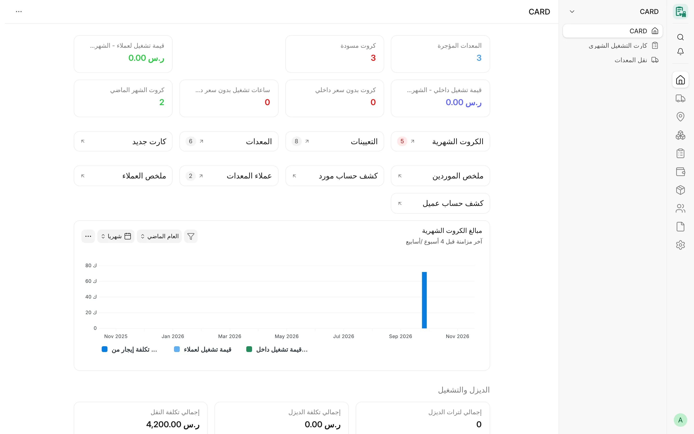

## نظرة عامة

CARD تطبيق مبني على إطار Frappe، موجَّه إلى المقاولين الذين يمتلكون المعدات الثقيلة أو يستأجرونها أو يشغّلونها.
يسجّل التطبيق كل معدة، ومكان عملها، ومن يشغّلها، ويسجّل ساعات تشغيل كل معدة شهرًا بشهر، ثم يحوّل هذه الساعات إلى
تكاليف موردين ومبالغ عملاء في مستندات ERPNext القياسية.

يتبع CARD تصميم Frappe HR؛ إذ يوجد سجل رئيسي واحد لكل معدة (على غرار **Employee**)، ومعاملة واحدة لكل معدة وفترة
(على غرار **Salary Slip**). ويرتبط كل سجل في CARD بسجلات ERPNext القياسية: **الشركة** و**المشروع** و**المورد**
و**العميل** و**الأصل** و**الصنف** و**الموظف**، فتظهر بيانات CARD في الشركات والمشروعات والدفاتر نفسها التي يستخدمها
باقي ERPNext.

لـ CARD واجهتان تعملان على التطبيق نفسه والبيانات نفسها:

| الواجهة | لمن | أين |
|---|---|---|
| **CARD Desk** | المديرون والمشرفون والمحاسبون وموظفو المخازن | واجهة Desk في ERPNext (`/app/card`) |
| **CARD Mobile** | المشغّلون والمشرفون والمديرون في الموقع | تطبيق الويب للهاتف على المسار `/cdms` |

واجهة CARD Desk هي نظام الإدارة الكامل، أما CARD Mobile فواجهة هاتف للإجراءات القليلة التي يحتاجها العاملون في
الموقع، ولا تكرّر واجهة Desk. راجع [CARD Mobile](/card/ar/features/card-mobile/) لمعرفة نطاقه الحالي.

<!-- screenshot: introduction-workspace -->

*مساحة عمل CARD*

## لمن صُمِّم

- **مديرو المعدات والتشغيل** الذين يحتاجون إلى سجل واحد للمعدات المملوكة والمستأجرة ومشروعاتها وتشغيلها الشهري.
- **المشرفون الميدانيون** الذين يسجّلون ساعات التشغيل أو يراجعونها، ويراجعون طلبات المشغّلين من قطع الغيار والأدوات.
- **المحاسبون** الذين يحتاجون إلى مبالغ الموردين والعملاء في صورة فواتير ERPNext مسودة لكل طرف وشهر، مع سجل
  تدقيق كامل ودون إعادة إدخال يدوي.
- **موظفو المخازن** الذين يصرفون قطع الغيار والأدوات على المعدات والمشروعات.
- **المشغّلون** الذين يطلبون قطع الغيار والمستهلكات والأدوات لمعداتهم من الهاتف.

## الوحدات الرئيسية

| الوحدة | ما تغطيه | الصفحة |
|---|---|---|
| المعدات | السجل الرئيسي **Card Equipment** «المعدات»: النوع والفئة والماركة والموديل والملكية وشروط الإيجار والوثائق وتواريخ انتهائها والربط بأصل ERPNext | [المعدات](/card/ar/features/equipment/) |
| الوحدات والمكوّنات | وحدات تشغيلية مكوّنة من عدة معدات مملوكة، بمكوّنات مؤرّخة | [الوحدات والمكوّنات](/card/ar/features/units-components/) |
| الحركة والتعيينات | ينقل **Equipment Transport** «نقل المعدات» المعدات بين المشروعات والورش والمستودعات والمورد، وتفتح عمليات النقل المعتمدة سجلات **Card Equipment Assignment** «تعيين معدة على مشروع» وتغلقها | [التعيينات والمواقع](/card/ar/features/assignments-locations/)، [النقل](/card/ar/features/transport/) |
| اليوميات | ساعات المعدات اليومية لكل شركة ومشروع وتاريخ | [اليوميات](/card/ar/features/daily-logs/) |
| الكروت الشهرية | **Card Monthly Card** «كارت التشغيل الشهري»: كارت واحد لكل معدة ووردية وشهر، مع جدول ساعات يومًا بيوم | [الكروت الشهرية](/card/ar/features/monthly-cards/) |
| الأسعار والتسويات | أسعار بالساعة وباليوم وبالشهر في جانب المورد وجانب العميل، وإضافات وخصومات مصنّفة | [اتفاقيات الأسعار](/card/ar/features/rate-agreements/)، [الإضافات والخصومات](/card/ar/features/adjustments/) |
| الفوترة والترحيل | فواتير مشتريات ومبيعات مسودة شهرية لكل مورد أو عميل، وسجل الترحيل المحاسبي، وروابط التسوية | [الفوترة والترحيل](/card/ar/features/invoicing-posting/) |
| الديزل | تعبئات الديزل للمشروعات بوصفها جلسات بالعداد، وجدول أسعار الديزل، وتحليل الاستهلاك | [الديزل](/card/ar/features/diesel/) |
| المواد والعهد | طلبات المشغّلين، ومراجعة المشرف، واعتماد المدير إلى طلبات مواد مسودة؛ وعهد الأدوات | [احتياجات المعدات](/card/ar/features/equipment-needs/)، [عهدة الأدوات](/card/ar/features/tool-custody/) |
| التقارير | كشوف حساب الموردين والعملاء، والتكلفة حسب المشروع، والديزل والنقل والصيانة وتقارير الرقابة المحاسبية | [نظرة عامة على التقارير](/card/ar/reports/overview/) |

## علاقة CARD بـ ERPNext وFrappe HR

| التطبيق | كيف يستخدمه CARD |
|---|---|
| إطار Frappe | أنواع المستندات (DocTypes) والصلاحيات والجلسات والترجمات وصفحات الويب وقوالب الطباعة |
| ERPNext (مطلوب) | الشركة والمشروع والمورد والعميل والأصل والصنف والموظف والمخزن ومركز التكلفة وطلب المواد وقيد المخزون وفاتورة المشتريات وفاتورة المبيعات وقيد اليومية ودفتر الأستاذ العام |
| Frappe HR (اختياري) | يستخدم CARD سجل **الموظف** في ERPNext الذي يوسّعه Frappe HR، ولا يشترط تثبيت Frappe HR |

لا يعلن CARD إلا عن `erpnext` تطبيقًا مطلوبًا. ولا يعدّل شيفرة Frappe أو ERPNext أو Frappe HR، بل يوسّعها
بالآليات القياسية فقط: الخطافات (hooks)، وأنواع مستنداته الخاصة، وبُعد محاسبي، وخطافات الصلاحيات، وروابط لوحة
المعلومات في نماذج المورد والعميل والمشروع والأصل.

:::note[لا يكتب CARD قيود دفتر الأستاذ العام أبدًا]
ينشئ CARD **مستندات ERPNext قياسية** — فاتورة مشتريات وفاتورة مبيعات وطلب مواد وقيد مخزون — في حالة مسودة،
عبر واجهة المستندات المعتادة. أما قيود الدفتر فيكتبها ERPNext نفسه عندما يعتمد مستخدم مخوَّل هذه المستندات. ولا
يُدرج CARD قيد دفتر أستاذ (GL Entry) مباشرة أبدًا.
:::

## المفاهيم الأساسية

| المفهوم | معناه في CARD |
|---|---|
| **المعدة** | سجل **Card Equipment**: آلة واحدة (حفّار، كسّارة، شاحنة، مولّد…). يحمل الشركة والنوع والفئة والملكية واتجاه الإيجار والأسعار والمشغّل والوثائق. وترتبط المعدة المملوكة بـ**الأصل** الخاص بها في ERPNext، ومنه يملأ CARD اسمها وماركتها ونوعها وتفاصيلها. |
| **الملكية** | «ملك» أو «إيجار» أو «طرف ثالث». تُخزَّن القيمة بالعربية وتُعرض مترجمة في اللغات الأخرى. |
| **الوحدة** | وحدة تشغيلية مكوّنة من عدة معدات مملوكة تعمل معًا (مثل خط كسّارة). للوحدة **مكوّنات** مؤرّخة، والمعدة التي تكون مكوّنًا في وحدة لا يُعمل لها كارت شهري مستقل. |
| **التعيين** | سجل **Card Equipment Assignment**: الفترة التي تعمل فيها المعدة على مشروع. تفتح عمليات النقل المعتمدة التعيينات وتغلقها، ويُرفض أي يوم في الكارت الشهري يقع خارج التعيين. |
| **النقل** | سجل **Equipment Transport**: ينقل معدة أو أكثر إلى مشروع أو ورشة أو مستودع أو يعيدها إلى المورد، مع تكلفته ومن يتحمّلها. |
| **اليومية** | سجل **Card Daily Log**: ساعات معدات مشروع واحد في تاريخ واحد (الوردية النهارية والليلية وأسباب التوقف). ويمكن توليد كروت شهرية مسودة من اليوميات المعتمدة. |
| **الكارت الشهري** | سجل **Card Monthly Card**: كارت لكل معدة ووردية («نهاري» أو «ليلي») وشهر. يضم جدول أيام بالساعات وحالات الأيام، والأسعار، والإضافات والخصومات، ويحسب مبالغ جانب المورد وجانب العميل. |
| **الاتجاه** | اتجاه إيجار المعدة وكارتها: «مستأجَرة من مورد» أو «مؤجَّرة لعميل» أو «إيجار من الباطن» (من مورد ولعميل) أو «تشغيل داخلي». ويحدد الاتجاه ما إذا كان الكارت يفوتر جانب المورد أو جانب العميل أو كليهما أو لا شيء منهما. |
| **المالك / المورد / العميل** | **المورد** (المؤجِّر) هو الطرف الذي يدفع له CARD مقابل معدة مستأجرة، و**العميل** هو الطرف الذي يفوتره CARD مقابل معدة مؤجَّرة له. أما المعدة المملوكة في التشغيل الداخلي فليس لها أيّ منهما، ويمكن أن تحمل سعر تشغيل داخليًا لتحليل التكلفة. |
| **أساس السعر** | «بالساعة» أو «باليوم» أو «بالشهر». يوزَّع السعر اليومي على ساعات المعدة اليومية، والسعر الشهري على ساعات الشهر القياسي (260 افتراضيًا). |
| **الترحيل** | تحويل الكروت الشهرية وتعبئات الديزل وعمليات النقل المعتمدة لشهر واحد إلى فواتير ERPNext **مسودة**: فاتورة مشتريات لكل مورد وفاتورة مبيعات لكل عميل. ويُسجَّل كل ترحيل في **سجل الترحيل المحاسبي** (GL Posting Log) حتى لا يُفوتَر أي مصدر مرتين. |
| **قفل الفترة** | تاريخ في الإعدادات؛ لا يجوز إنشاء الكروت وتعبئات الديزل وعمليات النقل المؤرّخة في هذا التاريخ أو قبله، ولا تعديلها أو اعتمادها أو إلغاؤها أو حذفها، إلا لدور التجاوز. |
| **عزل الشركات** | ينتمي كل سجل تشغيلي إلى شركة واحدة، ولا يرى المستخدم المقيَّد ببعض الشركات سجلات شركة أخرى ولا يغيّرها، ويفرض الخادم ذلك. |

## سير العمل المعتاد

1. أنشئ سجل **المعدات** (من أصل ERPNext للمعدة المملوكة، أو مع المؤجِّر والسعر للمعدة المستأجرة).
2. انقلها إلى مشروع بمستند **نقل المعدات** واعتمد النقل.
3. تحقّق من **تعيين المعدة على المشروع** الذي فتحه النقل.
4. أنشئ **كارت التشغيل الشهري** للمعدة والوردية والشهر (أو ولّده من اليوميات المعتمدة).
5. أدخل ساعات كل يوم، وأضف أي إضافات أو خصومات، واعتمد الكارت في نهاية الشهر.
6. رحّل الشهر: يبني CARD فواتير المشتريات والمبيعات المسودة، ثم يراجعها المحاسبون ويعتمدونها في ERPNext.

## صفحات ذات صلة

- [التثبيت](/card/ar/getting-started/installation/)
- [الإعداد](/card/ar/getting-started/configuration/)
- [مساحة العمل ولوحة القيادة](/card/ar/features/workspace-dashboard/)
- [الأدوار والصلاحيات](/card/ar/features/roles-permissions/)
