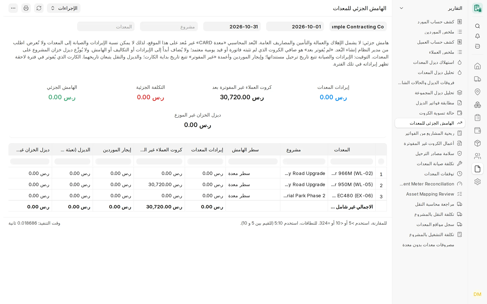
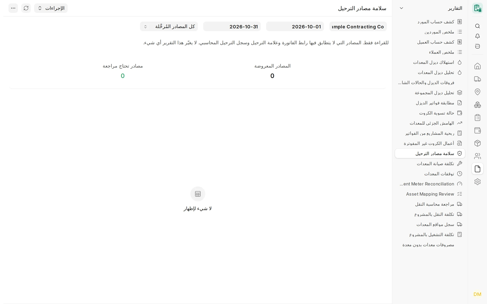

## نظرة عامة

لا يكتب CARD قيود دفتر الأستاذ بنفسه أبدًا: فهو يبني فواتير ERPNext قياسية من الكروت الشهرية وتعبئات الديزل وعمليات
النقل، ويسجّل في **سجل الترحيل المحاسبي** أيّ مستند اعترف بأيّ مصدر. وتفحص تقارير الرقابة المحاسبية هذه السلسلة من جهة
المحاسب: ما يُكسب ويُنفق لكل معدة، وأيّ الأعمال المعتمدة لم تُفوتر بعد، وأيّ المصروفات تفتقد وسم معدتها، وهل ما زالت
الروابط بين المصادر والترحيلات متطابقة.

## المفاهيم الأساسية

| المفهوم | المعنى |
|---|---|
| سجل الترحيل المحاسبي | سجل CARD للترحيل: الشركة، والطرف، والشهر، والحالة (مسودة، معتمد…)، والفاتورة أو قيد اليومية، و**مصادره** (الكروت والتعبئات وعمليات النقل التي يغطيها). |
| الكرت المعترف به | كرت يحجزه سجل ترحيل نشط في جانبه (فاتورة من CARD، أو فاتورة يدوية مربوطة، أو قيد يومية استحقاق مربوط)، أو رابط الفاتورة الخاص بذلك الجانب. |
| الهامش الجزئي | الإيرادات مطروحًا منها التكاليف التي يستطيع CARD نسبتها؛ ولا يشمل الإهلاك والعمالة والتأمين والمصاريف العامة. |
| حسابات مصروفات CARD | حسابات مصروف إيجار المعدات والديزل والنقل المحددة لكل شركة في إعدادات كارت للشركة. |

## الهامش الجزئي للمعدات

**الغرض.** صف لكل معدة ومشروع لشركة وفترة واحدة.

- **الإيرادات** – سطور فواتير المبيعات المعتمدة التي تحمل بُعد المعدة (المرحّلة في الفترة، صافية من الضريبة، شاملة
  الإشعارات الدائنة).
- **كروت العملاء غير المفوترة بعد** – صافي العميل لكروت العملاء المعتمدة التي لم يعترف بها أي مستند معتمد. يُعرض منفصلًا
  ولا يُضاف أبدًا إلى الإيرادات ولا إلى الهامش.
- **إيجار الموردين** – ما اعترفت به المستندات المعتمدة لكروت الموردين في الفترة؛ أما صافي المورد الذي لم يُعترف به بعد
  فيُعرض منفصلًا ولا يُضاف أبدًا إلى التكاليف.
- **الديزل (تعبئة مباشرة)** – التعبئات المباشرة بقيمة ترحيلها. أما تعبئات خزان المشروع فـ**لا** تُوزَّع على المعدات، بل
  تبقى في سطر على مستوى المشروع باسم «ديزل الخزان غير الموزع».
- **نقل على الشركة** – عمليات النقل التي تتحملها الشركة، حسب حصص المعدات المسجلة فيها.
- **الصيانة والتكاليف الأخرى المنسوبة للمعدة** – سطور تقرير
  [تكلفة صيانة المعدات](/card/ar/reports/maintenance-assets/).

<!-- screenshot: accounting-partial-margin -->

*تقرير الهامش الجزئي للمعدات*

**الفلاتر:** **الشركة** (إلزامي)، **من تاريخ** / **إلى تاريخ** (إلزاميان، والافتراضي الشهر الحالي)، **المشروع**،
**المعدات**.

**الأعمدة:** المعدات، المشروع، سطر الهامش («سطر معدة» أو «على مستوى المشروع: ديزل الخزان غير الموزع والتكاليف
المشتركة»)، إيرادات المعدات، كروت العملاء غير المفوترة بعد (خارج الإيرادات)، إيجار الموردين، الديزل (تعبئة مباشرة)،
ديزل الخزان غير الموزع، نقل على الشركة، الصيانة والتكاليف الأخرى المنسوبة للمعدة، التكلفة الجزئية، الهامش الجزئي، كروت
الموردين غير المفوترة بعد (خارج التكاليف).

**الإجماليات.** المربعات **إيرادات المعدات**، و**كروت العملاء غير المفوترة بعد**، و**التكلفة الجزئية**، و**الهامش
الجزئي** (بالأخضر إذا لم يكن سالبًا)، و**ديزل الخزان غير الموزع**، وصف الإجمالي القياسي مفعّل.

**التوقيت.** تتبع الإيرادات والصيانة تاريخ ترحيل مستنداتها؛ ويتبع إيجار الموردين وأعمدة غير المفوتر تاريخ بداية الكرت؛
ويتبع الديزل والنقل تاريخهما الخاص. والكرت الذي يُفوتر في فترة لاحقة تظهر إيراداته في تلك الفترة.

**الوصول.** System Manager وAccounts Manager — لقرّاء دفتر الأستاذ فقط. والجزء الذي لا يستطيع المستخدم قراءته (الكروت
الشهرية، أو تعبئات الديزل، أو عمليات النقل، أو فواتير المبيعات) يُستبعد ويُذكر في الرسالة. ودون بُعد المعدة المحاسبي لا
تُعرض الإيرادات ولا الصيانة.

## ربحية المشاريع من الفواتير

**الغرض.** سطر لكل مشروع لشركة واحدة وفترة واحدة: ما تقوله الفواتير المعتمدة عن إيرادات المشروع ومصروفاته. التقرير
للقراءة فقط.

- **إيرادات المشروع** – صافي بنود فواتير المبيعات المعتمدة المرحّلة في الفترة. الإشعار الدائن بنوده سالبة، فيخفّض
  الإيرادات.
- **مصروفات المشروع** – صافي بنود فواتير المشتريات المعتمدة المرحّلة في الفترة والمسجّلة على حساب مصروفات،
  وليست صنف مخزون ولا أصلًا ثابتًا. الإشعار المدين يخفّض المصروفات.
- **مشتريات خارج المصروفات** – صافي باقي بنود فواتير المشتريات: بند صنف مخزون، أو بند أصل ثابت،
  أو بند مسجّل على حساب ليس حساب مصروفات (وكذلك البند الذي ليس عليه حساب). هذا العمود للمعلومة فقط، ولا يدخل
  في الهامش.
- **هامش المشروع** – الإيرادات ناقص المصروفات. **نسبة هامش المشروع %** هي الهامش كنسبة من الإيرادات، وتبقى فارغة
  إذا لم يكن للمشروع إيرادات.

البند الذي ليس عليه مشروع يأخذ مشروع فاتورته. والبند الذي ليس له مشروع إطلاقًا يظهر في سطر **بدون مشروع**، فيطابق
الإجمالي صافي الفواتير: **مصروفات المشروع** مع **مشتريات خارج المصروفات** يساويان صافي فواتير
المشتريات. المبالغ صافية قبل ضريبة القيمة المضافة وبعملة الشركة، ويُقرَّب كل رقم مرة واحدة بدقة
تلك العملة (**مشتريات خارج المصروفات** هو صافي بنود المشتريات بعد التقريب ناقص المصروفات بعد التقريب). الفواتير الافتتاحية لا تُقرأ، لأنها تحمل أرصدة فترات سابقة.

:::caution
الهامش ليس صافي الربح الكامل. التقرير يقرأ الفواتير فقط. لا يقرأ قيود اليومية ولا دفتر الأستاذ العام، ولا يقدّر
شيئًا. الرواتب والإهلاك والمصروفات العمومية والتكاليف المسجلة بقيود اليومية غير مشمولة.

صنف المخزون لا يدخل أبدًا في **مصروفات المشروع**، حتى لو كان مسجّلًا على حساب مصروفات، وحتى لو استُهلك المخزون في
المشروع. مثلًا: الديزل أو قطع الغيار المشتراة كأصناف مخزون لا تدخل في مصروفات المشروع في هذا التقرير. لذلك قد
يكون الهامش أعلى من الحقيقي. وعمود **مشتريات خارج المصروفات** يعرض المبلغ الذي لم يدخل.
:::

**الفلاتر:** **الشركة** (إلزامي)، **من تاريخ** / **إلى تاريخ** (إلزاميان، الشهر الحالي افتراضيًا)، **المشروع**.

**الأعمدة:** المشروع، اسم المشروع، إيرادات المشروع، مصروفات المشروع، مشتريات خارج المصروفات،
هامش المشروع، نسبة هامش المشروع %.

**الإجماليات.** بطاقات **إيرادات المشروع** و**مصروفات المشروع** و**هامش المشروع** (أخضر إذا لم يكن سالبًا)، وبطاقة
رمادية **مشتريات خارج المصروفات** لا تدخل في البطاقات الثلاث. السطر
الأخير، **إجمالي كل المشاريع**، هو مجموع الأسطر.

**الصلاحية.** System Manager و Accounts Manager — قرّاء دفتر الأستاذ فقط. تُقرأ الفواتير بصلاحيات المستخدم نفسه.
المستخدم الذي لا يستطيع قراءة فاتورة المبيعات أو فاتورة المشتريات يُرفض: الهامش المبني على جانب واحد مضلِّل.
**اسم المشروع** يظهر لمشروع شركة التقرير فقط؛ ومشروع شركة أخرى يظهر برقمه فقط.

## أعمال الكروت غير المفوترة

**الغرض.** الكروت الشهرية المعتمدة لشركة واحدة التي تبدأ فترتها في التواريخ المختارة ولم يعترف بها بعدُ أي مستند قائم في
جانبها. ويُعرض جانب المورد (الكروت المستأجرة والمؤجرة من الباطن: صافيها) وجانب العميل (الكروت المؤجرة للعميل والمؤجرة
من الباطن: صافي العميل) منفصلين؛ وقد يكون الكرت المؤجر من الباطن مفتوحًا في جانب واحد فقط.

**الفلاتر**

- **الشركة** – إلزامي.
- **من تاريخ** / **إلى تاريخ** – إلزاميان؛ والافتراضي بداية السنة وتاريخ اليوم.
- **جانب الفوترة** – جانبا الفوترة (الافتراضي)، أو جانب المورد، أو جانب العميل.
- **المشروع**، **المعدات** – اختياريان.
- **تضمين الكروت المحجوزة في ترحيل مسودة** – غير مفعّل افتراضيًا؛ وعند تفعيله تُعرض الكروت التي ما زال مستند استحقاقها
  مسودة، مع تعليمها.

**الأعمدة:** الكرت، جانب الفوترة، الطرف، الشهر، المشروع، المعدات، مبلغ الكارت غير المفوتر (قبل الضريبة)، حالة الفوترة
(«غير مفوتر» أو «محجوز في ترحيل مسودة»)، المستند المسودة.

**الإجماليات.** المربعان **كروت الموردين غير المفوترة** و**كروت العملاء غير المفوترة**، وصف الإجمالي القياسي مفعّل.

**الوصول.** System Manager وAccounts Manager وCard Manager، ممن تمنحهم أدوارهم قراءة سجل الترحيل المحاسبي ويحق لهم
قراءة كروت التشغيل الشهرية.

## مصروفات معدات بدون معدة

**الغرض.** سطور مصروفات دفتر الأستاذ المسجلة على حسابات مصروفات CARD (إيجار المعدات، والديزل، والنقل) **دون** بُعد
المعدة — وهي تكاليف لا تراها قائمة الأرباح والخسائر لكل معدة بعد. وتُصحَّح في المستند المصدر.

**الفلاتر:** **الشركة** (إلزامي)، **من تاريخ** / **إلى تاريخ** (الافتراضي السنة الحالية).

**الأعمدة:** تاريخ الترحيل، الحساب، نوع المستند، المستند، المشروع، مركز التكلفة، مدين، دائن، ملاحظات.

**الإجماليات.** المربعات **سطور بدون معدة**، و**صافي المبالغ بدون معدة** (المدين − الدائن)، و**سطور ديزل خزان المشروع
(مقصودة، غير مدرجة)** — إذ تُرحَّل تعبئة خزان المشروع في سطر واحد على مستوى المشروع عن قصد، فتُعرف تلك السطور من خلال
التعبئة التي تشير إلى الفاتورة وتُعدّ منفصلة.

**الوصول.** System Manager وAccounts Manager — لقرّاء دفتر الأستاذ فقط. ودون البُعد، أو دون حسابات مصروفات الشركة في
الإعدادات، يعرض التقرير رسالة توضيحية بلا صفوف.

## سلامة مصادر الترحيل

**الغرض.** يرتبط المصدر (كرت شهري، أو تعبئة ديزل، أو نقل) بسجل الترحيل الذي رحّله من طريقين: صفوف المصادر في السجل،
ورابط الفاتورة وعلامة **مُرحَّل** المكتوبين على المصدر عند اعتماد الفاتورة. وقد يُخرجهما عن التطابق تعديلٌ مباشر في قاعدة
البيانات أو استيرادٌ أو إصدارٌ أقدم. ويعرض هذا التقرير كل مصدر للشركة في الفترة لا يتطابق فيه رابطه وعلامة ترحيله وسجل
ترحيله. ولا يصلح شيئًا؛ فالإصلاح قرار يتخذه شخص.

<!-- screenshot: accounting-posting-source-integrity -->

*تقرير سلامة مصادر الترحيل*

**الفلاتر:** **الشركة** (إلزامي)، **من تاريخ** / **إلى تاريخ** (إلزاميان؛ من بداية السنة إلى اليوم)، **إظهار** –
«المشكلات فقط» (الافتراضي) أو «كل المصادر المُرحَّلة».

**الفحوص**

- محجوز في أكثر من ترحيل معتمد للجانب نفسه.
- فاتورة مربوطة على المصدر، لكن لا يذكر المصدرَ أي سجل ترحيل معتمد، أو رحّله السجل على فاتورة أخرى.
- الفاتورة المربوطة غير موجودة أو غير معتمدة.
- سجل معتمد رحّل المصدر، لكن ليس على المصدر رابط فاتورة.
- معلَّم كمُرحَّل دون ترحيل معتمد أو رابط فاتورة؛ أو يذكره ترحيل معتمد لكنه غير معلَّم كمُرحَّل.
- المصدر ملغى لكنه ما زال مُرحَّلًا.
- سجل ترحيل لشهر داخل الفترة يذكر مصدرًا لم يعد موجودًا.

**الأعمدة:** فحص السلامة، نوع المستند المصدر، المصدر، التاريخ، حالة المصدر، علامة الترحيل، فاتورة المشتريات على المصدر،
فاتورة المبيعات على المصدر، سجل الترحيل المحاسبي، حالة السجل، مستند السجل، المبلغ في السجل، الدليل.

**الإجماليات.** المربعان **المصادر المعروضة** و**مصادر تحتاج مراجعة** (بالأحمر إن وُجدت).

**الوصول.** System Manager وAccounts Manager، ممن تمنحهم أدوارهم قراءة سجل الترحيل المحاسبي وكروت التشغيل الشهرية
وتعبئة ديزل للمشروع ونقل المعدات.

## ذو صلة

- [الفوترة والترحيل](/card/ar/features/invoicing-posting/)
- [واجهة API للترحيل والمحاسبة](/card/ar/api-reference/posting-accounting/)
- [الأطراف والكشوف](/card/ar/reports/parties-statements/)
- [تقارير الصيانة والأصول](/card/ar/reports/maintenance-assets/)
