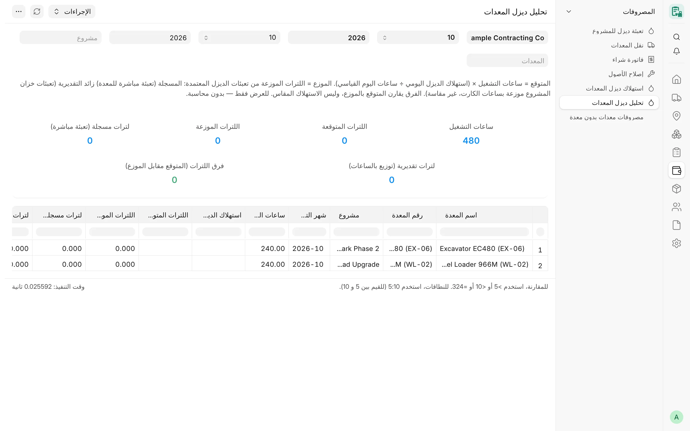
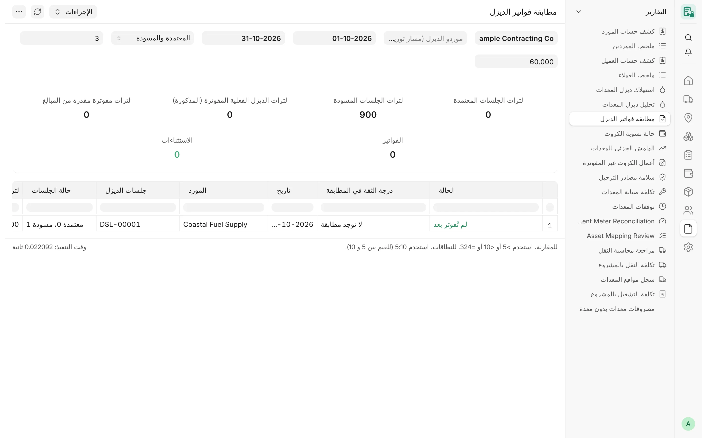

## نظرة عامة

يسجّل CARD الديزل في صورة جلسات **تعبئة ديزل للمشروع**: إما تعبئة مباشرة لمعدة واحدة، وإما تعبئة لخزان المشروع تتشاركه
المعدات العاملة فيه. وتحوّل تقارير الديزل هذه الجلسات إلى لترات وتكلفة لكل معدة، وتقارنها بما كان ينبغي أن تستهلكه
المعدة، وتفحصها مقابل فواتير الموردين أنفسهم. وهي للعرض فقط: لا ترحّل إلى دفتر الأستاذ أبدًا، ولا تغيّر صافي أي كرت.

## المفاهيم الأساسية

| المفهوم | المعنى |
|---|---|
| اللترات المسجلة | لترات التعبئات المباشرة للمعدة. |
| اللترات التقديرية | حصة المعدة من تعبئات خزان المشروع، موزعة حسب ساعات كروتها في الشهر (غير مقيسة). |
| اللترات الموزعة | اللترات المسجلة مضافًا إليها اللترات التقديرية. |
| غير موزع | تعبئات الخزان في شهرٍ لمشروعٍ ليس لأي كرت فيه ساعات، فلا يمكن توزيعها وتبقى غير موزعة. |
| اللترات المتوقعة | ساعات التشغيل × (استهلاك الديزل اليومي ÷ ساعات اليوم القياسي) للمعدة؛ أو الساعات × الاستهلاك المتوقع القديم لكل ساعة. |
| مسار التوريد | موردو الديزل الذين تُطابَق جلساتهم وفواتيرهم معًا (مندوب واحد وفواتير مجمّعة). |

## تحليل ديزل المعدات

**الغرض.** لكل معدة ومشروع وشهر: اللترات المتوقعة من ساعات الكروت مقابل اللترات الموزعة من التعبئات المعتمدة، مع
الفرق. ويقارن الفرق بين اللترات المتوقعة والموزعة، لا الاستهلاك المقيس.

<!-- screenshot: diesel-analysis -->

*تقرير تحليل ديزل المعدات*

**الفلاتر**

- **الشركة** – إلزامي.
- **من شهر**، **من سنة** – إلزاميان؛ والافتراضي الشهر الحالي.
- **إلى شهر**، **إلى سنة** – اختياريان؛ والافتراضي شهر البداية.
- **المشروع**، **المعدات** – اختياريان.

**الأعمدة:** اسم المعدة، رقم المعدة، المشروع، شهر التشغيل، ساعات التشغيل، استهلاك الديزل اليومي (لتر لليوم القياسي)،
اللترات المتوقعة، اللترات الموزعة، لترات مسجلة (تعبئة مباشرة)، لترات تقديرية (توزيع بالساعات)، فرق اللترات (المتوقع
مقابل الموزع)، نسبة الفرق %.

**الإجماليات.** المربعات **ساعات التشغيل**، و**اللترات المتوقعة**، و**اللترات الموزعة**، و**اللترات المسجلة**،
و**اللترات التقديرية** (بالبرتقالي إذا لم تكن صفرًا)، و**فرق اللترات** (بالأخضر إذا كان في حدود المطابقة المحددة في
الإعدادات).

**الوصول.** System Manager وCard Manager وCard User وAccounts Manager.

**ملاحظات.** لا تُحتسب إلا الكروت المعتمدة. والمعدة التي ليس لها أي رقم استهلاك تظهر قيمتها المتوقعة فارغة (دون خطأ).

## استهلاك ديزل المعدات

**الغرض.** لكل مشروع وشهر توجد فيه تعبئات معتمدة: اللترات والتكلفة الموزعة على كل معدة — التعبئات المباشرة كاملةً،
وتعبئات الخزان بالتناسب مع الساعات — وصف **غير موزع** لما لا يمكن توزيعه.

**الفلاتر:** **الشركة** (إلزامي)، **من تاريخ**، **إلى تاريخ**، **المشروع**، **المعدات**.

**الأعمدة:** المعدات (أو «غير موزع»)، المشروع، الشهر، اللترات الموزعة، لترات مسجلة (تعبئة مباشرة)، لترات تقديرية
(توزيع بالساعات)، تكلفة الديزل.

**الإجماليات.** لا توجد.

**الوصول.** System Manager وCard Manager وCard User وAccounts Manager.

:::note
يجري التوزيع دائمًا على شهر تقويمي كامل. وفلاتر التاريخ لا تحدد إلا أيّ أزواج (المشروع، الشهر) تظهر.
:::

## مطابقة فواتير الديزل

**الغرض.** يقارن جلسات الديزل في CARD بـ**فواتير الشراء** الخاصة بالموردين المدخلة في Desk. وتُقرأ اللترات وأجرة التوصيل
ونوع الوقود من نص سطر الفاتورة (اسم الصنف والوصف)، ويُستنتج أساس الضريبة لكل فاتورة من أرقامها هي. والفرق الذي يظهر
نقطة للمراجعة، وليس إثباتًا لفوترة زائدة أو فاتورة مفقودة أو دفعة مفقودة. ولا يُنشأ شيء ولا يُغيَّر ولا يُربط.

<!-- screenshot: diesel-invoice-reconciliation -->

*تقرير مطابقة فواتير الديزل*

**الفلاتر**

- **الشركة** – إلزامي.
- **موردو الديزل (مسار توريد واحد)** – اختيار متعدد لموردي جلسات الديزل الخاصة بالشركة
  (`card.diesel_reconciliation.diesel_supplier_options`). ويُطابَق الموردون المختارون بوصفهم مسارًا واحدًا؛ وإذا كان
  الفلتر فارغًا كان كل مورد مسارًا مستقلًا.
- **من تاريخ** / **إلى تاريخ** – إلزاميان؛ والافتراضي بداية السنة وتاريخ اليوم.
- **جلسات الديزل المشمولة** – «المعتمدة والمسودة» (الافتراضي) أو «المعتمدة فقط».
- **مدى تاريخ الفاتورة (أيام)** – الافتراضي 3.
- **أجرة التوصيل حتى (لتر)** – الافتراضي 60.

**ترتيب المطابقة**

1. **مربوطة** – جلسة تذكر الفاتورة.
2. **لكل توريد** – فاتورة من المسار مؤرخة من يوم قبل الجلسة إلى نهاية المدى بعدها، تساوي لترات الديزل فيها لترات
   الجلسة، أو تساويها مضافًا إليها أجرة توصيل مدمجة في سطر الديزل، أو — إذا لم تذكر الفاتورة لترات — يعطي إجماليها أو
   صافيها مقسومًا على سعر الجلسة لترات الجلسة في حدود 1 %.
3. **لكل فترة** – الفاتورة الأكبر بوضوح من توريد واحد تأخذ الجلسات غير المطابَقة بين الفاتورة المماثلة السابقة وتاريخ
   فاتورتها (الفواتير المجمّعة).
4. الجلسات التي بعد آخر فاتورة هي «لم تُفوتر بعد»؛ أما بقية الجلسات بلا فاتورة والفواتير بلا جلسة فهي استثناءات.

**الأعمدة:** الحالة، درجة الثقة في المطابقة (مؤكدة أو مستنتجة أو تقديرية أو لا توجد مطابقة)، التاريخ، المورد، جلسات
الديزل، حالة الجلسات، لترات الجلسات، فاتورة الشراء، رقم فاتورة المورد، لترات الديزل في الفاتورة، لترات الديزل الفعلية،
لترات أجرة التوصيل، فرق اللترات، إجمالي الفاتورة، صافي الفاتورة، الضريبة، نسبة الضريبة %، أساس الضريبة في السعر،
مشاريع الجلسات، مشاريع الفاتورة، فحص التخصيص (متطابق، أو تعارض في المشروع، أو تعارض في المعدة، أو الفاتورة بدون
مشروع)، الدليل.

**الإجماليات.** المربعات **لترات الجلسات المعتمدة**، و**لترات الجلسات المسودة**، و**لترات الديزل الفعلية المفوترة
(المذكورة)**، و**لترات مفوترة مقدرة من المبالغ**، و**الفواتير**، و**الاستثناءات** (بالأحمر إن وُجدت). وتُعرض حالات
الاستثناء باللون الأحمر.

**الوصول.** System Manager وAccounts Manager، ممن تمنحهم أدوارهم كذلك قراءة تعبئة ديزل للمشروع وفواتير الشراء.

## ذو صلة

- [الديزل](/card/ar/features/diesel/)
- [واجهة API للديزل](/card/ar/api-reference/diesel/)
- [تقارير النقل والتكاليف](/card/ar/reports/transport-costs/)
