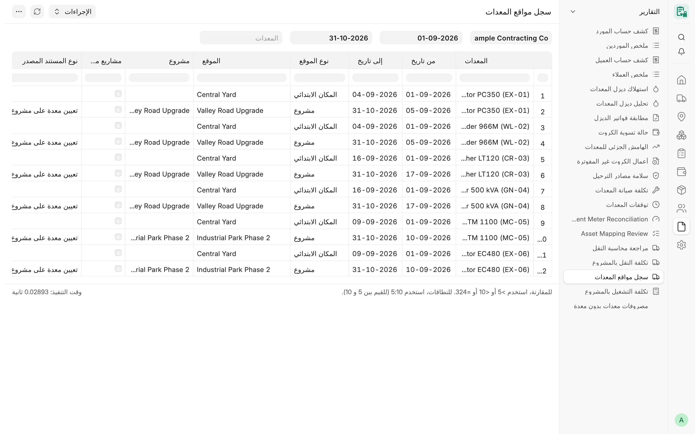
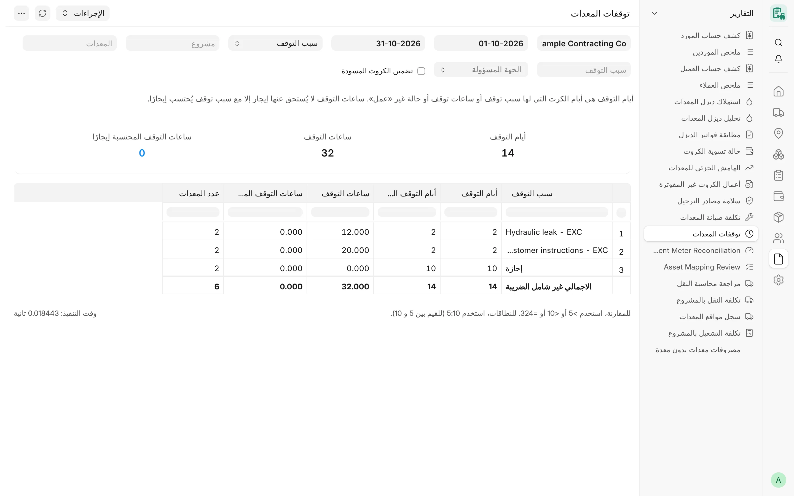

## نظرة عامة

تجيب تقارير التشغيل عن الأسئلة اليومية الخاصة بالأسطول: أين كانت المعدة، ولماذا توقفت، وهل قراءة عداد ساعاتها
معقولة، وما الذي استهلكته، وما الذي تطلبه المواقع، وما الأدوات التي في عهدة كل عامل. وجميعها للقراءة فقط، وتتبع
القواعد المشتركة الواردة في [نظرة عامة على التقارير](/card/ar/reports/overview/).

## المفاهيم الأساسية

| التقرير | المصدر الرئيسي | فلتر الشركة |
|---|---|---|
| سجل مواقع المعدات | المعدات، وتعيين معدة على مشروع، ونقل المعدات | شركة واحدة (إلزامي) |
| توقفات المعدات | صفوف الأيام في كروت التشغيل الشهرية | شركة واحدة (إلزامي) |
| مطابقة عدادات المعدات | قراءات عداد الساعات للأصول، وساعات الكروت الشهرية | شركة واحدة (إلزامي) |
| استهلاك المعدات | قيود المخزون (صرف مواد)، وسطور فواتير الشراء | جميع الشركات المسموح بها |
| القائمة المجمعة لاحتياجات المعدات | سطور مراجعات احتياجات المعدات | جميع الشركات المسموح بها |
| الطلبات المتكررة للمعدات | سطور طلبات احتياجات المعدات | جميع الشركات المسموح بها |
| عهد العمال | عهدة أدوات الموظف، والأصول (أمين العهدة) | جميع الشركات المسموح بها |

## سجل مواقع المعدات

**الغرض.** يعرض، لشركة واحدة ومعدة اختيارية وفترة محددة، أين كانت كل معدة في مقاطع زمنية مرتبطة بالتاريخ: تعيين على
مشروع، أو المكان الذي أرسلها إليه نقل معتمد (ورشة أو مخزن أو مورد)، أو المكان الابتدائي للشركة. فالنقل إلى ورشة أو
مخزن أو مورد في اليوم (ي) يُظهر المشروع في اليوم (ي) والمكان الجديد ابتداءً من اليوم التالي.

<!-- screenshot: operations-location-history -->

*تقرير سجل مواقع المعدات*

**الفلاتر**

- **الشركة** – إلزامي.
- **من تاريخ** / **إلى تاريخ** – إلزاميان؛ والافتراضي الشهر الحالي.
- **المعدات** – اختياري، ويقتصر على معدات الشركة المختارة.

**الأعمدة:** المعدات، من تاريخ، إلى تاريخ، نوع الموقع (مشروع أو ورشة أو مخزن أو مورد أو المكان الابتدائي)، الموقع
(اسم المشروع في مقطع المشروع)، المشروع، مشاريع متداخلة (خانة اختيار)، نوع المستند المصدر، المستند المصدر.

**الإجماليات والرسائل.** لا توجد إجماليات. وإذا وُجدت معدة على مشروعين في الأيام نفسها، تُعلَّم الصفوف بأنها متداخلة
ويذكر التقرير ذلك في رسالته.

**الوصول.** System Manager وCard Manager وCard User وAccounts Manager. ويجب كذلك أن تمنح أدوار المستخدم صلاحية قراءة
المعدات وتعيين معدة على مشروع ونقل المعدات؛ وتُرفض المعدة التابعة لشركة أخرى ولا تُقرأ.

**ملاحظات.** لا يجوز أن يسبق تاريخ النهاية تاريخ البداية. ويغطي المكان الابتدائي المدة السابقة لأول نقل.

## توقفات المعدات

**الغرض.** أيام وساعات التوقف في الكروت الشهرية لشركة واحدة خلال فترة. وصف التوقف هو يوم في الكرت له سبب توقف أو
ساعات توقف أو حالة يوم غير «عمل»؛ أما اليوم القديم الذي لا سبب له فيُعرض تحت حالة يومه حتى لا تضيع الأشهر السابقة.

<!-- screenshot: operations-equipment-downtime -->

*تقرير توقف المعدات*

**الفلاتر**

- **الشركة** – إلزامي.
- **من تاريخ** / **إلى تاريخ** – إلزاميان؛ والافتراضي بداية الشهر وتاريخ اليوم.
- **تجميع التوقف حسب** – سبب التوقف (الافتراضي)، أو الجهة المسؤولة، أو المعدات، أو المشروع، أو الشهر، أو كل يوم.
- **المشروع**، **المعدات** – اختياريان.
- **سبب التوقف** – اختياري، ويقتصر على سجلات **سبب توقف المعدة** الخاصة بالشركة.
- **الجهة المسؤولة** – اختياري: الشركة أو المورد أو العميل أو أخرى.
- **تضمين الكروت المسودة** – غير مفعّل افتراضيًا (الكروت المعتمدة فقط).

**الأعمدة (العرض المجمّع):** المجموعة (سبب التوقف، أو الجهة المسؤولة، أو المعدات — مع اسم المعدة —، أو المشروع، أو
الشهر)، أيام التوقف، أيام التوقف الكاملة، ساعات التوقف، ساعات التوقف المحتسبة إيجارًا، عدد المعدات.

**الأعمدة (كل يوم):** التاريخ، الكرت، المعدات، اسم المعدة، المشروع، حالة اليوم، سبب التوقف، ساعات التوقف، ساعات التوقف
المحتسبة إيجارًا، ساعات التشغيل، الجهة المسؤولة، سجل الجهة المسؤولة، سبب التوقف (الملاحظة)، كرت مسودة.

**الإجماليات.** مربعات الملخص **أيام التوقف** و**ساعات التوقف** و**ساعات التوقف المحتسبة إيجارًا**، وصف الإجمالي
القياسي مفعّل. ولا تُحتسب ساعات التوقف إيجارًا إلا إذا كان سبب التوقف مُعلَّمًا بأنه محتسب.

**الوصول.** System Manager وCard Manager وCard User وAccounts Manager، مع صلاحية قراءة كروت التشغيل الشهرية. ولا
تُحتسب إلا الكروت التي يحق للمستخدم قراءتها.

## مطابقة عدادات المعدات

**الغرض.** يفحص قراءات عداد الساعات التراكمية لكل معدة، ويقارن ساعات العداد بساعات كروتها الشهرية المعتمدة. ولا يُعدّ
ساعاتٍ إلا الفرق بين قراءتين مقبولتين متتاليتين. ولا يحدد التقرير نقطة بداية للصيانة ولا يغيّر شيئًا.

**الفلاتر**

- **الشركة** – إلزامي.
- **المعدات** – اختياري.
- **العرض** – «صف لكل معدة» (الافتراضي) أو «كل قراءة».
- **إظهار** – «التي تحتاج مراجعة فقط» (الافتراضي) أو «كل المعدات» (في العرض الملخّص فقط).
- **نسبة الفرق المسموح بها %** – الافتراضي 10.

**الأعمدة (صف لكل معدة):** الحالة (متطابق، أو تحتاج مراجعة، أو لا توجد قراءات عداد)، المعدات، اسم المعدة، الأصل،
قراءات العداد، أول قراءة مقبولة، تاريخ أول قراءة، آخر قراءة مقبولة، تاريخ آخر قراءة، ساعات العداد (الفروق فقط)، ساعات
CARD (كروت معتمدة، نفس الفترة)، نسبة الفرق %، مشاكل القراءات، حقول عداد الأصل، نقطة بداية الصيانة.

**الأعمدة (كل قراءة):** المعدات، الأصل، وقت القراءة، قراءة العداد، الساعات منذ القراءة المقبولة السابقة، فحص القراءة،
المصدر، السجل المصدر، الدليل.

تُصنَّف كل قراءة إلى: مقبولة، أو غير صالحة (صفر أو سالبة أو فارغة)، أو مكررة، أو راجعة إلى الخلف، أو إعادة تصفير
للعداد (تبدأ من جديد قرب الصفر)، أو قفزة مستحيلة (ساعات أكثر من الوقت المنقضي)، أو «الساعات المسجلة تساوي العداد كله
(تراكمية): تُتجاهل». ويحتاج الصف إلى مراجعة إذا كانت في قراءةٍ مشكلة، أو اختلفت حقول العداد في الأصل نفسه عن آخر قراءة
مقبولة بأكثر من النسبة المسموح بها، أو اختلفت ساعات CARD عن ساعات العداد بأكثر من تلك النسبة، أو تعارض رقم الأصل مع
اسمه أو صنفه.

**الإجماليات.** المربعان **المعدات** و**تحتاج مراجعة** (في العرض الملخّص) أو **القراءات** (في العرض التفصيلي). وتعيد
الرسالة ذكر سياسة الصيانة (تنبيه عند 250 ساعة تشغيل، وتغيير الزيت مستحق عند 300).

**الوصول.** System Manager وCard Manager وAccounts Manager، ممن تمنحهم أدوارهم كذلك قراءة المعدات وكروت التشغيل
الشهرية والأصول. وتُقرأ القراءات من نوع مستند قديم لسجل التموين إذا كان موجودًا على الموقع ويحق للمستخدم قراءته، وإلا
ذكرت الرسالة أنه لا توجد قراءات متاحة.

## استهلاك المعدات

**الغرض.** ما استهلكته كل معدة فعليًا: ما صُرف لها من المخزون (**قيد مخزون** معتمد بغرض صرف مواد) مضافًا إليه الأصناف
غير المخزنية التي اشتُريت واستُخدمت فورًا (سطور **فواتير شراء** معتمدة لأصناف غير مخزنية). ولا يُحتسب أبدًا شراء صنف
مخزني، لأن تكلفته تأتي مع الصرف، فلا يُحتسب شيء مرتين.

**الفلاتر:** **من تاريخ**، **إلى تاريخ**، **المشروع**، **المعدات** (جميعها اختيارية).

**الأعمدة:** المعدات، المشروع، الصنف، الكمية، التكلفة (بعملة شركة الصف)، المصدر (قيد المخزون أو فاتورة الشراء)،
التاريخ.

**الإجماليات.** لا توجد.

**الوصول.** System Manager وCard Manager وCard Supervisor وCard User وStock Manager وAccounts Manager. وتأتي الصفوف من
كل شركة يحق للمستخدم رؤيتها في المعدات.

**ملاحظات.** تُنسب السطور عبر **بُعد المعدة المحاسبي** (Card Equipment)؛ فإذا لم يكن مُعدًّا على الموقع ذكر التقرير
ذلك ولم يعرض شيئًا.

## القائمة المجمعة لاحتياجات المعدات

**الغرض.** القائمة الموحّدة التي تراجعها الإدارة: كل سطر من سجلات **مراجعة احتياجات المعدات** المعتمدة، مجمّعًا حسب
الصنف، مع الاحتفاظ بحصة كل معدة.

**الفلاتر**

- **المشروع** – اختياري.
- **اعتماد الإدارة** – معلّق (الافتراضي)، أو معتمد، أو فارغ لكليهما.

**الأعمدة:** الصنف المطلوب، الوصف، الكمية المطلوبة، الموجود بالموقع، الكمية المعتمدة، في المخزون، المعدات والكميات
(مثل `EQ-0001: 2, EQ-0002: 1`)، المراجعات.

**الإجماليات.** لا توجد.

**الوصول.** System Manager وCard Manager وCard Supervisor وCard User وStock Manager وAccounts Manager. وتنطبق قواعد
السجلات الخاصة بالمستخدم على المراجعات (كالمشرف المقيّد بمشاريعه).

**ملاحظات.** يُقرأ عمود **في المخزون** مباشرةً من مستودعات شركات التقرير، ولا يُعرض إلا للمستخدم الذي يحق له قراءة
المخزون؛ ولغيره يُحذف العمود.

## الطلبات المتكررة للمعدات

**الغرض.** الأصناف التي طُلبت مرة أخرى للمعدة نفسها خلال مدة التكرار المحددة في الإعدادات (أو القيمة الخاصة بالشركة).
وهي قائمة للمراجعة، وليست عقوبة ولا خصمًا.

**الفلاتر:** **المشروع**، **المعدات** (اختياريان).

**الأعمدة:** الطلب، التاريخ، المعدات، اسم المشغّل، الصنف، الكمية، آخر طلب في.

**الإجماليات.** لا توجد.

**الوصول.** System Manager وCard Manager وCard Supervisor وCard User وStock Manager وAccounts Manager، ولا تُعرض إلا
الطلبات المعتمدة التي يحق للمستخدم قراءتها.

## عهد العمال

**الغرض.** ما في عهدة كل عامل الآن: الأدوات القابلة للإرجاع من سجل العهدة (رصيد حركات التسليم والإرجاع والتحويل
المعتمدة)، مضافًا إليها الأدوات الرأسمالية المسجلة **أصولًا** معتمدة يكون العامل أمين عهدتها (باستثناء الأصول المُكهّنة
والمباعة).

**الفلاتر:** **الموظف** (اختياري).

**الأعمدة:** الموظف، اسم الموظف، الأداة، في العهدة، الأصل، النوع («أداة قابلة للإرجاع» أو «أصل»).

**الإجماليات.** لا توجد.

**الوصول.** System Manager وCard Manager وCard Supervisor وCard User وStock Manager وAccounts Manager، عبر جميع الشركات
التي يحق للمستخدم رؤيتها في عهدة أدوات الموظف.

## ذو صلة

- [نظرة عامة على التقارير](/card/ar/reports/overview/)
- [التعيينات والمواقع](/card/ar/features/assignments-locations/)
- [قراءات العدادات](/card/ar/features/meter-readings/)
- [احتياجات المعدات](/card/ar/features/equipment-needs/)
- [عهدة الأدوات](/card/ar/features/tool-custody/)
