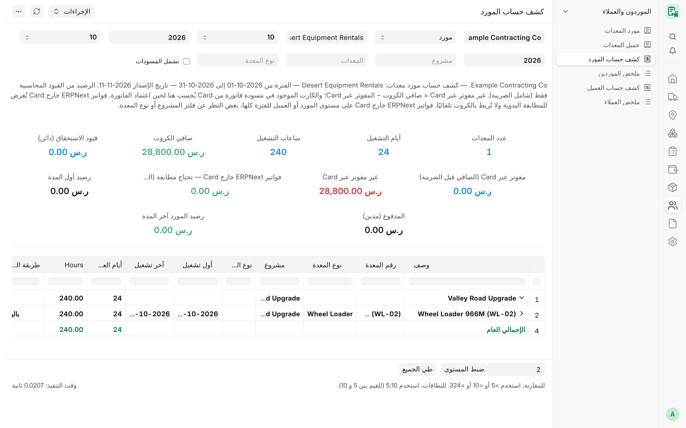
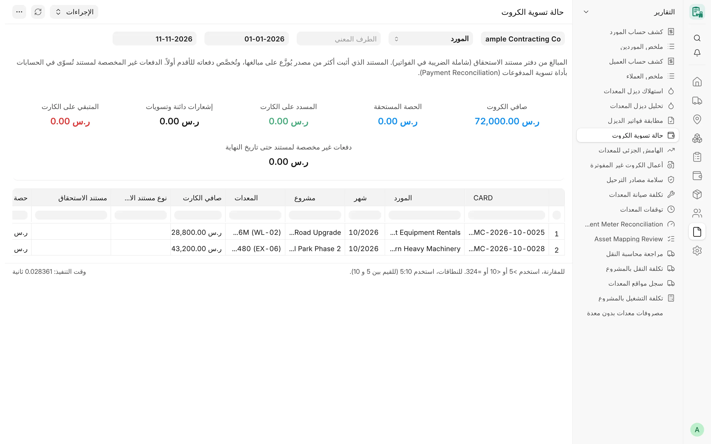

## نظرة عامة

تبيّن هذه التقارير ما يستحق لموردي المعدات، وما يستحق على العملاء مقابل المعدات المؤجرة لهم. فـ**الكشوف** تعرض الكروت
الشهرية لطرف واحد حسب المشروع والمعدة، و**الملخصات** تعرض صفًا لكل طرف مع رابط إلى كشفه، أما **حالة تسوية الكروت**
فتتتبع كل كرت داخل دفتر الأستاذ لتبيّن ما سُدد منه وما تبقى.

لا يخزّن CARD رصيدًا لأي طرف. فأرقام الكروت مصدرها الكروت الشهرية، وكل رصيد مصدره دفتر أستاذ ERPNext (**قيود دفتر
الأستاذ** أو **قيود دفتر المدفوعات**)، ولا يُعرض إلا لقرّاء دفتر الأستاذ (انظر
[من يرى المبالغ](/card/ar/reports/overview/#من-يرى-المبالغ)).

## المفاهيم الأساسية

| المفهوم | المعنى |
|---|---|
| جانب المورد | كروت المعدات المستأجرة والمؤجرة من الباطن: «مستأجَرة من مورد» و«إيجار من الباطن». ورقمها هو **صافي** الكرت. |
| جانب العميل | كروت «مؤجَّرة لعميل» و«إيجار من الباطن». ورقمها هو **صافي العميل**. |
| كشف المعدات الملك | نوع الكشف «معدات ملك»: الساعات حسب المشروع والمعدة، دون مبالغ. |
| المفوتر عبر CARD | صافي الكروت الذي فوترته فواتير CARD الشهرية **المعتمدة** للكروت المعروضة (الصافي قبل الضريبة). |
| غير المفوتر عبر CARD | صافي الكروت مطروحًا منه المفوتر عبر CARD. ويُحتسب الكرت الموجود في فاتورة CARD مسودة هنا إلى أن تُعتمد الفاتورة. |
| فواتير ERPNext خارج CARD | فواتير الطرف المعتمدة في الفترة التي لا يشير إليها أي ترحيل معتمد من CARD (الصافي قبل الضريبة). تُعرض للمطابقة اليدوية، ولا تُطابَق بالكروت تلقائيًا أبدًا. |
| حدّ المطابقة المسموح | القيمة المحددة في الإعدادات التي يُعرض دونها فرق «غير مفوتر عبر Card» باللون الأخضر. |

## كشف حساب المورد

**الغرض.** الكروت الشهرية لمورد واحد (أو كروت المعدات الملك) مجمّعة: المشروع ← المعدة ← الكرت، ومطابقتها — للمورد —
بدفتر حسابه: فالدائن قيود استحقاق (زيادة الالتزام)، والمدين مدفوعات (نقص الالتزام).

<!-- screenshot: statements-supplier-statement -->

*تقرير كشف حساب مورد المعدات*

**الفلاتر**

- **الشركة** – إلزامي.
- **نوع الكشف** – «مورد» أو «معدات ملك». وإذا كان فارغًا استُخدم نوع الكشف الافتراضي من الإعدادات.
- **المورد** – يظهر لنوع «مورد»، ويعرض موردي السجل الذين لهم كروت في الشركة. ودون اختيار مورد يعرض التقرير رسالة
  تطلب اختيار المورد لعرض الكشف.
- **من شهر**، **من سنة**، **إلى شهر**، **إلى سنة** – إلزامية؛ والافتراضي الشهر السابق.
- **المشروع**، **المعدات**، **نوع المعدة** – اختيارية.
- **تشمل المسودات** – قيمتها الافتراضية هي إعداد **تضمين المسودات في التقارير**؛ وتُعلَّم الكروت المسودة بعبارة
  «(مسودة)».

تُختار الكروت حسب الشهر الذي تبدأ فيه فترتها. ويستبعد كشف المورد المعدات الملك، أما كشف المعدات الملك فلا يشمل إلا
المعدات الملك.

**الأعمدة:** الوصف (المشروع أو المعدة أو رقم الكرت)، رقم المعدة، نوع المعدة، المشروع، نوع الوردية، أول تشغيل، آخر
تشغيل، أيام العمل، الساعات، ثم — إذا كانت لأي صف قيمة — ساعات التوقف المحتسبة إيجارًا. ويضيف كشف المورد: طريقة
الحساب، أساس احتساب اليوم، السعر، سعر الساعة، قيمة التشغيل، الإضافات، الخصومات، الصافي. وصف المعدة الذي تتعدد فيه
طرق الحساب أو الأسس يعرض «متعدد».

- أيام العمل هي الأيام المميزة المحتسبة بساعات تشغيل أو بساعات توقف محتسبة.
- سعر الساعة هو المبلغ مقسومًا على جميع الساعات المحتسبة (ساعات التشغيل وساعات التوقف المحتسبة).
- الإضافات والخصومات هي تسويات جانب المورد لكل كرت.

**الإجماليات.** صفا المشروع والمعدة يجمعان ما تحتهما، ويُختم الجدول بصف **الإجمالي العام**. ومربعات الملخص: **عدد
المعدات**، و**أيام التشغيل**، و**ساعات التشغيل**، وللمورد كذلك **صافي الكروت**. ويرى قارئ دفتر الأستاذ أيضًا: **قيود
الاستحقاق (دائن)**، و**مفوتر عبر Card (الصافي قبل الضريبة)**، و**غير مفوتر عبر Card**، و**فواتير ERPNext خارج Card —
تحتاج مطابقة (الصافي قبل الضريبة)**، و**رصيد أول المدة**، و**المدفوع (مدين)**، و**رصيد المورد آخر المدة** (الافتتاحي +
الاستحقاقات − المدفوعات، شاملًا الضريبة).

**الوصول.** System Manager وCard Manager وCard User وAccounts Manager. ومربعات دفتر الأستاذ لقرّائه فقط.

**الطباعة وPDF.** يُختار تنسيق الطباعة **Equipment Supplier Statement A4** مسبقًا، ويولّد إجراء PDF كشف A4 على الخادم
(انظر [الطباعة وPDF](/card/ar/reports/overview/#الطباعة-وpdf)).

## ملخص الموردين

**الغرض.** صف لكل مورد له كروت معتمدة غير ملك في الفترة، مرتّبة حسب الصافي (الأكبر أولًا)، مع إجماليات الكروت ومطابقة
دفتر الأستاذ. والنقر على اسم المورد يفتح كشفه بالشركة والفترة والمشروع نفسها.

**الفلاتر:** **الشركة** (إلزامي)، و**من شهر / من سنة / إلى شهر / إلى سنة** (إلزامية، والافتراضي الشهر السابق)،
و**المشروع** (اختياري).

**الأعمدة:** المورد، كود المورد، المعدات، الكروت، أيام التشغيل، الساعات، (ساعات التوقف المحتسبة إيجارًا)، صافي الكروت،
قيود الاستحقاق، مفوتر عبر Card (الصافي قبل الضريبة)، غير مفوتر عبر Card (بالأحمر إذا لم يكن صفرًا)، فواتير ERPNext
خارج Card — تحتاج مطابقة (بالبرتقالي إذا لم تكن صفرًا)، رصيد أول المدة، المدفوع، الرصيد آخر المدة. ويُختم الجدول بصف
**الإجمالي**.

**الإجماليات.** المربعات **عدد الموردين**، و**صافي الكروت**، و**غير مفوتر عبر Card**، و**فواتير ERPNext خارج Card —
تحتاج مطابقة**، و**إجمالي أرصدة الموردين**.

**الوصول.** System Manager وCard Manager وCard User وAccounts Manager. ولغير قارئ دفتر الأستاذ تُحذف على الخادم أعمدة
الدفتر (من قيود الاستحقاق إلى الرصيد آخر المدة) والمربعات الثلاثة الخاصة به.

## كشف حساب العميل

**الغرض.** نظير كشف المورد في جانب العميل: كروت الفوترة لعميل واحد (المؤجرة له والمؤجرة من الباطن) مجمّعة: المشروع ←
المعدة ← الكرت، ومطابقتها بدفتر ذمم العميل: فالمدين فواتير، والدائن مقبوضات.

**الفلاتر:** **الشركة** (إلزامي)، و**العميل** (عملاء السجل الذين لهم كروت في الشركة؛ ودونه يطلب التقرير اختيار
عميل)، و**من شهر / من سنة / إلى شهر / إلى سنة** (إلزامية)، و**المشروع**، و**المعدات**، و**نوع المعدة**، و**تشمل
المسودات** (قيمتها الافتراضية من الإعدادات).

**الأعمدة:** الوصف، رقم المعدة، نوع المعدة، المشروع، نوع الوردية، الفترة، أول تشغيل، آخر تشغيل، أيام العمل، الساعات،
(ساعات التوقف المحتسبة إيجارًا)، نوع سعر العميل، أساس احتساب اليوم، سعر العميل، سعر الساعة، مبلغ العميل، الإضافات،
الخصومات، الصافي.

- الكرت المعتمد يعرض سعر الساعة المخزّن عند اعتماده؛ أما المسودة، أو الكرت المحتسب على أساس اليوم الكامل، فيعرض مبلغه
  مقسومًا على جميع الساعات المحتسبة.
- الإضافات والخصومات هي تسويات جانب العميل.

**الإجماليات.** إجماليات الشجرة وصف **الإجمالي العام**. والمربعات: **عدد المعدات**، و**أيام التشغيل**، و**ساعات
التشغيل**، و**إجمالي المستحق (من الكروت)**؛ ولقارئ دفتر الأستاذ كذلك: **قيود الفوترة (مدين)**، و**مفوتر عبر Card
(الصافي قبل الضريبة)**، و**غير مفوتر عبر Card**، و**فواتير ERPNext خارج Card — تحتاج مطابقة**، و**رصيد أول المدة**،
و**المحصّل (دائن)**، و**رصيد العميل آخر المدة**.

**الوصول.** System Manager وCard Manager وCard User وAccounts Manager.

## ملخص العملاء

**الغرض.** صف لكل عميل له كروت فوترة معتمدة في الفترة، مرتّبة حسب المبلغ المستحق، مع رابط إلى كشف العميل.

**الفلاتر:** **الشركة**، و**من شهر / من سنة / إلى شهر / إلى سنة** (إلزامية)، و**المشروع**.

**الأعمدة:** العميل، كود العميل، المعدات، الكروت، أيام التشغيل، الساعات، (ساعات التوقف المحتسبة إيجارًا)، إجمالي
المستحق (من الكروت)، قيود الفوترة، مفوتر عبر Card (الصافي قبل الضريبة)، غير مفوتر عبر Card، فواتير ERPNext خارج Card —
تحتاج مطابقة، رصيد أول المدة، المحصّل، الرصيد آخر المدة؛ مع صف **الإجمالي**.

**الإجماليات.** المربعات **عدد العملاء**، و**إجمالي المستحق (من الكروت)**، و**غير مفوتر عبر Card**، و**فواتير ERPNext
خارج Card — تحتاج مطابقة**، و**إجمالي أرصدة العملاء**.

**الوصول.** System Manager وCard Manager وCard User وAccounts Manager؛ وتُحذف أعمدة الدفتر ومربعاته لغير قرّائه.

## حالة تسوية الكروت

**الغرض.** لكل كرت معتمد لطرف واحد في الفترة: المستند الذي اعترف به (فاتورة من CARD، أو فاتورة يدوية مربوطة، أو قيد
يومية استحقاق مربوط)، وحصة الكرت من ذلك المستند، وما سُدد، وما سوّته مستندات أخرى (إشعارات دائنة وتسويات)، وما تبقى.
ويأتي كل مبلغ من **قيود دفتر المدفوعات** (Payment Ledger Entry) في ERPNext الخاصة بمستند الاستحقاق، فتظهر الدفعة
الملغاة أو المطابَقة فورًا.

<!-- screenshot: statements-settlement-status -->

*تقرير حالة تسوية الكروت*

**الفلاتر**

- **الشركة** – إلزامي.
- **نوع الطرف** – مورد (الافتراضي) أو عميل.
- **الطرف** – اختياري، ويجب أن يحق للمستخدم قراءته.
- **من تاريخ** / **إلى تاريخ** – إلزاميان؛ والافتراضي بداية السنة وتاريخ اليوم.

**الأعمدة:** الكرت، المورد / العميل، الشهر، المشروع، المعدات، صافي الكارت، نوع مستند الاستحقاق، مستند الاستحقاق، حصة
الكارت من المستند، المسدد على الكارت، إشعارات دائنة وتسويات، المتبقي على الكارت، حالة التسوية.

**قيم حالة التسوية**

| الحالة | متى |
|---|---|
| غير مستحق بعد | لا يحجز الكرتَ أي سجل ترحيل نشط. |
| مستند الاستحقاق مسودة | الترحيل الحاجز غير معتمد. |
| لم يُعثر على قيد المستند في دفتر المدفوعات | ليس للمستند صف في دفتر المدفوعات، فيجب فحصه (ولا يُعرض أبدًا على أنه مسدد). |
| مستحق – غير مسدد | لم يُسدَّد شيء ولم يُسوَّ شيء. |
| مسدد جزئياً | سُدد جزء من الحصة أو سُوّي. |
| مسدد بالكامل | المتبقي في حدود 0.01. |

**القواعد**

- المبلغ الأصلي للمستند هو صفه في الدفتر (الإجمالي الكلي للفاتورة شاملًا الضريبة؛ ولقيد الاستحقاق: المبلغ الدائن
  للمورد).
- المستند الذي اعترف بعدة مصادر يُقسَّم بينها بنسبة مبالغها، وتُخصَّص تسويته للمصدر الأقدم أولًا، ويأخذ المصدر الأخير
  فرق التقريب.

**الإجماليات.** المربعات **صافي الكروت**، و**الحصة المستحقة**، و**المسدد على الكارت**، و**إشعارات دائنة وتسويات**،
و**المتبقي على الكارت**، و**دفعات غير مخصصة لمستند حتى تاريخ النهاية** (دفعات الطرف القائمة على نفسها، وتُسوّى في
ERPNext بأداة مطابقة المدفوعات).

**الوصول.** System Manager وAccounts Manager — لقرّاء دفتر الأستاذ فقط، ويُرفض غيرهم.

## ذو صلة

- [الموردون والعملاء](/card/ar/features/suppliers-customers/)
- [الفوترة والترحيل](/card/ar/features/invoicing-posting/)
- [التسويات](/card/ar/features/adjustments/)
- [تقارير الرقابة المحاسبية](/card/ar/reports/accounting-control/)
- [واجهة API للأطراف والكشوف](/card/ar/api-reference/parties-statements/)
