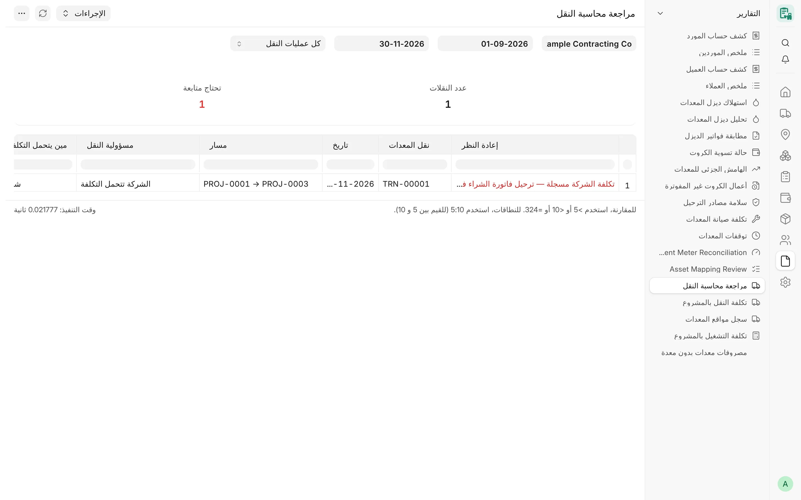

## نظرة عامة

لنقل المعدات تكلفة، لكن ليس كل نقل تكلفةً على الشركة: فقد يتحملها مورد المعدة أو العميل أو طرف آخر. وتعرض هذه التقارير
ما تتحمله الشركة وحده بوصفه تكلفتها، وتعرض منفصلةً المبالغ المتفق عليها لعمليات النقل التي لا تدفعها، وتشير إلى عمليات
النقل المعتمدة التي ما زالت محاسبتها تحتاج إلى قرار.

## المفاهيم الأساسية

| المفهوم | المعنى |
|---|---|
| تكلفة النقل على الشركة | **نقل معدات** معتمد يكون دافعه ومتحمل تكلفته النهائي هو الشركة، ويُحمَّل على **مشروع التكلفة** المختار له. والنقل المحمَّل على ورشة أو مخزن أو مركز تكلفة للمصاريف العامة لا مشروع له. |
| عمليات النقل القديمة | النقل المسجَّل قبل وجود حقول المسؤولية يحتفظ بقاعدته القديمة: يُحتسب على مشروع رأس المستند إذا كانت «التكلفة على» الشركة أو فارغة. |
| المبلغ المتفق عليه (ليس تكلفة على الشركة) | المبلغ الإعلامي لنقل يدفعه مورد المعدة أو العميل أو طرف آخر. يُعرض منفصلًا ولا يُضاف أبدًا إلى تكلفة الشركة. |
| القرار المالي | ما يسجّله مدير الحسابات لنقل يتحمل تكلفته العميل أو مورد المعدة. |

## تكلفة النقل بالمشروع

**الغرض.** صف لكل مشروع: عدد عمليات النقل المعتمدة التي هي تكلفة على الشركة ومبلغها، ومنفصلًا عنها عمليات النقل التي
لا تدفعها الشركة.

**الفلاتر:** **الشركة** (إلزامي)، **من تاريخ**، **إلى تاريخ**، **المشروع**.

**الأعمدة:** المشروع، عدد النقلات، تكلفة النقل، نقلات لا تدفعها الشركة، المبلغ المتفق عليه (ليس تكلفة على الشركة).

**الإجماليات.** لا توجد.

**الوصول.** System Manager وCard Manager وCard User وAccounts Manager.

## تكلفة التشغيل بالمشروع

**الغرض.** لكل مشروع: مبلغ **تعبئات ديزل المشروع** المعتمدة مضافًا إليه تكلفة النقل على الشركة، مأخوذين مباشرة من
المستندات (دون توزيع نسبي).

**الفلاتر:** **الشركة** (إلزامي)، **من تاريخ**، **إلى تاريخ**، **المشروع**.

**الأعمدة:** المشروع، الديزل، النقل، إجمالي تكلفة التشغيل، المبلغ المتفق عليه (ليس تكلفة على الشركة) — والعمود الأخير
لا يدخل في الإجمالي أبدًا.

**الإجماليات.** لا توجد.

**الوصول.** System Manager وCard Manager وCard User وAccounts Manager.

## مراجعة محاسبة النقل

**الغرض.** يعرض عمليات النقل المعتمدة في الفترة التي تحتاج محاسبتها إلى تدخل شخص، مع السبب. ولا يغيّر شيئًا ولا يربط ولا
يرحّل.

<!-- screenshot: transport-accounting-review -->

*تقرير مراجعة محاسبة النقل*

**الفلاتر**

- **الشركة** – إلزامي.
- **من تاريخ** / **إلى تاريخ** – إلزاميان؛ والافتراضي بداية السنة وتاريخ اليوم.
- **إظهار** – «تحتاج متابعة» (الافتراضي) أو «كل عمليات النقل».

**الأعمدة:** المراجعة، نقل المعدات، التاريخ، المسار (المصدر ← الوجهة)، مسؤولية النقل، متحمل التكلفة، تُحمّل على (مشروع
التكلفة أو المكان أو مركز تكلفة المصاريف العامة)، الناقل، تكلفة الناقل، المبلغ المتفق عليه (ليس تكلفة على الشركة)،
الطرف الآخر الذي يتحمل تكلفة النقل، الحالة المالية، القرار المالي للتكلفة، العميل، مبلغ الفوترة المتفق عليه (قبل
الضريبة)، مبلغ الاسترداد، فاتورة الشراء، الدليل.

**قيم المراجعة**

| المراجعة | تحتاج متابعة |
|---|---|
| مسجل قبل وجود حقول المسؤولية — للمراجعة | نعم، ما لم يكن مسجلًا بالفعل في فاتورة شراء |
| المسؤولية تحتاج مراجعة — ألغِ النقل وعدّله بالمسؤولية المؤكدة | نعم |
| القرار المالي معلّق (مدير الحسابات) | نعم |
| القرار المالي أعاد النقل للتصحيح — ألغِ النقل وعدّله | نعم |
| فوترة العميل مسجلة — إصدار الفاتورة في انتظار المحاسب والمستشار الضريبي | نعم |
| الاسترداد مسجل — لا يُرحّل حتى يقرر المحاسب | نعم |
| تحملتها الشركة — استثناء معتمد | نعم |
| تكلفة الشركة مسجلة — ترحيل فاتورة الشراء في انتظار المحاسب | نعم |
| للتسجيل فقط (لا تكلفة على الشركة) | لا |

**الإجماليات.** المربعان **عمليات النقل** و**تحتاج متابعة** (بالأحمر إن وُجدت). ويظهر عمود المراجعة بالأحمر في الصفوف
التي تحتاج متابعة.

**الوصول.** System Manager وAccounts Manager، ممن تمنحهم أدوارهم كذلك قراءة نقل المعدات وفواتير الشراء.

## ذو صلة

- [النقل](/card/ar/features/transport/)
- [واجهة API للنقل](/card/ar/api-reference/transport/)
- [تقارير الديزل والوقود](/card/ar/reports/diesel-fuel/)
