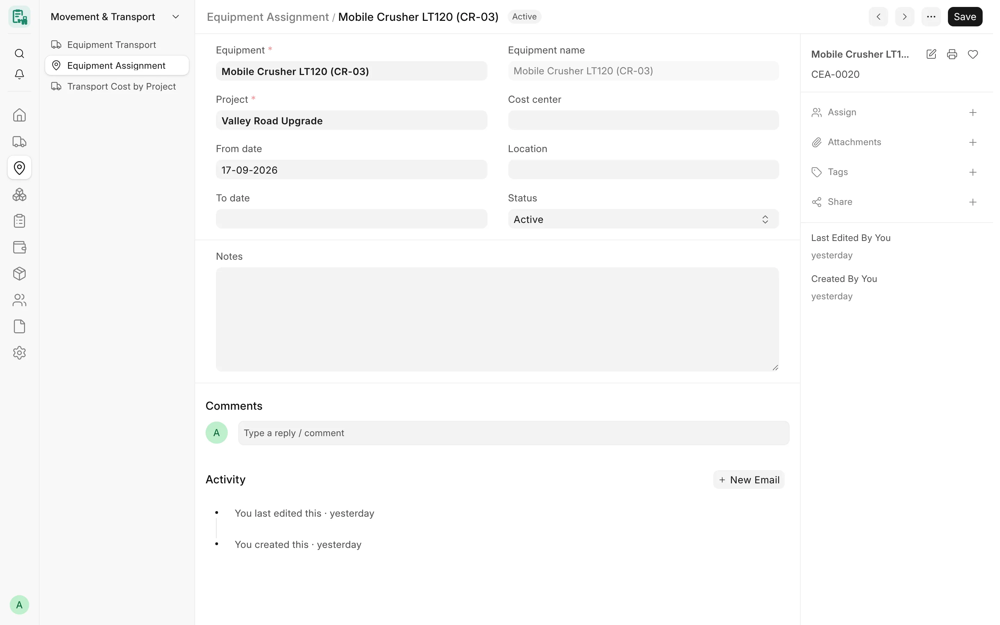
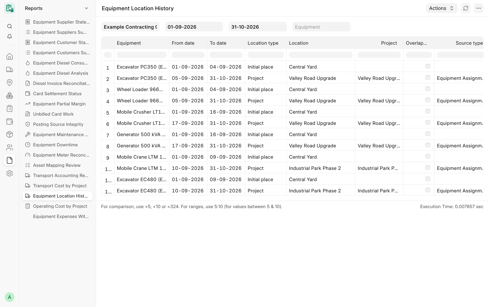

## Overview

A **Card Equipment Assignment** records that a machine is on a project for a period. Assignments are the backbone of
CARD's location logic: they decide which project a monthly card belongs to, which card days are valid, which cost
center a posting line takes, and where the machine is shown to be today.

Assignments are normally written by a submitted [Equipment Transport](/card/features/transport/): moving a machine to
a project closes its previous assignment and opens a new one. A Card Manager can also create or correct an assignment
by hand. When a machine is not on a project, its place is read from its last approved transport (workshop, storage or
supplier), or from the company's initial place.

<!-- screenshot: assignments-locations-assignment-form -->

*An equipment assignment*

## Key fields

| Field | Description |
|---|---|
| **Equipment** | The Card Equipment (mandatory). **Equipment name** is fetched from it. |
| **Project** | The ERPNext Project (mandatory). It must belong to the equipment's company. |
| **From date** / **To date** | The period. An empty To date means the assignment is open (still in force). |
| **Cost center** | Optional cost center for this period. Posting lines of the period use it, else the project's cost center. |
| **Location** | Free text for the place on site. |
| **Status** | «نشط» (Active) or «منتهي» (Ended), for information. |
| **Notes** | Free text. |

Assignments are numbered `CEA-0001`, … and keep a change history.

## Features

### Opening and closing by transport

When an Equipment Transport is submitted, each of its machines is moved:

| Situation | What happens |
|---|---|
| First move to a project (no open assignment) | A new assignment opens on the transport date. |
| Project → another project | The open assignment is closed and a new one opens, following the [move-day rule](#move-day-rule). |
| Machine already on that project | Nothing changes (the transport form refuses a move to the project the machine is already on). |
| Project → workshop, storage or supplier | The open assignment is closed on the transport date; nothing new opens. |

Each transport row records the **Previous assignment** it closed and the **Created assignment** it opened, and
cancelling the transport undoes exactly those changes. See [Transport](/card/features/transport/#assignment-open-and-close).

### Overlap check

One machine cannot be on two projects at once. A new or extended assignment is refused when its period overlaps
another assignment of the same machine (an open assignment counts as running forever):

> Equipment EQ-0001 is already assigned to project PROJ-0001 from … to (open).

- The check runs for a new assignment, a changed equipment, or a period that now covers more days (an earlier start,
  a later end, or a reopened end). Shortening a period — what a transport does when it closes one — is not re-checked.
- Two requests that write assignments of the same machine at the same time (two new assignments, or a new assignment
  while a transport cancel reopens the previous one) are processed one after the other, so they can never leave two
  overlapping periods.

### Protection of submitted card days

A change that would leave a billed day of a **submitted** monthly card outside every assignment of its project is
refused — shortening, moving or deleting the assignment, for the machine itself and for each component of a unit card.
A billed day is a day with working hours, or with stopped hours of a billable stop reason. For a backdated transport,
use a later date.

### Card days must fall inside an assignment

A monthly card's working days must fall inside an assignment of the card's project. For a unit, every component in the
unit on that day must be assigned there too. A machine with no assignment history at all is not constrained (older
data keeps working). See [Units & Components](/card/features/units-components/#effect-on-monthly-cards-and-assignments).

### Company rule

The equipment and the project must belong to the same company. Users limited by Company User Permissions see, open
and change only the assignments of equipment of their companies, in lists, reports, link searches and every save
path; a saved assignment cannot be moved to another company's equipment.

### Equipment status guard

A new assignment of an equipment with status «منتهية» (Ended) is warned about or refused according to the company's
**Equipment status rule** (see [Equipment](/card/features/equipment/#status-and-the-status-guard)). An assignment
opened by a transport is not checked twice; the transport checked the machine.

### Current project and assignment date

The equipment's **Current project** and **Assignment date** follow the assignment in force **today**:

- Exactly one assignment in force: its project and start date.
- None in force: both are emptied. A future assignment never moves them.
- Two or more in force (an overlap from older data): both stay empty, nothing is guessed, and an Info comment on the
  equipment lists the overlapping assignments (once per distinct set). The user acting is shown the message too.

They are updated after every assignment change and every transport. Because a project-to-project move may open the
new assignment on the next day, Card Settings offers an optional **Daily equipment location sync** (off by default):
a daily job re-syncs every machine that has assignments, and an overwritten value leaves a comment. Equipment without
assignments keeps its values.

### Move-day rule

On a project-to-project move, who gets the move day is set per company in Card Settings (**Move-day rule**):

| Rule | Old assignment ends | New assignment starts |
|---|---|---|
| New assignment starts the day after the move (default; also when empty) | on the move day | the day after |
| New assignment starts on the move day | the day before | on the move day |

The rule in force is recorded on each transport to a project when it is saved and submitted, so a later change of the
setting never changes how an existing transport is applied or cancelled. Under the "on the move day" rule a machine
that reached a project on a date cannot leave for another project on the same date; use a later date.

### Initial place of new equipment

Each company can set an **Initial place of new equipment** (an ERPNext Location) in Card Settings. A machine with no
assignment and no approved transport is considered to be in storage at that place; its first transport shows it as
**From**, and a first move to a project is recorded as **First entry**. When the setting is empty, the machine is in storage without a place.

### Current place of a machine

Where a machine is now is always derived, never typed:

1. On the project of its open assignment; otherwise
2. where its last submitted transport sent it (workshop, storage or supplier, with the place); otherwise
3. in storage at the company's initial place.

### Place cost centers

ERPNext Locations are not tied to a company, so Card Settings has a table **Cost center per workshop / storage place**
(Card Location Cost Center) with one row per **Company**, **Place** and **Cost Center**. A move to a workshop or a
storage place that the company pays is charged to the cost center of that place for the transport's company; such a
move is refused until the row exists. See [Transport](/card/features/transport/#cost-center).

### Site location

Both the equipment and the assignment have a free-text **Location** field for the exact place on site (for example a
yard or a zone). It is for information only and does not affect any rule.

### Equipment Location History

The **Equipment Location History** report (read-only) shows, for one company, a date range and an optional machine,
where each machine was as date segments:

| Column | Content |
|---|---|
| Equipment | The machine |
| From date / To date | The segment, clipped to the range |
| Location type | Project, Workshop, Storage, Supplier or Initial place |
| Location | The project title, the place or the supplier |
| Project | For project segments |
| Overlapping projects | Ticked when two projects were in force on the same day (one segment each) |
| Source type / Source document | The transport that opened the assignment, else the assignment; the transport for a workshop, storage or supplier place; empty for the initial place |

The report uses the same rules as the rest of CARD (including the move-day rule recorded on each transport). A move to
a workshop, storage or supplier on day T shows the project on T and the new place from T+1. A unit counts a
component's history only on the days that component is in the unit. Each day is decided from the full history, so the
rows never depend on the range asked for.

<!-- screenshot: assignments-locations-location-history -->

*Equipment Location History report*

## Workflow

1. Set the company's **Initial place**, **Move-day rule** and the **Cost center per workshop / storage place** rows in
   Card Settings.
2. Move a machine with an [Equipment Transport](/card/features/transport/) and submit it: the assignment opens.
3. Check the assignment in **Card Equipment Assignment**; add a cost center for the period if it differs from the
   project's.
4. Record the [monthly card](/card/features/monthly-cards/); its project comes from the assignments of the month.
5. Review past moves with the **Equipment Location History** report.

## Permissions

| Role | Card Equipment Assignment | Equipment Location History |
|---|---|---|
| System Manager | Read, write, create, delete | Yes |
| Card Manager | Read, write, create | Yes |
| Card User | Read | Yes |
| Accounts Manager | Read | Yes |

## Related

- [Transport](/card/features/transport/)
- [Equipment](/card/features/equipment/)
- [Units & Components](/card/features/units-components/)
- [Monthly Cards](/card/features/monthly-cards/)
- [Reports: Operations](/card/reports/operations/)
