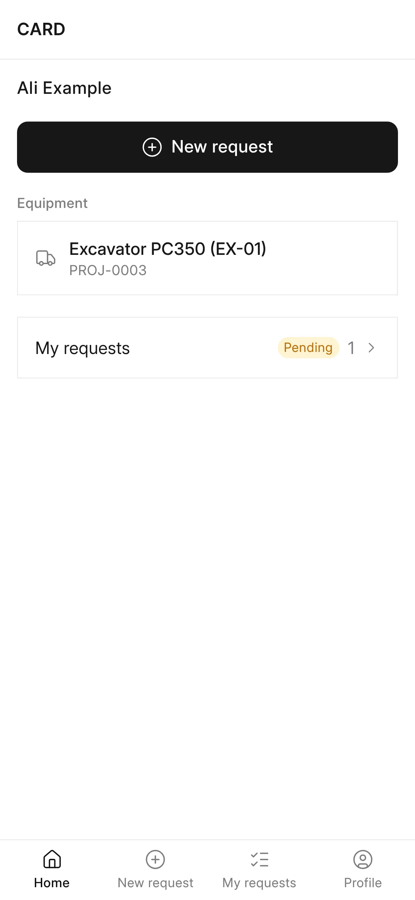
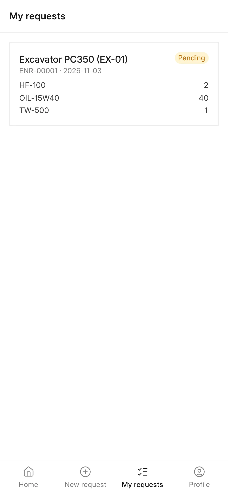

## Overview

**CARD Mobile** is the phone interface of CARD. It is a Progressive Web App (PWA) served by the CARD app itself at
`/cdms`, built the same way as the Frappe HR mobile app. CARD Desk stays the full management system; CARD Mobile
covers the actions people need on site, with the same accounts, the same data and the same server checks.

The current release covers the operator side of [equipment needs](/card/features/equipment-needs/): an operator
sees his machines, asks for parts, consumables and tools, and follows his requests. Card Users can also open a
read-only parts catalog. Hours entry, approvals, custody and notifications on the phone are planned (see
[Planned screens](#planned-screens)).

:::caution[Device support]
Installation on real iPhone and Android phones has not been tested yet. Device support will be stated only after
those tests on an HTTPS site.
:::

<!-- screenshot: card-mobile-home -->

*CARD Mobile home screen*

## Key concepts

| Concept | Meaning |
|---|---|
| **Phone only** | One interface designed for phones. On a computer the same interface is shown in a centred column up to 480 px wide; there is no separate desktop layout. |
| **Same account** | Users sign in inside the app with their ERPNext user. Sessions, CSRF protection and permissions are Frappe's own. |
| **Portal role** | Card Operator, Card Supervisor, Card Manager or System Manager. Needed to open the request screens. |
| **Active Employee** | An ERPNext Employee with status Active whose **User ID** is the user. Needed for the request screens. |
| **Catalog viewer** | A Card User without a portal role. He opens only the catalog and his profile. |
| **No duplicate logic** | CARD Mobile calls CARD's existing server methods; every call is checked again on the server. |

## Features

### Access

- A guest sees the in-app sign-in screen.
- A signed-in user with a portal role and an Active Employee opens the full app.
- A signed-in user with a portal role but no Active Employee sees a "not set up" screen: *Your account is not set up
  to ask for equipment needs. Ask your supervisor.*
- A Card User without a portal role is a catalog viewer: only **Catalog** and **Profile** are available.
- When the server cannot be reached, the app says so and offers **Try again**.
- An expired session returns the user to the sign-in screen.

### Bottom navigation

| User | Tabs |
|---|---|
| Operator, supervisor, manager | Home, New request, My requests, Profile |
| Catalog viewer | Catalog, Profile |

### Home

- The employee's name.
- **New request** button (shown when the user has at least one machine).
- **Equipment** — the machines the operator works on: those where he is the equipment's operator (unless the
  equipment status is «منتهية» Ended), and those on whose monthly card (draft or submitted) he is the operator for
  the current month. Each machine shows its current project. When there is none: *No equipment is assigned to you this month.*
- **My requests** — the number of requests, with a *Pending* badge while some are not yet approved or rejected.
- **Equipment Needs Review** — for supervisors and managers, a link to the review in CARD Desk.

### New request

1. Choose the **Equipment** (pre-selected when the operator has one machine).
2. For each line choose the kind — **Part or consumable** or **Tool** — and the item. The item field searches by item
   code, name, barcode or OEM part number; **Browse catalog** opens the catalog for the chosen machine.
3. Enter the **Quantity** and, when needed, the **Reason**.
4. Add more lines with **Add a line**, and optional **Notes**.
5. Tap **Send to supervisor**.

The app checks each line before sending: every line needs an item and a quantity, at least one line must have a
quantity, and an item without a confirmed fit for the machine needs a reason (*Why this item without a confirmed
fit?*). After sending, the app opens **My requests** with the message *Your request was sent to the supervisor.*

<!-- screenshot: card-mobile-new-request -->

*CARD Mobile requests*

### My requests

The operator's last 20 requests (not cancelled), newest first. Each shows the equipment, the request number and
date, its lines with quantities, and the review status:

| Status | Badge |
|---|---|
| Pending | Amber |
| In review | Blue |
| Approved | Green |
| Rejected | Red |

### Catalog

The catalog searches the standard ERPNext item catalogue by name, code, barcode or OEM number, with **Item group**
(including sub-groups) and **Brand** filters, images, OEM numbers and alternatives, and **Load more** for long
results. With a machine chosen, each item shows its fit for that machine:

| Fit | Meaning |
|---|---|
| Confirmed for this machine | A fitment record confirms the part for this machine |
| Confirmed for model *X* | A fitment record confirms it for the machine's model |
| Not compatible with this machine | A warning: the part is recorded as not fitting |
| Fit pending technical review | A fitment record exists but is not reviewed yet |
| No fitment record | Nothing is recorded |

**Fits this machine** limits the list to confirmed parts. Only confirmed fits count as a fit. See
[Maintenance & parts](/card/features/maintenance-parts/) for the fitment records.

### Profile

The user's **Employee**, **Company** and **User**, the install hint (see below) and **Logout**.

### Languages and direction

Translations come from Frappe's translation system in the page boot. Arabic and Urdu are shown right to left;
English, Bengali and Hindi left to right. Generic words (Home, Quantity, Logout…) use the translation context
*Card Mobile*, so CARD never overrides Frappe's or ERPNext's own translations. The app name is CARD in every
language. See [Languages](/card/features/languages/).

### Install on a phone

- **Android (Chrome)** — when the browser offers it, the Profile screen shows **Install the app**.
- **iPhone (Safari)** — the Profile screen shows the hint *On iPhone, tap Share, then Add to Home Screen.*
- Once installed, the app opens standalone with the name **CARD Mobile** (short name **CARD**) and the CARD icon.
  The hint is hidden when the app already runs installed.

The web app manifest, app icons and iPhone home-screen settings are included. The service worker is served at
`/cdms/sw.js`, so it controls `/cdms` and nothing wider; the browser checks it again on every load, so a new
build is picked up.

### Layout rules

- Safe areas for the notch, Dynamic Island and home indicator.
- Touch targets of at least 48 px and one main action per screen.
- Zoom is allowed.

### Planned screens

Planned, not implemented:

| Screen | For |
|---|---|
| Daily operating hours: entry, review and approval with separation of duties | Operators, supervisors, managers |
| Supervisor review, request on behalf of an operator, custody | Supervisors |
| Manager approvals | Managers |
| My tools in custody | Operators |
| Equipment, projects, assignment and transport views | By role |
| Monthly cards and diesel | By role |
| Suppliers, costs, reports and notifications | By role |

:::note[Operator web page]
Before CARD Mobile, operators used the server-rendered page `/equipment-needs` ("My equipment needs"). It is still
available and uses the same request logic.
:::

## Permissions

| Role | CARD Mobile access |
|---|---|
| Card Operator | Full app with an Active Employee: his machines, new requests, his requests |
| Card Supervisor, Card Manager, System Manager | Full app with an Active Employee, plus a link to the review in Desk |
| Card User (without a portal role) | Catalog and Profile only; no Employee needed |
| Other users | No access |

Every request is checked again on the server: an operator sees only his own requests, and only items he may pick.

## Related

- [Equipment needs](/card/features/equipment-needs/)
- [Tool custody](/card/features/tool-custody/)
- [Roles & permissions](/card/features/roles-permissions/)
- [Installation — build CARD Mobile](/card/getting-started/installation/#build-card-mobile)
