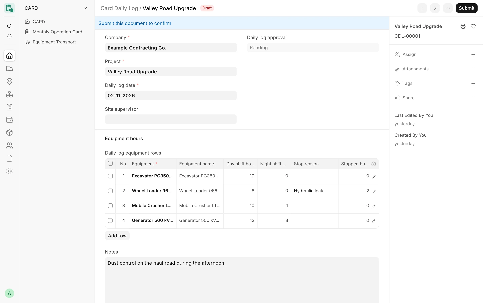
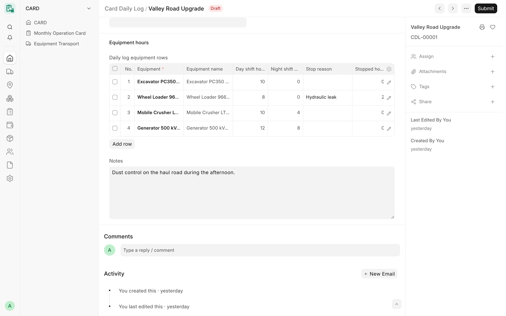

## Overview

A **Card Daily Log** records, for one company, one project and one date, the hours each machine worked on the day
shift and the night shift, the hours it stood still and why. The operator or the site supervisor enters the log and
submits it; a Card Manager then approves it or returns it for correction with a reason. An optional supervisor
verification step can be switched on per company.

Daily logs exist so that hours are captured close to the work, checked by someone other than the person who entered
them, and only then billed. Approved logs feed the [monthly cards](/card/features/monthly-cards/): one action creates
or updates the draft day-shift and night-shift cards of a project and month from every approved log, without ever
submitting a card or touching a submitted one.

:::note
Daily logs are part of the current development line of CARD (after release v4.7.0). The DocType opens at
`/app/card-daily-log`; there is no Desk sidebar link for it yet. Operators enter their logs on
[CARD Mobile](/card/features/card-mobile/#daily-logs-on-the-phone).
:::

<!-- screenshot: daily-logs-form -->

*A daily log with its rows*

## Key concepts

| Concept | Meaning |
|---|---|
| Daily log | One submittable record per company, project and date (`CDL-#####`). It holds one row per machine. |
| Row | One machine on that date: day shift hours, night shift hours, stop reason, stopped hours, responsible party and notes. |
| Preparer | Every user who created, saved, submitted or verified the log, or any earlier log in its amendment chain. |
| Approval status | Pending → (Verified by supervisor) → Approved, or Returned for correction. Written by the server only. |
| Card Daily Log Settings | One record per company with its self-approval rule and whether supervisor verification is required. |
| Generation | The **Generate monthly cards** action that builds draft monthly cards from approved logs. |

## Features

### Log header

The header identifies the log and shows its approval trail.

- **Company** – required; filled from the project.
- **Project** – required; must belong to the log's company.
- **Daily log date** – required, defaults to today.
- **Site supervisor** – optional link to a user.
- **Daily log approval** – the approval status (read only).
- **Daily log submitted by**, **Daily log verified by / on**, **Daily log approved by / on** – written by the server.
- **Approved by its own preparer** – ticked when a preparer approved the log under the "Warn only" rule.
- **Daily log return reason**, **returned by / on** – shown when the log was returned for correction.
- **Notes** – free text.

### Equipment rows

The **Equipment hours** section holds the rows (at least one is required).

| Field | Rules |
|---|---|
| Equipment | Required. Must belong to the log's company and may appear only once in the log. |
| Equipment name | Filled from the equipment. |
| Day shift hours | Hours on the day shift. |
| Night shift hours | Hours on the night shift. |
| Stop reason | Optional. Must be an enabled **Card Stop Reason** of the log's company. |
| Stopped hours | Hours the machine stood still. |
| Responsible party | Company, Supplier, Customer or Other. Empty takes the stop reason's default responsible party. |
| Responsible party record | The company, supplier or customer record (a Company party is always the log's company). |
| Responsible party name | Free-text name, used only when the party is Other. |
| Notes | Free text. |

The rows follow the same rules as the day rows of a monthly card:

- hours cannot be negative, and day, night and stopped hours together cannot exceed 24;
- no hours can be recorded for a future date;
- a row with hours must fall inside an assignment period of the machine on the log's project (for a unit, every
  component); a machine without any assignment history is not checked;
- the company's equipment status rule applies to a machine newly added to the log (an ended machine may be refused);
- the shift limits from Card Settings (**Max day-shift hours**, **Max night-shift hours**, 12 by default) only warn:
  every recorded hour counts, and rows over the limit are listed for review.

### One log per machine, project and date

A machine can appear in only one live (not cancelled) daily log for the same project and date. The check locks the
machine records first, so two logs saved at the same moment for the same machine cannot both pass.

### Approval flow

After submission the only change allowed on a log is its approval, and the server decides every transition from the
values stored in the database, whatever route is used (form button, REST, `frappe.client.set_value`, bulk update).

| From | To | Who | Rule |
|---|---|---|---|
| Pending | Verified by supervisor | Card Supervisor who is not a preparer | Only when the company requires supervisor verification. |
| Pending (or Verified) | Approved | Card Manager or System Manager | With supervisor verification on, the log must be verified first. |
| Pending (or Verified) | Returned for correction | Card Manager or System Manager | A return reason is required. With supervisor verification on, a Card Supervisor may also return a Pending log. |
| Approved or Returned | any | – | Final. Cancel and amend the log to change it. |
| any | Pending | – | Never allowed; cancel and amend instead. |

The form shows **Verify daily log**, **Approve daily log** and **Return daily log** buttons to the users who may use
them. Every approval field (who, when, reason, self-approval flag) is written by the server; values sent by a client
are discarded.

### No self-approval

A preparer is anyone who created, edited as a draft, submitted or verified the log, or any log it amends. When a
preparer approves, the company's **Daily log self-approval rule** decides:

- **Warn only (daily log)** – the default, also when the company has no settings record: the log is approved, a
  warning is shown and **Approved by its own preparer** is ticked so the log can be reviewed later.
- **Refuse (daily log)** – the approval is refused; another approver must approve.

No role is exempt, not even System Manager or Administrator. A verifier counts as a preparer for the approval.

### Cancel and amend

A log can be cancelled and amended like any submittable document. An approved log can be cancelled only by a Card
Manager or System Manager, because monthly cards may already have been generated from it. An amendment must stay in
the same company and keeps every earlier preparer.

### Card Daily Log Settings

One record per company (named after the company). A company without a record uses the defaults.

| Field | Options | Default |
|---|---|---|
| Company | – | required |
| Daily log self-approval rule | Warn only (daily log) / Refuse (daily log) | Warn only (daily log) |
| Daily log supervisor verification required | on / off | off (two-step flow: submit → approve) |

Only System Manager can create or change these records; Card Manager can read them. A user restricted to some
companies sees only those companies' settings, and the records cannot be shared with users outside their company.

### Generating draft monthly cards

On an approved, submitted log, users who may create monthly cards see **Generate monthly cards**. It asks for
confirmation and then creates or updates the draft monthly cards of the log's project for the month of the log date,
from **every** approved log of that company, project and month.

How the generation works:

1. It reads only logs that are submitted and **Approved**.
2. It builds one card per machine, project, month and shift – the same key as the monthly card's own duplicate check.
   Day shift hours and the stop data (stop reason, stopped hours, responsible party) go to the **day** shift card;
   night shift hours go to the **night** shift card. A shift card is created only when some log row has hours for it.
3. Each day taken from a log gets the day status «عمل» (Working), the day name, and the log's name in the day's notes.
4. **The approved log wins:** a day of a draft card covered by an approved log is set from the log on every run.
   When the day held other values (a manual correction or an earlier log) they are replaced and listed with their old
   and new hours and notes. Other days of the card are kept.
5. A day whose notes name a log that is no longer approved (for example cancelled) is cleared on a draft card and only
   reported on a submitted card.
6. Days are left out and reported when the machine was not on the project that day (yard, workshop, storage or
   another project) or was a component of a unit that day.
7. Every card is saved through its normal validation, with the user's own permissions. A card that fails validation
   is rolled back alone and listed; a permission error stops the whole run.

Rules that always hold:

- a submitted card is never changed and no card is ever submitted;
- running it again changes nothing that is already correct; a log approved later fills its day on the next run;
- a machine moved between two projects in the month gets one card per project (each run handles one project);
- if another run changed the same machine's cards at the same time, the machine is skipped and listed as a conflict:
  run the generation again.

The result dialog lists cards created, updated, unchanged and submitted cards not changed, then days replaced, days
cleared, stale days on submitted cards, conflicts, days left out and cards not saved.

<!-- screenshot: daily-logs-generation-result -->

*Daily log rows*

## Workflow

1. The operator or site supervisor creates a daily log for the project and date, adds a row per machine and submits it.
2. If the company requires it, another Card Supervisor verifies the log.
3. A Card Manager approves the log, or returns it with a reason (a returned log is cancelled, amended and submitted
   again).
4. During or at the end of the month, a user opens an approved log and clicks **Generate monthly cards**.
5. The draft monthly cards are reviewed, completed (additions, deductions) and submitted through the normal
   [monthly card](/card/features/monthly-cards/) flow.

## Permissions

| Role | Daily log | Card Daily Log Settings |
|---|---|---|
| Card Operator | Create, submit, cancel and amend **own** logs | – |
| Card Supervisor | Create, submit, cancel, amend; verify (when required) and return a Pending log | – |
| Card Manager | Full use except delete; approve and return | Read |
| System Manager | Full use including delete; approve and return | Create, change, delete |
| Card User | Read, print, report | – |

Company User Permissions apply: a restricted user sees and changes only the logs of their companies. Generating cards
needs the right to create a monthly card of that company and project and to read its daily logs.

## Related

- [Monthly Cards](/card/features/monthly-cards/)
- [Assignments & Locations](/card/features/assignments-locations/)
- [Equipment](/card/features/equipment/)
- [Roles & Permissions](/card/features/roles-permissions/)
- [CARD Mobile](/card/features/card-mobile/)
