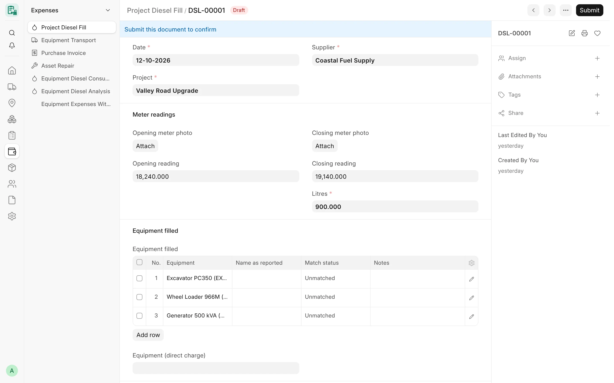
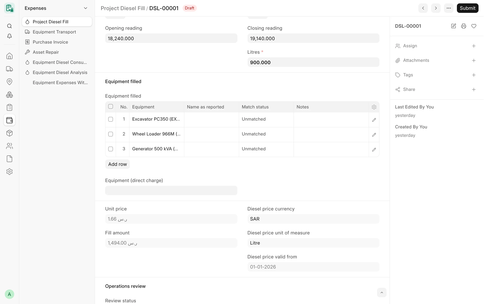

## Overview

A **Project Diesel Fill** (تعبئة ديزل للمشروع) records one diesel delivery on a project: a metered session in which the
supplier's tanker fills a project tank or one or more machines. The litres come from the fill meter readings, proven by
private photos of the meter at the start and at the end. The price per litre is not typed: it comes from the company's
approved price, and any other price is an audited exception.

A fill is reviewed by operations before it can be submitted. Once submitted, it becomes a diesel line on the
supplier's monthly draft Purchase Invoice (see [Invoicing & Posting](/card/features/invoicing-posting/)), and it feeds
the diesel consumption and analysis reports. Fills are named `DSL-#####`.

<!-- screenshot: diesel-form -->

*A project diesel fill*

## Key concepts

| Concept | Meaning |
|---|---|
| Session | One delivery: opening reading (counter reset to zero), closing reading, litres = closing − opening. |
| Direct charge | The fill is charged in full to one machine, **Equipment (direct charge)**. The litres are recorded for that machine. |
| Project tank | No single machine: the fill stays at project level. A list of filled machines may be kept, without litres. |
| Company price | The approved price per litre of the fill's company on the fill date. |
| Price source | «سعر الشركة» (Company Price), «استثناء» (Exception) or «يحتاج مراجعة» (Needs Review). |
| Operations review | Draft → Needs Review → Operations Approved or Rejected. Only an approved fill can be submitted. |
| Totalizer | The meter's cumulative counter, used as an advisory cross-check of the session. |

## Features

### The fill form

The form has three main sections:

1. **Fill** – **Date**, **Project**, **Supplier**, **Company** (hidden for a single-company user).
2. **Meter readings** – **Opening meter photo** and **Opening reading**, **Closing meter photo** and **Closing
   reading**, **Litres**.
3. **Equipment filled** – either **Equipment (direct charge)** or the **Equipment filled** table.

The price appears on one line: **Unit price**, **Fill amount** (litres × unit price) and **Price source** when it is
not the company price. **Meter details**, **Price exception**, **Supplier invoice and source**, **Cost Center and
posting** and **Remarks** are collapsed or shown only when relevant. The operations review section appears after the
first save.

<!-- screenshot: diesel-meter-photos -->

*Meter readings on a diesel fill*

### Meter photos and readings

- The meter photos are shown as large cards in place of a file link. Clicking a photo opens it in full size; an
  editable fill has **Change** and **Remove** buttons.
- Photos must be **private** image files uploaded to this fill (JPEG, PNG or WebP, checked by content, 10 MB at most).
- The opening and closing photos must be different files, and one photo (same file or same bytes) can prove only one
  live fill. A rejected fill releases its photos.
- When a closing reading is given, **Litres = Closing reading − Opening reading**, and a typed litres value is
  replaced (with a notice). A closing reading lower than the opening one is refused.

### Totalizer check

**Meter details** holds the **Opening totalizer** and **Closing totalizer** (the cumulative drums), the opening and
closing photo times and the photo location. An unreadable last drum may be written as `?`. CARD compares the session
with the totalizer movement (tolerance 1 litre) and sets **Totalizer check**:

| Value | Meaning |
|---|---|
| Not Checkable | No closing reading, or a totalizer side missing or unreadable |
| Consistent | The session falls inside the totalizer movement |
| Inconsistent | The session is outside it; a warning is written and the fill goes to review |

Other warnings, written to **Evidence warnings**, are: another fill on the same project and date (allowed, never a
duplicate by itself), a closing photo time before the opening one, and a closing photo dated on another day than the
fill.

### Direct charge or project tank

| Mode | How to enter it | Posting | Reports |
|---|---|---|---|
| Direct charge | Set **Equipment (direct charge)** | One line on that machine | Recorded litres of that machine |
| Project tank | Leave it empty; optionally list **Equipment filled** | One project-level line, no machine | Split between the machines by operating hours, shown as an **estimate** |

You cannot use both: a fill has either one direct-charge machine or the list. Each list row has **Equipment**,
**Name as reported**, **Match status** («غير مطابق» Unmatched, «مطابق» Matched, «طرف ثالث» Third Party) and **Notes**;
a matched row needs its equipment, and every listed machine must belong to the fill's company. The list carries no
litres and is never counted as recorded consumption.

### Allocation to equipment by hours

For the diesel reports and the diesel panel of a monthly card, a project-tank fill is split between the machines that
worked on the same project and month, in proportion to their operating hours on submitted cards of the same company.
A single largest-remainder rule makes the shares add up exactly to the fill. Every figure keeps the recorded part
(direct fills) and the estimated part (tank fills split by hours) apart. This split is for display only: it never
changes a card's amount and is never used in a posting.

### Diesel price

The price per litre is locked to the company price:

- A new fill takes the company price on its date. A typed price different from it is refused; use a price exception.
- With no approved price for the company (zero or missing), a new fill is refused.
- A saved draft keeps the price it was created with when the company price changes later (an orange notice says so).
  If its company or date changes, a different price sends it to **Needs Review**.
- A fill with **Needs Review** cannot be submitted until someone decides: **Use company price** or an approved
  exception.

The company price comes from Card Settings, tab **Diesel Settings**:

- **Diesel price schedule** (جدول أسعار الديزل) – dated rows of **Company**, **Diesel price valid from**, **Diesel unit
  price (per litre)**, **Diesel price currency** (the company currency; another currency is refused) and an optional
  **Diesel price unit of measure**. One price per company and date, always above zero. A fill takes the row with the
  latest valid-from date on or before its date.
- Without a schedule row for the date, the company's **Diesel unit price (per litre)** in its company settings row
  applies. While a company has a schedule, its price can change only by a new dated row.

A new or backdated schedule row never reprices submitted fills; CARD tells you how many submitted fills of the company
are on or after its date.

### Price snapshot

Each fill stores what its company price was resolved from: **Company price** (hidden), **Diesel price currency**,
**Diesel price unit of measure** and **Diesel price valid from** (empty for the company's plain unit price). The
snapshot is kept whenever the price is kept and never changes after submit.

### Price exceptions

A user with the **Diesel price exception role** (default *Accounts Manager*) may tick **Price exception**, type
another price and give an **Exception reason**. CARD stamps **Exception by** and **Exception on**, keeps the company
price it replaced and logs the change.

| Action | Rule |
|---|---|
| Zero price | Only the **Diesel zero price role** (empty by default = nobody) |
| Negative price | Always refused |
| New price on an existing exception | Needs its own new reason |
| End an exception | **Remove price exception**, with the exception role and a written reason; a plain save cannot end it |
| Change a saved draft's price | **Use company price**, with the exception role and a written reason |
| Amendment of a cancelled fill | The copied exception is dropped and the copy goes to Needs Review |

Every price change of a saved draft is recorded in the Version history and as a comment with its reason.

### Diesel supplier policy

**Diesel supplier policy** and **Diesel supplier** in Card Settings control the supplier:

- «ثابت» (Fixed) – the settings supplier is filled in and nobody may change it;
- «متغير» (Variable, default) – the settings supplier is the default; only the **Diesel supplier editor role**
  (default *Card Manager*) may choose another.

The form asks the server whether the supplier can be edited, so Card Users never need to read Card Settings. A disabled
supplier cannot be chosen.

### Project, status and company checks

- **Project and cost center** must belong to the fill's company; the cost center must be enabled and not a group.
- **Diesel fill project check** (per company in Card Company Settings): each direct-charge or listed machine needs a
  Card Equipment Assignment on the fill's project in force on the fill date. Values: «إيقاف» *Off*, «تنبيه فقط» *Warn
  only* (default, also when empty: a message, the fill is saved) or «رفض» *Refuse*. Only new fills, or fills whose
  company, equipment, project or date changed, are checked.
- **Equipment status**: a machine with status «منتهية» (Ended) gets no new fill, under the company's **Equipment status
  rule** (Warn only by default, or Refuse). A fill dated on or before the machine's exit date is its last work and is
  never stopped. Every machine is checked again on submit.
- **Company isolation**: a user limited to some companies cannot read, create, change or share fills of another company.

### Operations review

The **Operations review** section holds **Review status**, **Review notes**, **Reviewed by** and **Reviewed on**:

- Only **Card Manager** or **System Manager** may set *Operations Approved* or *Rejected*; the reviewer and time are set
  by the server.
- Approval needs the closing meter photo and the closing reading.
- A draft with a warning, or an inconsistent totalizer, moves to *Needs Review* automatically.
- A material change after approval (litres, company, project, date, supplier, equipment, cost center, readings,
  photos, totalizers or the equipment list) sends the fill back to *Needs Review*.
- Submit requires *Operations Approved* and a price that is not *Needs Review*.

### Import of reviewed sessions

Diesel sessions prepared and checked outside the site (for example from a message log) can be imported by a Card
Manager or System Manager with a server command, with a dry run by default:

- one draft fill per **Source key**; a re-run skips keys that already exist;
- meter photos are checked against their SHA-256 and stored as private files of the fill;
- equipment is kept as **Name as reported** only;
- the price is the company price, or the price of the session's own supplier invoice (shown in **Supplier invoice no.**,
  **Invoiced litres**, **Invoice price per litre**, **Delivery charge billed as litres** and **Invoice evidence**); a
  historical invoice price waits as *Needs Review* until the price exception role approves it;
- the import never approves, submits or posts. The source fields are set by the import only and cannot be typed.

Imported fills are never posted by CARD: the supplier's own invoice is the Purchase Invoice.

### Meter extraction

An optional local worker can read the meter photos. It is off unless the site administrator configures it; without it
the manual flow is unchanged. When a photo is new or changed, a background job sends it to the worker as the saving
user and applies the answer through the fill's own validation:

- only a clear, validated closing reading that matches the entered litres is written, with a note to check it against
  the photo;
- an unreadable photo, no meter, a meter not reset to zero, an ambiguous or conflicting reading, or a reading that would
  change a person's value sends the fill to *Needs Review* with a line in **Evidence warnings**;
- a value a person entered is never overwritten, and approved, rejected or submitted fills are never touched;
- a private crop of the meter is attached and shown beside the photo when a reading is disputed.

### Diesel Invoice Reconciliation

The read-only report **Diesel Invoice Reconciliation** (مطابقة فواتير الديزل), for System Manager and Accounts Manager,
matches the diesel sessions with the suppliers' own Purchase Invoices. Filters: **Company**, **Diesel suppliers (one
delivery stream)**, **From date**, **To date**, **Diesel sessions to include** (submitted and draft, or submitted only),
**Invoice date window (days)** and **Delivery charge up to (litres)**.

It reads the litres from the invoice line text, separates delivery charges from physical diesel, derives each
invoice's VAT basis from its own figures, matches per delivery and per period (aggregated invoices), splits by project
and lists exceptions. It writes nothing. See [Diesel & fuel reports](/card/reports/diesel-fuel/).

### Diesel as a stock item

:::caution[Planned]
Diesel as a stock item with tanks and warehouses is not built. Today a fill is an expense line on the supplier's
Purchase Invoice.
:::

### Print format

**Project Diesel Fill Print** prints the document number, date, project, supplier, direct-charge equipment and
remarks, an amount summary (litres, unit price, amount) with the amount in words, and three signature lines
(Prepared By, Received By, Approved By). It follows the user's language and page direction and marks drafts and
cancelled fills. See [Print Formats](/card/features/print-formats/).

## Workflow

1. Start a new fill: date, project, supplier (filled from the settings), and the machine or the list of filled machines.
2. Attach the opening meter photo and enter the opening reading (zero after reset).
3. After filling, attach the closing photo and enter the closing reading; litres are computed.
4. Save. The price is set from the company price; warnings, if any, move the fill to *Needs Review*.
5. A Card Manager reviews the photos and readings and sets *Operations Approved* (or *Rejected*).
6. Submit. The fill waits for the monthly posting of its supplier.

## Permissions

| Action | Roles |
|---|---|
| Create and edit draft fills | Card User, Card Manager, System Manager |
| Submit, cancel, amend | Card Manager, System Manager |
| Approve or reject the operations review | Card Manager, System Manager |
| Price exception, use company price, remove exception | Diesel price exception role (default Accounts Manager) |
| Zero price | Diesel zero price role (none by default) |
| Change the supplier (variable policy) | Diesel supplier editor role (default Card Manager) |
| Edit the price schedule and company price | System Manager, Accounts Manager |
| Import sessions | Card Manager, System Manager |
| Read fills | Card User, Card Manager, Accounts Manager, System Manager |

## Related

- [Invoicing & Posting](/card/features/invoicing-posting/)
- [Meter Readings](/card/features/meter-readings/)
- [Monthly Cards](/card/features/monthly-cards/)
- [Assignments & Locations](/card/features/assignments-locations/)
- [Diesel & fuel reports](/card/reports/diesel-fuel/)
- [Diesel API](/card/api-reference/diesel/)
