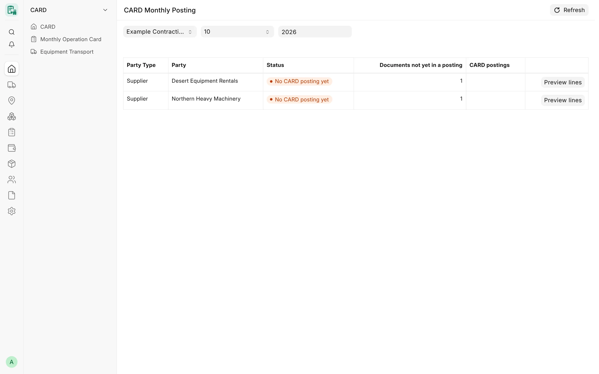

## Overview

CARD records operations: monthly cards, diesel fills and equipment transports. Once a month it gathers the submitted,
not-yet-invoiced documents of each party and builds **one draft Purchase Invoice per supplier** and **one draft Sales
Invoice per customer**. Every invoice line carries the project, the cost center and the machine (through the
**Card Equipment** accounting dimension), so the official ERPNext ledger, profit and loss and every per-equipment
report see the same figures.

CARD **never writes ledger entries**. It only creates standard ERPNext documents as drafts. An accountant reviews and
submits them in ERPNext, and ERPNext posts the General Ledger. A GL Posting Log records what each draft contains, and a
set of integrity checks makes sure that what reaches the ledger is exactly what CARD built from its source documents.

<!-- screenshot: invoicing-posting-page -->

*The CARD Monthly Posting page*

## Key concepts

| Concept | Meaning |
|---|---|
| Posting unit | One company, one party (supplier or customer), one month, one side. Only one active posting may exist per unit. |
| Side | Supplier side (Purchase Invoice) or customer side (Sales Invoice). A sub-rental card is posted on both sides separately. |
| Source document | A submitted Card Monthly Card, Project Diesel Fill or Equipment Transport that the posting includes. |
| Draft posting | The draft invoice CARD built. It reserves its sources so no other posting can take them. |
| Posted | The invoice was submitted in ERPNext. CARD then writes the invoice link and the `Posted` flag onto each source. |
| GL Posting Log | The audit record of one posting: party, month, status, invoice, sources, signatures. |
| Origin | `Built` (CARD created the invoice) or `Linked` (an existing hand-booked document was linked to CARD sources). |
| Sequence | 1 is the month's primary posting; 2 and higher are supplementary postings for documents submitted later. |

## Features

### CARD Monthly Posting page

The Desk page **CARD Monthly Posting** (الترحيل الشهري CARD), at `/app/card-monthly-posting`, is the screen from which
the monthly drafts are created. It is open to **Card Manager** and **System Manager**.

1. Choose the **Company**, **Month** and **Year**.
2. The page lists every party of that month on the sides you may post, with:
   - **Party Type** and **Party**;
   - **Status**: *No CARD posting yet*, *Draft posting* or *Posted*;
   - **Documents not yet in a posting** – how many submitted sources are still waiting;
   - **CARD postings** – the active posting documents (a linked supplier invoice is marked as such).
3. **Preview lines** runs the builder as a dry run and shows, without writing anything, the lines the next draft
   would contain: description, item, account, project, cost center, equipment, VAT treatment of the line and amount,
   followed by the totals (line total, customer discount, net total, taxable and zero-rated net, VAT estimate) and the
   list of **CARD source documents**.
4. If the build would be refused, the preview shows the reason under *This posting cannot be built yet* instead of
   the lines.
5. **Create draft posting** (or **Rebuild draft posting** when a CARD draft already exists) builds the invoice and
   opens it.

The VAT figure in the preview is an estimate: ERPNext computes the invoice taxes when the draft is built. The draft may
also differ from the preview if documents changed after it was shown; the confirmation dialog says so.

<!-- screenshot: invoicing-posting-preview -->

*Monthly posting preview*

### Supplier side: one draft Purchase Invoice per supplier

The supplier draft takes, for the chosen company and month:

| Source | Included when |
|---|---|
| Card Monthly Card | Submitted, card direction bills a supplier, no Purchase Invoice yet, card month = posting month |
| Project Diesel Fill | Submitted, fill date in the month, no Purchase Invoice yet, **not** an imported session |
| Equipment Transport | Submitted, date in the month, no Purchase Invoice yet, cost borne by the company, no responsibility scenario recorded |

Each source becomes its own line:

- **Card** – item *Rental item*, account *Equipment rental expense account*, rate = the card's total amount; each
  supplier-side addition or deduction becomes a further line (a deduction is a negative line) on the account and item
  of its addition/deduction type.
- **Diesel fill** – item *Diesel item*, account *Diesel expense account*, rate = the fill amount. A fill charged to one
  machine carries that machine; a project-tank fill (no machine) stays **one project-level line** and is never split
  between machines in the posting.
- **Transport** – item *Transport item*, account *Transport/mobilization expense account*, one line per machine share
  of the trip cost.

The invoice is dated the last day of the month, in the company currency, with rounding disabled so the amounts match
to the smallest unit.

:::note
Diesel sessions imported from a reviewed message log are never posted by CARD. Their supplier's own invoice is the
Purchase Invoice; it is entered in ERPNext and can be linked to the fills (see *Linking hand-booked documents*).
:::

### Customer side: one draft Sales Invoice per customer

The customer draft takes the submitted cards of the month whose direction bills a customer and that have no Sales
Invoice yet. Each card gives one line with item *Rental-out item*, account *Equipment rental income account* and rate =
the card's customer amount.

Customer-side rules required by e-invoicing:

- A Sales Invoice never carries a negative line. A **taxable** customer deduction becomes a discount on the Net Total,
  which lowers the VAT base by the same amount.
- A **non-taxable** customer deduction is refused, because it cannot be shown without shifting the VAT base.
- A zero-rated addition line in the same month as a deduction discount is refused for the same reason.
- A monthly total below zero is refused on both sides.

### Suppliers without VAT registration

VAT registration is read from the supplier's **Tax ID**. A supplier with a Tax ID gets the company's purchase tax
template; a supplier without one gets a Purchase Invoice **without** taxes. A VAT-registered supplier whose company has
no purchase tax template is refused, so VAT is never dropped silently.

:::caution[Planned]
A Journal Entry for non-VAT suppliers (and an agent or related-party model) is not built. Today such suppliers get a
Purchase Invoice without taxes. CARD does not create Journal Entries; it only links existing ones (see below).
:::

### VAT templates

CARD sets VAT per line through two Item Tax Templates per company:

- **VAT item tax template (company rate)** – carries the single rate of the company's purchase and sales tax
  templates; the first posting creates it as `CARD VAT <rate>% - <company abbreviation>` when it is missing.
- **VAT 0% item tax template** – for non-taxable addition/deduction lines (`CARD VAT 0% - <abbr>`).

The rate is never hardcoded: it is the one positive rate of the configured tax templates. Templates with different
rates, several VAT rows, or rows other than *On Net Total* are refused. An existing linked template is never renamed
or changed; a new rate gets a new template. Items used on CARD lines must carry no item-level taxes. The built log
stores the VAT CARD built, and submit refuses a draft whose VAT changed.

### Diesel price VAT basis

For a VAT-registered diesel supplier, each company sets **Diesel price VAT basis**:

| Value | Effect on the diesel line |
|---|---|
| Exclusive | The line is the fill amount; VAT is added on top. |
| Inclusive | The line is booked net (fill amount × 100 ÷ (100 + rate)), so VAT is not counted twice. A note on the log shows gross, net, VAT and rounding. |
| (empty) | The build is refused until the basis is verified. |

### Project and equipment cost allocation

Every line takes a cost center by a fixed rule, and any doubt stops the build for review instead of guessing:

| Line | Cost center |
|---|---|
| Card line | The cost center of the equipment assignment(s) to the card's project on its working days; else the project's cost center. Assignments that resolve to different cost centers are refused. |
| Diesel fill | The fill's own cost center; else the assignment of its machine on the fill date; else the project's (project-tank fill). |
| Transport to a workshop or storage | The cost center configured for that place in Card Settings (*Cost center per workshop / storage place*). |
| Company-paid transport to or from a project | Refused for review: CARD records no cost-bearing project for such a move, so the accountant enters the supplier invoice manually. |

A cost center must be an enabled, non-group cost center of the posting's company. The company default or the
machine's asset cost center is never used for project work. A card covers one project; a machine that worked on two
projects in a month has one card per project.

### Card Equipment accounting dimension

**Card Equipment** is a standard ERPNext Accounting Dimension. It adds a `card_equipment` field to the ledger-bearing
documents, so invoice lines, Stock Entry and Material Request rows and GL entries carry the machine. When an equipment
is linked to an ERPNext Asset, CARD keeps the Asset's dimension pointing at the equipment, so depreciation entries made
by ERPNext also land on the machine.

The dimension is created once by an administrator with a manual command; it is never created by a migration. Posting
is **fail-closed**: while the dimension is missing or disabled, every build is refused with a message telling the
administrator what to run.

### Rebuilds and late documents

- A draft already exists for the unit → the build is refused; use **Rebuild draft posting**. A rebuild deletes the
  draft (freeing its sources) and builds the month again with every waiting document.
- The month's posting is already submitted → a new build creates a **supplementary posting** (sequence 2, 3, …) with
  only the new documents.

:::caution
A rebuild deletes and recreates the draft invoice, so manual edits made on the draft are lost.
:::

### Posting integrity checks

The draft is checked when it is built and again when it is submitted:

| Check | What it prevents |
|---|---|
| One active posting per unit (unique posting key) | Two drafts or invoices for the same party, month and side |
| Source reservation and row locks | Two builds or links taking the same document at the same time |
| Card identity | Invoice lines that do not add up to the card's stored net amount (within the *Reconciliation tolerance*) |
| Built signature | Any edit of party, account, cost center, project, equipment, item, rate, quantity or tax rows after the build |
| Sources total = invoice net total | Value edits that no longer match the source documents |
| Discount lock | Discounts typed on a CARD invoice (additions and deductions belong on the cards) |
| Builder version | Old drafts that split a project-tank fill by hours must be rebuilt before submit |
| Posting date and period | An invoice dated outside its month, or in a closed or frozen period |
| Bill No and Bill Date | A VAT-registered supplier's invoice submitted without the supplier's own number and date |
| Supplier invoice number used once | The same supplier bill number booked twice |
| Copy guard | A duplicated CARD invoice, or a manual invoice that names a source a CARD posting already holds |
| Amendment guard | Amending a cancelled CARD invoice (rebuild the month instead) |
| Source cancel guard | Cancelling a card, fill or transport that a draft or submitted posting holds |

When the only differences are a cost center or an expense/income account, an **Accounts Manager** may accept the
correction with a written reason (same company, enabled leaf, same root type). The acceptance is tied to the exact
invoice content; any later edit needs a new acceptance. Every other change needs a rebuild.

### Hand-booked supplier invoices around the month

Before a supplier draft is built, CARD looks for that supplier's Purchase Invoices that CARD did not build, dated from
one month before to two months after the posting month, with a line on an expense account, a CARD account or a CARD
item. Each one is possible evidence that the same operations were already booked. The build is refused until each is
either:

- **linked** to the CARD sources it pays for, or
- **declared unrelated** by an accountant (Accounts Manager, Accounts User or System Manager), by ticking it under
  **Supplier invoices to review** on the posting page.

The reviewed invoices and the reviewer are stored on the log. When a hand-booked invoice is submitted for a supplier
CARD already posted for a nearby month, ERPNext shows the CARD postings as a warning.

### Linking hand-booked documents

Two server methods record that an existing document already covers CARD sources. Nothing is reposted and the
document is not changed; a GL Posting Log with origin *Linked* reserves the sources so CARD never invoices them again.
Both need an accountant role and are not yet exposed as Desk buttons.

| Link | Use | Evidence required |
|---|---|---|
| Supplier invoice link | A Purchase Invoice booked by hand for cards, fills or transports | Sources compared with the invoice net total on one VAT basis; a gap needs an accountant's reason and is stored as an open difference |
| Accrual Journal Entry link | A submitted Journal Entry that recognised supplier cards (expense debit, supplier credit) | The entry credits exactly one supplier, and the credit net of tax rows equals the cards' net within tolerance, or an accepted difference with a reason |

Cancelling the linked invoice or Journal Entry frees the sources again.

### Settlement status

The read-only report **Card Settlement Status** shows, per submitted card of one party, the document that recognised
it (CARD invoice, linked invoice or linked Journal Entry), the card's share, what is paid and what remains, from
ERPNext's Payment Ledger. See [Suppliers & Customers](/card/features/suppliers-customers/).

### Period run before posting (opt-in)

Added after release v4.7.0. A company can require an approved **Card Period Run** before its monthly posting. In
**Card Company Settings**, section *Period approval*:

| Field | Meaning |
|---|---|
| Require an approved period run before posting | Off by default. When on, the monthly posting of a company and month is refused unless the conditions below hold |
| Period run self-approval rule | *Warn only (period run)* (default) or *Refuse (period run)*: what happens when one of the run's preparers approves it |

With the setting on, posting (and its preview, and a rebuild) goes ahead only when:

1. the month has an active Card Period Run that is submitted and approved, for its current version;
2. it was not approved by one of its preparers while the company's rule is *Refuse*;
3. every card, diesel fill and transport the posting is about to bill is in the run, on the same side and for the
   same party, unchanged since the run was built;
4. the run is still current: nothing was added or changed after it.

Otherwise the preview shows the company and month as *blocked* with the reason. Amounts on invoices are never
compared with the run; the run fingerprints the source documents instead. A run and a posting running at the same
time cannot overtake each other.

### Period lock

**Period lock date** in Card Settings locks monthly cards, diesel fills and transports dated on or before that date:
save, submit, cancel, amend and delete are refused. A save or submit is judged by both the stored and the new date, so
a document cannot be moved out of the locked period. A cancel may not change the document's date.

Users with the **Period lock override role** may bypass the lock. Every override is logged, recorded as a comment on
the document and, if **Notify on period lock override** is on, notified to System Managers. The posting builder also
refuses a posting date inside the lock, a closed Accounting Period, a frozen-books date or a missing or disabled
fiscal year.

### Cancellation and correction

| Action | Effect |
|---|---|
| Delete a draft invoice | Its sources are freed and the log is cancelled |
| Cancel a submitted invoice | ERPNext reverses the ledger; CARD clears the invoice link and `Posted` on the sources and cancels the log |
| Correct a submitted invoice | Use an ERPNext return, credit note or debit note; CARD does not create them |

### Accounting settings

Accounting is configured in **Card Settings**, tab **Accounting**:

- **Enable accounting posting** – when off, every CARD accounting feature is disabled (default off).
- **Company settings** – one row per company (Card Company Settings):
  - **Accounts**: equipment rental expense, diesel expense, transport/mobilization expense, equipment rental income,
    payable (creditors), receivable (debtors), cost center;
  - **Tax templates**: purchase tax template, sales tax template;
  - **Items**: rental item, diesel item, transport item, rental-out item;
  - **VAT item tax template (company rate)**, **VAT 0% item tax template**, **Diesel price VAT basis**;
  - **Transport responsibility posting** and **Transport recharge income account** (see
    [Transport](/card/features/transport/)).
- **Addition/Deduction Types** (tab *Warehouse & Cost Centers*) – each type posts to its own account and item; see
  [Adjustments](/card/features/adjustments/).
- **Reconciliation tolerance** (tab *Operations*) – default 0.01.

If the posting items or VAT item tax templates are missing, the first posting creates the service items
`CARD-RENTAL`, `CARD-DIESEL`, `CARD-TRANSPORT`, `CARD-RENTAL-OUT`, the adjustment items and the VAT templates, and fills
them into the company row. The preview reports this without creating anything.

The build also checks the ERPNext settings it relies on: Buying Settings allow negative rates and repeated items and
require no Purchase Order; Selling Settings require no Sales Order or Delivery Note and do not validate selling
prices; the Accounts Settings options that copy taxes from templates are off.

## Workflow

1. Submit the month's cards, diesel fills and transports.
2. Open **CARD Monthly Posting**, choose the company and month.
3. For each party, press **Preview lines** and check the lines, cost centers and VAT.
4. Review any **Supplier invoices to review**: link them to their sources, or have an accountant tick them as unrelated.
5. Press **Create draft posting**. The draft invoice opens.
6. The accountant enters the supplier's Bill No and Bill Date (VAT-registered suppliers) and submits the invoice in
   ERPNext.
7. On submit, CARD marks every source as posted and the log as Submitted.

## Permissions

| Action | Roles |
|---|---|
| Open the posting page, preview, create or rebuild a draft | Card Manager, System Manager (with Item read and access to the company and party) |
| Declare a supplier invoice unrelated | Accounts Manager, Accounts User, System Manager |
| Accept a cost center or account correction | Accounts Manager, System Manager |
| Link a supplier invoice or an accrual Journal Entry | Accounts Manager, Accounts User, System Manager |
| Read GL Posting Logs | System Manager, Accounts Manager, Card Manager (no one may edit or delete a log) |
| Turn on accounting posting | System Manager |
| Edit company accounting rows | System Manager, Accounts Manager |

## Related

- [Monthly Cards](/card/features/monthly-cards/)
- [Adjustments](/card/features/adjustments/)
- [Diesel](/card/features/diesel/)
- [Transport](/card/features/transport/)
- [Suppliers & Customers](/card/features/suppliers-customers/)
- [Accounting control reports](/card/reports/accounting-control/)
- [Posting & accounting API](/card/api-reference/posting-accounting/)
