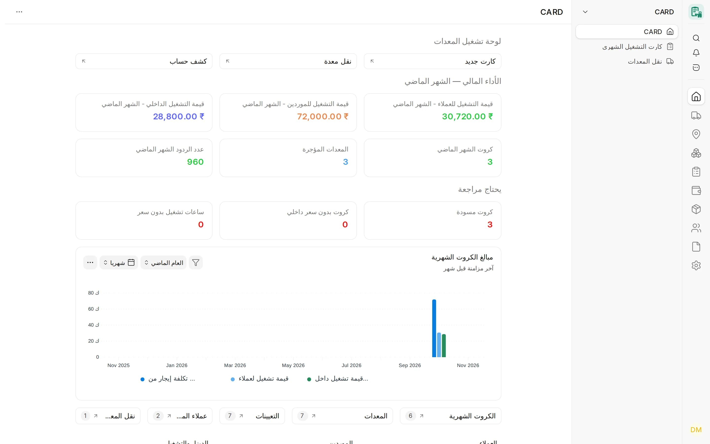

## Overview

Card is bilingual from the ground up: the whole app is available in **Arabic** (right to left) and **English**, and
the operator screens are also available in **Urdu** (right to left), **Bengali** and **Hindi**. Card uses Frappe's
standard translation system, so each user sees Card in the language set on his user profile, in the Desk, in Card
Mobile and in prints.

The application name shows as **Card** in every language.

<!-- screenshot: languages-workspace-arabic -->

*The Card workspace in Arabic*

## Key concepts

| Concept | Meaning |
|---|---|
| **Locale file** | A `card/locale/<lang>.po` file with Card's own translations. Card ships one for every language Frappe ships, plus the template `main.pot`. |
| **Stored value** | The value saved in the database for a Select field. Many Card Select values are stored in Arabic. |
| **Translation context** | A tag on a source text (`msgctxt`) so that a translation applies only inside Card. |
| **Direction** | Right to left (RTL) or left to right (LTR), chosen from the language. |

## Features

### Supported languages

| Language | Direction | Coverage |
|---|---|---|
| Arabic | Right to left | The whole app: Desk, Card Mobile, reports and prints |
| English | Left to right | The whole app; English for every value stored in Arabic |
| Urdu | Right to left | Operator screens (Card Mobile); stored values in English |
| Bengali | Left to right | Operator screens (Card Mobile); stored values in English |
| Hindi | Left to right | Operator screens (Card Mobile); stored values in English |
| Other Frappe languages | As Frappe | Only the application name; other Card texts show untranslated |

### Arabic and right to left

- **Desk** — with Arabic as the user's language, Frappe shows the whole Desk right to left, and Card's DocTypes,
  fields, buttons, messages, workspace, launcher and reports in Arabic.
- **Card Mobile** — the page boot carries the language and its direction; Arabic and Urdu are right to left.
- **Prints** — every Card print follows the print language; the page is right to left for Arabic, Hebrew, Persian,
  Pashto and Urdu. See [Print formats](/card/features/print-formats/).

### The application name

The name **Card** is never translated:

- the source text `Card` translates to `Card` in every Card locale file;
- the apps screen shows **Card** (Desk) and **Card Mobile**;
- an upgrade patch removes any site **Translation** of the exact source text `Card` (for example one that turned the
  name into a translated word), because a site Translation would win over the app's files. Every other Translation
  is kept, and each removed row is kept as a Deleted Document.

Record and DocType names stay as they are (for example *Card Monthly Card*); only the displayed app name is Card.

### Values stored in Arabic

Many Select fields store their value in Arabic, for example:

| Field | Stored values (English) |
|---|---|
| Ownership | «ملك» (Owned), «إيجار» (Rented), «طرف ثالث» (Third Party) |
| Rental direction / Card direction | «مستأجَرة من مورد» (Rented from Supplier), «مؤجَّرة لعميل» (Rented to Customer), «إيجار من الباطن» (Sub-rental), «تشغيل داخلي» (Internal Operation) |
| Shift | «نهاري» (Day), «ليلي» (Night) |
| Rate basis | «بالساعة» (Per Hour), «باليوم» (Per Day), «بالشهر» (Per Month) |
| Equipment status | «نشطة» (Active), «متوقفة» (Stopped), «في الصيانة» (Under Maintenance), «منتهية» (Ended) |
| Adjustment kind | «إضافة» (Addition), «خصم» (Deduction) |

The English locale translates these values, and Urdu, Bengali and Hindi use the same English (they never fall back
to Arabic). Arabic workspace labels (number cards, charts, shortcuts) are translated the same way.

:::note
The stored value stays Arabic in every language. Report filters, scripts, imports and integrations must use the
stored Arabic value. Free-text data (names, notes) is shown as entered.
:::

### How Card translations are scoped

- `card/locale/*.po` contains Card strings only.
- Generic words used by Card Mobile (Home, Login, Quantity, Logout…) carry the context **Card Mobile**, so Card never
  changes how Frappe or ERPNext translate the same word elsewhere.
- A translation with a context falls back to the plain translation, then to the source text.

### Adding or correcting a translation

- For one site, use the standard **Translation** DocType of Frappe (it overrides the app files on that site). Do not
  add a Translation of the source text `Card`.
- To change Card itself, edit the language's `.po` file in `card/locale/` and contribute it to the project.

### Known limits

- Languages other than Arabic and English show untranslated Card strings outside the operator screens.
- Raw values in exports and some Data fields (such as stored day names) keep the stored Arabic text.
- Dock tooltips show their stored titles.

## Related

- [Print formats](/card/features/print-formats/)
- [Card Mobile](/card/features/card-mobile/)
- [Introduction](/card/getting-started/introduction/)
