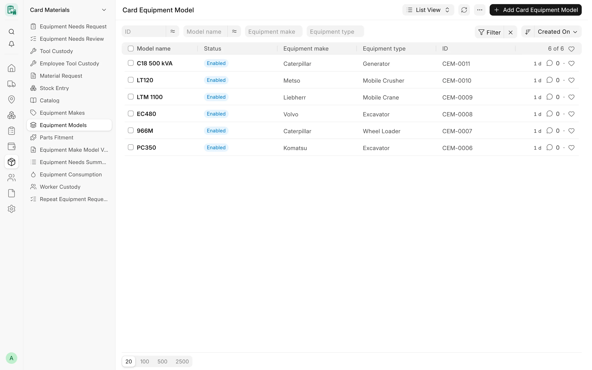
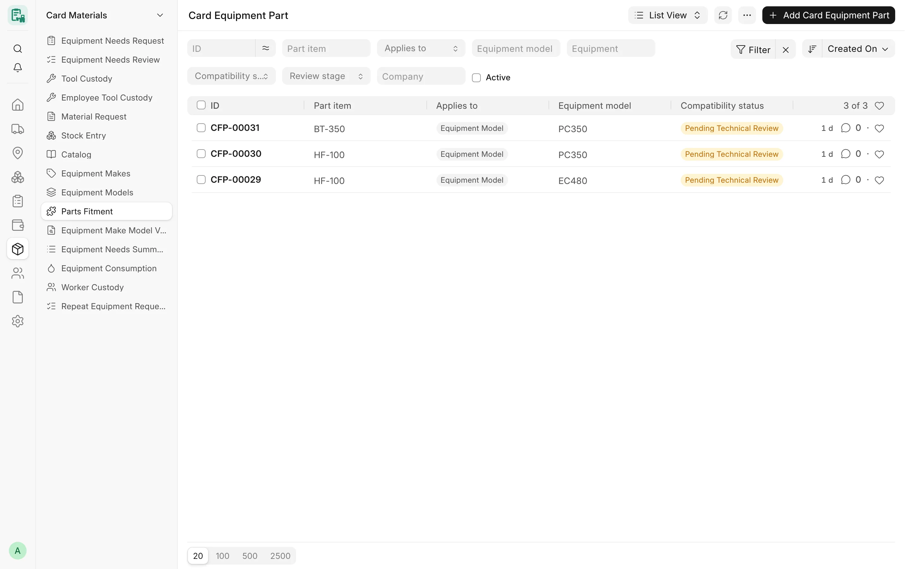

## Overview

CARD keeps **no item master of its own**. Parts, consumables and tools are standard ERPNext Items, and CARD adds three
things on top of them:

- a **catalog search** that lets operators and supervisors find the right item by name, code, barcode or OEM part
  number, with the user's own ERPNext rights;
- **parts fitment** (توافق قطع الغيار): documented, reviewed records that an Item fits an equipment model or one machine;
- **cost per machine**: parts issued from stock and maintenance purchases carry the **Card Equipment** dimension, so
  every machine has its maintenance cost in the official ledger.

<!-- screenshot: maintenance-parts-catalog -->

*Equipment models*

## Key concepts

| Concept | Meaning |
|---|---|
| Equipment make / model | Masters **Card Equipment Make** (ماركة المعدة) and **Card Equipment Model** (موديل المعدة); a model belongs to one make and one equipment type. |
| Fitment row | A **Card Equipment Part** record: an Item fits an equipment model, or one machine, with a compatibility status and evidence. |
| Effective fit | The fit of an Item for one machine, worked out at read time: the machine's own row wins over its model's. |
| Second review | The person who proposed a row can never make its final decision; a second, independent reviewer does. |
| Card Equipment dimension | The accounting dimension that puts the machine on Stock Entry, Material Request and invoice rows. |

## Features

### Catalog search

The catalog is one paged search over the standard ERPNext catalogue: Item, Item Group, Brand, Item Barcode, Item
Manufacturer (OEM part numbers) and Item Alternative. It is used by the **Browse catalog** item picker of CARD Mobile and
by the item search of the `/equipment-needs` page; the **Catalog** entry of the *Card Materials* sidebar opens the
ERPNext Item list.

- Search by **item name**, **item code**, **barcode** or **OEM part number** (barcode and OEM numbers from three
  characters).
- Filter by **item group** (with its sub-groups) and **brand**.
- Each result shows the image, unit, group, brand, OEM numbers and standard alternatives (two-way alternatives
  included).
- Results are paged on the server; there is no total count, only whether another page exists.
- With a machine selected, every item shows its **fit for that machine**, and **Fits this machine** lists only the items
  confirmed for it.

No stock, price, supplier or account is ever returned by the catalog.

Who sees what is decided on the server:

| User | Catalog access |
|---|---|
| Roles that read Item | Their normal ERPNext list, with their User Permissions, shares and permission rules |
| Card Operator, Card Supervisor, Card Manager (portal roles) without Item read | The same catalogue on fixed safe fields, with their Item, Item Group and Brand User Permissions applied |
| Card User | Read-only catalog viewer in CARD Mobile; no access to requests |
| Anyone else | Nothing |

Permission rules registered by other apps (for example a company restriction on Item) are applied as ERPNext's own
list applies them. Where a permission query server script exists, the restricted read returns nothing.

### Equipment makes and models

- **Card Equipment Make** – **Make name**, **Disabled**.
- **Card Equipment Model** – **Model name**, **Equipment make**, **Equipment type**, **Disabled**, **Description**.
- Names are compared without case, spaces, dashes, dots, underscores or slashes, so «PC200-8» and «pc 200 8» are the
  same and a duplicate is refused.
- On a Card Equipment, **Equipment make** and **Equipment model** are commercial (permission level 1) fields; the model
  must match the make and the equipment type. The older free-text brand and model are kept.
- The read-only report **Equipment Make Model Values** lists the free-text brand and model values with their equipment
  count, to help map them to the masters (filter *Without equipment model only*).

### Parts fitment (Card Equipment Part)

A fitment row (`CFP-#####`, change tracking on) says that an Item fits:

- **Applies to** = «Equipment Model» – every machine of that model (no company), or
- **Applies to** = «Equipment» – one machine; the row takes the machine's company and model.

Fields:

- **Part item** – an enabled Item, not a template and not past its end of life.
- **Compatibility status** – «قيد المراجعة الفنية» Pending Technical Review (on creation), «مؤكد» Confirmed or «غير متوافق»
  Not Compatible.
- **Review stage** – «بانتظار المراجعة الثانية» Pending Second Review while a first review waits.
- **Decision reason**, **Active**.
- **Fitment evidence**: **Evidence source** (Maker parts book, Maker or dealer catalogue, Supplier or dealer
  confirmation, Physical check on the machine, Installation record, Other), **Evidence reference**, **Evidence file**
  (private JPEG, PNG, WebP or PDF of this row), **Quantity per use**, **Technical notes**.
- **Review record** (server-written): proposed by and on, first review by, on, decision and reason, decided by and on,
  retired by and on, retire reason, source.

Rules:

- One row per item and model, or per item and machine. A retired duplicate must be made active again instead.
- The item, scope, model and machine of a row never change after creation.
- Fitment rows are **retired, never deleted**. Retiring needs a reason; restoring sends the row back to review.

<!-- screenshot: maintenance-parts-fitment -->

*Parts fitment records*

### Fitment review

| Who | What they may do |
|---|---|
| Card Supervisor | Propose rows and document their own rows while they are pending; never set the status |
| Card Manager / System Manager (proposer) | Their decision on their own proposal is a **first review** only: it needs a new reason and an evidence file, and the row waits as *Pending Second Review* |
| Card Manager / System Manager (another person) | Make the final decision (Confirmed or Not Compatible), or send a first review back with a reason |

- A decision needs an **evidence source** and **reference**.
- New evidence on a decided row, by anyone, returns it to *Pending Technical Review*.
- A machine may be confirmed against its model's *Not Compatible* row only with technical notes explaining the
  exception.
- No role is exempt from the second-person rule, Administrator included.

### Fit states

When a machine is chosen, each Item has one of five separate states:

| State | Meaning |
|---|---|
| «مؤكد للمعدة» Confirmed for machine | An active Confirmed row on this machine |
| «مؤكد للموديل» Confirmed for model | An active Confirmed row on the machine's model, not overruled by a machine row |
| «غير متوافق» Not compatible | A Not Compatible row; shown with a warning |
| «قيد المراجعة» Pending review | A row still under review; never treated as a fit |
| «لا يوجد سجل توافق» No fitment record | No row at all |

Equipment needs requests store the state each line had when it was asked for; a line without a confirmed fit needs a
**Reason for an item without a confirmed fit** (see [Equipment Needs](/card/features/equipment-needs/)).

### Stock issued to equipment

The cost of a part reaches the machine only when stock is issued to it:

1. An approved equipment needs review creates a draft **Material Request** of type *Material Issue* (parts from the
   store) or *Purchase* (parts to buy), with item, project, cost center, warehouse and, for parts, the **Card
   Equipment** dimension on each row.
2. The stock team issues the part with a standard ERPNext **Stock Entry** (*Material Issue*) whose rows keep the project,
   the cost center and the machine.
3. The issue posts in ERPNext under the company's stock settings; CARD writes nothing.

The read-only report **Equipment Consumption** lists what was issued to each machine (submitted Material Issue rows)
plus non-stock items bought for it.

### Equipment Maintenance Cost

The read-only report **Equipment Maintenance Cost** (تكلفة صيانة المعدات), for System Manager and Accounts Manager (with
General Ledger access), lists one row per document line tagged to a machine through the Card Equipment dimension, for
one company and period:

- submitted **Purchase Invoice** lines, except invoices that recognise CARD cards, diesel fills or transports, fixed
  asset lines and lines of stock items (those count when issued);
- submitted **Material Issue** Stock Entry lines at their valuation.

Filters: **Company**, **From date**, **To date**, **Project**, **Equipment**. Without the dimension the report explains
it and lists nothing. The same lines feed the maintenance part of the **Equipment Partial Margin** report.

## Workflow

1. Create the equipment makes and models, then set make and model on each machine.
2. A supervisor proposes fitment rows with evidence; a Card Manager confirms or rejects them (a second manager when the
   first one proposed the row).
3. Operators find items in the catalog, with the fit shown for their machine, and ask for them through Equipment Needs.
4. After approval, the stock team issues the parts with a Stock Entry carrying the machine.
5. Follow the cost per machine in **Equipment Maintenance Cost** and **Equipment Consumption**.

## Permissions

| Item | Roles |
|---|---|
| Equipment makes and models (create, write) | System Manager, Card Manager |
| Equipment makes and models (read) | Card Supervisor, Card User, Accounts Manager |
| Fitment rows (create, write) | System Manager, Card Manager, Card Supervisor (own pending rows) |
| Fitment decisions, retire and restore | Card Manager, System Manager |
| Equipment Make Model Values | System Manager, Card Manager |
| Equipment Maintenance Cost | System Manager, Accounts Manager |
| Equipment Consumption | System Manager, Card Manager, Card Supervisor, Card User, Stock Manager, Accounts Manager |

A machine fitment row belongs to its machine's company; a user limited to some companies sees only the machine rows of
those companies (model rows are shared technical data).

## Related

- [Equipment](/card/features/equipment/)
- [Equipment Needs](/card/features/equipment-needs/)
- [Tool Custody](/card/features/tool-custody/)
- [CARD Mobile](/card/features/card-mobile/)
- [Meter Readings](/card/features/meter-readings/)
- [Maintenance & assets reports](/card/reports/maintenance-assets/)
- [Materials & needs API](/card/api-reference/materials-needs/)
