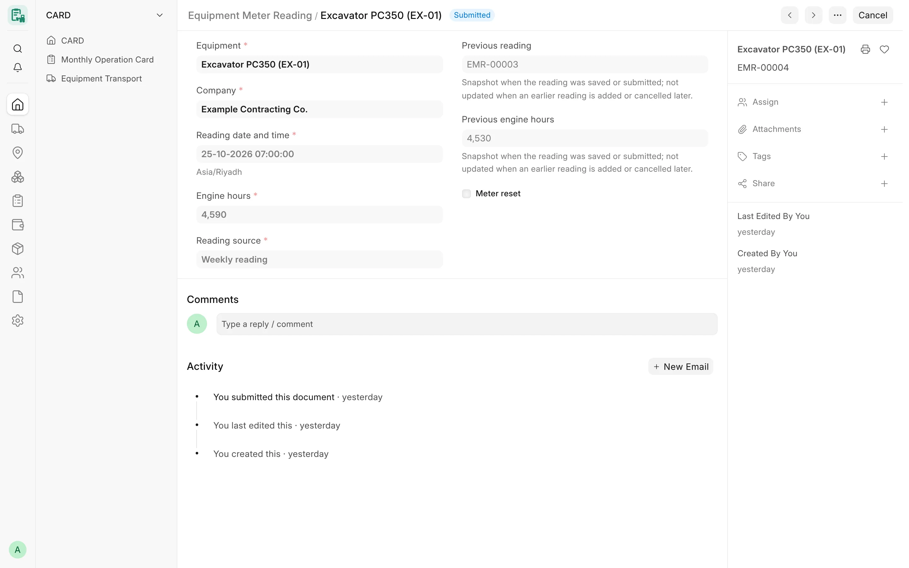
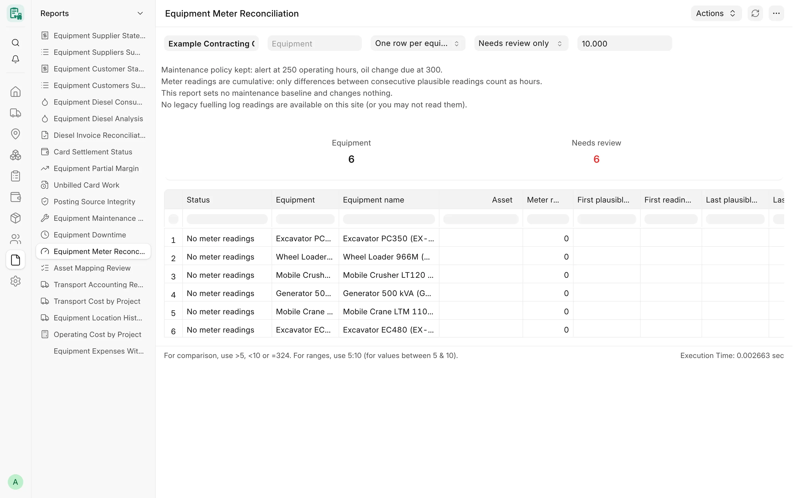

## Overview

An hour meter tells how long a machine really ran. CARD keeps engine-hour readings in their own document,
**Equipment Meter Reading** (قراءة عداد المعدة), entered by the site supervisor, typically once a week, at a handover or
at a service visit. The server keeps each machine's readings in a rising sequence, so a mistyped or out-of-order
reading is refused instead of corrupting the history.

A second tool, the read-only **Equipment Meter Reconciliation** report, compares hour-meter readings recorded elsewhere
on the site with the hours of CARD's submitted monthly cards, to show where the two disagree.

:::note
Meter readings do not feed anything yet: monthly cards, billable hours, diesel figures and postings are unchanged by
them. They are the basis for later maintenance and consumption features.
:::

<!-- screenshot: meter-readings-form -->

*An equipment meter reading*

## Key concepts

| Concept | Meaning |
|---|---|
| Engine hours | The meter value at the reading's date and time. |
| Sequence | Per machine, submitted readings rise with time; the reading just before and just after are compared. |
| Meter reset | A reading lower than the previous one, accepted only when marked as a reset with a reason (new or replaced meter). |
| Previous reading | A snapshot of the earlier reading taken at save or submit; it is not updated later. |
| Plausible reading | In the reconciliation report, a reading that passes every check; only differences between consecutive plausible readings count as hours. |

## Features

### Equipment Meter Reading

A submittable document named `EMR-#####`, with change tracking:

- **Equipment** – required.
- **Company** – always the equipment's company, set by the server (read only). An equipment without a company cannot
  get a reading.
- **Reading date and time** – required; default now.
- **Engine hours** – required; never negative.
- **Reading source** – «قراءة أسبوعية» Weekly reading (default), «قراءة عند التسليم» Handover reading, «قراءة عند الصيانة»
  Service reading or «قراءة أخرى» Other reading.
- **Previous reading** and **Previous engine hours** – read only snapshot.
- **Meter reset** and **Reset reason** – the reason is mandatory for a reset.
- **Meter photo or document** – optional private JPEG, PNG, WebP or PDF of this record, checked by content.
- **Notes**.

### Sequence rules

Checked on every save and again on submit, under a lock on the equipment so that two parallel submits cannot both
pass:

| Situation | Result |
|---|---|
| Lower than the previous submitted reading | Refused, unless marked as a meter reset with a reason |
| Marked as a reset but not lower than the previous reading | Refused |
| Backdated reading higher than the next submitted reading | Refused (unless the next one is a reset) |
| Next submitted reading is a reset and would no longer be lower | Refused |
| Two submitted readings of the same machine at the same date and time | Refused |
| Cancelling a reading would leave the next one out of sequence | Cancel refused; cancel the later readings first |

An amendment must amend a cancelled reading of the same company that the user may read; the amended reading keeps the
attachment of the cancelled one.

### Meter readings on monthly cards

:::caution[Removed]
Meter readings per shift on monthly cards existed in an older generation of the app and are not part of the current
code. Hours on cards are entered as working hours per day. Restoring them is an open owner decision.
:::

### Meter fields on the equipment

The **Meter and maintenance** tab of a Card Equipment stores **Meter type** («ساعات» hours, «كيلومترات» kilometres or «بدون
عداد» no meter), **Meter reading at receipt**, **Last reading**, **Tank capacity (liter)**, **Expected consumption
(liter/hour)**, **Maintenance every (hour)**, **Maintenance every (liter of diesel)**, **Last maintenance date** and
**Meter reading at last maintenance**. These values are stored for reference; no CARD logic reads them yet.

### Equipment Meter Reconciliation

A read-only Script Report for **System Manager**, **Card Manager** and **Accounts Manager** (with read access to Card
Equipment, monthly cards and Assets).

Filters: **Company**, **Equipment**, **View** (*One row per equipment* or *Every reading*), **Show** (*Needs review only*
or *All equipment*), **Allowed difference %** (default 10).

Per machine it compares:

- hour-meter readings from another app's fuelling log, when that DocType exists on the site and the user may read it;
- hour-meter fields that an Asset may carry;
- with the operating hours of CARD's **submitted** monthly cards for the same period.

Each reading is classified:

| Flag | Meaning |
|---|---|
| Plausible | Counts: hours = difference from the previous plausible reading |
| Invalid reading | Zero, negative or empty |
| Duplicate reading | Same value at the same time, or the same value as the previous plausible reading on the same day |
| Backward reading | Lower than the previous plausible reading |
| Meter reset | The reading restarts near zero; a new run begins |
| Impossible jump | More hours than the elapsed time allows |
| Cumulative | Recorded hours equal the whole meter; ignored |

The summary also shows identity conflicts between an Asset's ID and its name or item, Asset meter fields that differ
from the last plausible reading, and differences between meter hours and CARD hours above the allowed percentage.
Cumulative readings are never added up as hours. The report writes nothing and sets no maintenance baseline: a
baseline needs a verified meter reading and a verified maintenance event.

<!-- screenshot: meter-readings-reconciliation -->

*Equipment Meter Reconciliation report*

### Maintenance warnings by hours

The reconciliation report shows the maintenance policy kept from existing practice: an alert at **250** operating
hours and an oil change due at **300**.

:::caution[Planned]
Automatic maintenance warnings by hours (per equipment type) are not built. The policy is displayed in the report only,
and no warning or task is created.
:::

## Workflow

1. Each week (or at a handover or service), the site supervisor opens **Equipment Meter Reading**, picks the machine and
   enters the date, time and engine hours, with a photo of the meter.
2. Submit. A lower value is refused unless it is a real meter reset with a reason.
3. Run **Equipment Meter Reconciliation** to compare recorded meters with card hours and review the flagged machines.

## Permissions

| Action | Roles |
|---|---|
| Create, submit, cancel, amend meter readings | Card Manager, Card Supervisor |
| Delete a draft meter reading | Card Manager |
| Read meter readings | Card User (and the roles above) |
| Equipment Meter Reconciliation | System Manager, Card Manager, Accounts Manager |

A user limited to some companies sees and records readings only for those companies.

## Related

- [Equipment](/card/features/equipment/)
- [Monthly Cards](/card/features/monthly-cards/)
- [Diesel](/card/features/diesel/)
- [Maintenance & Parts](/card/features/maintenance-parts/)
- [Maintenance & assets reports](/card/reports/maintenance-assets/)
