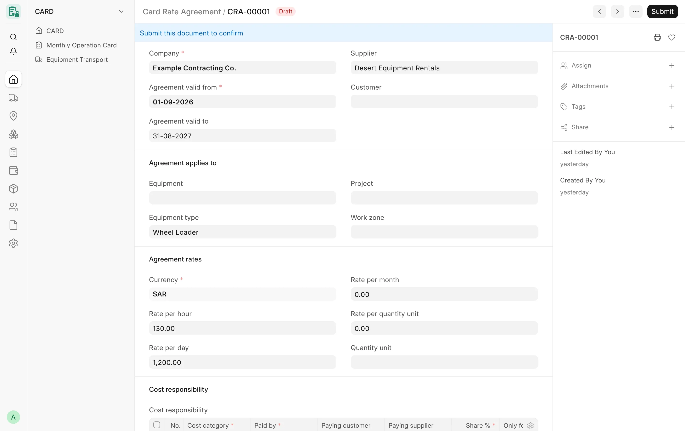

## Overview

A **Card Rate Agreement** (اتفاقية أسعار المعدة) records, for one company, the agreed rates of one machine – or of every
machine of one equipment type – with a supplier, a customer or both, for a date range, optionally limited to one
project and one work zone. Its **Cost responsibility** table says who pays each cost category (rental, diesel,
transport, maintenance) and in what share.

Agreements exist so that a change of rate is a new, dated record instead of an edit of the equipment, and so that the
history of who agreed to pay what is kept.

:::caution[Opt-in, not wired yet]
Rate agreements can be created and submitted, but **nothing in CARD reads them yet**. Monthly cards, the monthly
posting and transports keep using the rates on the equipment. Using agreements on cards will be a separate opt-in per
company. Rate agreements are part of the current development line (after release v4.7.0) and open at
`/app/card-rate-agreement`.
:::

<!-- screenshot: rate-agreements-form -->

*A rate agreement*

## Key concepts

| Concept | Meaning |
|---|---|
| Agreement | A submittable record (`CRA-#####`). A submitted agreement is never edited: a changed rate is a new agreement. |
| Scope | Company + equipment or equipment type + supplier and/or customer + optional project + optional work zone. |
| Validity | **Agreement valid from** (required) to **Agreement valid to** (empty = open-ended). |
| Agreement key | The scope values. Two submitted agreements with the same key may not overlap in time. |
| Cost responsibility | Rows of **Card Agreement Responsibility**: cost category, paying party, share %. |

## Features

### Agreement fields

- **Company** – required.
- **Agreement valid from** – required; **Agreement valid to** – optional, cannot be before the start date.
- **Supplier** and **Customer** – at least one is required.
- **Agreement applies to**: **Equipment** or **Equipment type** (one is required), **Project**, **Work zone**.
- **Agreement rates**: **Currency** (the company's currency, read only), **Rate per hour**, **Rate per day**,
  **Rate per month**, **Rate per quantity unit** and **Quantity unit** (required when a quantity rate is entered).
- **Cost responsibility** table and **Remarks**.

Validation:

- the equipment and the project must belong to the agreement's company; an amendment keeps the company;
- when an equipment is chosen its equipment type is filled in (and must match one that was entered);
- rates cannot be negative; an agreement needs at least one rate or one cost responsibility row;
- a rate of 0 means "no rate for this basis", never a free service;
- the work zone is free text, compared without surrounding spaces and ignoring letter case.

### Dated agreements and overlap

Two submitted agreements with the same equipment, equipment type, supplier, customer, project and work zone may not be
in force on the same day. To change a rate, end or cancel the current agreement and create a new one from a later
date. The check runs on save and again at submit under a company lock, so two agreements submitted at the same moment
cannot both pass.

Agreements with different keys may overlap – for example one for an equipment type and one for a single machine of
that type. CARD does not choose between them: when more than one agreement matches a machine, party and date, the
lookup reports every match and refuses to pick one, so the user ends all but one.

### How an agreement is matched

The lookup that future card and posting steps will use finds the one submitted agreement that:

1. belongs to the company and is in force on the date;
2. is for the machine itself, or (with no machine on the agreement) for its equipment type;
3. names the party being billed (the supplier or the customer);
4. is for the given project or for no project, and for the given work zone or for no zone.

No match returns nothing; several matches are an error.

### Card Agreement Responsibility

Each row of the **Cost responsibility** table:

| Field | Options / rules |
|---|---|
| Cost category | Rental, Diesel, Transport, Maintenance (required) |
| Paid by | Company, Customer, Supplier, Other party (required) |
| Paying customer | Required when paid by Customer |
| Paying supplier | Required when paid by Supplier |
| Other paying party | Free-text name, required when paid by Other party |
| Share % | Default 100; more than 0 and at most 100 |
| Only for equipment | Optional; only on an agreement for an equipment type, and the machine must be of that type |

Rules:

- the shares of each cost category (and each "only for equipment" machine) must add up to exactly 100%;
- the same payer cannot appear twice for the same category and machine;
- only the party field of the chosen payer is kept;
- every row's equipment belongs to the agreement's company.

Example (fictitious): rental 100% paid by the Company; diesel 60% by **Customer A** and 40% by the Company.

### Billing Basis master and default rates

- A separate **Billing Basis** master does not exist in the current CARD. The billing basis is the **Rate type** of
  the equipment (per hour, per day, per month), with the **Day billing basis** for per-day rates (see
  [Monthly Cards](/card/features/monthly-cards/)).
- Default rates per equipment category or type in Card Settings are **planned**, not built. Today each machine
  carries its own rates; an agreement for an equipment type records type-wide rates but is not applied yet.

## Workflow

1. Create an agreement for the company, the machine or equipment type and the party, with the start date.
2. Enter the rates and, if needed, the cost responsibility rows.
3. Submit it. From now on it can only be cancelled (and amended) or ended by a new agreement.
4. When the rate changes, create a new agreement from the new date and end the old one.

## Permissions

| Role | Rights |
|---|---|
| Card Manager | Create, edit, submit, cancel, amend |
| System Manager | All, including delete |
| Accounts Manager | Read, print, report, export |
| Card User | Read, print, report |

Company User Permissions apply to agreements: a restricted user sees and changes only the agreements of their
companies.

## Related

- [Monthly Cards](/card/features/monthly-cards/)
- [Equipment](/card/features/equipment/)
- [Suppliers & Customers](/card/features/suppliers-customers/)
- [Transport](/card/features/transport/)
