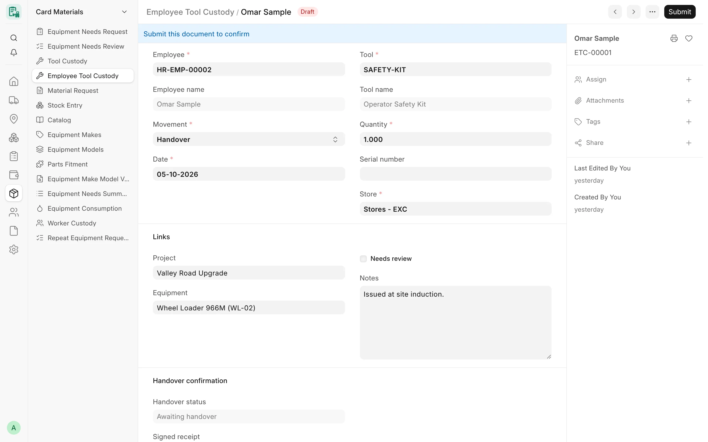
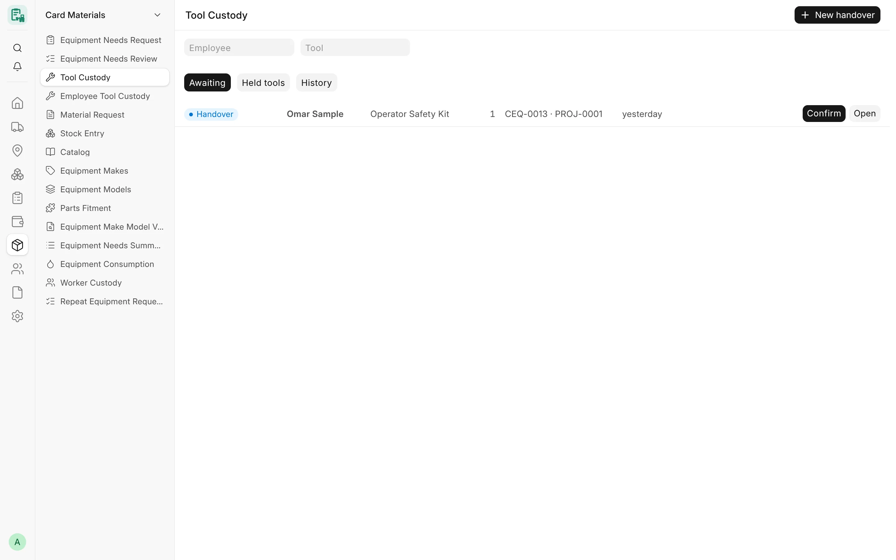

## Overview

Workers on site hold returnable tools — grinders, jacks, measuring tools — that belong to the company's stock.
**Employee Tool Custody** records every movement of such a tool between the store and a worker, between two workers,
and out of custody when it is lost or damaged.

CARD uses a hybrid model: while a worker holds a tool it stays on the books in **one custody store** (an ERPNext
Warehouse), so the stock value does not disappear; only a **loss** or **damage** is issued as a cost, to the project
and the machine. Every movement that moves stock creates a standard ERPNext **Stock Entry**, and every change of
holder needs a receipt signed by the people involved.

Capital tools recorded as ERPNext Assets are not custody records: their custodian is kept on the Asset (Asset
Movement), and the [Worker Custody](#worker-custody-report) report shows both.

<!-- screenshot: tool-custody-form -->

*A tool custody handover*

## Key fields

| Field | Description |
|---|---|
| **Employee** | The worker whose custody changes (mandatory). The record's company is the employee's company. |
| **Movement** | Handover, Return, Transfer, Loss or Damage (mandatory). |
| **To employee** | For a Transfer: the worker who receives the tool. |
| **Date** | Today by default; set to the confirmation day for a Handover or Return. |
| **Tool** / **Tool name** | The ERPNext Item. |
| **Quantity** | Above zero (default 1). |
| **Serial number** | Optional; passed to the Stock Entry. |
| **Store** | For a Handover or Return: the store the tool leaves or comes back to. |
| **Project**, **Equipment** | Optional links; a loss or damage is charged to them. |
| **Stock Entry** | Read-only link to the entry the movement created. |
| **Needs review** | Ticked automatically on a Loss or Damage. |
| **Handover confirmation** | Handover status, Signed receipt, Reason not handed over, Confirmed by, Confirmed on, and the Equipment Needs Review the handover comes from. |

Records are numbered `ETC-00001`, … and are submittable: a movement takes effect when it is confirmed (submitted).

## Features

### Movements

| Movement | Stock Entry on confirmation | Receipt | Notes |
|---|---|---|---|
| **Handover** | Material Transfer from the **Store** to the custody store, submitted with the record | Required | The tool must be a stock item with stock in the store. |
| **Return** | Material Transfer from the custody store to the **Store**, submitted with the record | — | The worker must hold the quantity. |
| **Transfer** | None (the tool stays in the custody store) | Required | Worker to worker in the same company. |
| **Loss** | **Draft** Material Issue from the custody store, with the project, the project's cost center and the equipment | — | Left for the stock team to submit; marked **Needs review**. |
| **Damage** | Same as Loss | — | Same as Loss. |

Rules:

- A tool is never a fixed asset (record that custodian on the Asset instead), and a tool handed over must be a stock
  item.
- A Return, Transfer, Loss or Damage cannot take more than the worker holds. The balance is checked again under a lock
  when the movement is confirmed, so two movements at the same moment cannot both pass.
- A Transfer needs another employee as **To employee**.
- Every linked record — the receiving employee, the store, the custody store, the project and the equipment — must
  belong to the employee's company.
- Movements that move stock need the **Tool custody store**: per company in Card Settings, else the site's store in
  Card Settings (Materials).

### Confirmation and separation of duties

Confirming (submitting) a movement is the store side's job:

- A Handover or Return also needs permission to submit Stock Entries in ERPNext. The Stock Entry is created and
  submitted in the same transaction with the confirmer's own rights: if ERPNext refuses it (for example, no stock in
  the store), nothing is confirmed.
- A Handover or Transfer needs the **Signed receipt**, signed by the receiving employee and the issuer.
- The worker(s) of the movement and, for a handover from an approved equipment-needs line, its requester, the person
  who entered the request for the worker and the approver can never confirm it. Administrator is not exempt.
- **Confirmed by** and **Confirmed on** are recorded by the server; a confirmed Handover gets the status **Handed
  over**.
- A second click or a second user confirming the same movement waits, then sees it already confirmed.

### Signed receipt

- The **Tool Handover Receipt** print format names the record, the movement, the date, the employee (and the
  receiving employee or the store), the equipment and the project, and who gives and who takes the tool. Print it,
  have it signed, then attach the scan.
- The receipt must be a private JPEG, PNG, WebP or PDF file uploaded to this record (or the user's own recent upload,
  which the record then claims). A file of another record is refused.
- A receipt stays a private file of its custody record: it cannot be made public, detached or reused for another
  record, and a cancelled movement that has a receipt cannot be deleted.

### Handovers from equipment needs

When an equipment-needs review that includes tools is approved, CARD prepares a draft Handover for each tool line (see
[Equipment Needs](/card/features/equipment-needs/)). On such a draft:

- the employee, movement, tool, project and equipment decided by the approval cannot change; the store side may choose
  the store (same company) and lower the quantity;
- a **partial** handover leaves a new draft for the rest;
- if the worker does not take the tool, the store side or a Card Manager closes the draft as **Not handed over** with a
  reason (never for a handover to oneself); nothing is moved or counted;
- only a Card Manager makes a replacement handover for the tools not handed over yet;
- such a handover is kept: it cannot be deleted or amended.

### Cancelling

- A confirmed Handover or Return cancels its own submitted Stock Entry in the same transaction (this needs permission
  to cancel Stock Entries).
- The draft Stock Entry of a Loss or Damage is removed with the cancel.
- A Handover or Transfer cannot be cancelled while later movements already use those tools.
- Cancelling a handover of an approved line gives its quantity back to the line.

### Tool Custody screen

The **Tool Custody** Desk page gathers the work in three tabs:

| Tab | Content |
|---|---|
| **Awaiting** | Draft handovers, returns and transfers waiting for confirmation (a handover without stock in the store shows **Waiting for stock**). |
| **Held tools** | What each worker holds now. |
| **History** | Confirmed and cancelled movements. |

From the screen the store side can start a **New handover**, a **Return** or a **Transfer** (defaults filled in: the
company's main store, and for a handover the worker's machine and its project), **Print receipt**, attach the
**Signed receipt** and **Confirm** with the quantity and serial number. Only the actions the server would allow are
shown. The page is open to Card Supervisor, Card Manager, Stock Manager and System Manager; the store side and managers
start on Awaiting, others on Held tools.

<!-- screenshot: tool-custody-screen -->

*The tool custody screen*

### Worker Custody report

**Worker Custody** lists what each worker holds now, for the companies the user may see, with an optional employee
filter:

| Column | Content |
|---|---|
| Employee / Employee name | The worker |
| Tool | The Item |
| Held | Quantity in custody (from confirmed movements) |
| Asset | For a capital tool: the Asset whose custodian is the worker |
| Kind | Returnable tool or Asset |

### Mobile

:::note[Planned]
Tool custody on CARD Mobile ("My tools in custody" for operators, custody for supervisors) is planned and not
available yet. Operators can already request tools from CARD Mobile through equipment needs.
:::

## Workflow

1. Set the **Tool custody store** in Card Settings (per company, or the site value under Materials).
2. Open **Tool Custody** (or **Employee Tool Custody** → **New**) and create a Handover for the worker and the tool.
3. Print the receipt, have it signed by the worker and the issuer, and attach it.
4. The store side confirms: the tool moves to the custody store.
5. Later, record a Return (back to the store), a Transfer (to another worker) or a Loss / Damage (a draft Material
   Issue for the stock team).
6. Check who holds what in **Worker Custody**.

## Permissions

| Role | Employee Tool Custody | Tool Custody screen | Worker Custody |
|---|---|---|---|
| System Manager | Read, write, create, submit, cancel, delete | Yes | Yes |
| Card Manager | Read, write, create, submit, cancel, delete | Yes | Yes |
| Stock Manager | Read, write, create, submit, cancel | Yes | Yes |
| Card Supervisor | Read, write, create, submit | Yes | Yes |
| Card User | Read | — | Yes |
| Accounts Manager | — | — | Yes |

Confirming a Handover or Return also needs the ERPNext right to submit Stock Entries. Users limited by Company User
Permissions work only with custody records of their companies' employees.

## Related

- [Equipment Needs](/card/features/equipment-needs/)
- [Roles & Permissions](/card/features/roles-permissions/)
- [Print Formats](/card/features/print-formats/)
- [CARD Mobile](/card/features/card-mobile/)
- [API: Materials & Needs](/card/api-reference/materials-needs/)
