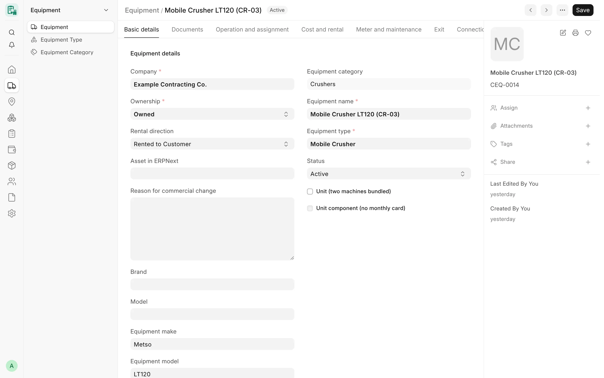

## Overview

Some machines only work together: a mobile crusher and the generator that powers it, for example. CARD records such
a pair as a **unit** — one Card Equipment record that lists its pieces as **components**. The unit stays **one
equipment on its monthly card**, so it is priced and billed once; the component table keeps the dated history of
which pieces were inside it.

Units are for owned equipment only. Each piece is still its own Card Equipment record, with its own Asset, documents
and meter, but while it is inside a unit it is billed on the unit's card and not on a card of its own.

<!-- screenshot: units-components-unit-form -->

*A crusher in the equipment form*

## Key concepts

| Concept | Meaning |
|---|---|
| **Unit** | A Card Equipment with **Unit (two machines bundled)** ticked. |
| **Component** | A row of the unit's **Components** table: the piece (a Card Equipment), its **Role** (free text, e.g. "Generator"), **From** and **To** dates and a **Change reason**. |
| **Current component** | A row with no **To** date. A row with a To date is history: the piece left the unit. |
| **Unit component flag** | **Unit component (no monthly card)** on the piece — read-only, derived from the units' component tables. |

## Features

### Owned-only rule

- A unit and every piece that joins it must be «ملك» (Owned). The **Unit** tick is read-only on a machine that is not
  owned.
- The ownership of a unit, or of a current component, cannot change away from owned: take the piece out of the unit
  first.
- The component picker lists only owned equipment of the same company that is not itself a unit.
- Records created before this rule are not changed. A read-only check lists any existing unit or piece that breaks it,
  or whose component flag does not match the tables (see [API: Equipment](/card/api-reference/equipment/)).

### Component rules

Checked on the server every time the component table changes:

- Only a unit can list components.
- A unit cannot be its own component, and a unit cannot be a component of another unit.
- A component cannot itself be a unit.
- A piece cannot be listed twice among the current components, and cannot be a current component of two units at once.
- Every component belongs to the unit's company.
- A row's **To** date cannot be before its **From** date.
- Component rows are changed only through the unit itself: a row saved, moved or updated on its own is refused, so
  every change is in the unit's history. Changing a row's **Role** alone is allowed.
- Component rows are at permission level 1: only Card Manager and System Manager change them.

### Dates and history

**From** and **To** decide when a piece counts as part of the unit (an empty date is open on that side). Two actions in
the unit's **Unit** menu keep the history without editing rows by hand:

| Action | What it does |
|---|---|
| **Replace component** | From the chosen date, a new piece takes the place of the old one: the old row gets To = the day before; a new row with the same role starts on the date. |
| **Move to another unit** | From the chosen date, the piece leaves this unit and joins another owned unit of the same company. |

Both ask for the component, the date and an optional change reason, and both refuse:

- a date on or before the current row's From date;
- a date covered by a **submitted** monthly card of the unit (or of the target unit) — an approved period is never
  rewritten;
- a piece that is not on the unit's current project on that date, when the piece has assignment history: move it there
  with an [Equipment Transport](/card/features/transport/) first.

The buttons appear only for users who may write the component table.

### The unit component flag

**Unit component (no monthly card)** is ticked automatically on a piece while it is a current component of a unit and
cleared when it leaves; each change leaves a comment on the piece. A save, REST call or import never sets it by hand.

### Effect on monthly cards and assignments

- The unit's card carries the pieces: a piece's own monthly card may not record working hours on a day inside one of
  its component periods.
- A day on a unit's card is valid on a project only when the unit (if it has assignments) and **every** component in
  the unit that day are assigned to that project. The error lists the pieces that are not, with their assignment
  periods.
- A unit with no assignment of its own uses its components' assignments to find its projects.
- The [Equipment Location History](/card/features/assignments-locations/#equipment-location-history) report counts a
  component's history for the unit only on the days it is in the unit.

## Workflow

1. Create each piece as an owned Card Equipment.
2. Create (or open) the main machine, tick **Unit (two machines bundled)** and add the pieces in **Components** with
   their roles and From dates.
3. Move the unit and its pieces to the project with one [Equipment Transport](/card/features/transport/).
4. Record the monthly card on the unit only.
5. When a piece is replaced or moves to another unit, use **Unit → Replace component** or **Unit → Move to another
   unit** with the change date.

## Permissions

| Role | Unit tick and components |
|---|---|
| System Manager, Card Manager | Read, write (incl. Replace / Move actions) |
| Card User, Accounts Manager | Read |

## Related

- [Equipment](/card/features/equipment/)
- [Assignments & Locations](/card/features/assignments-locations/)
- [Monthly Cards](/card/features/monthly-cards/)
- [Transport](/card/features/transport/)
