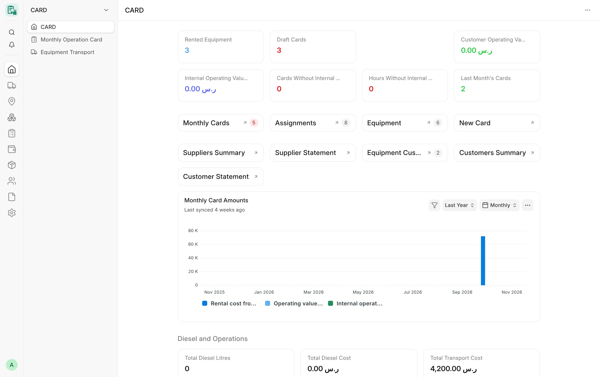

## Overview

CARD Desk opens on the **Card** workspace: a dashboard with key figures of the last month, two monthly charts and
shortcuts to the screens used every day. Around it, the CARD launcher (Dock) gives ten entries, each opening a
sidebar with the DocTypes, pages and reports of one area. Users reach every CARD screen from these two places
without searching.

All figures on the workspace are read with the user's own permissions: a user limited to some companies sees only
the figures of those companies, and amounts a user may not read are not shown.

<!-- screenshot: workspace-dashboard-overview -->

*Workspace number cards and charts*

## Key concepts

| Concept | Meaning |
|---|---|
| **Workspace** | The **Card** Desk page at `/app/card`, shipped as a fixture. |
| **Number card** | A tile with one figure (count or sum) on the workspace. |
| **Dashboard chart** | A bar chart by month on the workspace. |
| **Launcher (Dock)** | The CARD app rail with ten entries. Each entry opens a **sidebar**. |
| **Sidebar** | The navigation list of one area (for example Movement & Transport). |
| **Desk icon** | The **CARD** icon on the Desk and on the apps screen, with the CARD logo. |

## Features

### Opening CARD

- **Desk icon** — the CARD icon on the Desk opens the Card workspace. On the apps screen (`/apps`) the entry
  **CARD** opens the Desk and **CARD Mobile** opens the phone app at `/cdms`.
- The **CARD** entry is shown to users who can read at least one CARD Desk document (Card Equipment, Card Monthly
  Card, the supplier and customer registries, Equipment Transport, Project Diesel Fill, Equipment Needs Review or
  Employee Tool Custody). It is hidden from Website Users and from operators.
- The **CARD Mobile** entry is shown to users who may open the phone app (see [CARD Mobile](/card/features/card-mobile/)).

### Number cards

The workspace shows eleven number cards. Labels are stored in Arabic and shown translated in other languages.

| Number card | Arabic label | What it shows |
|---|---|---|
| Rented Equipment | المعدات المؤجرة | Count of Card Equipment with ownership «إيجار» (Rented) |
| Draft Cards | كروت مسودة | Count of monthly cards still in draft |
| Supplier Rental Cost - Last Month | تكلفة إيجار من موردين - الشهر الماضي | Supplier net amount of last month's cards (rented-from-supplier and sub-rental) |
| Customer Operating Value - Last Month | قيمة تشغيل لعملاء - الشهر الماضي | Customer net amount of last month's cards (rented-to-customer and sub-rental) |
| Internal Operating Value - Last Month | قيمة تشغيل داخلي - الشهر الماضي | Hours (or working days) × internal operating rate of owned and third-party equipment |
| Cards Without Internal Rate | كروت بدون سعر داخلي | Last month's cards with no supplier or customer side and no internal rate |
| Hours Without Internal Rate - Last Month | ساعات تشغيل بدون سعر داخلي - الشهر الماضي | The operating hours of those cards |
| Last Month's Cards | كروت الشهر الماضي | Count of submitted cards of last month |
| Total Diesel Litres | إجمالي لترات الديزل | Sum of litres of submitted diesel fills |
| Total Diesel Cost | إجمالي تكلفة الديزل | Sum of the amount of submitted diesel fills |
| Total Transport Cost | إجمالي تكلفة النقل | Sum of the amount of submitted transports |

:::note
Each value stays in its own figure: a card that has two sides (for example an owned machine rented to a customer
that also has an internal rate) counts in both, and the figures are never added into one number. The internal rate
is a restricted field of Card Equipment; a user who cannot read it gets no internal value and no missing-rate count.
:::

### Charts

| Chart | Arabic label | Content |
|---|---|---|
| Monthly Card Amounts | مبالغ الكروت الشهرية | Bars per month over the last year, in three separate series: supplier rental cost, customer operating value and internal operating value |
| Monthly Diesel Cost | تكلفة الديزل الشهرية | Sum of the amount of submitted diesel fills per month over the last year |

The Monthly Card Amounts chart uses its own chart source, **Card Monthly Values**. It is computed for each user
from the cards that user may read and is never served from a shared cache, so one company's totals never reach a
user of another company.

### Shortcuts

The workspace groups its shortcuts in four blocks:

- **Operation** — Monthly Cards, Assignments, Equipment, **New Card** (opens a new Card Monthly Card).
- **Parties** — Suppliers Summary, Supplier Statement, Equipment Customers, Customers Summary, Customer Statement.
- **Diesel and Operations** — Equipment Diesel Consumption, Transport Cost by Project, Operating Cost by Project.
- **Accounting** — Purchase Invoice, Sales Invoice, Payment Entry (the standard ERPNext lists).

<!-- screenshot: workspace-dashboard-shortcuts -->

*Shortcuts and report links*

### Launcher (Dock)

The CARD launcher has ten entries, in this order. Each opens a sidebar.

| Entry | Arabic | Sidebar content |
|---|---|---|
| Dashboard | لوحة القيادة | The Card workspace, Card Monthly Card, Equipment Transport |
| Equipment | المعدات | Card Equipment, Card Equipment Type, Card Equipment Category |
| Movement & Transport | الحركة والنقل | Equipment Transport, Card Equipment Assignment, Transport Cost by Project |
| Operating Units | الوحدات التشغيلية | Operating units (Card Equipment), Card Equipment Assignment |
| Operation Cards | كروت التشغيل | Card Monthly Card, Operating Cost by Project |
| Expenses | المصروفات | Project Diesel Fill, Equipment Transport, Purchase Invoice, Asset Repair, diesel consumption and analysis reports, Equipment Expenses Without Equipment |
| Materials | المواد والمشتريات | Equipment Needs Request and Review, the Tool Custody page, Employee Tool Custody, Material Request, Stock Entry, the catalog (Item), equipment makes and models, parts fitment, and the materials reports |
| Suppliers & Customers | الموردون والعملاء | Card Equipment Supplier and Customer, supplier and customer statements and summaries |
| Reports | التقارير | Every CARD report (statements, diesel, settlement, margin, unbilled work, integrity, maintenance, downtime, meters, asset mapping, transport, location history, operating cost) |
| Settings | الإعدادات | Card Settings |

Entries a user may not open are filtered out by Frappe when the launcher is built.

:::tip[Launcher on upgraded sites]
Frappe keeps a site's or a user's saved Dock layout as the whole rail. After every migrate CARD adds to such a
layout any shipped entry it does not name yet, in the shipped order, without removing or reordering the user's own
rows. A layout saved after the shipped one is left untouched.
:::

### Desk pages

| Page | Route | Roles | Purpose |
|---|---|---|---|
| CARD Monthly Posting | `/app/card-monthly-posting` | Card Manager, System Manager | Pick a company and a month and preview the monthly posting per party before building the draft invoices. See [Invoicing & posting](/card/features/invoicing-posting/) |
| Tool Custody | `/app/tool-custody` | Card Supervisor, Card Manager, Stock Manager, System Manager | Hand over, return and track tools in employee custody. See [Tool custody](/card/features/tool-custody/) |

### Connections on ERPNext forms

CARD adds a **Card** group to the Connections tab of four standard forms, without removing the connections of
ERPNext or other apps:

| Form | CARD connections |
|---|---|
| Supplier | Card Equipment, Card Monthly Card, Project Diesel Fill, Equipment Transport (as transporter) |
| Customer | Card Equipment Customer, Card Monthly Card |
| Project | Card Monthly Card, Card Equipment Assignment, Project Diesel Fill, Equipment Transport, Card Equipment (current project) |
| Asset | Card Equipment |

## Permissions

| What | Who sees it |
|---|---|
| Workspace and shortcuts | Users with access to the Card module; each shortcut opens only if the user may read its target |
| Number cards and charts | Computed with the user's DocType rights, Company User Permissions and field levels |
| CARD Monthly Posting page | Card Manager, System Manager |
| Tool Custody page | Card Supervisor, Card Manager, Stock Manager, System Manager |

## Related

- [Introduction](/card/getting-started/introduction/)
- [Monthly cards](/card/features/monthly-cards/)
- [Reports overview](/card/reports/overview/)
- [Roles & permissions](/card/features/roles-permissions/)
