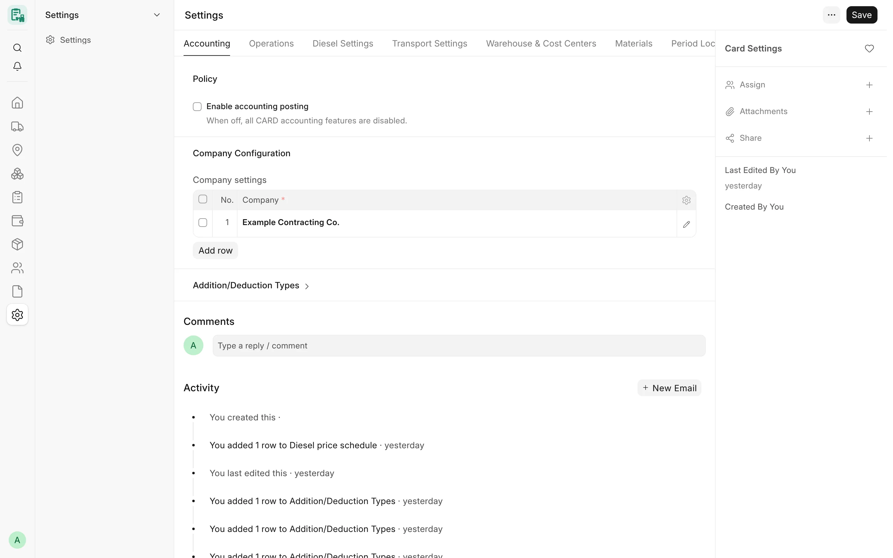

## Overview

All CARD configuration lives in one single DocType, **Card Settings**, opened from the launcher entry **Settings**
(Card Setup). It has site-wide values (shifts, warnings, diesel supplier policy, period lock, notifications) and a
table of **Card Company Settings** with one row per company: the accounts, items, tax templates, diesel price,
stores and equipment rules of that company.

Every value has a built-in default. When a field has never been set, CARD behaves as it did before the field
existed, so a new site works with an empty Card Settings until accounting posting is switched on.

<!-- screenshot: configuration-card-settings -->

*Card Settings*

## Key concepts

| Concept | Meaning |
|---|---|
| Site value | A field of Card Settings itself. It applies to every company. |
| Company row | A row of **Company settings** (Card Company Settings). It applies only to that company. A company has at most one row. |
| Fallback | Some company values are optional: when empty, the site value applies (stores, repeated-request days). |
| Field level | Card Settings fields have permission levels. Level 2 fields are policy values, level 1 fields are the company rows and the diesel price schedule. See [Who can change settings](#who-can-change-settings). |

## Features

### Accounting tab

- **Enable accounting posting** — when off, all CARD accounting features are disabled. Default off.
- **Company settings** — the table of Card Company Settings rows (see [Card Company Settings](#card-company-settings)).
- **Addition/Deduction Types** — the configured addition and deduction types per company. Each type has a
  **Type name**, a **Kind** («إضافة» Addition or «خصم» Deduction), an **Account** (expense on the purchase side,
  income on the sales side), **Taxable**, an **Item** (a non-stock service item provisioned automatically),
  **Downtime charge** and **Disabled**. Each type posts to its own account as an invoice line; taxable types carry
  the VAT rate of the company's tax templates, non-taxable types 0%. Disabled types are hidden from new card rows;
  existing rows stay valid.

:::note
The field **Auto-submit postings** is deprecated: it is hidden, read only and not used.
:::

### Operations tab

**Defaults**

| Field | Default | Effect |
|---|---|---|
| Default shift | «نهاري» (Day) | Shift proposed on a new monthly card |
| Max day-shift hours / Max night-shift hours | 12 / 12 | Hours per day above which a card shows a warning (never a block; all hours are billed) |
| Default daily hours (new equipment only) | 0 | Pre-fills new equipment only; 0 = no default |
| Default fuel charged to (new equipment) | empty | «المؤجر» (Lessor) or «الشركة» (Company) |
| Default operator charged to (new equipment) | empty | «المؤجر» (Lessor) or «الشركة» (Company) |
| Default rate basis | empty | Fills the supplier and customer rate basis on new equipment when left blank: «باليوم», «بالساعة», «بالشهر» |
| Standard month hours | 260 | Hours a monthly rate is spread over (26 days × 10 hours) |
| Daily equipment location sync | off | When on, a daily job sets each equipment's current project and assignment date from the assignment in force today; an overwritten value leaves a comment. Equipment without assignment history is never changed |

**Warnings**

- **Warn when day hours exceed daily hours** (default on).
- **Warn when card dates fall outside rental period** (default on; rented equipment only).

**Report defaults**

- **Reconciliation tolerance** — default 0.01.
- **Default statement type** — «مورد» (Supplier) or «معدات ملك» (Owned Equipment); default Supplier.
- **Include draft cards in reports** — default off.

### Diesel Settings tab

- **Diesel price per litre** — shown at the top as one value per company: the price of the company's diesel price
  schedule row in force today, or, for a company without a schedule, the company row's **Diesel unit price (per
  litre)**. A company picker appears only when there are several companies. Users who may write level 1 get a
  button to change the price.
- **Diesel price schedule** — dated prices (**Card Diesel Price** rows): company, fuel type (Diesel), **Diesel price
  valid from**, **Diesel unit price (per litre)**, currency (the company currency) and an optional unit of measure.
  A fill takes the price in force on its date. Once a company has schedule rows, its price changes only by adding a
  new dated row.
- **Diesel supplier policy** — «ثابت» (Fixed: one diesel supplier, set in **Diesel supplier**) or «متغير»
  (Variable, default: the supplier is chosen on each fill).

See [Diesel](/card/features/diesel/) for how fills use these values.

### Transport Settings tab

- **Transport price per project** — a table of **Project** and **Transport amount**: the standard transport price
  of each project. Only the transport price editor role (see Advanced Permissions) may change it.

### Warehouse & Cost Centers tab

- **Cost center per workshop / storage place** — rows of company, **Place** (an ERPNext Location) and **Cost
  Center**. A transport to that workshop or storage place charges that cost center.

### Materials tab

Site-wide values for [equipment needs](/card/features/equipment-needs/) and [tool custody](/card/features/tool-custody/):

- **Main store** — the store used by equipment needs reviews and as the default store of tool custody.
- **Tool custody store** — the warehouse that holds tools in employee custody.
- **Flag a repeated request within (days)** — default 30. A request for the same item within this window is flagged
  for review (never refused).

A company row can override all three.

### Period Lock tab

- **Period lock date** — cards, diesel fills and transports dated on or before this date are locked: they cannot be
  created, edited, submitted, cancelled, amended or deleted.
- **Period lock override role** — users with this role may bypass the lock. Every override is logged and written as
  a comment on the document, and can send a notification (see [Notifications & alerts](/card/features/notifications-alerts/)).

### Notifications tab

All notifications are off by default:

- **Notify on card submit**
- **Notify on period lock override**

The field **Notify on accounting posting** is deprecated (hidden, read only, not used).

### Advanced Permissions tab

Roles that unlock specific actions. Each is a link to a Role:

| Field | Default | What the role may do |
|---|---|---|
| Diesel supplier editor role | Card Manager | Change the supplier of a diesel fill (Variable policy only; with the Fixed policy nobody may) |
| Diesel price exception role | Accounts Manager | Approve a diesel price exception on a fill (with a reason) |
| Diesel zero price role | empty | Save a fill with a zero price. Empty = nobody may |
| Transport price editor role | Card Manager | Change the transport price per project |

### Card Company Settings

One row per company in **Company settings**. **Company** is required.

**Accounts**

- Equipment rental expense account
- Diesel expense account
- Transport/mobilization expense account
- Equipment rental income account
- Payable (Creditors)
- Receivable (Debtors)
- Cost center

**Tax templates**

- Purchase tax template (Purchase Taxes and Charges Template)
- Sales tax template (Sales Taxes and Charges Template)

**Items**

- Rental item, Diesel item, Transport item, Rental-out item — the service items used on the invoice lines CARD
  builds.

**Pricing**

- **Diesel unit price (per litre)** — the company's diesel price when it has no diesel price schedule.

**Settlement**

- **VAT item tax template (company rate)** — the per-line VAT template at the single rate of the company's purchase
  and sales tax templates. Provisioned automatically as `CARD VAT <rate>% - <abbr>`.
- **VAT 0% item tax template** — the per-line 0% template for non-taxable adjustment lines, provisioned as
  `CARD VAT 0% - <abbr>`.
- **Diesel price VAT basis** — Exclusive or Inclusive.
- **Diesel fill project check** — Off, Warn only (default) or Refuse. A new diesel fill (or one whose company,
  equipment, project or date changed) needs each equipment assigned to the fill's project on the fill date.
  Submitted fills are never checked again.

**Equipment and transport**

- **Initial place of new equipment** — where an equipment of this company with no movement history is recorded,
  shown as From on its first transport. Empty: storage without a place.
- **Move-day rule** — for a project-to-project transport: *New assignment starts the day after the move* (default;
  the old project keeps the move day) or *New assignment starts on the move day*.
- **Equipment status rule** — *Warn only* (default) or *Refuse*, for an equipment with status «منتهية» (Ended) on a
  new assignment, transport or monthly card. A return to the supplier, an owned machine moved to storage or a
  workshop, and a card of the month of its exit are never stopped.

**Materials**

- **Main store**, **Tool custody store**, **Flag a repeated request within (days)** — empty or 0 means the site value
  of the Materials tab applies. Warehouses must be enabled stock (not group) warehouses of this company. The tool
  custody store cannot change while any tool of the company is held in custody.

**Transport responsibility posting**

- **Transport responsibility posting** — *Hold* (default) keeps transports recorded with a responsibility scenario
  out of the monthly invoices (the Transport Accounting Review report lists them); *Post* adds them to the monthly
  draft invoices. Switch to Post only after your accountant and tax adviser agree.
- **Transport recharge income account** — shown only with Post: the income account of transport cost billed to a
  customer. Must be an enabled, non-group account of this company.

:::note
**Bank / cash account** and **Mode of payment** on the company row are deprecated: hidden, read only and not used.
:::

### Check setup

:::caution[Planned]
A "Check setup" action that validates the whole configuration in one step is planned and not available yet. Until
then, CARD checks each value where it is used: posting refuses to build an invoice when an account, item, tax
template or the accounting dimension is missing, and names what is missing.
:::

## Workflow

1. Open **Settings** from the CARD launcher.
2. On the **Accounting** tab add a **Company settings** row for each company and fill its accounts, tax templates
   and items.
3. Add the addition and deduction types you use.
4. Review the **Operations** defaults and warnings.
5. Set the diesel price (schedule or company price) and the diesel supplier policy.
6. Set the stores on the **Materials** tab or on each company row.
7. When everything is in place, an authorised user turns on **Enable accounting posting**.

## Who can change settings

| Role | Level 0 (form, tables) | Level 1 (company rows, diesel price schedule) | Level 2 (policy values) |
|---|---|---|---|
| System Manager | Read, write | Read, write | Read, write |
| Accounts Manager | Read, write | Read, write | Read |
| Card Manager | Read | — | Read |

A user limited to some companies by Company User Permissions sees and changes only the company rows, addition and
deduction types and diesel price rows of those companies; rows of other companies, and their change history, are
removed from the form on the server.

## Related

- [Installation](/card/getting-started/installation/)
- [Invoicing & posting](/card/features/invoicing-posting/)
- [Diesel](/card/features/diesel/)
- [Roles & permissions](/card/features/roles-permissions/)
