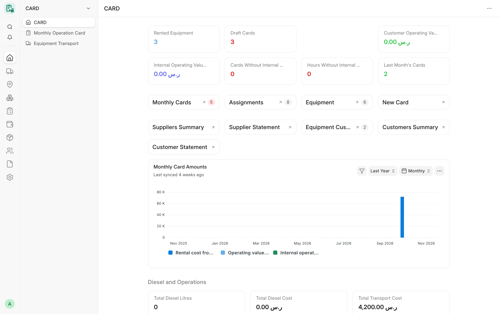

## Overview

CARD is a Frappe application for contractors that own, rent and operate heavy equipment. It records every machine,
where it works and who runs it, records the operating hours of each machine month by month, and turns those hours
into supplier costs and customer amounts on standard ERPNext documents.

CARD follows the design of Frappe HR. There is one master record per machine (like **Employee**) and one transaction
per machine and period (like **Salary Slip**). Every CARD record links to the standard ERPNext **Company**,
**Project**, **Supplier**, **Customer**, **Asset**, **Item** and **Employee** records, so CARD data appears in the
same companies, projects and ledgers that the rest of ERPNext uses.

CARD has two interfaces on the same app and the same data:

| Interface | For | Where |
|---|---|---|
| **CARD Desk** | Managers, supervisors, accounts and stores staff | The ERPNext Desk (`/app/card`) |
| **CARD Mobile** | Operators, supervisors and managers on site | The phone web app at `/cdms` |

CARD Desk is the complete management system. CARD Mobile is a phone front end for the few actions people need on
site; it does not copy the Desk. See [CARD Mobile](/card/features/card-mobile/) for its current scope.

<!-- screenshot: introduction-workspace -->

*The CARD workspace*

## Who it is for

- **Equipment and operations managers** who need one register of owned and rented machines, their projects and
  their monthly operation.
- **Site supervisors** who record or review operating hours and review the operators' requests for parts and tools.
- **Accountants** who need supplier and customer amounts as draft ERPNext invoices, per party and month, with a
  full audit trail and no manual re-keying.
- **Stores staff** who issue parts and tools against equipment and projects.
- **Operators** who request parts, consumables and tools for their own machine from a phone.

## Main modules

| Module | What it covers | Page |
|---|---|---|
| Equipment | The **Card Equipment** master: type, category, make and model, ownership, rental terms, documents and their expiry, link to the ERPNext Asset | [Equipment](/card/features/equipment/) |
| Units and components | Operating units made of several owned machines, with dated components | [Units & components](/card/features/units-components/) |
| Movement and assignments | **Equipment Transport** moves machines between projects, workshops, storage and the supplier; submitted transports open and close **Card Equipment Assignment** records | [Assignments & locations](/card/features/assignments-locations/), [Transport](/card/features/transport/) |
| Daily logs | Daily equipment hours per company, project and date | [Daily logs](/card/features/daily-logs/) |
| Monthly cards | **Card Monthly Card**: one card per machine, shift and month with a day-by-day grid of hours | [Monthly cards](/card/features/monthly-cards/) |
| Rates and adjustments | Hourly, daily and monthly rates on the supplier and customer side; typed additions and deductions | [Rate agreements](/card/features/rate-agreements/), [Adjustments](/card/features/adjustments/) |
| Invoicing and posting | Monthly draft Purchase and Sales Invoices per supplier or customer, the GL Posting Log, settlement links | [Invoicing & posting](/card/features/invoicing-posting/) |
| Diesel | Project diesel fills as metered sessions, the diesel price schedule, consumption analysis | [Diesel](/card/features/diesel/) |
| Materials and custody | Operator requests, supervisor review, manager approval into draft Material Requests; tool custody | [Equipment needs](/card/features/equipment-needs/), [Tool custody](/card/features/tool-custody/) |
| Reports | Supplier and customer statements, cost by project, diesel, transport, maintenance and accounting control reports | [Reports overview](/card/reports/overview/) |

## How CARD relates to ERPNext and Frappe HR

| Application | How CARD uses it |
|---|---|
| Frappe Framework | DocTypes, permissions, sessions, translations, web pages, print formats |
| ERPNext (required) | Company, Project, Supplier, Customer, Asset, Item, Employee, Warehouse, Cost Center, Material Request, Stock Entry, Purchase Invoice, Sales Invoice, Journal Entry and the General Ledger |
| Frappe HR (optional) | CARD uses the ERPNext **Employee** record, which Frappe HR extends. Frappe HR is not required |

CARD declares only `erpnext` as a required app. It does not change Frappe, ERPNext or Frappe HR code; it extends them
through standard mechanisms only: hooks, its own DocTypes, an accounting dimension, permission hooks and dashboard
connections on the Supplier, Customer, Project and Asset forms.

:::note[CARD never writes General Ledger rows]
CARD creates **standard ERPNext documents** — Purchase Invoice, Sales Invoice, Material Request and Stock Entry —
as drafts, through the normal document API. The ledger rows are written by ERPNext itself when an authorised user
submits those documents. CARD never inserts a GL Entry directly.
:::

## Key concepts

| Concept | Meaning in CARD |
|---|---|
| **Equipment** | A **Card Equipment** record: one machine (excavator, crusher, truck, generator…). It carries the company, type, category, ownership, rental direction, rates, operator and documents. An owned machine is linked to its ERPNext **Asset**, from which CARD fills its name, brand, type and details. |
| **Ownership** | «ملك» (Owned), «إيجار» (Rented) or «طرف ثالث» (Third Party). The value is stored in Arabic and shown translated in other languages. |
| **Unit** | An operating unit made of several owned machines working together (for example a crusher line). The unit has dated **components**; a machine that is a unit component gets no monthly card of its own. |
| **Assignment** | A **Card Equipment Assignment**: the period during which a machine works on a project. Assignments are opened and closed by submitted transports, and a monthly card day outside an assignment is refused. |
| **Transport** | An **Equipment Transport**: moves one or more machines to a project, a workshop, storage or back to the supplier, with its cost and who bears it. |
| **Daily log** | A **Card Daily Log**: the hours of the equipment of one project on one date (day and night shifts, stop reasons). Approved daily logs can generate draft monthly cards. |
| **Monthly card** | A **Card Monthly Card**: one per machine, shift («نهاري» Day / «ليلي» Night) and month. It holds a day grid of hours and day statuses, the rates, additions and deductions, and computes the supplier and customer amounts. |
| **Direction** | The rental direction of the equipment and its card: «مستأجَرة من مورد» (Rented from Supplier), «مؤجَّرة لعميل» (Rented to Customer), «إيجار من الباطن» (Sub-rental: from a supplier and to a customer) or «تشغيل داخلي» (Internal Operation). The direction decides whether the card bills a supplier side, a customer side, both or neither. |
| **Owner / supplier / customer** | The **supplier** (lessor) is the party CARD pays for a rented machine; the **customer** is the party CARD bills for a machine rented out. An owned machine on internal operation has neither and can carry an internal operating rate for cost analysis. |
| **Rate basis** | «بالساعة» (Per Hour), «باليوم» (Per Day) or «بالشهر» (Per Month). A daily rate is spread over the machine's daily hours; a monthly rate over the standard month hours (default 260). |
| **Posting** | Turning submitted monthly cards, diesel fills and transports of one month into **draft** ERPNext invoices: a Purchase Invoice per supplier and a Sales Invoice per customer. Each posting is recorded in a **GL Posting Log** so a source is never invoiced twice. |
| **Period lock** | A date in Card Settings. Cards, diesel fills and transports dated on or before it cannot be created, changed, submitted, cancelled or deleted, except by the override role. |
| **Company isolation** | Every operational record belongs to one company. A user limited to some companies never sees or changes another company's records; the server enforces this. |

## Typical workflow

1. Create the **Card Equipment** record (from its ERPNext Asset for an owned machine, or with the lessor and rate for
   a rented one).
2. Move it to a project with an **Equipment Transport** and submit the transport.
3. Check the **Card Equipment Assignment** that the transport opened.
4. Create the **Card Monthly Card** for the machine, shift and month (or generate it from approved daily logs).
5. Enter the hours of each day, add any additions or deductions, and submit the card at month end.
6. Post the month: CARD builds the draft Purchase and Sales Invoices, which accounts review and submit in ERPNext.

## Related

- [Installation](/card/getting-started/installation/)
- [Configuration](/card/getting-started/configuration/)
- [Workspace & dashboard](/card/features/workspace-dashboard/)
- [Roles & permissions](/card/features/roles-permissions/)
