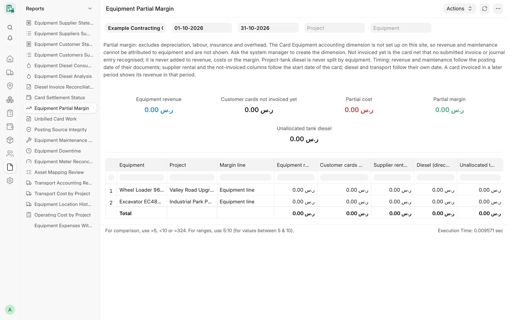
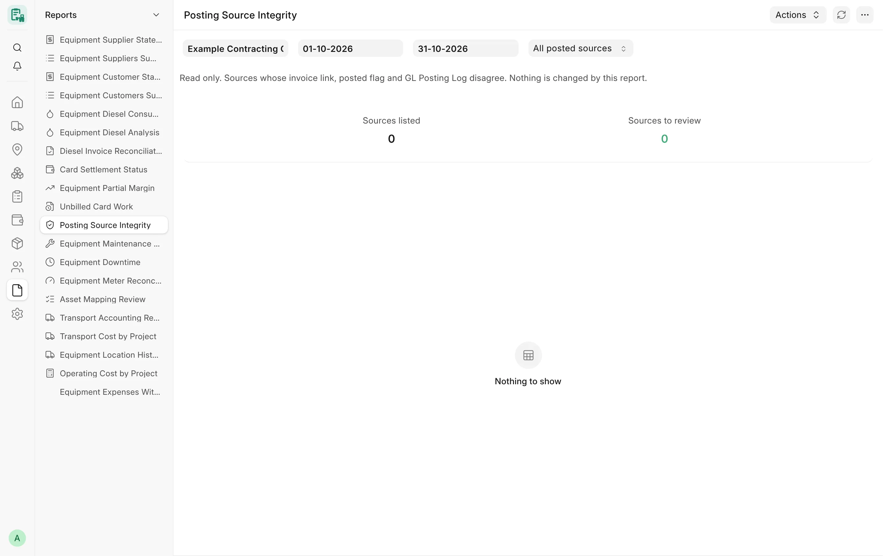

## Overview

CARD never writes ledger entries itself: it builds standard ERPNext invoices from monthly cards, diesel fills and
transports, and records which document recognised which source in a **GL Posting Log**. The accounting control reports
check that chain from the accountant's side: what is earned and spent per machine, which approved work is not invoiced
yet, which expenses miss their machine tag, and whether the links between sources and postings still agree.

## Key concepts

| Concept | Meaning |
|---|---|
| GL Posting Log | CARD's record of a posting: company, party, month, status (Draft, Submitted…), the invoice or journal entry, and its **sources** (the cards, fills and transports it covers). |
| Recognised card | A card held by an active posting log of its side (a CARD invoice, a linked hand-booked invoice or a linked accrual journal entry), or by the side's own invoice link. |
| Partial margin | Revenue minus the costs CARD can attribute; it excludes depreciation, labour, insurance and overhead. |
| CARD expense accounts | The equipment rental, diesel and transport expense accounts set per company in Card Company Settings. |

## Equipment Partial Margin

**Purpose.** One row per equipment and project for one company and period.

- **Revenue** – submitted Sales Invoice lines carrying the Card Equipment dimension (posted in the period, net of VAT,
  credit notes included).
- **Customer cards not invoiced yet** – the customer net of submitted customer cards that no submitted document
  recognised. Shown apart, never added to revenue or the margin.
- **Supplier rental** – what submitted documents recognised for the supplier cards of the period; the supplier net
  not recognised yet is shown apart, never added to costs.
- **Diesel (direct fills)** – direct fills at the posting's valuation. Project-tank fills are **not** split by
  equipment: they sit on a project-level line, "Unallocated tank diesel".
- **Company transport** – company-borne transports, by their recorded equipment shares.
- **Maintenance and other tagged costs** – the lines of the
  [Equipment Maintenance Cost](/card/reports/maintenance-assets/#equipment-maintenance-cost) report.

<!-- screenshot: accounting-partial-margin -->

*Equipment Partial Margin report*

**Filters:** **Company** (required), **From date** / **To date** (required, current month by default), **Project**,
**Equipment**.

**Columns:** Equipment, Project, Margin line ("Equipment line" or "Project level: unallocated tank diesel and shared
costs"), Equipment revenue, Customer cards not invoiced yet (not in revenue), Supplier rental, Diesel (direct fills),
Unallocated tank diesel, Company transport, Maintenance and other tagged costs, Partial cost, Partial margin, Supplier
cards not invoiced yet (not in costs).

**Totals.** Tiles **Equipment revenue**, **Customer cards not invoiced yet**, **Partial cost**, **Partial margin** (green
when not negative) and **Unallocated tank diesel**; the standard total row is enabled.

**Timing.** Revenue and maintenance follow the posting date of their documents; supplier rental and the not-invoiced
columns follow the start date of the card; diesel and transport follow their own date. A card invoiced in a later
period shows its revenue in that period.

**Access.** System Manager, Accounts Manager — ledger readers only. A part the user cannot read (monthly cards, diesel
fills, transports, sales invoices) is left out and named in the message. Without the Card Equipment dimension,
revenue and maintenance are not shown.

## Unbilled Card Work

**Purpose.** Submitted monthly cards of one company whose period starts in the chosen dates and that no live document
of their side recognises yet. The supplier side (rented-in and sub-rented cards: their net) and the customer side
(rented-out and sub-rented cards: their customer net) are listed apart; a sub-rented card can be open on one side only.

**Filters**

- **Company** – required.
- **From date** / **To date** – required; default to the start of the year and today.
- **Billing side** – Both billing sides (default), Supplier side, Customer side.
- **Project**, **Equipment** – optional.
- **Include cards held by a draft posting** – off by default; when on, cards whose recognising document is still a
  draft are listed and marked.

**Columns:** Card, Billing side, Party, Month, Project, Equipment, Card amount not invoiced (before VAT), Billing status
("Not invoiced" or "Held by a draft posting"), Draft document.

**Totals.** Tiles **Supplier cards not invoiced** and **Customer cards not invoiced**; the standard total row is enabled.

**Access.** System Manager, Accounts Manager, Card Manager, whose roles read GL Posting Log and who may read Card Monthly
Card.

## Equipment Expenses Without Equipment

**Purpose.** Ledger expense lines booked on the CARD expense accounts (equipment rental, diesel, transport) **without**
the Card Equipment dimension — costs the per-equipment profit and loss cannot see yet. Fix them at the source
document.

**Filters:** **Company** (required), **From date** / **To date** (default: the current year).

**Columns:** Posting date, Account, Voucher type, Voucher, Project, Cost center, Debit, Credit, Remarks.

**Totals.** Tiles **Lines without equipment**, **Net amount without equipment** (debit − credit) and **Project tank
diesel lines (intended, not listed)** — a project-tank diesel fill posts one project-level line by design, so those
lines are identified through the fill that points to the invoice and counted apart.

**Access.** System Manager, Accounts Manager — ledger readers only. Without the dimension, or without the company's
expense accounts in Card Settings, the report shows an explanatory message and no rows.

## Posting Source Integrity

**Purpose.** A source (monthly card, diesel fill, transport) and the posting log that posted it are linked two ways:
the log's source rows, and the invoice link and **posted** flag written on the source when the invoice is submitted.
A direct database edit, an import or an older version can leave them out of step. This report lists every source of
the company and period whose link, posted flag and posting log disagree. It repairs nothing; the fix is a person's
decision.

<!-- screenshot: accounting-posting-source-integrity -->

*Posting Source Integrity report*

**Filters:** **Company** (required), **From date** / **To date** (required; start of year to today), **Show** –
"Problems only" (default) or "All posted sources".

**Checks**

- Held by more than one submitted posting of the same side.
- Invoice linked on the source, but no submitted posting log lists the source, or the log posted it on another
  invoice.
- The linked invoice does not exist or is not submitted.
- A submitted log posted the source, but the source has no invoice link.
- Marked posted without a submitted posting or invoice link; or a submitted posting lists it but it is not marked
  posted.
- The source is cancelled but still posted.
- A posting log of a month in the period lists a source that no longer exists.

**Columns:** Integrity check, Source type, Source, Date, Source status, Posted flag, Purchase Invoice on the source,
Sales Invoice on the source, GL Posting Log, Log status, Document of the log, Amount in the log, Evidence.

**Totals.** Tiles **Sources listed** and **Sources to review** (red when any).

**Access.** System Manager, Accounts Manager, whose roles read GL Posting Log, Card Monthly Card, Project Diesel Fill
and Equipment Transport.

## Related

- [Invoicing and posting](/card/features/invoicing-posting/)
- [Posting and accounting API](/card/api-reference/posting-accounting/)
- [Parties and statements](/card/reports/parties-statements/)
- [Maintenance and asset reports](/card/reports/maintenance-assets/)
