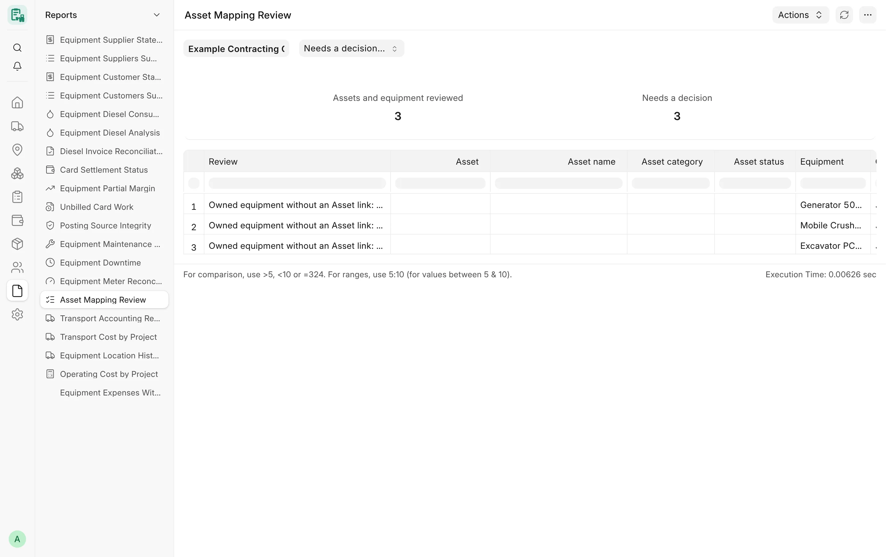

## Overview

Owned equipment is also an ERPNext **Asset**, and its maintenance is bought on ordinary purchase invoices and stock
issues. These reports connect the two worlds: they collect the maintenance cost tagged to each machine, show which
Assets still need a CARD equipment record (or the reverse), and prepare the clean make and model masters used by
parts fitment.

## Key concepts

| Concept | Meaning |
|---|---|
| Card Equipment dimension | The accounting dimension that tags invoice and stock lines with a CARD equipment. It is a manual setup step; reports that need it explain when it is missing. |
| Asset link | The Card Equipment field that links an owned (or third-party) machine to its submitted Asset. Rented equipment never has an Asset. |
| Equipment type for an Asset category | A **Card Equipment Type** can name the Asset category it maps to. |

## Equipment Maintenance Cost

**Purpose.** One row per document line of one company and period tagged to a machine through the Card Equipment
dimension: submitted **Purchase Invoice** lines and submitted **Material Issue** Stock Entry lines at their valuation.

**Excluded:** invoices that recognise CARD cards, diesel fills or transports; fixed-asset lines; purchase lines of stock
items (they reach the machine through the material issue); depreciation, labour and insurance.

**Filters:** **Company** (required), **From date** / **To date** (required, current month by default), **Project**,
**Equipment**.

**Columns:** Posting date, Document type, Cost document, Equipment, Project, Cost item, Expense account, Maintenance cost
(net of VAT, company currency).

**Totals.** Tiles **Maintenance and other tagged costs** and **Equipment with tagged costs**; the standard total row is
enabled.

**Access.** System Manager, Accounts Manager — ledger readers only. When the user cannot read Purchase Invoice or Stock
Entry, those lines are not counted and the message says so. The same lines feed the maintenance column of the
[Equipment Partial Margin](/card/reports/accounting-control/#equipment-partial-margin).

## Asset Mapping Review

**Purpose.** Classifies every submitted Asset of the company against CARD equipment, one by one, so the owner decides
which Assets need a CARD equipment record. It also lists owned equipment without an Asset link. It creates, links and
changes nothing.

<!-- screenshot: asset-mapping-review -->

*Asset Mapping Review report*

**Filters:** **Company** (required); **Show** – "Needs a decision only" (default) or "All Assets".

**Columns:** Review, Asset, Asset name, Asset category, Asset status, Equipment, Ownership, Equipment type, Type for this
category, Evidence.

**Review values**

| Review | Needs a decision |
|---|---|
| Linked | Only when the Asset ID conflicts with its name or item |
| Linked to equipment that is not owned: review (rented equipment has no Asset) | Yes |
| Linked; equipment type differs from the type of this Asset category | Yes |
| Sold or scrapped: no CARD equipment needed | No |
| Not in CARD: decide whether it is operated equipment (type available) | Yes |
| Not in CARD: no equipment type for this Asset category yet | Yes |
| Owned equipment without an Asset link: confirm its Asset or ownership | Yes |
| Linked Asset is not a submitted Asset of this company you may read | Yes |

**Totals.** Tiles **Assets and equipment reviewed** and **Needs a decision**.

**Access.** System Manager, Card Manager, Accounts Manager, whose roles also read Asset and Card Equipment. A machine can
then be created from its Asset with the [Create from Asset API](/card/api-reference/equipment/).

## Equipment Make Model Values

**Purpose.** The free-text **brand** and **model** values of the equipment, grouped after normalising (so "PC200-8" and
"pc 200 8" fall together), so a Card Manager can create the **Card Equipment Make** and **Card Equipment Model** records
by hand. Read only: nothing is matched or written automatically.

**Filters:** **Without equipment model only** (checked by default).

**Columns:** Brand (text), Model (text), Equipment type, Equipment count, Equipment make, Equipment model.

**Totals.** None.

**Access.** System Manager, Card Manager; the user's own record rules on Card Equipment apply.

## Related

- [Equipment](/card/features/equipment/)
- [Maintenance and parts](/card/features/maintenance-parts/)
- [Meter readings](/card/features/meter-readings/)
- [Equipment API](/card/api-reference/equipment/)
