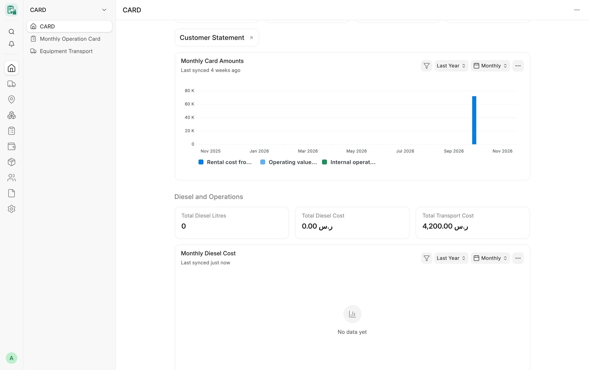

## Overview

CARD ships its reports as standard Frappe **Script Reports** in the **Card** module. Each report is read-only: it
reads monthly cards, equipment, diesel fills, transports, needs reviews, custody records and — for users allowed to
see them — ERPNext ledger rows, and it never creates, changes, links or posts anything. A report shows a point to
review; it never corrects data by itself.

Script reports read their data in bulk, which bypasses the per-document permission check of the Desk list. CARD
therefore scopes every report itself: by company, by the roles that may run it, by the documents the user may read,
and by whether the user may see ledger figures. The rules are the same for every report and are described below.

<!-- screenshot: reports-overview-sidebar -->

*Reports in the CARD workspace*

## Key concepts

| Concept | Meaning |
|---|---|
| Script Report | A standard Frappe report whose rows are built by Python code (`execute`) and whose filters are defined in JavaScript. |
| Report company | The single company a report runs for. It is chosen in the **Company** filter and validated on the server. |
| Permitted companies | The companies the user may see. User Permissions on **Company** restrict the set (honouring "Applicable for"); a user without any Company User Permission sees every company. |
| Ledger reader | A user whose **roles** grant read on **GL Entry** without an "only if owner" restriction, for the report company. A shared GL Entry never counts. |
| Report roles | The roles listed on each report. Only they (plus any "Role Permission for Page and Report" override) may run it. |
| Summary tiles | The figures shown above the table (report summary). Money tiles carry the company currency. |

## Features

### Company-scoped access

- Most reports run for **one company**. The **Company** filter is an Autocomplete fed by
  `card.api.card_company_options`, which lists only the permitted companies. The server checks the value again: a
  company the user may not see is refused with "You are not permitted to view data of company …".
- When the filter is empty the server uses the user's default company, then the site default company, but only when
  that company is permitted; with exactly one permitted company it is used automatically; otherwise the report asks
  to "Select a company".
- A report that reads several document types uses the **intersection** of the companies the user may see for each
  of them.
- A few operational reports have no Company filter and list every permitted company at once: **Worker Custody**,
  **Equipment Consumption**, **Equipment Needs Summary** and **Repeat Equipment Requests**. **Equipment Make Model
  Values** applies the user's own record rules (User Permissions) on equipment.
- Inside the company, rows are further limited to the records the user may read wherever the report uses
  `frappe.get_list` (for example monthly cards limited by User Permissions on project or equipment).

### Filters

Filters are defined in each report's JavaScript. Common patterns:

- **Company** – required Autocomplete, defaulted to the user's default company.
- **Project** – an Autocomplete (`card.api.card_project_options`) listing the projects of the permitted companies,
  shown as `PROJ-0001: Project name`. It is not a Link filter, because Frappe would check the user's read right on
  Project, which operational roles do not have.
- **Supplier / Customer** on the statements – a Link to the CARD party registry (**Card Equipment Supplier** /
  **Card Equipment Customer**) filtered by `card.api.card_suppliers_query` / `card_customers_query`: only parties
  with at least one monthly card in a permitted company.
- **Period** – either **From date / To date** or **From month / From year / To month / To year** (the statements
  and summaries default to the previous month).
- **Show** – several review reports default to "Needs attention" / "Problems only" and can show all rows.

### Tree display

The **Equipment Supplier Statement** and **Equipment Customer Statement** are shown as a tree: Project → Equipment →
Card, opened to the first level. Project and equipment rows are bold totals of their children, and a green
**Grand total** row closes the statement. Both reports also fix the header alignment of the table in right-to-left
(Arabic) layouts.

### Print and PDF

- Every report can be printed or exported with the standard report menu (**Print**, **PDF**, **Export**).
- The **Equipment Supplier Statement** opens its Print and PDF dialogs with the **Equipment Supplier Statement A4**
  print format pre-selected. Its **PDF** action is replaced: only the filters are sent to the server
  (`card.card.report.equipment_supplier_statement.statement_pdf.download_pdf`), which runs the report with the user's
  permissions, builds the A4 statement and renders it with the Chrome PDF generator so Arabic text is shaped
  correctly. It requires the **print** right on Card Monthly Card and writes an Access Log entry.

### Who can see money

- **Ledger figures** (opening balance, accrual entries, payments, closing balance, invoiced through CARD, invoices
  outside CARD, payment-ledger settlement) are computed only for ledger readers of the report company. For other
  users the figures are **removed on the server** — the columns, the row values and the summary tiles never reach the
  browser — and the report message says "Ledger balances are shown only to users with General Ledger access."
- Some reports are purely financial and **refuse** a non-ledger reader: **Card Settlement Status**, **Equipment
  Maintenance Cost**, **Equipment Partial Margin** and **Equipment Expenses Without Equipment**.
- Card amounts (rates, operating amount, additions, deductions, net) on the statements come from the monthly cards
  and are shown to every user who may run the report.
- **Stock quantities** on the Equipment Needs Summary are shown only to users who may read stock; otherwise the
  column is removed.
- **Link columns** to a DocType the user cannot read are turned into plain text, so the Desk neither resolves the
  title nor opens a record the user may not see. A Project column then shows the project's name instead of its
  record name.

### Currency

Money columns are labelled with the **report company's default currency**. CARD converts nothing; every figure comes
from documents of that company. **Equipment Consumption**, which spans several companies, labels each row with its
own company's currency.

### Running a report through the API

Reports can be run with the standard Frappe endpoint `frappe.desk.query_report.run` (the same permission rules
apply):

```bash
curl -s -G "https://<your-site>/api/method/frappe.desk.query_report.run" \
  -H "Authorization: token <api_key>:<api_secret>" \
  --data-urlencode "report_name=Equipment Downtime" \
  --data-urlencode 'filters={"company":"Example Contracting Co.","from_date":"2026-01-01","to_date":"2026-01-31","group_by":"Reason"}'
```

## All reports

| Report | Purpose | Documented in |
|---|---|---|
| Equipment Location History | Where each machine was, per period: project, workshop, storage, supplier or initial place. | [Operations](/card/reports/operations/) |
| Equipment Downtime | Stopped days and hours of monthly cards by reason, responsible party, equipment, project, month or day. | [Operations](/card/reports/operations/) |
| Equipment Meter Reconciliation | Hour-meter readings checked for plausibility and compared with CARD card hours. | [Operations](/card/reports/operations/) |
| Equipment Consumption | Stock issued to each machine plus non-stock items bought for it. | [Operations](/card/reports/operations/) |
| Equipment Needs Summary | The consolidated list of submitted needs-review lines, merged by item. | [Operations](/card/reports/operations/) |
| Repeat Equipment Requests | Items asked again for the same machine within the repeat window. | [Operations](/card/reports/operations/) |
| Worker Custody | What each worker holds now: returnable tools and assets in custody. | [Operations](/card/reports/operations/) |
| Equipment Supplier Statement | One supplier's (or owned equipment's) cards by project and equipment, reconciled with the supplier ledger. | [Parties and statements](/card/reports/parties-statements/) |
| Equipment Suppliers Summary | One row per supplier with card totals and ledger reconciliation. | [Parties and statements](/card/reports/parties-statements/) |
| Equipment Customer Statement | One customer's billing cards by project and equipment, reconciled with the customer ledger. | [Parties and statements](/card/reports/parties-statements/) |
| Equipment Customers Summary | One row per customer with accrued totals and ledger reconciliation. | [Parties and statements](/card/reports/parties-statements/) |
| Card Settlement Status | For every card of a party: the recognising document, what is paid and what remains. | [Parties and statements](/card/reports/parties-statements/) |
| Equipment Diesel Analysis | Expected litres from hours against allocated litres, per equipment, project and month. | [Diesel and fuel](/card/reports/diesel-fuel/) |
| Equipment Diesel Consumption | Allocated diesel litres and cost per equipment, project and month. | [Diesel and fuel](/card/reports/diesel-fuel/) |
| Diesel Invoice Reconciliation | CARD diesel sessions matched with the suppliers' own purchase invoices. | [Diesel and fuel](/card/reports/diesel-fuel/) |
| Transport Cost by Project | Company transport cost per project, with amounts the company does not pay shown apart. | [Transport and costs](/card/reports/transport-costs/) |
| Operating Cost by Project | Diesel plus company transport cost per project. | [Transport and costs](/card/reports/transport-costs/) |
| Transport Accounting Review | Submitted transports whose accounting still needs a person. | [Transport and costs](/card/reports/transport-costs/) |
| Equipment Maintenance Cost | Purchase and material-issue lines tagged to equipment through the Card Equipment dimension. | [Maintenance and assets](/card/reports/maintenance-assets/) |
| Asset Mapping Review | Every submitted Asset classified against CARD equipment for a decision. | [Maintenance and assets](/card/reports/maintenance-assets/) |
| Equipment Make Model Values | Free-text brand and model values grouped, to create make and model records. | [Maintenance and assets](/card/reports/maintenance-assets/) |
| Equipment Partial Margin | Revenue minus partial costs per equipment and project. | [Accounting control](/card/reports/accounting-control/) |
| Unbilled Card Work | Submitted cards that no invoice or linked journal entry recognises yet. | [Accounting control](/card/reports/accounting-control/) |
| Equipment Expenses Without Equipment | Ledger lines on the CARD expense accounts without the Card Equipment dimension. | [Accounting control](/card/reports/accounting-control/) |
| Posting Source Integrity | Sources whose invoice link, posted flag and posting log disagree. | [Accounting control](/card/reports/accounting-control/) |

## Permissions

| Report | Roles that may run it |
|---|---|
| Equipment Consumption, Equipment Needs Summary, Repeat Equipment Requests, Worker Custody | System Manager, Card Manager, Card Supervisor, Card User, Stock Manager, Accounts Manager |
| Equipment Location History, Equipment Downtime, Equipment Supplier Statement, Equipment Suppliers Summary, Equipment Customer Statement, Equipment Customers Summary, Equipment Diesel Analysis, Equipment Diesel Consumption, Transport Cost by Project, Operating Cost by Project | System Manager, Card Manager, Card User, Accounts Manager |
| Equipment Meter Reconciliation, Asset Mapping Review | System Manager, Card Manager, Accounts Manager |
| Unbilled Card Work | System Manager, Accounts Manager, Card Manager |
| Equipment Make Model Values | System Manager, Card Manager |
| Card Settlement Status, Diesel Invoice Reconciliation, Equipment Maintenance Cost, Equipment Partial Margin, Equipment Expenses Without Equipment, Transport Accounting Review, Posting Source Integrity | System Manager, Accounts Manager |

:::note
Holding a report role is necessary but not always sufficient. Several reports also require that the user's roles
read each document type they list (for example Asset, Purchase Invoice or GL Posting Log); each report section states
its extra checks.
:::

## Related

- [Operations reports](/card/reports/operations/)
- [Parties and statements](/card/reports/parties-statements/)
- [Roles and permissions](/card/features/roles-permissions/)
- [API reference](/card/api-reference/overview/)
