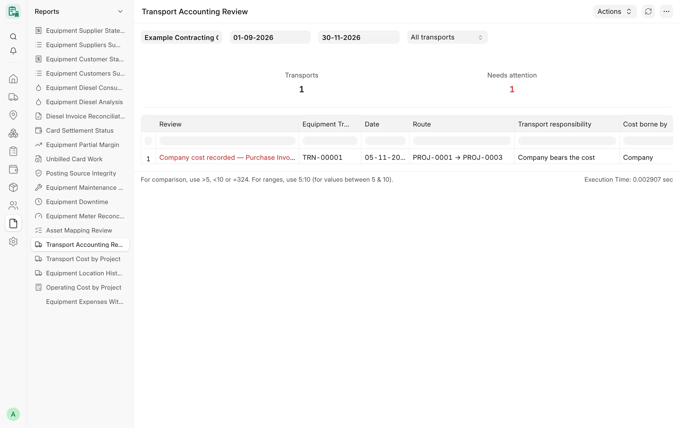

## Overview

Moving equipment costs money, but not every move is the company's cost: the equipment supplier, the customer or
another party may bear it. These reports show only what the company bears as its cost, list the agreed amounts of
moves it does not pay separately, and point to the submitted transports whose accounting still needs a decision.

## Key concepts

| Concept | Meaning |
|---|---|
| Company transport cost | A submitted **Equipment Transport** whose payer and final cost bearer are both the company, charged to its chosen **cost project**. A move charged to a workshop, storage or overhead cost center has no project. |
| Older transports | A transport recorded before the responsibility fields existed keeps its old rule: it counts on its header project when its "cost borne by" is the company or empty. |
| Agreed amount (not company cost) | The informational amount of a move paid by the equipment supplier, the customer or another party. Shown apart, never added to the company cost. |
| Financial decision | What an Accounts Manager records for a transport whose cost the customer or the equipment supplier bears. |

## Transport Cost by Project

**Purpose.** One row per project: the number and amount of submitted transports that are company cost, and, apart, the
moves the company does not pay.

**Filters:** **Company** (required), **From date**, **To date**, **Project**.

**Columns:** Project, Transports, Transport cost, Transports not paid by the company, Agreed amount (not company cost).

**Totals.** None.

**Access.** System Manager, Card Manager, Card User, Accounts Manager.

## Operating Cost by Project

**Purpose.** Per project: the amount of submitted **Project Diesel Fills** plus the company transport cost, taken
straight from the documents (no pro-rata allocation).

**Filters:** **Company** (required), **From date**, **To date**, **Project**.

**Columns:** Project, Diesel, Transport, Total operating cost, Agreed amount (not company cost) — the last one is never
part of the total.

**Totals.** None.

**Access.** System Manager, Card Manager, Card User, Accounts Manager.

## Transport Accounting Review

**Purpose.** Lists the submitted transports of a period whose accounting needs a person, with the reason. It changes,
links and posts nothing.

<!-- screenshot: transport-accounting-review -->

*Transport Accounting Review report*

**Filters**

- **Company** – required.
- **From date** / **To date** – required; default to the start of the year and today.
- **Show** – "Needs attention" (default) or "All transports".

**Columns:** Review, Equipment Transport, Date, Route (source → destination), Transport responsibility, Cost borne by,
Cost charged to (cost project, place, or overhead cost center), Transporter, Transporter cost, Agreed amount (not
company cost), Other party bearing the transport cost, Financial status, Cost decision, Customer, Agreed billing amount
(before VAT), Recovery amount, Purchase Invoice, Evidence.

**Review values**

| Review | Needs attention |
|---|---|
| Recorded before the responsibility fields — review | Yes, unless already on a Purchase Invoice |
| Responsibility needs review — cancel and amend with the verified responsibility | Yes |
| Financial decision pending (Accounts Manager) | Yes |
| Financial decision rejected — cancel and amend the transport | Yes |
| Customer billing recorded — invoicing waits for the accountant and the tax adviser | Yes |
| Recovery recorded — not posted until the accountant decides | Yes |
| Absorbed by the company — approved exception | Yes |
| Company cost recorded — Purchase Invoice posting waits for the accountant | Yes |
| Record only (no company cost) | No |

**Totals.** Tiles **Transports** and **Needs attention** (red when any). The Review column is red on rows that need
attention.

**Access.** System Manager, Accounts Manager, whose roles also read Equipment Transport and Purchase Invoice.

## Related

- [Transport](/card/features/transport/)
- [Transport API](/card/api-reference/transport/)
- [Diesel and fuel reports](/card/reports/diesel-fuel/)
